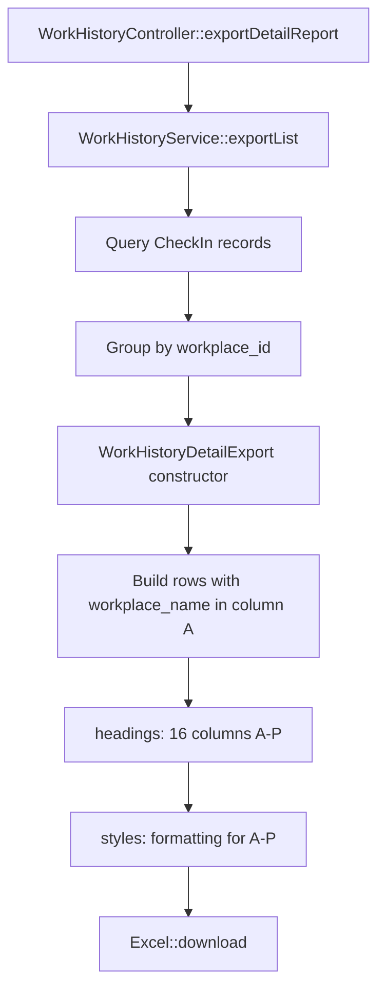

# Design Document: Work History Detail Export Filter by Workplace

## Overview

This change modifies the `WorkHistoryDetailExport` class to add a dedicated "Xưởng" (Workplace) column as column A, populate it on every data row, stop merging cells on workplace header rows, and adjust all column references to account for the new 16-column layout (A–P). No new files are created; the change is confined to a single backend export class and its data provider in the service layer.

### Key Changes

1. **New Workplace Column**: Add "Xưởng" as column A in headings and populate it on every data row with the workplace name
2. **Remove Cell Merging**: Replace `mergeCells()` calls with simple bold styling on column A of header rows
3. **Column Reference Shift**: Update all column-letter references (number formats, borders, bold ranges) from A–O to A–P

### Excel Layout Change Summary

**Before (15 columns, A–O):**

| Row Type | A | B | C | ... | O |
|----------|---|---|---|-----|---|
| Header | Ngày làm | Giờ làm | Mã NV | ... | Giờ LT đêm |
| Workplace | ← Merged A:O "Workplace Name" → | | | | |
| Data | 2025/1/15 | 9:00-18:00 | 001 | ... | 0:00 |

**After (16 columns, A–P):**

| Row Type | A | B | C | D | ... | P |
|----------|---|---|---|---|-----|---|
| Header | Xưởng | Ngày làm | Giờ làm | Mã NV | ... | Giờ LT đêm |
| Workplace | Workplace Name | | | | | |
| Data | Workplace Name | 2025/1/15 | 9:00-18:00 | 001 | ... | 0:00 |

## Architecture



## Components and Interfaces

### New Files

None.

### Modified Files

| File | Changes |
|------|---------|
| `backend/app/Exports/WorkHistoryDetailExport.php` | Add workplace column to headings, data rows, and header rows; remove `mergeCells()`; update column references in `styles()` |

### Implementation Details

#### `WorkHistoryDetailExport` Constructor Changes

```php
// Workplace header row: name in column A, rest blank
// BEFORE:
$this->data->push([Arr::get($data, '0.workplace_name')]);

// AFTER:
$this->data->push([Arr::get($data, '0.workplace_name')]);
// No change to header row structure — it already puts name in first element.
// The key change: no mergeCells() will be called on this row.

// Data rows: add workplace_name as first element
// BEFORE:
$this->data->push([
    'date' => $date,
    'shift_time' => ...,
    ...
]);

// AFTER:
$this->data->push([
    'workplace_name' => Arr::get($item, 'workplace_name'),
    'date' => $date,
    'shift_time' => ...,
    ...
]);
```

#### `headings()` Changes

```php
// BEFORE: 15 columns starting with 'Ngày làm'
// AFTER: 16 columns starting with 'Xưởng'
public function headings(): array
{
    return [
        [
            'Xưởng',           // NEW column A
            'Ngày làm',        // shifted to B
            'Giờ làm',         // shifted to C
            // ... rest shifted by 1
        ],
    ];
}
```

#### `styles()` Changes

```php
// Column reference mapping (old → new):
// A (date text)     → B
// C (staff_no text) → D
// H:O ([H]:mm)      → I:P
// A1:O1 (bold)      → A1:P1
// mergeCells A:O    → REMOVED
// borders A:O       → A:P

// Header row bold styling for workplace header rows:
// BEFORE: merge A{row}:O{row}
// AFTER:  bold A{row} only, no merge
```

## Data Models

No database changes. The modification is purely in the Excel output format.

### Row Data Structure

```
Workplace Header Row: [workplace_name]
  → Renders as: A=workplace_name, B–P=blank, bold on A

Data Row: [workplace_name, date, shift_time, staff_no, name, name_kana,
           check_in_time, check_out_time, check_in_time_rounded,
           check_out_time_rounded, break_time, work_minutes,
           work_minutes_normal, work_minutes_night,
           work_minutes_overtime, work_minutes_night_overtime]
  → 16 values, columns A–P

Separator Rows: [''], ['']
  → 2 empty rows between groups (unchanged)
```

## Correctness Properties

### Property 1: Every Data Row Has Workplace Name

*For any* exported Data_Row, column A SHALL contain a non-empty workplace name string.

**Validates: Requirements 1.3**

### Property 2: No Merged Cells

*For any* row in the exported spreadsheet, no cells SHALL be merged.

**Validates: Requirements 2.1**

### Property 3: Column Count Consistency

*For any* Data_Row, the row SHALL contain exactly 16 values corresponding to columns A through P.

**Validates: Requirements 1.4**

### Property 4: Format Integrity

*For any* time/hour column (I through P), the cell format SHALL be `[H]:mm`.

**Validates: Requirements 4.3**

## Error Handling

### Export Errors

| Scenario | Handling |
|----------|----------|
| Empty workplace name | Workplace name defaults to whatever is stored in the database; no special handling needed (existing behavior) |
| No check-in records | Returns empty export (existing behavior, unchanged) |

No new error scenarios are introduced by this change.

## Testing Strategy

### Unit Tests

**WorkHistoryDetailExport (`backend/tests/`):**
- Test that headings returns 16 columns with "Xưởng" as the first element
- Test that data rows contain workplace name as the first element
- Test that workplace header rows contain only the workplace name in the first element

### Integration Tests

- Export a detail report with multiple workplaces and verify:
    - Column A contains workplace names on every data row
    - No merged cells exist in the output
    - Column formatting is correct (text on A, B, D; `[H]:mm` on I–P)
    - Workplace header rows are bold and unmerged
    - Empty separator rows are preserved between groups
- Open the exported file in Excel and verify that filtering by column A (Xưởng) correctly isolates records for a single workplace

### Test Configuration

Testing can be done via the existing export endpoint:

```bash
# Manual test: trigger export and inspect the downloaded .xlsx file
docker compose exec php php artisan tinker
# Or via API: GET /api/manage/work-histories/export?date_from=...&date_to=...
```
