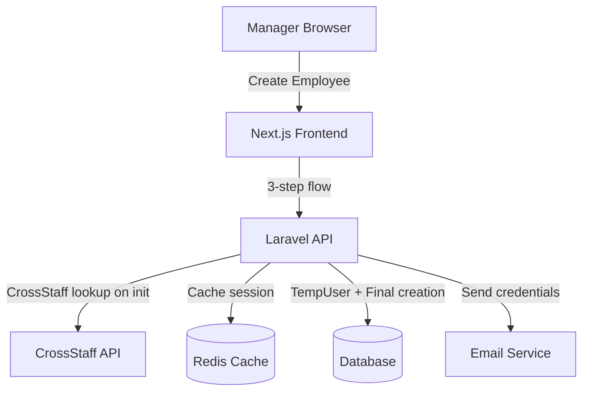
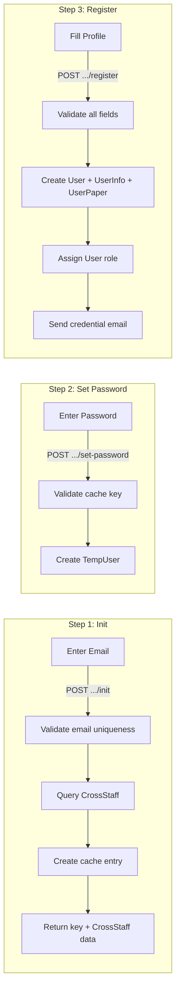
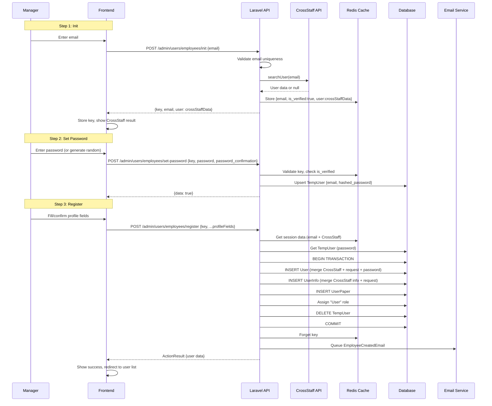

# Design Document: Admin Create Employee

## Overview

This feature adds admin endpoints and a multi-step page for managers to create employee accounts. Instead of building a separate flow, it **mirrors the existing self-registration flow** using the same cache-key-based session pattern. The admin initiates with an email (which triggers CrossStaff lookup and cache creation), sets a password (creating a TempUser), and submits the full profile — all using the same backend logic as registration, minus the OTP verification. This maximizes code reuse and keeps CrossStaff data handling entirely on the backend.

### Design Goals
- Mirror the self-registration flow (cache key, TempUser, RegisterNewUserAction pattern) to maximize code reuse
- Keep CrossStaff data mapping on the backend — no need to expose a lookup endpoint or handle mapping on the frontend
- Follow established Action pattern, permission conventions, and API response format
- Provide a multi-step page consistent with the registration UX

### Key Design Decisions
- **Cache-key session pattern** — same as registration. The init step creates a cache entry with email + CrossStaff data, returns the key to the frontend. Subsequent steps use this key, exactly like the OTP flow but without sending/verifying OTP
- **Reuse `RegisterNewUserAction`** (or a thin wrapper) for the final creation step, since it already handles User + UserInfo + UserPaper + role assignment + CrossStaff data merging
- **No CrossStaff lookup endpoint** — CrossStaff is queried during the init step and stored in cache, just like `verifyRegisterOtp` does. The frontend receives pre-filled data from the init response
- **Three-step flow** matches registration: init (email) → set password → submit profile
- **New permission** `user.general.create-employee` follows the existing `{entity}.{context}.{action}` naming convention
- **Additional difference from registration**: sends credential email instead of registration success email

## Architecture

### System Context



### High-Level Architecture



## Components and Interfaces

### Component 1: Admin Employee Init (New)

**Purpose**: Initialize employee creation session — validate email, query CrossStaff, create cache

**Responsibilities**:
- Validate email is unique in users table
- Query CrossStaff API by email and map response data
- Create cache entry with email, CrossStaff data, and `is_verified: true` (skip OTP)
- Return cache key and CrossStaff user data to frontend

**Interfaces**:
- **Input**: `{ email: string }`
- **Output**: `{ key: string, email: string, user: CrossStaffData | null }`
- **Dependencies**: `CrossStaffApiService`, Cache

**Implementation Notes**:
- New method `initEmployee()` on `Admin\UserController`
- Reuses the same CrossStaff search and mapping logic from `AuthService::verifyRegisterOtp()`
- Sets `is_verified: true` in cache immediately (no OTP step)
- Cache TTL: 1 day (same as post-OTP-verification in registration)

### Component 2: Admin Employee Set Password (Reuse)

**Purpose**: Set password for the employee being created

**Responsibilities**:
- Validate cache key is valid and verified
- Create or update TempUser with email and hashed password

**Interfaces**:
- **Input**: `{ key: string, password: string, password_confirmation: string }`
- **Output**: `{ data: true }`
- **Dependencies**: Cache, TempUser model

**Implementation Notes**:
- New method `setEmployeePassword()` on `Admin\UserController`
- Reuses `AuthService::storeTempUser()` or the same logic — validates cache, creates TempUser
- Same validation as `RegisterPasswordRequest`

### Component 3: Admin Employee Register (Extend)

**Purpose**: Create the employee account with full profile data

**Responsibilities**:
- Validate cache key and all profile fields
- Create User, UserInfo, UserPaper records
- Assign "User" role
- Delete TempUser and cache
- Send credential email (instead of registration success email)

**Interfaces**:
- **Input**: Cache key + all profile fields (same as `StoreRegisterRequest`)
- **Output**: `ActionResult` with created User
- **Dependencies**: `RegisterNewUserAction` (or new `CreateEmployeeAction` wrapping similar logic)

**Implementation Notes**:
- New method `registerEmployee()` on `Admin\UserController`
- Uses a new `CreateEmployeeAction` that follows the same logic as `RegisterNewUserAction` but:
  - Always sets `paper_status` to `Registered` (never auto-approves even with CrossStaff data)
  - Sends `EmployeeCreatedEmail` (with credentials) instead of `RegistrationSuccessEmail`
- Same validation rules as `StoreRegisterRequest` (reuse the same request class or duplicate rules)

### Component 4: EmployeeCreatedEmail (New)

**Purpose**: Send login credentials to newly created employee

**Responsibilities**:
- Deliver email with employee's email address and plaintext password
- Support multi-language templates (en, vi, ja)

**Interfaces**:
- **Input**: User model, plaintext password
- **Output**: Rendered email
- **Dependencies**: Laravel Mail, `LocalizableMail` trait

**Implementation Notes**:
- Located at `app/Mail/EmployeeCreatedEmail.php`
- Uses `LocalizableMail` trait for locale-aware templates
- Templates at `resources/views/employee/` with locale subdirectories

### Component 5: Create Employee Page (Frontend)

**Purpose**: Multi-step page for managers to create employee accounts

**Responsibilities**:
- Step 1: Email input → call init endpoint → display CrossStaff data if found
- Step 2: Password input (manual or auto-generate) → call set-password endpoint
- Step 3: Profile form (pre-filled from CrossStaff) → call register endpoint
- Handle errors and navigate between steps
- Redirect to user list on success

**Interfaces**:
- **Input**: Manager interaction
- **Output**: API calls to the 3 admin employee endpoints
- **Dependencies**: Mantine UI, Mantine Stepper, React Query, form validation

**Implementation Notes**:
- Located at `frontend/src/pages/admin/user/create.page.tsx`
- Uses Mantine `Stepper` component for the multi-step flow
- Step 3 form sections: Basic Info (name, kana), Personal Details (birthday, gender, nationality, japanese_level), Address (postal_code, prefecture, address), Documents (residence card, passport), Other (facebook_link, is_household_head, registered_location)
- CrossStaff data auto-fills form fields in Step 3 — fields are editable/overridable
- Stores cache key in component state between steps

## Data Models

### Entity: Cache Session (same as registration)

```typescript
// Backend cache structure (not a frontend type)
interface EmployeeCacheSession {
    email: string;
    is_verified: true;           // Always true (no OTP)
    user: {                      // From CrossStaff, or null
        staff_no: string;
        cross_staff_id: string;
        first_name: string;
        last_name: string;
        first_name_kana: string;
        last_name_kana: string;
        info: CrossStaffInfoData;
    } | null;
}
```

### Entity: Register Payload (Step 3)

```typescript
// frontend/src/pages/admin/user/create.page.tsx
interface RegisterEmployeePayload {
    key: string;                     // Cache key from Step 1
    first_name: string;
    last_name: string;
    first_name_kana: string;
    last_name_kana: string;
    birthday?: string;               // YYYY-MM-DD
    gender?: string;                 // male, female, other, prefer_not_to_say
    nationality?: string;            // JP, VN, CN, TH, etc.
    postal_code?: string;
    prefecture?: string;
    address?: string;
    japanese_level?: string;         // N5, N4, N3, N2, N1
    registered_location?: string;
    residence_number_1?: string;     // 12-digit
    residence_expiry_date_1?: string;
    residence_status_1?: string;
    passport_number?: string;
    passport_expiry_date?: string;
    is_household_head?: boolean;
    facebook_link?: string;
}
```

**Validation Rules** (same as `StoreRegisterRequest`):
- key: required string
- first_name, last_name, first_name_kana, last_name_kana: required, max 255
- birthday, passport_expiry_date, residence_expiry_date_1: nullable, format Y-m-d
- residence_number_1: nullable, exactly 12 characters, unique (`UniqueResidenceNumber`)
- passport_number: nullable, unique (`UniquePassportNumber`)
- gender, nationality, japanese_level, residence_status_1: nullable, valid enum value

### Data Flow



## API Design

### Endpoint 1: Init Employee

**Method**: `POST`
**Path**: `/admin/users/employees/init`
**Permission**: `user.general.create-employee`

**Request**:
```json
{
    "email": "employee@example.com"
}
```

**Response**:
```json
{
    "data": {
        "key": "emp_xxxxxxxxx",
        "email": "employee@example.com",
        "user": {
            "staff_no": "STF123",
            "cross_staff_id": "CS456",
            "first_name": "Taro",
            "last_name": "Yamada",
            "first_name_kana": "タロウ",
            "last_name_kana": "ヤマダ",
            "info": {
                "registered_location": "Tokyo",
                "birthday": "1990-01-15",
                "gender": "male",
                "nationality": "JP",
                "phone": "+81-90-1234-5678",
                "postal_code": "100-0001",
                "prefecture": "Tokyo",
                "address": "Chiyoda Ward",
                "residence_number_1": "123456789012",
                "residence_expiry_date_1": "2027-12-31",
                "residence_status_1": "Resident",
                "passport_number": "XX1234567",
                "passport_expiry_date": "2030-06-15"
            }
        }
    }
}
```

**Response (no CrossStaff match)**:
```json
{
    "data": {
        "key": "emp_xxxxxxxxx",
        "email": "employee@example.com",
        "user": null
    }
}
```

**Error Responses**:
- `403 Forbidden`: Missing permission
- `422 Unprocessable Entity`: Email already exists or invalid format

### Endpoint 2: Set Employee Password

**Method**: `POST`
**Path**: `/admin/users/employees/set-password`
**Permission**: `user.general.create-employee`

**Request**:
```json
{
    "key": "emp_xxxxxxxxx",
    "password": "passwordHere",
    "password_confirmation": "passwordHere"
}
```

**Response**:
```json
{
    "data": true
}
```

**Error Responses**:
- `400 Bad Request`: `REGISTER_INVALID_SESSION` — cache key expired or not verified
- `403 Forbidden`: Missing permission
- `422 Unprocessable Entity`: Validation errors

### Endpoint 3: Register Employee

**Method**: `POST`
**Path**: `/admin/users/employees/register`
**Permission**: `user.general.create-employee`

**Request**:
```json
{
    "key": "emp_xxxxxxxxx",
    "first_name": "Taro",
    "last_name": "Yamada",
    "first_name_kana": "タロウ",
    "last_name_kana": "ヤマダ",
    "birthday": "1990-01-15",
    "gender": "male",
    "nationality": "JP",
    "postal_code": "100-0001",
    "prefecture": "Tokyo",
    "address": "Chiyoda Ward",
    "japanese_level": "N2",
    "registered_location": "Tokyo",
    "residence_number_1": "123456789012",
    "residence_expiry_date_1": "2027-12-31",
    "residence_status_1": "Resident",
    "passport_number": "XX1234567",
    "passport_expiry_date": "2030-06-15",
    "is_household_head": false,
    "facebook_link": "https://facebook.com/taro"
}
```

**Response (success)**:
```json
{
    "data": {
        "id": 42,
        "email": "employee@example.com",
        "first_name": "Taro",
        "last_name": "Yamada",
        "staff_no": "STF123",
        "paper_status": "registered"
    }
}
```

**Error Responses**:
- `400 Bad Request`: `REGISTER_INVALID_SESSION`, `REGISTER_TEMP_USER_NOT_FOUND`, `REGISTER_STAFF_NO_ALREADY_EXISTS`
- `403 Forbidden`: Missing permission
- `422 Unprocessable Entity`: Validation errors (duplicate residence number, passport, etc.)

## Security Considerations

### Authentication
- All three endpoints require authenticated access via `auth:api` middleware (custom `AccessTokenGuard`)

### Authorization
- New permission `user.general.create-employee` enforced at route level via Laratrust middleware
- Frontend hides the "Create Employee" button when user lacks the permission

### Data Protection
- Password is hashed using `Hash::make()` before storage in TempUser
- Plaintext password is sent via email and never stored after hashing
- Cache entries expire after 1 day
- CrossStaff API credentials managed via environment variables

### Input Validation
- Email uniqueness validated in init step
- All profile fields validated using same rules as `StoreRegisterRequest`
- Residence number and passport uniqueness enforced via custom validation rules
- Cache key validated at each step to prevent session tampering

## Error Handling

### Session Errors

| Scenario | Handling |
|----------|----------|
| Cache key expired or invalid | Return `REGISTER_INVALID_SESSION` error |
| TempUser not found (password not set) | Return `REGISTER_TEMP_USER_NOT_FOUND` error |
| Staff number from CrossStaff already used | Return `REGISTER_STAFF_NO_ALREADY_EXISTS` error |

### Validation Errors

| Scenario | Handling |
|----------|----------|
| Duplicate email | Return 422 with field-level error (init step) |
| Duplicate residence_number_1 | Return 422 with field-level error (register step) |
| Duplicate passport_number | Return 422 with field-level error (register step) |
| Invalid enum value | Return 422 with field-level error |
| Missing required field | Return 422 with field-level error |

### System Errors

| Scenario | Handling |
|----------|----------|
| Database transaction failure | Roll back all changes, return 500 |
| CrossStaff API timeout/failure | Continue without CrossStaff data, return user: null in init response |
| Email delivery failure | Log error, do not block user creation (email queued) |

## Performance Considerations

### Expected Load
- **Concurrent Users**: Low (admin operation, not user-facing)
- **Requests per Second**: < 1 (manual form submission)

### Optimization Strategies
- CrossStaff lookup happens once during init, cached for subsequent steps
- Email sent via queue (`ShouldQueue`) to avoid blocking the response
- Cache-based sessions avoid extra DB queries between steps

## Testing Strategy

### Unit Tests

**CreateEmployeeAction (`tests/Unit/Actions/Admin/User/CreateEmployeeActionTest.php`):**
- Test successful employee creation with all fields
- Test User, UserInfo, and UserPaper records are created
- Test "User" role is assigned
- Test paper_status is always "Registered" (never auto-approved, even with CrossStaff data)
- Test transaction rollback on failure
- Test CrossStaff data (staff_no, cross_staff_id) is stored when provided
- Test credential email is queued

### Integration Tests

**Employee Creation API (`tests/Feature/Admin/EmployeeApiTest.php`):**
- Test full 3-step flow: init → set-password → register
- Test init returns CrossStaff data when found
- Test init returns user: null when not found in CrossStaff
- Test init rejects duplicate email
- Test set-password creates TempUser
- Test set-password rejects invalid/expired cache key
- Test register creates User + UserInfo + UserPaper
- Test register rejects duplicate residence number
- Test register rejects duplicate passport number
- Test register rejects expired cache key
- Test register rejects when TempUser not found
- Test 403 on all endpoints when missing permission
- Test credential email is sent after successful registration
