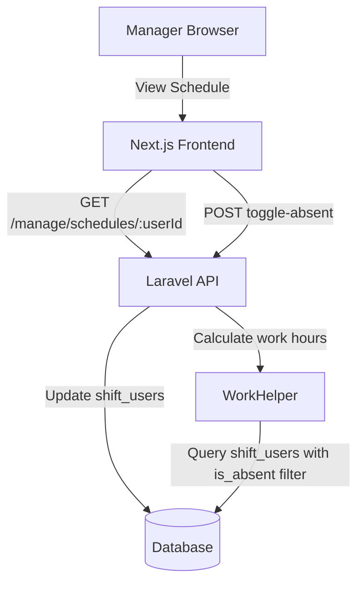
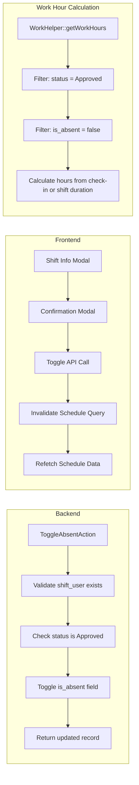
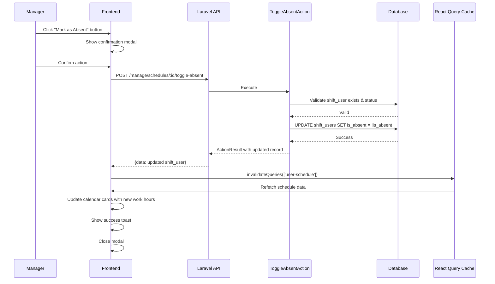

# Design Document: Shift Absent Tracking

## Overview

This feature adds absent tracking to the shift management system by introducing an `is_absent` boolean field on the `shift_users` table. The design modifies the work hour calculation logic to exclude absent shifts and provides a frontend toggle in the shift info modal. The implementation follows existing patterns: database migration for schema changes, Action pattern for the API endpoint, and React Query for cache invalidation.

### Design Goals

- Minimal changes to existing work hour calculation logic
- Reuse existing modal and button components from Mantine
- Follow established Action pattern and API response format
- Ensure data consistency with proper validation

### Key Design Decisions

- **Database-first approach**: Add `is_absent` column with default `false` to maintain backward compatibility
- **WorkHelper modification**: Filter out absent shifts in `getWorkHours()` method where check-in doesn't exist
- **Toggle endpoint**: Single endpoint that flips the boolean value (idempotent operation)
- **Frontend cache invalidation**: Use React Query's `invalidateQueries` to refresh schedule data
- **Confirmation modal**: Prevent accidental toggles with a confirmation step

## Architecture

### System Context



### High-Level Architecture



## Components and Interfaces

### Component 1: Database Migration (New)

**Purpose**: Add `is_absent` column to `shift_users` table

**Responsibilities**:
- Add boolean column `is_absent` after `is_reported`
- Set default value to `false`
- Add index for query performance

**Interfaces**:
- **Input**: None (migration script)
- **Output**: Modified database schema
- **Dependencies**: Laravel migration system

**Implementation Notes**:
- Located at `database/migrations/YYYYMMDD_add_is_absent_to_shift_users_table.php`
- Use `after('is_reported')` to maintain column ordering
- Add index for filtering performance in `getWorkHours()`

### Component 2: ToggleAbsentAction (New)

**Purpose**: Toggle the `is_absent` field for a shift_user

**Responsibilities**:
- Validate shift_user exists
- Verify shift status is 'Approved'
- Toggle `is_absent` boolean
- Update `updated_at` timestamp
- Return updated shift_user record

**Interfaces**:
- **Input**: `shiftUserId: int`
- **Output**: `ActionResult` with updated ShiftUser model
- **Dependencies**: ShiftUser model, DB transaction

**Implementation Notes**:
- Located at `app/Actions/Manage/Shift/ToggleAbsentAction.php`
- Use `DB::transaction()` for data consistency
- Return error if shift status is not 'Approved'

**TypeScript Interface**:
```typescript
// frontend/src/types/api.d.ts (response type)
interface ToggleAbsentResponse {
    id: number;
    shift_id: number;
    user_id: number;
    is_absent: boolean;
    status: string;
    updated_at: string;
}
```

### Component 3: ScheduleController Extension (Modify)

**Purpose**: Add toggle absent endpoint

**Responsibilities**:
- Receive toggle request
- Call ToggleAbsentAction
- Return JSON response

**Interfaces**:
- **Input**: `POST /manage/schedules/:shiftUserId/toggle-absent`
- **Output**: JSON response with updated shift_user or error
- **Dependencies**: ToggleAbsentAction, auth middleware

**Implementation Notes**:
- Add `toggleAbsent(int $shiftUserId)` method to `ScheduleController`
- Apply existing manage permission middleware
- Use `ResponseHelper::success()` or `ResponseHelper::error()`

### Component 4: WorkHelper Modification (Modify)

**Purpose**: Exclude absent shifts from work hour calculations

**Responsibilities**:
- Filter out shift_users where `is_absent = true`
- Only apply filter when no check-in exists
- Maintain existing behavior for shifts with check-in data

**Interfaces**:
- **Input**: Same as current `getWorkHours()` signature
- **Output**: Same structure, but excludes absent shifts
- **Dependencies**: ShiftUser model with is_absent field

**Implementation Notes**:
- Modify `getWorkHours()` method in `app/Helpers/WorkHelper.php`
- Add `->where('shift_users.is_absent', false)` to the query
- Ensure filter only applies when check-in doesn't exist

### Component 5: Shift Info Modal Enhancement (Modify)

**Purpose**: Add toggle absent button to shift info modal

**Responsibilities**:
- Display toggle button only for approved shifts
- Show confirmation modal before toggling
- Call toggle API on confirmation
- Invalidate schedule query on success

**Interfaces**:
- **Input**: CalendarCard with shift_user data
- **Output**: API call to toggle endpoint
- **Dependencies**: Mantine Modal, Button, useMutation

**Implementation Notes**:
- Modify `frontend/src/pages/manage/user/[id]/partials/shift_info_modal.tsx`
- Add conditional button rendering based on `card.status`
- Use `useMutation` for toggle API call
- Use `useQueryClient().invalidateQueries()` for cache refresh

**TypeScript Interface**:
```typescript
// frontend/src/types/shift.d.ts (add to CalendarCard)
export type CalendarCard = {
    id: number;
    shiftId: number;
    workplaceName: string;
    startTime: string;
    endTime: string;
    position: string;
    workHours: string | null;
    hasCheckIn: boolean;
    status: string;
    isAbsent?: boolean;  // NEW FIELD
};
```

### Component 6: Schedule API Extension (Modify)

**Purpose**: Add toggle absent mutation hook

**Responsibilities**:
- Provide React Query mutation for toggle API
- Handle success/error states
- Trigger schedule refetch on success

**Interfaces**:
- **Input**: `shiftUserId: number`
- **Output**: Mutation function
- **Dependencies**: React Query, API config

**Implementation Notes**:
- Add `useToggleAbsentMutation()` to `frontend/src/pages/manage/user/[id]/api.ts`
- Use `useMutation` with `onSuccess` callback to invalidate queries
- Query key pattern: `['user-schedule', userId, params]`

## Data Models

### Entity: ShiftUser (Modified)

```php
// Backend: app/Models/ShiftUser.php
class ShiftUser extends AbstractModel
{
    protected $guarded = [];

    protected $casts = [
        'is_overtime_allowed' => 'boolean',
        'is_absent' => 'boolean',  // NEW
    ];

    // ... existing relationships
}
```

### Entity: ShiftUserSchedule (Modified)

```typescript
// Frontend: frontend/src/types/models/shift_user.d.ts
export interface ShiftUserSchedule extends ShiftUser {
    workplace_position: WorkplacePosition;
    shift: Shift;
    check_in: CheckIn | null;
    is_absent?: boolean;  // NEW FIELD (optional for backward compatibility)
}
```

### Database Schema

```sql
-- Migration adds this column to shift_users table
ALTER TABLE shift_users 
ADD COLUMN is_absent BOOLEAN DEFAULT FALSE AFTER is_reported,
ADD INDEX idx_is_absent (is_absent);
```

### Data Flow



## API Design

### Endpoint: Toggle Absent

**Method**: `POST`
**Path**: `/manage/schedules/:shiftUserId/toggle-absent`
**Permission**: Existing manage permission (e.g., `shift.general.manage`)

**Path Parameters**:
```
shiftUserId: number (required)
```

**Request Body**: None

**Response (Success)**:
```json
{
    "data": {
        "id": 42,
        "shift_id": 10,
        "user_id": 5,
        "is_absent": true,
        "status": "approved",
        "updated_at": "2026-03-08T10:30:00.000000Z"
    }
}
```

**Response (Error - Not Found)**:
```json
{
    "error": "shift_user.not_found"
}
```

**Response (Error - Invalid Status)**:
```json
{
    "error": "shift_user.invalid_status",
    "data": {
        "message": "Can only toggle absent status for approved shifts"
    }
}
```

**Response (Error - Forbidden)**:
```json
{
    "error": "forbidden"
}
```

## Correctness Properties

### Property 1: Absent Filter in Work Hour Calculation

*For any* shift_user record `su` where `su.status = 'Approved'` AND `su.is_absent = true` AND `su.check_in IS NULL`, *IF* `WorkHelper::getWorkHours()` is called for the user and date range containing `su.shift.date`, *THEN* `su` SHALL NOT be included in the returned work hours.

- **Related Requirements**: 2.1, 2.2, 2.5

### Property 2: Check-In Precedence

*For any* shift_user record `su` where `su.check_in IS NOT NULL`, *IF* `WorkHelper::getWorkHours()` is called, *THEN* `su.is_absent` SHALL NOT affect the inclusion of `su` in work hour calculations (check-in data takes precedence).

- **Related Requirements**: 2.4

### Property 3: Toggle Idempotency

*For any* valid shift_user id `id` where `su.status = 'Approved'`, *IF* the toggle endpoint is called N times, *THEN* the `is_absent` value SHALL alternate between `true` and `false` for each call.

- **Related Requirements**: 4.1

### Property 4: Status Validation

*For any* shift_user record `su` where `su.status != 'Approved'`, *IF* the toggle endpoint is called with `su.id`, *THEN* the system SHALL return a 400 error and `su.is_absent` SHALL remain unchanged.

- **Related Requirements**: 4.4

### Property 5: Schedule Refresh

*For any* successful toggle API call, *IF* the frontend receives a 200 response, *THEN* the schedule query cache SHALL be invalidated and refetched within 100ms.

- **Related Requirements**: 5.1, 5.2

## Error Handling

### Validation Errors

| Scenario | Error Code | HTTP Status | Handling |
|----------|------------|-------------|----------|
| Shift user not found | `shift_user.not_found` | 404 | Return error response, frontend shows toast |
| Status not approved | `shift_user.invalid_status` | 400 | Return error with message, frontend shows toast |
| Missing permission | `forbidden` | 403 | Return error response, frontend shows toast |

### System Errors

| Scenario | Error Code | HTTP Status | Handling |
|----------|------------|-------------|----------|
| Database connection failed | `database.error` | 500 | Rollback transaction, return error |
| Query timeout | `timeout` | 500 | Return error, frontend shows toast |
| Cache invalidation failed | N/A | N/A | Log error, continue (graceful degradation) |

### Frontend Errors

| Scenario | Handling |
|----------|----------|
| Toggle API fails | Show error toast, keep modal open |
| Refetch fails | Show error toast, modal closes (user can manually refresh) |
| Network timeout | Show timeout error toast |

## Performance Considerations

### Expected Load

- **Concurrent Users**: Low (manager operation)
- **Requests per Day**: < 100 (manual absence marking)
- **Query Impact**: Minimal (single row UPDATE, indexed SELECT in getWorkHours)

### Optimization Strategies

- Add index on `is_absent` column for efficient filtering
- Use React Query's selective invalidation (only invalidate affected user's schedule)
- No batch operations needed (single-row updates only)

## Testing Strategy

### Unit Tests

**ToggleAbsentAction (`tests/Unit/Actions/Manage/Shift/ToggleAbsentActionTest.php`):**
- Test successful toggle from false to true
- Test successful toggle from true to false
- Test error when shift_user not found
- Test error when status is not 'Approved' (pending, rejected)
- Test `updated_at` is updated
- Test transaction rollback on failure

### Integration Tests

**Toggle Absent API (`tests/Feature/Manage/ToggleAbsentApiTest.php`):**
- Test full flow: API call → database update → response
- Test 404 on non-existent shift_user
- Test 400 on non-approved status
- Test 403 on missing permission
- Test response structure matches specification

**Work Hour Calculation (`tests/Unit/Helpers/WorkHelperTest.php`):**
- Test `getWorkHours()` excludes absent shifts without check-in
- Test `getWorkHours()` includes absent shifts with check-in (check-in takes precedence)
- Test `getWorkHours()` includes non-absent approved shifts (existing behavior)
- Test backward compatibility (existing tests still pass)

### Frontend Tests

**Shift Info Modal (`tests/pages/manage/user/partials/shift_info_modal.test.tsx`):**
- Test toggle button shows for approved shifts
- Test toggle button hidden for non-approved shifts
- Test confirmation modal displays on click
- Test API call on confirm
- Test schedule refresh on success
- Test error handling

### Property-Based Tests

**Toggle Idempotency:**
- Generate random initial `is_absent` value
- Call toggle N times
- Verify final value matches expected alternating pattern

**Work Hour Exclusion:**
- Generate random set of shifts with varying `is_absent` and `check_in` states
- Calculate work hours
- Verify absent shifts without check-in are excluded
