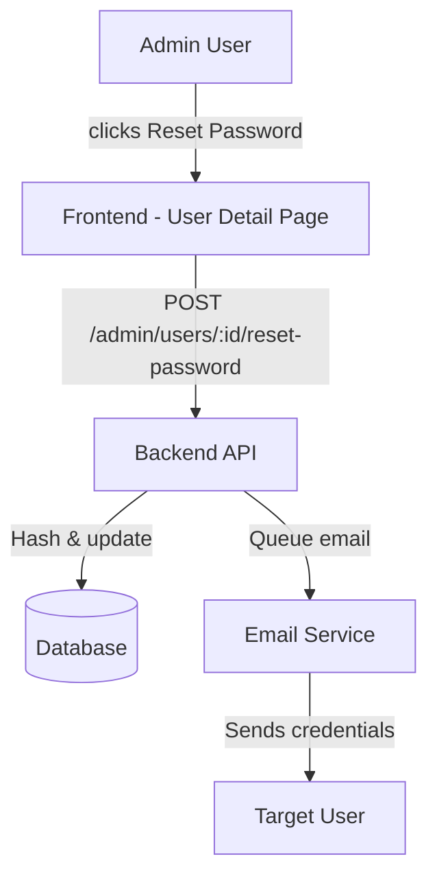
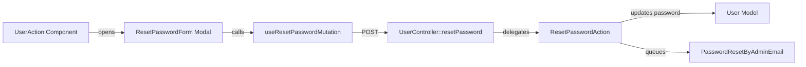
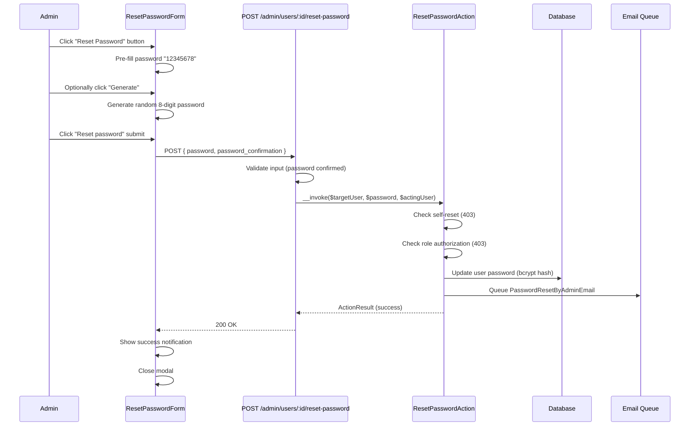

# Design Document: Admin Reset Password

## Overview

This feature adds a password reset capability to the admin user detail page. It follows existing codebase patterns: a new Action class handles the backend logic, a Mantine Modal with a form handles the frontend UI, and the Laratrust permission system governs access. The password generation utility is extracted into a shared function used by both the creation and reset flows.

### Design Goals
- Reuse existing patterns (Action pattern, Modal + form, permission middleware)
- Extract shared password generation logic to avoid duplication
- Enforce role-based authorization at both API and UI levels

### Key Design Decisions
- **Separate Action class** (`ResetPasswordAction`) following the single-purpose Action pattern, rather than adding logic to `UserService`
- **New `PasswordResetByAdminEmail` Mailable** with a dedicated email template, distinct from the welcome email sent during account creation
- **Role check inside the Action class**, not in middleware, because the restriction depends on the target user's role (which requires a DB lookup)
- **Shared `generateRandomPassword` utility** extracted to `frontend/src/utils/password.utils.ts`

## Architecture

### System Context



### High-Level Architecture



## Components and Interfaces

### Component 1: ResetPasswordForm (Frontend)

**Purpose**: Modal form component for entering and submitting the new password.

**Responsibilities**:
- Display password and password confirmation fields with default value `12345678`
- Provide "Generate" button to generate random 8-digit password
- Validate matching passwords before submission
- Call reset password API mutation
- Show success/error notifications

**Interfaces**:
- **Input**: `id: string` (target user ID), `close: () => void` (close modal callback)
- **Output**: API call via `useResetPasswordMutation`
- **Dependencies**: `@mantine/form`, `@mantine/notifications`, shared `generateRandomPassword`

**Implementation Notes**:
- Follows `UserLockForm` pattern: form component rendered inside a `<Modal>`
- Uses `useForm` with `validatorResolver` for validation
- Uses `FormHelper.toParams()` for data serialization
- Calls `close()` in `finally` block after success, keeps modal open on error

### Component 2: Password Utility (Frontend - Shared)

**Purpose**: Shared utility for generating random numeric passwords.

**Responsibilities**:
- Generate cryptographically random 8-character numeric passwords
- Used by both user creation page and reset password modal

**Interfaces**:
- **Input**: `length?: number` (default: 8)
- **Output**: `string` of random digits

**Implementation Notes**:
- Extract existing `generateRandomPassword` from `create.page.tsx`
- Uses `window.crypto.getRandomValues` for secure randomness
- Import in both `create.page.tsx` and `reset_password_form.tsx`

### Component 3: ResetPasswordAction (Backend)

**Purpose**: Single-purpose Action class to reset a user's password with authorization checks.

**Responsibilities**:
- Validate that the acting user is not resetting their own password
- Validate role-based authorization (non-global_admin can only reset `user` role passwords)
- Hash and update the target user's password
- Queue email notification with new credentials

**Interfaces**:
- **Input**: `User $targetUser`, `string $password`, `User $actingUser`
- **Output**: `ActionResult`
- **Dependencies**: `User` model, `PasswordResetByAdminEmail`, `Hash` facade

**Implementation Notes**:
- Located at `app/Actions/Admin/User/ResetPasswordAction.php`
- Returns `ActionResult` with appropriate error codes for authorization failures
- Uses `Mail::to()->queue()` for async email delivery (same pattern as `CreateEmployeeAction`)

### Component 5: PasswordResetByAdminEmail (Backend)

**Purpose**: Mailable class for notifying users that their password has been reset by an admin.

**Responsibilities**:
- Send an email with the user's name, email, and new password
- Use the user's preferred locale for the email template

**Interfaces**:
- **Input**: `User $user`, `string $password`
- **Output**: Localized markdown email

**Implementation Notes**:
- Located at `app/Mail/PasswordResetByAdminEmail.php`
- Follows `EmployeeCreatedEmail` structure: uses `LocalizableMail` trait, `Queueable`, `SerializesModels`
- Uses localized template `password.reset-by-admin` with views at:
  - `resources/views/password/reset-by-admin.blade.php` (English)
  - `resources/views/password/vi/reset-by-admin.blade.php` (Vietnamese)
  - `resources/views/password/ja/reset-by-admin.blade.php` (Japanese)
- Email content differs from welcome email: informs user their password was reset by an administrator

### Component 4: API Route & Controller Method (Backend)

**Purpose**: HTTP endpoint for the reset password operation.

**Responsibilities**:
- Validate request input (password + confirmation)
- Apply permission middleware
- Delegate to `ResetPasswordAction`

**Interfaces**:
- **Input**: `POST /admin/users/{user}/reset-password` with `{ password, password_confirmation }`
- **Output**: JSON response via `ActionResult::toResponse()`
- **Dependencies**: `ResetPasswordAction`, Laratrust permission middleware

## Data Models

### Request Payload

```typescript
// frontend/src/pages/admin/user/api.ts
interface ResetPasswordRequest {
    password: string;
    password_confirmation: string;
}
```

### API Configuration

```typescript
// frontend/src/configs/api.config.ts
ADMIN_USER_RESET_PASSWORD: 'admin/users/:id/reset-password'
```

### Permission Enum Addition

```php
// backend/app/Enums/PermissionName.php
case UserResetPassword = 'user.general.reset-password';
```

```typescript
// frontend/src/enums/permission_name.enum.ts
USER_RESET_PASSWORD: { value: 'user.general.reset-password', text: 'User Reset Password' }
```

### Data Flow



## API Design

### Endpoint: Reset User Password

**Method**: `POST`
**Path**: `/api/admin/users/{user}/reset-password`
**Middleware**: `permission:user.general.reset-password`

**Request**:
```json
{
    "password": "12345678",
    "password_confirmation": "12345678"
}
```

**Success Response** (200):
```json
{
    "data": null
}
```

**Error Responses**:
- `403 Forbidden`: Acting user lacks permission, or role-based restriction violated, or self-reset attempted
- `404 Not Found`: Target user does not exist
- `422 Unprocessable Entity`: Validation error (password mismatch, empty password)

## Security Considerations

### Authentication
- Endpoint protected by `access-token` guard (existing auth system)
- Only authenticated admin users can access

### Authorization
- **Layer 1 (Middleware)**: Laratrust `permission:user.general.reset-password` middleware checks the acting user has the permission
- **Layer 2 (Action)**: `ResetPasswordAction` checks:
  - Acting user is not the target user (self-reset blocked)
  - If acting user does NOT have `global_admin` role, target user must only have the `user` role
  - If acting user HAS `global_admin` role, any target is allowed (except self)

### Data Protection
- Password is hashed with `Hash::make()` (bcrypt) before storage
- Plain-text password is only sent via email (queued via `PasswordResetByAdminEmail`)
- Plain-text password is never stored or logged

### Input Validation
- `password`: required, string, confirmed
- `password_confirmation`: must match `password` (Laravel `confirmed` rule)

## Error Handling

### Authorization Errors

| Scenario | Error Code | HTTP Status |
|----------|-----------|-------------|
| Self-reset attempted | `ErrorCode::Forbidden` | 403 |
| Non-global_admin resetting non-user role | `ErrorCode::Forbidden` | 403 |
| Missing permission | Laratrust middleware default | 403 |

### Validation Errors

| Scenario | Handling |
|----------|----------|
| Password empty | 422 - Laravel validation |
| Password confirmation mismatch | 422 - Laravel validation |
| Target user not found | 404 - Laravel model binding |

### Frontend Errors

| Scenario | Handling |
|----------|----------|
| API returns error | Show error notification, keep modal open |
| Network failure | Show generic error notification, keep modal open |

## Performance Considerations

### Expected Load
- Low frequency operation (password resets are infrequent)
- No caching or optimization needed

### Optimization Strategies
- Email is queued (not sent synchronously) to keep response time fast
- Single DB query to update password

## Testing Strategy

### Unit Tests

**PasswordResetByAdminEmail (`tests/Unit/Mail/PasswordResetByAdminEmailTest.php`):**
- Test correct localized template is selected for each locale (en, vi, ja)
- Test email content contains all required data (name, email, password)
- Uses `RefreshDatabase` trait and `User::factory()` for test setup

**ResetPasswordAction (`tests/Unit/Actions/Admin/User/ResetPasswordActionTest.php`):**
- Test successful password reset updates the hash in database
- Test email is queued (`Mail::fake()` + `Mail::assertQueued()`) after successful reset
- Test self-reset returns 403 error, password unchanged, no email queued
- Test non-global_admin resetting admin role returns 403
- Test non-global_admin resetting global_admin role returns 403
- Test global_admin resetting admin role succeeds
- Test global_admin resetting user role succeeds
- Test global_admin cannot reset own password (self-reset)
- Uses `RefreshDatabase`, `Mail::fake()`, Laratrust role/permission setup in `setUp()`

### Frontend Tests
- Manual testing: verify button visibility based on permission
- Manual testing: verify modal form interaction (default value, generate, submit)
- Manual testing: verify success/error notifications
