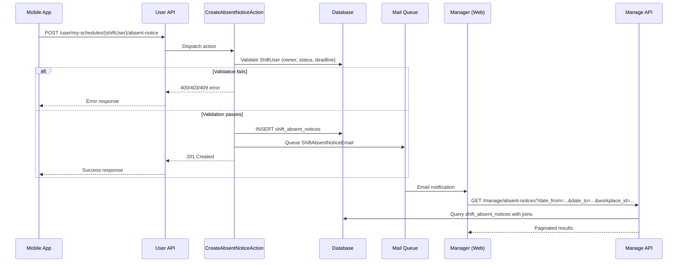

# Design Document: Shift Absent Notice

## Overview

This feature adds employee-initiated absent notices for approved shifts. The backend introduces a new `shift_absent_notices` table, a mobile API endpoint for submission with deadline validation, and a management API for listing notices. Email notifications are sent to configured recipients. The frontend adds a management list page with date range and workplace filters.

### Key Changes

1. **Database**: New `shift_absent_notices` table with foreign key to `shift_users`
2. **Config**: Add `absent_notice.before_hour` to `config/work.php`; add general-purpose `system_notification_emails` config key
3. **Mobile API**: `POST /user/my-schedules/{shiftUser}/absent-notice` endpoint with ownership, status, and deadline validation
4. **Email**: New `ShiftAbsentNoticeEmail` mailable queued to `SYSTEM_NOTIFICATION_EMAILS` recipients
5. **User API (existing)**: Eager load `absentNotice` on `GET /user/my-schedules` and `GET /user/my-schedules/{shiftUser}` so mobile app can display notice status
6. **Management API**: `GET /manage/absent-notices` paginated endpoint with date range and workplace filters
7. **Frontend**: New absent notices list page under management section

## Architecture



## Components and Interfaces

### New Files

| File | Purpose |
|------|---------|
| `backend/database/migrations/xxxx_create_shift_absent_notices_table.php` | Migration for `shift_absent_notices` table |
| `backend/app/Models/ShiftAbsentNotice.php` | Eloquent model for absent notices |
| `backend/app/Actions/User/Schedule/CreateAbsentNoticeAction.php` | Action to validate and create absent notice |
| `backend/app/Mail/ShiftAbsentNoticeEmail.php` | Mailable for manager email notification |
| `backend/app/Http/Controllers/User/ScheduleController.php` | Add `createAbsentNotice` method |
| `backend/app/Actions/Manage/AbsentNotice/GetAbsentNoticesAction.php` | Action to query and return paginated absent notices |
| `backend/app/Http/Controllers/Manage/AbsentNoticeController.php` | Management controller for listing absent notices |
| `backend/app/Http/Requests/Manage/AbsentNotice/IndexRequest.php` | Form request for list endpoint validation |
| `backend/app/ModelFilters/ShiftAbsentNoticeFilter.php` | Eloquent filter for absent notices |
| `frontend/src/pages/manage/absent-notice/index.page.tsx` | Management list page |
| `frontend/src/pages/manage/absent-notice/api.ts` | React Query hooks for absent notice API |

### Modified Files

| File | Changes |
|------|---------|
| `backend/config/work.php` | Add `absent_notice.before_hour` and `system_notification_emails` config keys |
| `backend/.env.example` | Add `ABSENT_NOTICE_BEFORE_HOUR` and `SYSTEM_NOTIFICATION_EMAILS` env vars |
| `backend/app/Services/User/ScheduleService.php` | Eager load `absentNotice` relation in `getListSchedules()` and `getShiftUserDetail()` |
| `backend/app/Models/ShiftUser.php` | Add `absentNotice` hasOne relationship |
| `backend/routes/api.php` | Add mobile and manage routes for absent notices |
| `frontend/src/configs/api.config.ts` | Add `MANAGE_ABSENT_NOTICES` endpoint constant |
| `frontend/src/configs/route.config.ts` | Add `MANAGE_ABSENT_NOTICE` route definition |
| `frontend/src/configs/sidebar.config.ts` | Add absent notice nav item under management section |

### Interface Definitions

```php
// backend/app/Models/ShiftAbsentNotice.php
class ShiftAbsentNotice extends Model
{
    protected $fillable = ['shift_user_id'];

    public function shiftUser(): BelongsTo  // -> ShiftUser (with shift, user, workplacePosition)
}

// backend/app/Models/ShiftUser.php (add relationship)
public function absentNotice(): HasOne  // -> ShiftAbsentNotice
```

```php
// backend/app/Actions/User/Schedule/CreateAbsentNoticeAction.php
class CreateAbsentNoticeAction
{
    /**
     * @param ShiftUser $shiftUser
     * @param User $authUser  // authenticated employee
     * @return JsonResponse   // 201 on success, 400/403/409 on failure
     */
    public function __invoke(ShiftUser $shiftUser, User $authUser): JsonResponse
}
```

```php
// backend/app/Actions/Manage/AbsentNotice/GetAbsentNoticesAction.php
class GetAbsentNoticesAction
{
    /**
     * @param array $conditions  // date_from, date_to, workplace_id, page_size
     * @return JsonResponse      // Paginated absent notices
     */
    public function __invoke(array $conditions): JsonResponse
}
```

```typescript
// frontend/src/pages/manage/absent-notice/api.ts
interface AbsentNoticeListItem {
    id: number;
    shift_date: string;
    workplace_name: string;
    shift_time: string;       // "HH:mm - HH:mm"
    user_name: string;
    position_name: string;
    requested_at: string;     // ISO datetime
}

interface AbsentNoticeFilters {
    date_from: string;
    date_to: string;
    workplace_id?: number;
}
```

## Data Models

### shift_absent_notices table

| Column | Type | Constraints |
|--------|------|-------------|
| `id` | BIGINT UNSIGNED | PK, auto-increment |
| `shift_user_id` | BIGINT UNSIGNED | FK → shift_users.id, UNIQUE, ON DELETE CASCADE |
| `created_at` | TIMESTAMP | nullable |
| `updated_at` | TIMESTAMP | nullable |

### Config additions (config/work.php)

```php
'absent_notice' => [
    'before_hour' => (int) env('ABSENT_NOTICE_BEFORE_HOUR', 12),
],

'system_notification_emails' => array_filter(
    array_map('trim', explode(',', env('SYSTEM_NOTIFICATION_EMAILS', '')))
),
```

### Management API Response

```json
{
    "data": {
        "data": [
            {
                "id": 1,
                "shift_date": "2026-03-15",
                "workplace_name": "Warehouse A",
                "shift_time": "09:00 - 17:00",
                "user_name": "Nguyen Van A",
                "position_name": "Worker",
                "requested_at": "2026-03-14T10:30:00+09:00"
            }
        ],
        "current_page": 1,
        "last_page": 3,
        "per_page": 15,
        "total": 42
    }
}
```

## Correctness Properties

### Property 1: Deadline Enforcement

*For any* absent notice submission, the system SHALL reject the request if the current time is less than `config('work.absent_notice.before_hour')` hours before the shift's start datetime (shift date + workplace_shift start_time).

**Validates: Requirements 2.3, 3.4, 3.8**

### Property 2: Ownership Enforcement

*For any* absent notice submission, the system SHALL reject the request if the authenticated user's ID does not match the `user_id` on the target ShiftUser record.

**Validates: Requirements 3.2, 3.6**

### Property 3: Single Notice Per Shift Assignment

*For any* ShiftUser record, at most one ShiftAbsentNotice record SHALL exist, enforced by the unique constraint on `shift_user_id`.

**Validates: Requirements 1.2, 3.9**

### Property 4: Approved Status Requirement

*For any* absent notice submission, the system SHALL reject the request if the ShiftUser status is not `approved`.

**Validates: Requirements 3.3, 3.7**

## Error Handling

### Mobile API Errors

| Scenario | HTTP Status | Handling |
|----------|-------------|----------|
| ShiftUser not found | 404 | Return standard not found response |
| ShiftUser belongs to another user | 403 | Return forbidden response |
| ShiftUser status is not approved | 400 | Return error code `SHIFT_USER_INVALID_STATUS` |
| Current time past deadline | 400 | Return error code `ABSENT_NOTICE_DEADLINE_PASSED` |
| Duplicate notice (unique constraint) | 409 | Return error code `ABSENT_NOTICE_ALREADY_EXISTS` |

### Email Errors

| Scenario | Handling |
|----------|----------|
| `SYSTEM_NOTIFICATION_EMAILS` is empty | Skip email silently, absent notice still created |
| Mail queue fails | Laravel queue retry mechanism handles retries; absent notice already persisted |
| Invalid email address in config | Laravel mail exception logged; does not affect absent notice creation |

### Management API Errors

| Scenario | HTTP Status | Handling |
|----------|-------------|----------|
| Missing `shift.list` permission | 403 | Middleware rejects request |
| Invalid date format in filters | 422 | Form request validation error |

## Testing Strategy

### Unit Tests

**CreateAbsentNoticeAction (`backend/tests/Unit/Actions/User/Schedule/CreateAbsentNoticeActionTest.php`):**
- Test successful creation for approved shift within deadline
- Test rejection when ShiftUser belongs to another user (403)
- Test rejection when ShiftUser status is not approved (400)
- Test rejection when current time is past deadline (400)
- Test rejection when notice already exists (409)
- Test email is queued on successful creation
- Test email is skipped when `SYSTEM_NOTIFICATION_EMAILS` is empty

**GetAbsentNoticesAction (`backend/tests/Unit/Actions/Manage/AbsentNotice/GetAbsentNoticesActionTest.php`):**
- Test returns paginated results with correct fields
- Test date range filter defaults (today to today + 7)
- Test workplace_id filter
- Test sort order (shift date asc, requested_at asc)

### Integration Tests

- End-to-end mobile API: authenticate as employee → submit notice → verify DB record → verify email queued
- End-to-end management API: authenticate as manager with `shift.list` permission → list notices with filters → verify response shape
- Permission check: verify 403 when manager lacks `shift.list` permission
