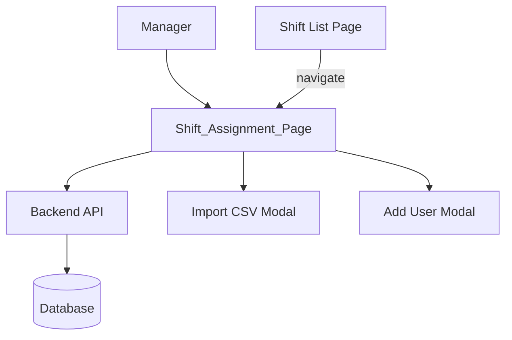
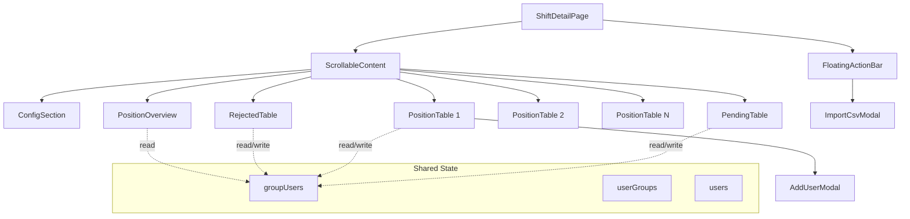
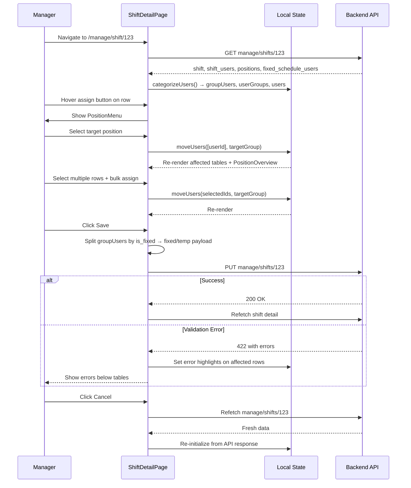

# Design Document: Shift Assignment Page

## Overview

Replace the shift update modal with a dedicated page at `/manage/shift/[id]` using a table-based UI for user-to-position assignment. The page reuses all existing backend APIs and frontend query hooks, replacing only the presentation layer. The core state management pattern (`groupUsers` / `userGroups` / `users` records) is preserved from the modal implementation but adapted to work with a combined fixed/temporary view.

### Design Goals
- Scalable UI that handles 200+ users without performance degradation
- Familiar table-based interaction pattern using mantine-datatable
- Zero backend changes — reuse existing API endpoints and payload format
- Consistent with existing page patterns (user info tab floating bar, DataTable usage)

### Key Design Decisions
- **Combined fixed/temp view** instead of tabs: reduces context switching, groups users by position with visual row distinction (background color) for fixed vs. temporary
- **Hover-triggered Menu** instead of drag-and-drop: faster for single reassignment, works at any scale
- **Bulk action per table** instead of global: scoped context makes bulk operations less error-prone
- **Flexbox floating bar** (same pattern as `admin/user/[id]`): pure CSS, no z-index issues, reliable scroll behavior
- **Local state with explicit save**: all changes are local until the user clicks Save, Cancel refetches from API

## Architecture

### System Context



### High-Level Architecture



## Components and Interfaces

### Component 1: ShiftDetailPage

**Purpose**: Top-level page component that loads shift data, manages state, and orchestrates child components.

**Responsibilities**:
- Fetch shift detail data via `useGetShiftDetailQuery`
- Initialize and manage `groupUsers`, `userGroups`, `users` state from API response
- Provide `moveUsers(userIds: string[], targetGroup: string)` function to children
- Construct API payload on save using existing format
- Handle form validation errors from API response

**Interfaces**:
- **Input**: Route param `id` from URL
- **Output**: Renders full page layout
- **Dependencies**: `useGetShiftDetailQuery`, `useUpdateShiftMutation`, `categorizeUsers` helper

**Implementation Notes**:
- File: `frontend/src/pages/manage/shift/[id].page.tsx`
- CSS module: `frontend/src/pages/manage/shift/[id].module.css`
- Uses Mantine `useForm` for config fields (fixed_total, temp_total, max_registered_temp, break_minutes)
- The `moveUsers` function updates both `groupUsers` and `userGroups` atomically via `useState` setter
- On save, split combined `groupUsers` back into `fixed` and `temp` payloads using `users[id].is_fixed` flag

### Component 2: FloatingActionBar

**Purpose**: Non-scrolling action bar with save, cancel, import, and export buttons.

**Responsibilities**:
- Render action buttons with permission-based visibility
- Trigger save, cancel, import modal, and export actions
- Show loading state during save/export operations

**Interfaces**:
- **Input**: `onSave`, `onCancel`, `onImport`, `onExport` callbacks; `isReadOnly`, `isSaving` flags; permission booleans
- **Output**: Renders Paper component with buttons
- **Dependencies**: None (pure presentational)

**Implementation Notes**:
- Inline within `[id].page.tsx` or extracted to `partials/floating_action_bar.tsx`
- Uses `Paper` with `style={{ flexShrink: 0 }}` pattern from `admin/user/[id].page.tsx`
- Left side: Import CSV button, Export Excel button
- Right side: Cancel button, Save button (primary)

### Component 3: ConfigSection

**Purpose**: Editable inputs for shift configuration displayed above position overview.

**Responsibilities**:
- Render NumberInput fields for fixed_total, temp_total, max_registered_temp, break_minutes
- Bind to Mantine form state
- Display read-only in ended shifts

**Interfaces**:
- **Input**: Mantine `form` instance, `isReadOnly` flag
- **Output**: Renders a horizontal row of labeled inputs
- **Dependencies**: Mantine form

**Implementation Notes**:
- Inline within the page or extracted to `partials/config_section.tsx`
- Uses Mantine `NumberInput` with `SimpleGrid` or `Group` layout

### Component 4: PositionOverview

**Purpose**: Read-only cards showing fill status per position.

**Responsibilities**:
- Render one card per position with name, count breakdown, salary
- Show success/warning indicators based on fill level
- Update reactively when `groupUsers` changes

**Interfaces**:
- **Input**: `positions: WorkplacePosition[]`, `groupUsers: Record<string, string[]>`, `users: Record<string, User>`
- **Output**: Renders SimpleGrid of cards
- **Dependencies**: None

**Implementation Notes**:
- File: `frontend/src/pages/manage/shift/partials/position_overview.tsx`
- Each card shows: position name, `{fixedCount}F + {tempCount}T / {total}`, `¥{salary}/h`
- Success: green indicator when assigned >= needed (derive needed from position capacity or total)
- Warning: orange/red indicator when 0 assigned
- Uses Mantine `Card` or `Paper` in a `SimpleGrid`

### Component 5: AssignmentTable

**Purpose**: Reusable table component used for pending, each position, and rejected groups.

**Responsibilities**:
- Render DataTable with user rows, checkbox selection, and action column
- Group fixed users at top, temp users at bottom with distinct row backgrounds
- Provide row-level Position_Menu on hover
- Provide bulk action controls (target dropdown + execute button)
- Display validation errors below the table
- Highlight rows with errors

**Interfaces**:
- **Input**:
    - `groupId: string` — "pending", position ID, or "rejected"
    - `title: string` — display title with count
    - `userIds: string[]` — user IDs in this group
    - `users: Record<string, User>` — user lookup
    - `positions: WorkplacePosition[]` — for menu options
    - `onMove: (userIds: string[], targetGroup: string) => void`
    - `onAddUsers?: () => void` — only for position tables
    - `errors?: Record<string, string[]>` — userId -> error messages
    - `isReadOnly: boolean`
- **Output**: Renders DataTable with bulk action header and error footer
- **Dependencies**: mantine-datatable, Mantine Menu

**Implementation Notes**:
- File: `frontend/src/pages/manage/shift/partials/assignment_table.tsx`
- Uses `DataTable` from `mantine-datatable` with `selectedRecords` for checkboxes
- Row background: default for `is_fixed === 1`, tinted (e.g., light blue `var(--mantine-color-blue-0)`) for temp
- Sorting: fixed users first, then temp users (stable sort by `is_fixed` descending)
- Columns: `#` (row index), Name (with avatar), Staff No, Type badge (固定/派遣), Action
- Error rows: apply `var(--mantine-color-red-0)` background via `rowClassName` or `rowStyle`

### Component 6: PositionMenu

**Purpose**: Hover-triggered dropdown menu for reassigning a user to a different group.

**Responsibilities**:
- Show all positions, pending, and rejected as menu options
- Exclude the current group from options
- Trigger `onMove` when an option is selected

**Interfaces**:
- **Input**: `currentGroup: string`, `positions: WorkplacePosition[]`, `onSelect: (targetGroup: string) => void`
- **Output**: Renders Mantine Menu with Menu.Target (button) and Menu.Dropdown
- **Dependencies**: Mantine Menu

**Implementation Notes**:
- Inline within AssignmentTable or extracted to `partials/position_menu.tsx`
- Uses `<Menu trigger="hover" openDelay={100} closeDelay={200}>` for hover behavior
- Menu.Target: Button with text "配置" or icon
- Menu.Dropdown items:
    - One `Menu.Item` per position (excluding current)
    - `Menu.Divider`
    - "登録リスト" (Pending) — shown only if current group is a position or rejected
    - "不採用" (Rejected) — shown only if current group is not rejected

### Component 7: ImportCsvModal (reuse)

**Purpose**: Existing modal for CSV file upload. Reused as-is.

**Interfaces**:
- **Input**: `opened`, `onClose`, encoding/file callbacks
- **Dependencies**: Existing `modal_import_csv.tsx`

**Implementation Notes**:
- Reuse `frontend/src/pages/manage/shift/partials/update/modal_import_csv.tsx` directly (move to shared location or import from current path)

### Component 8: AddUserModal (reuse)

**Purpose**: Existing modal for searching and adding users to a position. Reused as-is.

**Interfaces**:
- **Input**: `workplaceId`, `shiftId`, existing user IDs, callback
- **Dependencies**: Existing `add_user_modal.tsx`

**Implementation Notes**:
- Reuse `frontend/src/pages/manage/shift/partials/update/add_user_modal.tsx`

## Data Models

### State: Assignment Groups

```typescript
// frontend/src/pages/manage/shift/[id].page.tsx
// Core state — same shape as current modal, derived from categorizeUsers()

// groupId -> userId[] mapping
type GroupUsers = Record<string, string[]>;
// Special group IDs: 'pending', 'rejected'
// Position group IDs: position.id as string

// userId -> groupId mapping (reverse index for O(1) lookup)
type UserGroups = Record<string, string>;

// userId -> User object with is_fixed flag
type Users = Record<string, User>;
```

**Validation Rules**:
- A user can only belong to one group at a time
- Moving a user removes them from the source group and adds to target group
- Both `groupUsers` and `userGroups` must be updated atomically

### State: Form Values

```typescript
// Mantine form shape
interface ShiftConfigForm {
    fixed_total: number;
    temp_total: number;
    max_registered_temp: string;
    break_minutes: string;
}
```

### API Payload (unchanged)

```typescript
// Constructed on save from groupUsers + users
interface ShiftUpdatePayload {
    fixed_total: number;
    temp_total: number;
    max_registered_temp: string;
    break_minutes: string;
    fixed: {
        pending_ids: string[];
        rejected_ids: string[];
        approved_ids: Record<string, string[]>; // positionId -> userIds[]
    };
    temp: {
        pending_ids: string[];
        rejected_ids: string[];
        approved_ids: Record<string, string[]>;
    };
}
```

**Relationships**:
- `ShiftUpdatePayload.fixed` and `.temp` are split from the combined `groupUsers` by checking `users[id].is_fixed`
- Position IDs in `approved_ids` correspond to `WorkplacePosition.id`

### Data Flow



## API Design

No new API endpoints. Existing endpoints reused:

### Endpoint 1: Get Shift Detail

**Method**: `GET`
**Path**: `/api/manage/shifts/:id`

**Response**:
```json
{
    "data": {
        "shift": { "id": 123, "fixed_total": 5, "temp_total": 3, "break_minutes": 60, "..." : "..." },
        "shift_users": [
            { "user_id": 1, "workplace_position_id": 2, "status": "approved", "is_fixed": 1, "user": { "..." : "..." } }
        ],
        "positions": [
            { "id": 2, "name": "組立A", "salary_per_hour": 1200, "sort_order": 1 }
        ],
        "fixed_schedule_users": []
    }
}
```

### Endpoint 2: Update Shift

**Method**: `PUT`
**Path**: `/api/manage/shifts/:id`

**Request**: `ShiftUpdatePayload` as defined in Data Models.

**Error Responses**:
- `422 Unprocessable Entity`: Validation errors with user-specific error codes (expired_residence, max_hour, overlap, etc.)

### Endpoint 3: Import CSV

**Method**: `POST`
**Path**: `/api/manage/shifts/:id/import-csv`

**Request**: `FormData` with `file` and `encoding` fields.

### Endpoint 4: Export Excel

**Method**: `GET`
**Path**: `/api/manage/shifts/:id/export`

**Response**: Binary Excel file download.

## Security Considerations

### Authentication
- Page requires authenticated session (handled by existing Layout component)

### Authorization
- Page access requires `SHIFT_EDIT` permission — enforced by RouteConfig and Layout permission check
- Import button visibility requires `SHIFT_IMPORT` permission
- Export button visibility requires `SHIFT_EXPORT` permission
- All API calls include session token; backend enforces permissions independently

### Data Protection
- No new data exposure — same data as the existing modal
- User PII (names, staff numbers) displayed only to authorized managers

### Input Validation
- Config inputs use NumberInput with min/max constraints
- User IDs in payload come from API response data, not user input
- Backend validates all assignments independently (overlap, max hours, document expiry)

## Error Handling

### API Errors

| Scenario | Handling |
|----------|----------|
| Shift not found (404) | Display error state with back navigation |
| Permission denied (403) | Redirect to 403 page (handled by Layout) |
| Validation error (422) | Parse error codes, highlight affected rows, show messages below tables |
| Network error | Show error notification, preserve local state |
| Save conflict | Show error notification, user can retry or cancel to refresh |

### Validation Errors (per user)

| Error Code | Display Message | Row Highlight |
|------------|----------------|---------------|
| expired_residence | 在留カード期限切れ | Red background |
| expired_student | 学生証期限切れ | Red background |
| expired_passport | パスポート期限切れ | Red background |
| max_hour | 最大勤務時間超過 | Red background |
| max_shift | 最大シフト数超過 | Red background |
| overlap | シフト重複 | Red background |
| is_disabled | アカウント無効 | Red background |
| rejected_paper | 書類不備 | Red background |
| missing_staff_no | 社員番号未設定 | Red background |

### CSV Import Errors

| Scenario | Handling |
|----------|----------|
| Invalid file format | Show error in import modal |
| Invalid staff numbers | Show error list in alert below floating bar |
| Position mismatch | Show error list with affected staff numbers |

## Performance Considerations

### Expected Load
- **Users per shift**: Typically 5-50, max ~200
- **Positions per workplace**: Typically 3-10
- **Concurrent page users**: Low (managers only, ~5-10 concurrent)

### Optimization Strategies
- `useMemo` for derived data: sorted user lists per table, position counts
- `useCallback` for `moveUsers` to prevent unnecessary re-renders
- DataTable virtualization not needed for <200 rows per table
- Single API call on page load (shift detail includes all needed data)
- Position overview count calculation is O(n) where n = total users — negligible

## Testing Strategy

### Unit Tests

**categorizeUsers helper** (`shift.helper.test.ts`):
- Correctly groups users by position, pending, rejected
- Handles empty shift_users array
- Handles users with no position (pending)

**moveUsers function**:
- Moves single user between groups
- Moves multiple users (bulk)
- Updates both groupUsers and userGroups atomically
- Removes from source group correctly

**Payload construction**:
- Splits combined groups into fixed/temp payloads
- Maps position groups to approved_ids format
- Correctly identifies pending and rejected IDs per type

### Integration Tests

- Page loads and displays all sections with API data
- Row menu moves user and updates position overview counts
- Bulk select + assign moves multiple users
- Save submits correct payload format
- Cancel refetches and resets local state
- Validation errors highlight correct rows and show messages
- CSV import populates position tables
- Read-only mode for ended shifts disables all actions

### Test Configuration

```typescript
// Use existing test setup with React Testing Library + MSW for API mocking
// Mock useRouter for route param access
// Mock permission hooks for authorization testing
```
