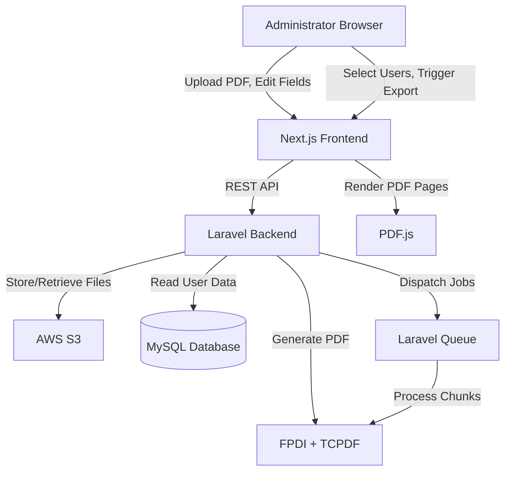
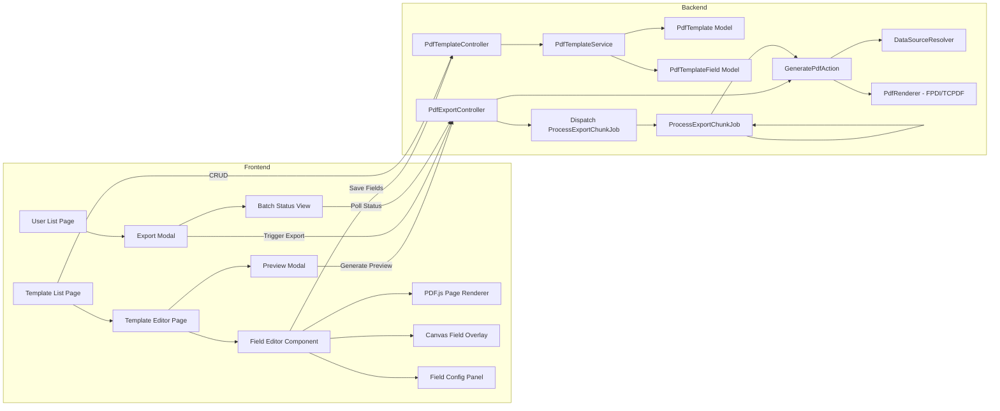
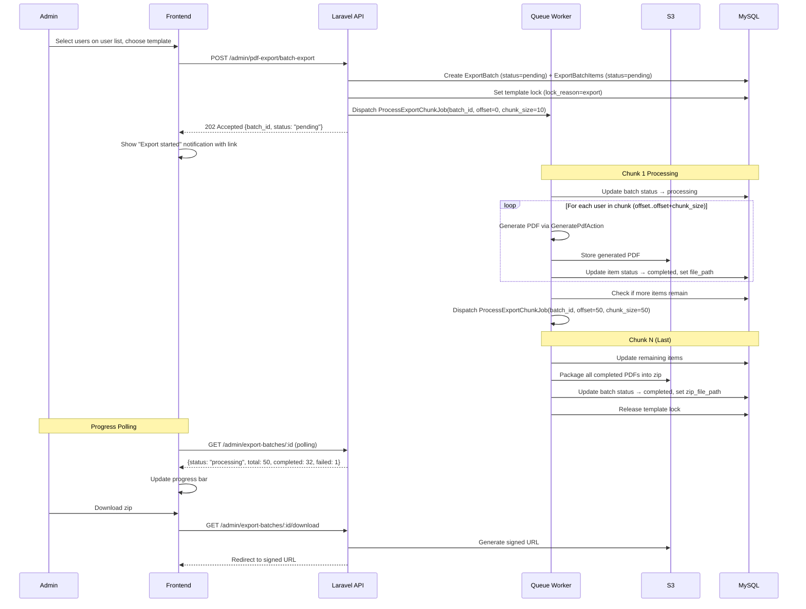
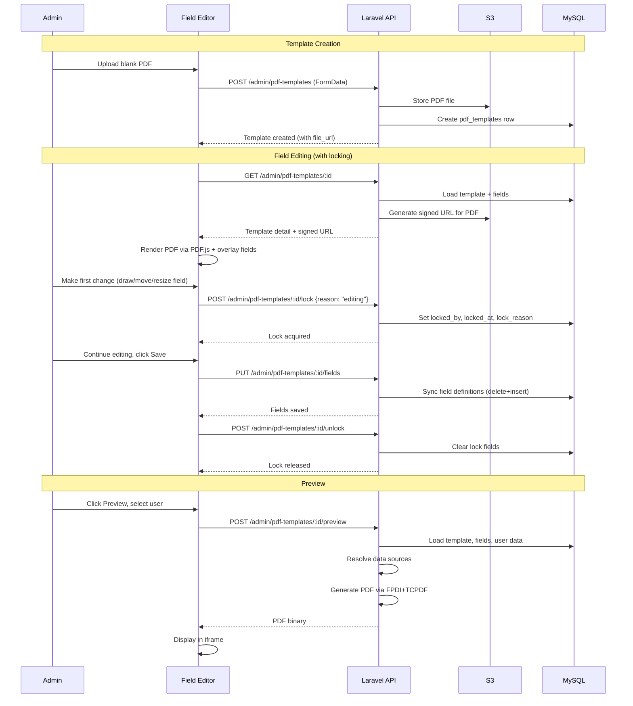
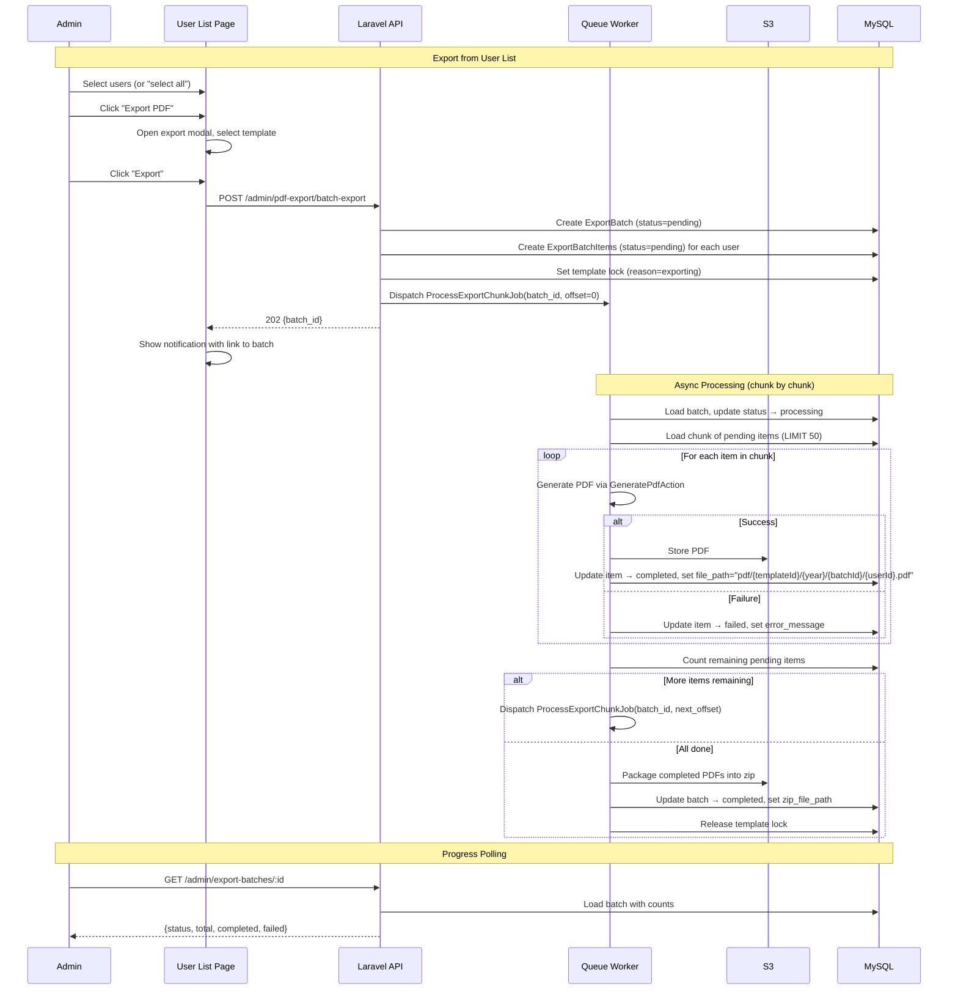

# Design Document: PDF Template Export

## Overview

This feature adds a PDF template management and export system to the admin section. Administrators upload blank PDFs, visually place data-bound fields on them via a browser-based editor, and generate filled PDFs per user. Export is initiated from the user list screen and processed asynchronously via chunked background jobs. The backend uses FPDI + TCPDF to overlay text and shapes onto the original PDF. The frontend uses PDF.js for rendering and a custom canvas-based editor for field placement. All files are stored on S3, and export history is tracked per template per batch with per-item status.

### Design Goals
- Provide a precise, intuitive visual editor for placing fields on PDF pages
- Generate high-quality PDFs with Japanese font support
- Follow existing codebase patterns (Action pattern, Service layer, React Query, Mantine UI)
- Keep the data source system extensible via backend configuration
- Process exports asynchronously to avoid blocking the UI
- Prevent data corruption from concurrent edits via template locking

### Key Design Decisions
- **PDF.js + Canvas overlay** for the field editor — renders PDF pages as canvas, overlays field rectangles/circles on a second canvas layer. This gives full control over field positioning without DOM complexity.
- **FPDI + TCPDF** for PDF generation — FPDI imports the original PDF pages, TCPDF handles text rendering with Japanese fonts. This is the most reliable approach for overlaying content on existing PDFs in PHP.
- **Field definitions stored as JSON-compatible DB rows** — each field is a row in `pdf_template_fields` with position, size, page number, and configuration as JSON columns. This allows efficient querying while keeping style config flexible.
- **Data sources defined in a PHP config file** — a single config file maps keys to resolver classes/closures, making it easy to add new sources without migrations.
- **Canvas coordinate system** — all field positions stored as percentages (0–100) relative to page dimensions, ensuring resolution independence.
- **Export from user list** — export is always initiated from the user list screen, not from the template editor. This matches the mental model of "I need documents for these employees" rather than "I have a template, now find employees."
- **Async chunked export** — batch export uses a self-dispatching Laravel Job that processes N users per chunk, then dispatches itself for the next chunk. This avoids long-running jobs and respects queue worker memory/timeout limits.
- **Template locking** — Redis-based locks with 30-minute TTL prevent concurrent edits and protect templates during active exports. Lock automatically expires if not refreshed.
- **Soft-delete templates** — uses Laravel's `SoftDeletes` trait so export history and generated PDFs remain accessible after template deletion.

## Architecture

### System Context



### High-Level Architecture



### Async Export Flow



## Components and Interfaces

### Component 1: Template List Page

**Purpose**: Display all PDF templates with search, and provide CRUD entry points.

**Responsibilities**:
- Render paginated template list with name, page count, field count, lock status, created/modified dates
- Provide create button (opens upload modal)
- Provide edit, delete, re-upload, and export history actions per template
- Filter templates by name
- Show lock indicator when template is locked (with tooltip showing who/why)

**Interfaces**:
- **Input**: Template list API response
- **Output**: Navigation to editor page, trigger delete/re-upload actions
- **Dependencies**: `useGetPdfTemplatesQuery`, `useDeletePdfTemplateMutation`

**Implementation Notes**:
- Follow existing `admin/user/index.page.tsx` pattern with `DDataTable`
- Located at `frontend/src/pages/admin/pdf-template/index.page.tsx`
- Delete button disabled when template is locked; tooltip shows reason

### Component 2: Template Editor Page

**Purpose**: Full-page editor for placing and configuring fields on a PDF template.

**Responsibilities**:
- Load template data and PDF file
- Host the Field Editor component (PDF renderer + canvas overlay)
- Host the Field Config Panel for selected field
- Provide save, preview, and back navigation
- Manage editor state (selected field, zoom level, tool mode)
- Acquire edit lock on first change; release on save or navigation away

**Interfaces**:
- **Input**: Template ID from URL, template detail API response
- **Output**: Save field definitions via API, trigger preview, lock/unlock API calls
- **Dependencies**: `useGetPdfTemplateDetailQuery`, `useUpdatePdfTemplateFieldsMutation`, `useLockTemplateMutation`, `useUnlockTemplateMutation`

**Implementation Notes**:
- Located at `frontend/src/pages/admin/pdf-template/[id].page.tsx`
- Uses `jotai` atoms for editor state (zoom, selected field, tool mode, clipboard)
- Full-width layout without sidebar to maximize editor space
- On first field change (create/move/resize/delete/config change): call lock API
- On `beforeunload` and route navigation: call unlock API
- If template is already locked by another user: show read-only mode with banner

### Component 3: Field Editor Component

**Purpose**: Canvas-based visual editor for drawing, selecting, moving, and resizing fields on PDF pages.

**Responsibilities**:
- Render PDF pages via PDF.js onto a canvas
- Render field overlays on a second canvas layer
- Handle mouse events for drawing new fields (rectangle/circle)
- Handle field selection, dragging (move), and resize via corner/edge handles
- Handle copy (Ctrl+C) and paste (Ctrl+V) of selected field
- Handle delete (Delete/Backspace key) of selected field
- Support zoom in/out with controls
- Page navigation for multi-page PDFs

**Interfaces**:
- **Input**: PDF file URL, array of field definitions, zoom level, current page
- **Output**: Field created/updated/deleted callbacks
- **Dependencies**: `pdfjs-dist` (PDF.js), HTML5 Canvas API

**Implementation Notes**:
- Two stacked canvases: bottom for PDF rendering, top for field interaction
- Fields stored with percentage-based coordinates (relative to page size) for resolution independence
- Drawing mode: click-and-drag creates a new field; default mode allows selection/move/resize
- Resize handles appear on selected field (8 handles: corners + midpoints)
- Minimum field size enforced (e.g., 2% x 2% of page)
- Zoom range: 50%–200%, controlled via toolbar buttons or Ctrl+scroll

### Component 4: Field Config Panel

**Purpose**: Side panel showing configuration options for the selected field.

**Responsibilities**:
- Display and edit field's bound Data Source (searchable dropdown showing only name, grouped by `group`)
- Display and edit Fill Mode (text or shape)
- For text mode: font weight, font size (disabled when overflow = shrink), h-align, v-align, letter spacing mode, overflow mode
- For shape mode: fill style (filled/outlined), color picker, stroke width (for outlined mode)
- Show field's shape type (rectangle/circle) — read-only after creation
- Show field's page number — read-only

**Interfaces**:
- **Input**: Selected field definition, list of data sources
- **Output**: Field configuration change callbacks
- **Dependencies**: `useGetDataSourcesQuery`, Mantine form components

**Implementation Notes**:
- Right-side panel, ~300px wide
- Data source dropdown uses Mantine `Select` with `searchable` prop
- Color picker uses Mantine `ColorInput`
- Panel is empty/hidden when no field is selected

### Component 5: Preview Modal

**Purpose**: Render a filled PDF preview in the browser.

**Responsibilities**:
- Display generated PDF in an iframe/embed
- Provide download button for the preview PDF

**Interfaces**:
- **Input**: Template ID
- **Output**: PDF blob for display and download
- **Dependencies**: `usePreviewPdfMutation`

**Implementation Notes**:
- Uses `<iframe>` or `<object>` to display the PDF blob URL
- Preview uses placeholder values: field-level placeholder (if set) or data source default placeholder

### Component 6: Export Modal (User List Page)

**Purpose**: Allow administrators to select a template and trigger export for selected users.

**Responsibilities**:
- Display template selector (searchable dropdown of available templates)
- Show count of selected users (N selected, or "All X users matching filters")
- Trigger batch export API call
- Show confirmation with link to batch status page/view

**Interfaces**:
- **Input**: Selected user IDs (or "all" flag with current filter params), template list
- **Output**: Trigger `useCreateBatchExportMutation`
- **Dependencies**: `useGetPdfTemplatesQuery`, existing user list selection state

**Implementation Notes**:
- Located at `frontend/src/pages/admin/user/partials/export_pdf_modal.tsx`
- Opened via "Export PDF" button in user list toolbar (visible when users are selected)
- For "select all": passes the current filter params to the backend, which resolves the full user list server-side
- After successful trigger: show notification with link to export history

### Component 7: Batch Status View

**Purpose**: Show real-time progress of export batches.

**Responsibilities**:
- Display batch status (pending/processing/completed/failed) with progress bar
- Show item-level breakdown: completed count, failed count, total
- List individual items with status, user name, and download link (if completed)
- Provide zip download button when batch is completed
- Auto-refresh/poll while batch is in progress

**Interfaces**:
- **Input**: Batch ID, `useGetExportBatchQuery`, `useGetExportBatchItemsQuery`
- **Output**: Download triggers
- **Dependencies**: Polling mechanism (React Query refetchInterval)

**Implementation Notes**:
- Accessible from export history page and from notification link after triggering export
- Uses React Query's `refetchInterval` option to poll every 3 seconds while batch status is not "completed"
- Progress bar: `completed_count / total_count`
- Failed items shown in red with error message tooltip

### Component 8: PdfTemplateController (Backend)

**Purpose**: Handle CRUD operations for PDF templates and their fields.

**Responsibilities**:
- List templates (paginated, filterable, excludes soft-deleted)
- Create template (upload PDF, store on S3)
- Show template detail with fields
- Update template metadata and fields (with lock check)
- Re-upload template PDF file
- Soft-delete template (with lock check)
- Return data source list
- Lock/unlock template for editing

**Interfaces**:
- **Input**: HTTP requests with validation via FormRequest classes
- **Output**: JSON responses via `ResponseHelper`
- **Dependencies**: `PdfTemplateService`

**Implementation Notes**:
- Located at `backend/app/Http/Controllers/Admin/PdfTemplateController.php`
- Follows existing controller pattern with constructor-injected service
- Update/delete/saveFields endpoints check Redis lock status before proceeding
- Lock endpoint: sets Redis key `pdf_template:lock:{id}` with value `{user_id}:{reason}` and TTL 1800 seconds (30 min). Only `editing` reason is allowed via API.
- Unlock endpoint: deletes Redis key (only by the lock owner). Export locks are released by the background job, not manually.
- Refresh lock endpoint: extends TTL via Redis EXPIRE
- Export locks: When an export is triggered, the system automatically sets a lock with reason `exporting` before dispatching the job. This lock is released when the batch completes or fails.

### Component 9: PdfExportController (Backend)

**Purpose**: Handle PDF preview, export triggering, and export history.

**Responsibilities**:
- Generate preview PDF (using placeholder values) — synchronous
- Trigger batch export (creates batch + items, dispatches first chunk job) — async
- Return export history for a template
- Return batch detail with item statuses
- Serve download URLs for generated PDFs and zip files

**Interfaces**:
- **Input**: Template ID, user ID(s) or filter params, optional value overrides
- **Output**: Preview PDF binary, batch creation response (202), history JSON, download redirects
- **Dependencies**: `GeneratePdfAction`, `ProcessExportChunkJob`, `PdfTemplateService`

**Implementation Notes**:
- Located at `backend/app/Http/Controllers/Admin/PdfExportController.php`
- Preview returns PDF binary with `Content-Type: application/pdf` (synchronous, single user)
- Batch export returns `202 Accepted` with batch ID immediately
- For "select all" mode: receives filter params and resolves user IDs server-side via the same query the user list uses

### Component 10: GeneratePdfAction (Backend)

**Purpose**: Generate a single filled PDF for one user from a template.

**Responsibilities**:
- Load template and its field definitions
- Resolve all data source values for the given user
- Use FPDI to import the original PDF pages
- Use TCPDF to overlay text and shapes on each page
- Return the generated PDF binary

**Interfaces**:
- **Input**: `PdfTemplate`, optional value overrides
- **Output**: PDF binary string
- **Dependencies**: `DataSourceResolver`, FPDI, TCPDF, Japanese font files

**Implementation Notes**:
- Located at `backend/app/Actions/Admin/PdfTemplate/GeneratePdfAction.php`
- Invokable class following existing Action pattern
- Converts percentage-based field coordinates to absolute positions using PDF page dimensions
- Text rendering: uses TCPDF's `MultiCell` or `Cell` methods with alignment options
- Shape rendering: uses TCPDF's `Rect` or `Ellipse` methods with fill/outline and configurable stroke width
- Auto letter spacing: calculates spacing = (field_width - total_char_width) / (char_count - 1)
- Shrink-to-fit: iteratively reduces font size until text fits within bounds (font size input disabled when shrink is selected)

### Component 11: DataSourceResolver (Backend)

**Purpose**: Resolve data source keys to actual values for a given user.

**Responsibilities**:
- Load the data source configuration
- For model_field type: read the attribute from User or UserInfo (handle null UserInfo gracefully)
- For fixed type: return the configured fixed string value
- For custom_function type: execute the registered closure with User and nullable UserInfo

**Interfaces**:
- **Input**: Data source key, `User` (with `UserInfo` eager-loaded)
- **Output**: `string|bool` resolved value
- **Dependencies**: Data source config file, User model

**Implementation Notes**:
- Located at `backend/app/Services/Admin/PdfTemplate/DataSourceResolver.php`
- Config file at `backend/config/pdf_data_sources.php` returns an array of source definitions
- Each source: `['key' => '...', 'name' => '...', 'placeholder' => '...', 'type' => '...', 'group' => '...', 'resolver' => ...]`
- For `model_field`: resolver is a dot-notation path like `user.email` — resolved via `data_get($user, 'email')` or `data_get($user->userInfo, 'address')` (handles null userInfo)
- For `fixed`: resolver is the fixed string value to return
- For `custom_function`: resolver is a Closure `fn(User $user, ?UserInfo $userInfo): string|bool`

### Component 12: PdfTemplateLockService (Backend)

**Purpose**: Manage template locks using Redis with TTL for automatic expiration.

**Responsibilities**:
- Acquire lock for editing or export
- Release lock when editing/export completes
- Refresh lock TTL on continued activity
- Query lock status and owner info

**Interfaces**:
- **Input**: Template ID, user ID, lock reason
- **Output**: Lock acquisition success/failure, lock info
- **Dependencies**: Redis via Laravel Cache

**Implementation Notes**:
- Located at `backend/app/Services/Admin/PdfTemplate/PdfTemplateLockService.php`
- Uses Laravel's `Cache` facade with Redis driver
- Lock key pattern: `pdf_template:lock:{template_id}`
- Lock value format: JSON `{user_id, reason, user_name, locked_at}`
- TTL: 1800 seconds (30 minutes)
- Methods:
  - `acquire(int $templateId, int $userId, string $reason, string $userName): bool` — SETNX or SET with NX
  - `release(int $templateId, int $userId): bool` — delete if owner matches
  - `refresh(int $templateId, int $userId): bool` — EXPIRE if owner matches
  - `get(int $templateId): ?array` — get lock info (user_id, reason, user_name, ttl_remaining)
  - `isLocked(int $templateId): bool`
  - `isLockedBy(int $templateId, int $userId): bool`

### Component 13: ProcessExportChunkJob (Backend)

**Purpose**: Background job that processes a chunk of users in a batch export, then dispatches itself for the next chunk.

**Responsibilities**:
- Load the export batch and its pending items for the current chunk
- For each item in the chunk: generate PDF, store on S3, update item status
- If more items remain: dispatch a new instance of itself for the next chunk
- If no more items remain: package completed PDFs into zip, update batch status to completed, release template lock

**Interfaces**:
- **Input**: `$batchId`, `$offset`, `$chunkSize` (default 50)
- **Output**: Side effects (DB updates, S3 uploads, next job dispatch)
- **Dependencies**: `GeneratePdfAction`, `ExportBatch`, `ExportBatchItem`, S3

**Implementation Notes**:
- Located at `backend/app/Jobs/ProcessExportChunkJob.php`
- Implements `ShouldQueue`
- `$tries = 3` — Laravel will retry the job up to 3 times on failure
- `$timeout = 300` — 5 minutes per chunk (should be well within limits for 50 PDFs)
- On chunk start: update batch status to "processing" if still "pending"
- Per item: wrap in try/catch — on failure, set item status to "failed" with error message, continue
- After processing chunk: query count of remaining "pending" items
  - If > 0: `dispatch(new self($batchId, $offset + $chunkSize, $chunkSize))`
  - If 0: finalize batch (zip, status update, lock release)
- Uses DB transactions per item update (not wrapping the entire chunk)
- The zip file is created by reading all completed item file paths from S3 and packaging them

**Failure handling**:
- If the job itself fails (e.g., worker crash) after max retries: the `failed()` method marks all remaining pending items as "failed" and sets batch status to "failed"
- Stale batch detection: if a batch has been "processing" for more than 1 hour, it can be manually retried

## Data Models

### Entity 1: PdfTemplate

```typescript
// frontend/src/types/models/pdf_template.d.ts
interface PdfTemplate {
    id: number;
    name: string;
    file_path: string;
    file_name: string;
    page_count: number;
    field_count: number; // appended attribute
    // Lock state (appended from Redis)
    lock_info: { user_id: number; user_name: string; reason: string; ttl: number } | null;
    created_at: string;
    updated_at: string;
    deleted_at: string | null;
}

interface PdfTemplateDetail extends PdfTemplate {
    fields: PdfTemplateField[];
    file_url: string; // signed S3 URL for PDF.js rendering
}
```

**Validation Rules**:
- `name`: required, string, max 255, unique (among non-deleted)
- `file`: required on create, optional on re-upload, PDF mime type, max 5MB

**Relationships**:
- Has many `PdfTemplateField`
- Has many `ExportBatch`

### Entity 2: PdfTemplateField

```typescript
// frontend/src/types/models/pdf_template.d.ts
interface PdfTemplateField {
    id: number;
    pdf_template_id: number;
    page: number;
    shape: 'rectangle' | 'circle';
    // Position and size as percentages (0-100) relative to page dimensions
    x: number;
    y: number;
    width: number;
    height: number;
    // Data binding
    data_source_key: string;
    // Field-level placeholder (nullable, overrides data source default)
    placeholder: string | null;
    // Fill mode
    fill_mode: 'text' | 'shape';
    // Text style config (when fill_mode = 'text')
    text_config: TextConfig | null;
    // Shape style config (when fill_mode = 'shape')
    shape_config: ShapeConfig | null;
    created_at: string;
    updated_at: string;
}

interface TextConfig {
    font_weight: 'normal' | 'bold';
    font_size: number; // in pt
    h_align: 'left' | 'center' | 'right';
    v_align: 'top' | 'middle' | 'bottom';
    letter_spacing: 'auto' | number; // 'auto' = distribute evenly across field width, number = fixed points (pt)
    overflow: 'wrap' | 'trim' | 'shrink';
}

interface ShapeConfig {
    fill_style: 'filled' | 'outlined';
    color: string; // hex color, e.g. '#FF0000'
    stroke_width: number; // stroke width in pt for outlined mode
}
```

**Validation Rules**:
- `page`: required, integer, >= 1, <= template page count
- `shape`: required, uses PdfTemplateFieldShape enum values ['rectangle', 'circle']
- `x`, `y`: required, numeric, 0–100
- `width`, `height`: required, numeric, > 0, <= 100
- `data_source_key`: required, must exist in config
- `fill_mode`: required, uses PdfTemplateFieldFillMode enum values ['text', 'shape']
- `text_config`: required if fill_mode = 'text', valid JSON matching TextConfig
- `shape_config`: required if fill_mode = 'shape', valid JSON matching ShapeConfig

**Relationships**:
- Belongs to `PdfTemplate`

### Entity 3: ExportBatch

```typescript
// frontend/src/types/models/pdf_template.d.ts
interface ExportBatch {
    id: number;
    pdf_template_id: number;
    exported_by: number; // admin user ID
    status: 'pending' | 'processing' | 'completed' | 'failed';
    zip_file_path: string | null; // S3 path to zip file when completed
    total_count: number; // appended attribute
    completed_count: number; // appended attribute
    failed_count: number; // appended attribute
    created_at: string;
    updated_at: string;
}

interface ExportBatchDetail extends ExportBatch {
    items: ExportBatchItem[];
    template: PdfTemplate;
    exporter: { id: number; name: string };
}
```

**Relationships**:
- Belongs to `PdfTemplate`
- Belongs to `User` (exported_by)
- Has many `ExportBatchItem`

### Entity 4: ExportBatchItem

```typescript
// frontend/src/types/models/pdf_template.d.ts
interface ExportBatchItem {
    id: number;
    export_batch_id: number;
    user_id: number;
    status: 'pending' | 'completed' | 'failed';
    file_path: string | null; // S3 path, null until completed
    file_name: string | null;
    error_message: string | null; // null unless failed
    created_at: string;
    updated_at: string;
    user: { id: number; name: string; staff_no: string | null };
}
```

**Relationships**:
- Belongs to `ExportBatch`
- Belongs to `User`

### Entity 5: DataSource (Config-based, not DB)

```typescript
// frontend/src/types/models/pdf_template.d.ts
interface DataSource {
    key: string;
    name: string;
    placeholder: string;
    type: 'model_field' | 'fixed' | 'custom_function';
    group: string; // for grouping in dropdown: 'User', 'User Info', 'Custom', etc.
}
```

### Database Schema

**Note on Enums**: The database uses VARCHAR columns for enum values instead of MySQL ENUM types. This provides better flexibility and portability. PHP enum classes (in `app/Enums/`) are used for type safety and are cast to/from string values in Eloquent models.

```sql
-- pdf_templates
CREATE TABLE pdf_templates (
    id BIGINT UNSIGNED AUTO_INCREMENT PRIMARY KEY,
    name VARCHAR(255) NOT NULL UNIQUE,
    file_path VARCHAR(500) NOT NULL,
    file_name VARCHAR(255) NOT NULL,
    page_count INT UNSIGNED NOT NULL DEFAULT 1,
    -- Timestamps
    created_at TIMESTAMP NULL,
    updated_at TIMESTAMP NULL,
    deleted_at TIMESTAMP NULL,
    INDEX idx_deleted_at (deleted_at)
);

-- pdf_template_fields
CREATE TABLE pdf_template_fields (
    id BIGINT UNSIGNED AUTO_INCREMENT PRIMARY KEY,
    pdf_template_id BIGINT UNSIGNED NOT NULL,
    page INT UNSIGNED NOT NULL,
    shape VARCHAR(20) NOT NULL DEFAULT 'rectangle', -- uses PdfTemplateFieldShape enum
    x DECIMAL(8,4) NOT NULL,
    y DECIMAL(8,4) NOT NULL,
    width DECIMAL(8,4) NOT NULL,
    height DECIMAL(8,4) NOT NULL,
    data_source_key VARCHAR(100) NOT NULL,
    placeholder VARCHAR(255) NULL,
    fill_mode VARCHAR(20) NOT NULL DEFAULT 'text', -- uses PdfTemplateFieldFillMode enum
    text_config JSON NULL,
    shape_config JSON NULL,
    created_at TIMESTAMP NULL,
    updated_at TIMESTAMP NULL,
    FOREIGN KEY (pdf_template_id) REFERENCES pdf_templates(id) ON DELETE CASCADE,
    INDEX idx_template_page (pdf_template_id, page)
);

-- export_batches
CREATE TABLE export_batches (
    id BIGINT UNSIGNED AUTO_INCREMENT PRIMARY KEY,
    pdf_template_id BIGINT UNSIGNED NOT NULL,
    exported_by BIGINT UNSIGNED NOT NULL,
    status VARCHAR(20) NOT NULL DEFAULT 'pending', -- uses ExportBatchStatus enum: pending/processing/completed/failed
    zip_file_path VARCHAR(500) NULL,
    created_at TIMESTAMP NULL,
    updated_at TIMESTAMP NULL,
    FOREIGN KEY (pdf_template_id) REFERENCES pdf_templates(id) ON DELETE CASCADE,
    FOREIGN KEY (exported_by) REFERENCES users(id),
    INDEX idx_template (pdf_template_id),
    INDEX idx_status (status)
);

-- export_batch_items
CREATE TABLE export_batch_items (
    id BIGINT UNSIGNED AUTO_INCREMENT PRIMARY KEY,
    export_batch_id BIGINT UNSIGNED NOT NULL,
    user_id BIGINT UNSIGNED NOT NULL,
    status VARCHAR(20) NOT NULL DEFAULT 'pending', -- uses ExportBatchItemStatus enum: pending/completed/failed
    file_path VARCHAR(500) NULL,
    file_name VARCHAR(255) NULL,
    error_message TEXT NULL,
    created_at TIMESTAMP NULL,
    updated_at TIMESTAMP NULL,
    FOREIGN KEY (export_batch_id) REFERENCES export_batches(id) ON DELETE CASCADE,
    FOREIGN KEY (user_id) REFERENCES users(id),
    INDEX idx_batch (export_batch_id),
    INDEX idx_user (user_id),
    INDEX idx_batch_status (export_batch_id, status)
);
```

### Data Flow





## API Design

### Endpoint 1: List Templates

**Method**: `GET`
**Path**: `/api/admin/pdf-templates`
**Permission**: `pdf_template.list`

**Query Parameters**:
```
name?: string        # Filter by name (partial match)
page?: number        # Page number
page_size?: number   # Items per page (default 15)
```

**Response**:
```json
{
    "data": {
        "data": [
            {
                "id": 1,
                "name": "Residence Card Template",
                "file_name": "residence_card.pdf",
                "page_count": 2,
                "field_count": 15,
                "locked_by": null,
                "locked_at": null,
                "lock_reason": null,
                "locker": null,
                "created_at": "2026-03-17T10:00:00Z",
                "updated_at": "2026-03-17T12:00:00Z"
            }
        ],
        "current_page": 1,
        "last_page": 1,
        "per_page": 15,
        "total": 1
    }
}
```

### Endpoint 2: Create Template

**Method**: `POST`
**Path**: `/api/admin/pdf-templates`
**Permission**: `pdf_template.create`
**Content-Type**: `multipart/form-data`

**Request**:
```
name: string         # Template name (required, unique)
file: File           # PDF file (required, max 5MB, mime: application/pdf)
```

**Response** (201):
```json
{
    "data": {
        "id": 1,
        "name": "Residence Card Template",
        "file_path": "pdf-templates/abc123.pdf",
        "file_name": "residence_card.pdf",
        "page_count": 2,
        "field_count": 0,
        "created_at": "2026-03-17T10:00:00Z",
        "updated_at": "2026-03-17T10:00:00Z"
    }
}
```

**Error Responses**:
- `422 Unprocessable Entity`: Validation failure (file too large, not PDF, name taken)

### Endpoint 3: Get Template Detail

**Method**: `GET`
**Path**: `/api/admin/pdf-templates/{id}`
**Permission**: `pdf_template.list`

**Response**:
```json
{
    "data": {
        "id": 1,
        "name": "Residence Card Template",
        "file_path": "pdf-templates/abc123.pdf",
        "file_name": "residence_card.pdf",
        "file_url": "https://s3.../pdf-templates/abc123.pdf?X-Amz-Signature=...",
        "page_count": 2,
        "field_count": 15,
        "locked_by": null,
        "locked_at": null,
        "lock_reason": null,
        "locker": null,
        "fields": [
            {
                "id": 1,
                "page": 1,
                "shape": "rectangle",
                "x": 25.5,
                "y": 10.2,
                "width": 30.0,
                "height": 5.0,
                "data_source_key": "user.email",
                "fill_mode": "text",
                "text_config": {
                    "font_weight": "normal",
                    "font_size": 12,
                    "h_align": "left",
                    "v_align": "middle",
                    "letter_spacing": "auto",
                    "overflow": "shrink"
                },
                "shape_config": null
            }
        ],
        "created_at": "2026-03-17T10:00:00Z",
        "updated_at": "2026-03-17T12:00:00Z"
    }
}
```

### Endpoint 4: Update Template

**Method**: `PUT`
**Path**: `/api/admin/pdf-templates/{id}`
**Permission**: `pdf_template.update`

**Request**:
```json
{
    "name": "Updated Template Name"
}
```

**Response**:
```json
{
    "data": { "...template object..." }
}
```

**Error Responses**:
- `423 Locked`: Template is locked by another user or by an active export

### Endpoint 5: Save Template Fields

**Method**: `PUT`
**Path**: `/api/admin/pdf-templates/{id}/fields`
**Permission**: `pdf_template.update`

**Request**:
```json
{
    "fields": [
        {
            "id": 1,
            "page": 1,
            "shape": "rectangle",
            "x": 25.5,
            "y": 10.2,
            "width": 30.0,
            "height": 5.0,
            "data_source_key": "user.email",
            "placeholder": "custom@example.com",
            "fill_mode": "text",
            "text_config": {
                "font_weight": "normal",
                "font_size": 12,
                "h_align": "left",
                "v_align": "middle",
                "letter_spacing": "auto",
                "overflow": "shrink"
            },
            "shape_config": null
        }
    ]
}
```

**Implementation Note**: Backend performs a sync operation — deletes all existing fields for the template and re-inserts the provided list. Field IDs in the request are for frontend tracking only; the backend assigns new IDs.

**Response**:
```json
{
    "data": { "...template detail with new fields..." }
}
```

**Error Responses**:
- `423 Locked`: Template is locked by another user or by an active export

### Endpoint 6: Delete Template (Soft Delete)

**Method**: `DELETE`
**Path**: `/api/admin/pdf-templates/{id}`
**Permission**: `pdf_template.delete`

**Response** (200):
```json
{
    "data": null
}
```

**Error Responses**:
- `423 Locked`: Template is locked (being edited or has active export)

### Endpoint 7: List Data Sources

**Method**: `GET`
**Path**: `/api/admin/pdf-templates/data-sources`
**Permission**: `pdf_template.list`

**Response**:
```json
{
    "data": [
        {
            "key": "user.email",
            "name": "Email",
            "placeholder": "example@email.com",
            "type": "model_field",
            "group": "User"
        },
        {
            "key": "user.name",
            "name": "Full Name",
            "placeholder": "Yamada Taro",
            "type": "model_field",
            "group": "User"
        },
        {
            "key": "fixed_company_name",
            "name": "Company Name",
            "placeholder": "DGF Co., Ltd.",
            "type": "fixed",
            "group": "Fixed"
        },
        {
            "key": "is_household_head",
            "name": "Is Household Head",
            "placeholder": "true",
            "type": "custom_function",
            "group": "Custom"
        }
    ]
}
```

### Endpoint 8: Preview PDF

**Method**: `POST`
**Path**: `/api/admin/pdf-templates/{id}/preview`
**Permission**: `pdf_template.export`

**Response**: PDF binary with `Content-Type: application/pdf`

Preview uses placeholder values: field-level placeholder (if set on the field) or data source default placeholder. Note: Preview is allowed even when template is locked, since it's a read-only operation.

### Endpoint 9: Re-upload Template PDF

**Method**: `POST`
**Path**: `/api/admin/pdf-templates/{id}/re-upload`
**Permission**: `pdf_template.update`
**Content-Type**: `multipart/form-data`

**Request**:
```
file: File           # PDF file (required, max 5MB, mime: application/pdf)
```

**Response**:
```json
{
    "data": { "...updated template object with new page_count..." }
}
```

**Error Responses**:
- `422 Unprocessable Entity`: Validation failure
- `423 Locked`: Template is locked

**Implementation Note**: Replaces the S3 file, updates `file_path`, `file_name`, and `page_count`. Existing field definitions are preserved (not deleted). Frontend should warn the user that field positions may no longer align with the new PDF.

### Endpoint 10: Lock Template

**Method**: `POST`
**Path**: `/api/admin/pdf-templates/{id}/lock`
**Permission**: `pdf_template.update`

**Request**:
```json
{
    "reason": "editing"
}
```

**Response**:
```json
{
    "data": { "...template object with lock_info populated..." }
}
```

**Error Responses**:
- `423 Locked`: Template is already locked by another user or export

**Implementation Note**: Sets Redis key `pdf_template:lock:{id}` with TTL of 30 minutes. If the template is already locked by the same user, the TTL is refreshed. Use the refresh endpoint to extend TTL on subsequent changes.

### Endpoint 11: Refresh Lock

**Method**: `POST`
**Path**: `/api/admin/pdf-templates/{id}/refresh-lock`
**Permission**: `pdf_template.update`

**Response**:
```json
{
    "data": { "...template object with lock_info populated..." }
}
```

**Error Responses**:
- `423 Locked`: Template is locked by a different user

**Implementation Note**: Extends the TTL of an existing lock. Only the lock owner can refresh.

### Endpoint 12: Unlock Template

**Method**: `POST`
**Path**: `/api/admin/pdf-templates/{id}/unlock`
**Permission**: `pdf_template.update`

**Response**:
```json
{
    "data": { "...template object with lock_info null..." }
}
```

**Implementation Note**: Deletes the Redis lock key. Only the lock owner can unlock. Export locks are released by the background job, not manually.

### Endpoint 13: Trigger Batch Export

**Method**: `POST`
**Path**: `/api/admin/pdf-export/batch-export`
**Permission**: `pdf_template.export`

**Request**:
```json
{
    "template_id": 1,
    "user_ids": [5, 12, 23, 45],
    "select_all": false,
    "filters": null
}
```

For "select all" mode:
```json
{
    "template_id": 1,
    "user_ids": [],
    "select_all": true,
    "filters": {
        "name": "yamada",
        "department_id": 3
    }
}
```

**Response** (202):
```json
{
    "data": {
        "id": 1,
        "pdf_template_id": 1,
        "status": "pending",
        "total_count": 45,
        "completed_count": 0,
        "failed_count": 0,
        "created_at": "2026-03-17T14:00:00Z"
    }
}
```

**Error Responses**:
- `422 Unprocessable Entity`: No users found, invalid template ID
- `423 Locked`: Template is locked (being edited or exported)

### Endpoint 14: Export History

**Method**: `GET`
**Path**: `/api/admin/pdf-templates/{id}/export-history`
**Permission**: `pdf_template.list`

**Query Parameters**:
```
page?: number
page_size?: number
```

**Response**:
```json
{
    "data": {
        "data": [
            {
                "id": 1,
                "pdf_template_id": 1,
                "exported_by": 3,
            "status": "completed",
            "zip_file_path": "pdf/{templateId}/{year}/{batchId}/all.zip",
                "total_count": 5,
                "completed_count": 4,
                "failed_count": 1,
                "exporter": { "id": 3, "name": "Admin User" },
                "created_at": "2026-03-17T14:00:00Z",
                "updated_at": "2026-03-17T14:02:00Z"
            }
        ],
        "current_page": 1,
        "last_page": 1,
        "per_page": 15,
        "total": 1
    }
}
```

### Endpoint 15: Get Export Batch Info

**Method**: `GET`
**Path**: `/api/admin/export-batches/{id}`
**Permission**: `pdf_template.list`

**Response**:
```json
{
    "data": {
        "id": 1,
        "pdf_template_id": 1,
        "exported_by": 3,
        "status": "completed",
        "zip_file_path": "pdf/1/2026/1/all.zip",
        "total_count": 5,
        "completed_count": 4,
        "failed_count": 1,
        "exporter": { "id": 3, "name": "Admin User" },
        "created_at": "2026-03-17T14:00:00Z",
        "updated_at": "2026-03-17T14:02:00Z"
    }
}
```

### Endpoint 16: List Export Batch Items

**Method**: `GET`
**Path**: `/api/admin/export-batches/{id}/items`
**Permission**: `pdf_template.list`

**Query Parameters**:
```
page?: number
page_size?: number
status?: string  # Filter by status: pending, completed, failed
```

**Response**:
```json
{
    "data": {
        "data": [
            {
                "id": 1,
                "user_id": 5,
                "status": "completed",
                "file_path": "pdf/1/2026/1/5.pdf",
                "file_name": "5.pdf",
                "error_message": null,
                "user": { "id": 5, "name": "Yamada Taro", "staff_no": "001" },
                "created_at": "2026-03-17T14:00:00Z",
                "updated_at": "2026-03-17T14:00:05Z"
            },
            {
                "id": 2,
                "user_id": 8,
                "status": "failed",
                "file_path": null,
                "file_name": null,
                "error_message": "UserInfo record not found",
                "user": { "id": 8, "name": "Suzuki Hanako", "staff_no": "002" },
                "created_at": "2026-03-17T14:00:00Z",
                "updated_at": "2026-03-17T14:00:06Z"
            }
        ],
        "current_page": 1,
        "last_page": 1,
        "per_page": 15,
        "total": 2
    }
}
```

### Endpoint 17: Download Exported PDF (Single Item)

**Method**: `GET`
**Path**: `/api/admin/export-batch-items/{id}/download`
**Permission**: `pdf_template.export`

**Response**: Redirect to signed S3 URL or PDF binary with `Content-Disposition: attachment`

### Endpoint 18: Download Batch Zip

**Method**: `GET`
**Path**: `/api/admin/export-batches/{id}/download`
**Permission**: `pdf_template.export`

**Response**: Redirect to signed S3 URL for the zip file

**Error Responses**:
- `404`: Batch not found or not yet completed
- `409`: Batch has no completed items

## Security Considerations

### Authentication
- All endpoints require authenticated session via `auth:api` middleware
- Token-based authentication consistent with existing API

### Authorization
- Five granular permissions enforced at route level via Laratrust middleware:
  - `pdf_template.list` — view templates, data sources, export history
  - `pdf_template.create` — create new templates
  - `pdf_template.update` — edit template name and fields, lock/unlock, re-upload
  - `pdf_template.delete` — soft-delete templates
  - `pdf_template.export` — preview, trigger export, and download PDFs

### Data Protection
- S3 files accessed via signed URLs with short expiration (15 minutes)
- Generated PDFs stored with non-guessable paths (include batch ID and UUID)
- Template PDF files are not publicly accessible
- Soft-deleted template files remain on S3 for historical access

### Input Validation
- PDF file upload validated for MIME type and size (< 5MB)
- Field coordinates validated as numeric within 0–100 range
- Data source keys validated against the config whitelist
- JSON config fields validated against expected schema
- User IDs in export requests validated for existence
- Template lock ownership validated before allowing update/delete

## Error Handling

### Template Management

| Scenario | Handling |
|----------|----------|
| Upload non-PDF file | 422 with validation error message |
| Upload file > 5MB | 422 with file size error |
| Duplicate template name | 422 with uniqueness error |
| Template not found | 404 via Laravel route model binding |
| Template soft-deleted | 404 for CRUD, still accessible for export history |
| S3 upload failure | 500 with logged error, transaction rolled back |
| Template locked for update/delete/export | 423 with lock info (who, why, since when) |

### Field Editor

| Scenario | Handling |
|----------|----------|
| Invalid data source key | 422 with validation error on save |
| Invalid field coordinates | 422 with validation error on save |
| PDF.js fails to render | Frontend shows error state with retry button |
| Save fails | Frontend shows error notification, fields remain in editor |
| Lock acquisition fails | Frontend shows "template is being edited by X" banner, switch to read-only mode, disable export |
| Lock TTL expires | Redis auto-expires the key, allowing new lock acquisition |

### PDF Generation

| Scenario | Handling |
|----------|----------|
| User has missing data for a field | Render empty string (no error) |
| Custom function throws exception | Log error, render empty string for that field |
| FPDI fails to load template PDF | Item marked as failed with error message |
| S3 storage failure on item | Retry up to 3 times, then mark item as failed |
| Chunk job fails after max retries | Mark remaining pending items as failed, set batch to completed |
| Template deleted during export | Export continues (template data was loaded at job start); lock prevents deletion while active |

## Performance Considerations

### Expected Load
- **Template management**: Low frequency (< 10 templates total, edited infrequently)
- **PDF generation**: Medium frequency (single exports several times daily, batch up to 200 users)
- **Field editor**: Single user at a time per template (enforced by locking)

### Optimization Strategies
- **PDF.js rendering**: Render only the current page, not all pages simultaneously
- **Field save**: Bulk sync (delete all + insert all) in a single transaction, avoiding per-field API calls
- **PDF generation**: Reuse FPDI template import across chunk — import once per chunk, clone per user
- **Signed URLs**: Cache signed URLs on the frontend for the duration of the editing session
- **Batch export chunking**: Process 50 users per job to keep memory usage bounded and allow queue worker recycling between chunks
- **Canvas rendering**: Use `requestAnimationFrame` for smooth field dragging; debounce resize calculations
- **Polling**: Frontend polls batch status every 3 seconds while in progress, stops on completion
- **Select-all optimization**: Server-side user resolution avoids sending potentially thousands of IDs from frontend

## Testing Strategy

### Unit Tests

**DataSourceResolver (`backend/tests/Unit/Services/PdfTemplate/DataSourceResolverTest.php`):**
- Resolves model_field type correctly for User attributes
- Resolves model_field type correctly for UserInfo attributes
- Resolves date type with correct format
- Resolves time type with correct format
- Resolves custom_function type with User and UserInfo input
- Returns empty string for null model field values
- Returns boolean for truthy/falsy custom functions

**GeneratePdfAction (`backend/tests/Unit/Actions/PdfTemplate/GeneratePdfActionTest.php`):**
- Generates PDF with text fields at correct positions
- Generates PDF with shape fields when value is truthy
- Skips shape fields when value is falsy
- Handles auto letter spacing calculation
- Handles shrink-to-fit overflow
- Handles wrap overflow with line breaks
- Handles trim overflow

**PdfTemplateService (`backend/tests/Unit/Services/PdfTemplate/PdfTemplateServiceTest.php`):**
- Creates template with S3 file upload
- Lists templates with name filter (excludes soft-deleted)
- Updates template metadata
- Soft-deletes template
- Syncs field definitions correctly
- Re-uploads PDF and updates page count
- Locks and unlocks template
- Rejects update/delete on locked template (423)
- Auto-releases stale locks

**ProcessExportChunkJob (`backend/tests/Unit/Jobs/ProcessExportChunkJobTest.php`):**
- Processes chunk of items and updates statuses
- Dispatches next chunk when items remain
- Finalizes batch when all items processed
- Creates zip file on batch completion
- Handles item-level failures gracefully
- Releases template lock on batch completion
- Marks remaining items as failed when job fails after max retries

### Integration Tests

**PdfTemplateController (`backend/tests/Feature/Admin/PdfTemplateControllerTest.php`):**
- CRUD operations with permission checks
- Upload validation (size, type)
- Field save and retrieve round-trip
- Data sources endpoint returns config list
- Soft-delete and verify hidden from list
- Re-upload PDF replaces file, preserves fields
- Lock/unlock endpoints
- Lock enforcement on update/delete (423)

**PdfExportController (`backend/tests/Feature/Admin/PdfExportControllerTest.php`):**
- Preview with placeholder data
- Trigger batch export returns 202 with batch ID
- Batch export creates correct number of items
- Select-all mode resolves users server-side
- Export history pagination
- Batch detail with item statuses
- Download individual item
- Download batch zip
- Permission enforcement on all endpoints

### Frontend Tests

**Field Editor Component:**
- Renders PDF page and existing fields
- Creates field on mouse draw
- Selects field on click
- Moves field on drag
- Resizes field via handles
- Deletes field on keypress
- Copy/paste creates duplicate field
- Zoom scales PDF and fields proportionally

**Export Modal (User List):**
- Opens with correct user count
- Template selector loads and filters
- Triggers export and shows confirmation
- Handles select-all mode

**Batch Status View:**
- Displays progress bar correctly
- Polls while in progress
- Stops polling on completion
- Shows failed items with error messages
- Download buttons enabled when applicable
