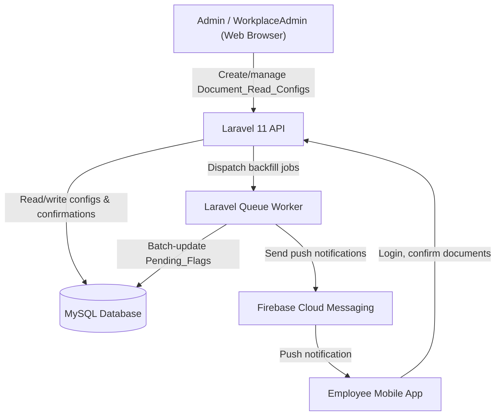
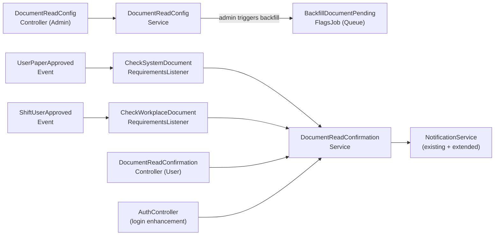
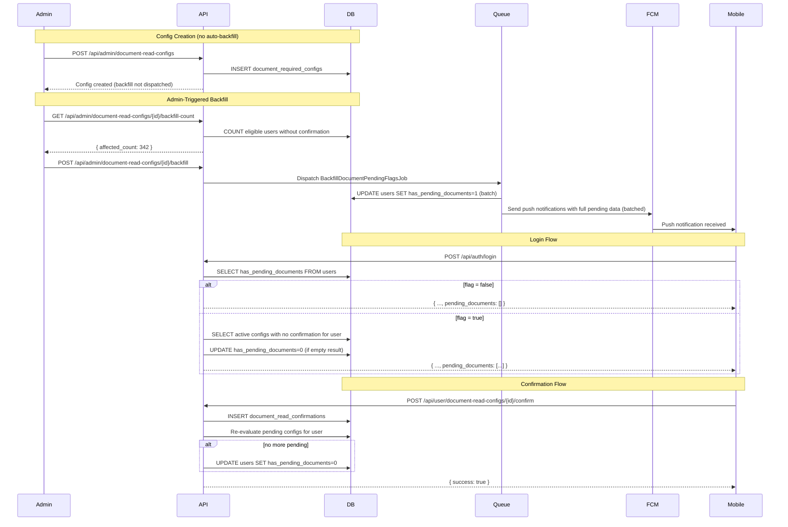

# Design Document: Document Read Confirmation

## Overview

The feature is built as an extension of the existing Laravel 11 backend and Next.js 15 frontend. Two new database tables (`document_required_configs`, `document_read_confirmations`) store configuration and audit records respectively. A boolean `has_pending_documents` flag is added to the `users` table as a DB-level cache to short-circuit the login-time pending document query. Event listeners hook into the existing `ShiftUserApproved` event and a new `UserPaperApproved` event to set the flag and send FCM push notifications. A queued batch job handles backfilling the flag for existing eligible employees when explicitly triggered by an admin. The login API is extended to return pending document data when the flag is true.

### Design Goals
- Zero overhead on login when no documents are pending (single indexed boolean column read).
- Full audit trail for every confirmation (timestamp, IP, device info).
- Consistent with existing patterns: Laratrust RBAC, event/listener architecture, queued jobs, FCM via `user_devices`, Admin/Manage/User route prefixes.
- Minimal blast radius: no changes to existing Document, Workplace, or ShiftUser models beyond adding listeners.

### Key Design Decisions
- **Pending_Flag over view/join**: A denormalized `has_pending_documents` boolean on `users` eliminates a multi-table join on every login. It is treated as an eventually-consistent cache; the login query self-heals if the flag is stale.
- **New `UserPaperApproved` event**: Rather than modifying the paper-approval action directly, dispatch an event to keep the approval logic decoupled from notification side-effects.
- **Separate `document_required_configs` table (not inside `system_configs`)**: The existing `system_configs` is a single-row settings table unsuitable for multi-row config lists with multilingual fields and workplace scoping.
- **No `scope` column**: Scope is derived from `workplace_id`: NULL = system-wide, non-NULL = workplace-scoped. This eliminates a denormalization risk where a `scope` enum could get out of sync with `workplace_id`.
- **`UNIQUE(user_id, document_required_config_id)` constraint on confirmations**: Prevents duplicate inserts at the DB level, allowing safe `firstOrCreate` patterns.
- **CASCADE delete on confirmations**: Deleting a config cascade-deletes its confirmations. Deactivating preserves them.
- **Backfill is opt-in**: Creating/activating a config does NOT auto-backfill. The admin must explicitly trigger backfill after seeing the affected employee count.
- **Admin UI placement**: A single config management page lists both system-wide and per-workplace configs. A single confirmation audit page shows confirmations across both types.

---

## Architecture

### System Context



### High-Level Architecture



---

## Components and Interfaces

### Component 1: DocumentRequiredConfig Model

**Purpose**: Eloquent model for `document_required_configs` records.

**Responsibilities**:
- Represent a required-reading configuration at system-wide or workplace scope.
- Provide relationships to `Document` and `Workplace`.

**Interfaces**:
- **Relations**: `belongsTo(Document)`, `belongsTo(Workplace)` (nullable), `hasMany(DocumentReadConfirmation)`
- **Scopes**: `scopeActive()`, `scopeSystem()`, `scopeForWorkplace(int $workplaceId)`

**Implementation Notes**:
- No `scope` column in DB; scope is derived from `workplace_id` (NULL = system-wide, non-NULL = workplace-scoped). A computed `scope` accessor on the model provides this value.
- `workplace_id` is nullable; NULL means system-wide.
- `is_active` defaults to `true`.
- `document_id` FK uses `SET NULL` on document deletion (config becomes orphaned but remains queryable).

---

### Component 2: DocumentReadConfirmation Model

**Purpose**: Audit record of an employee confirming a required document. Cascade-deleted when the parent config is deleted.

**Responsibilities**:
- Store `user_id`, `document_required_config_id`, `ip_address`, `device_info`. The `created_at` timestamp serves as the confirmation time.
- Provide relationships for querying by user or config.

**Interfaces**:
- **Relations**: `belongsTo(User)`, `belongsTo(DocumentRequiredConfig)`

**Implementation Notes**:
- DB unique constraint on `(user_id, document_required_config_id)` prevents duplicates.
- FK on `document_required_config_id` uses `CASCADE` on delete — confirmations are removed when config is deleted.
- `device_info` is a JSON column storing `{ model, os, app_version }`.

---

### Component 3: DocumentReadConfigService

**Purpose**: Business logic for creating/updating/deactivating configs and orchestrating backfill.

**Responsibilities**:
- CRUD operations with permission checks.
- Backfill is opt-in: admin must explicitly trigger after reviewing affected count.

**Interfaces**:
- `createSystemConfig(array $data): DocumentRequiredConfig`
- `createWorkplaceConfig(Workplace $workplace, array $data): DocumentRequiredConfig`
- `updateConfig(DocumentRequiredConfig $config, array $data): DocumentRequiredConfig`
- `deleteConfig(DocumentRequiredConfig $config): void`
- `listSystemConfigs(): Collection`
- `listWorkplaceConfigs(Workplace $workplace): Collection`
- `listAllConfigs(): Collection` — for the unified admin config page
- `getBackfillCount(DocumentRequiredConfig $config): int` — returns count of eligible employees who have not yet confirmed
- `triggerBackfill(DocumentRequiredConfig $config): void` — rejects if config is inactive (422); dispatches `BackfillDocumentPendingFlagsJob`

**Implementation Notes**:
- Creating/activating a config does NOT auto-dispatch the backfill job. Admin must explicitly call `triggerBackfill` after reviewing the count from `getBackfillCount`.
- Deleting a config hard-deletes; confirmations are cascade-deleted by the DB FK constraint.

---

### Component 4: DocumentReadConfirmationService

**Purpose**: Manages the confirmation lifecycle and Pending_Flag state.

**Responsibilities**:
- Insert a `DocumentReadConfirmation` record on employee confirmation (immutable — never update existing records).
- Re-evaluate and update `has_pending_documents` flag after each confirmation.
- Query pending documents for a user (used by login and self-heal logic).
- Set `has_pending_documents = true` when triggered by events.

**Interfaces**:
- `confirm(User $user, int $configId, string $ipAddress, array $deviceInfo): ?DocumentReadConfirmation`
- `getPendingConfigs(User $user): Collection` — returns active configs applicable to user with no confirmation, ordered by `id` ascending
- `setPendingFlag(User $user, bool $value): void`
- `evaluateAndResetFlag(User $user): void` — queries pending, sets flag to false if none remain

**Implementation Notes**:
- `confirm()` uses `firstOrCreate` (never updates existing records — audit data is immutable). If the config is inactive, returns null without creating a record (no-op success).
- `getPendingConfigs` queries:
    1. Active configs where `workplace_id IS NULL` (system-wide), user has no confirmation, AND user's `paper_status = 'approved'`.
    2. Active configs where `workplace_id IS NOT NULL`, user has had at least one approved shift at that workplace, AND has no confirmation.
    - Return merged collection ordered by `id` ascending.
- Uses `DB::transaction()` when inserting confirmation + re-evaluating flag to prevent race conditions.

---

### Component 5: UserPaperApproved Event + CheckSystemDocumentRequirementsListener

**Purpose**: Decouple paper-approval side effects from the approval action.

**Responsibilities (Event)**: Carry `User $user` payload after paper status transitions to `approved`.

**Responsibilities (Listener)**:
- Query active system-wide configs.
- If any exist and the user has no confirmation, call `DocumentReadConfirmationService::setPendingFlag(true)` and send FCM notification.

**Implementation Notes**:
- Listener implements `ShouldQueue` (async).
- Fire `UserPaperApproved` from the existing paper-approval action (`Admin\UserController::approvePapers`).

---

### Component 6: CheckWorkplaceDocumentRequirementsListener

**Purpose**: Listen to the existing `ShiftUserApproved` event and trigger workplace document requirements on first approved shift.

**Responsibilities**:
- Check if this is the employee's first approved shift at the workplace by counting prior `ShiftUser` records with `approved_at IS NOT NULL` for the same `(user_id, workplace_id)` pair (excluding the current one).
- If first shift AND active Workplace_Configs exist with no confirmations, set Pending_Flag + send FCM notification.

**Interfaces**:
- `handle(ShiftUserApproved $event): void`

**Implementation Notes**:
- Implements `ShouldQueue` + `ShouldDispatchAfterCommit` to run after the approving DB transaction commits.
- Uses the shift's workplace ID from `$event->shiftUser->shift->workplace_id`.

---

### Component 7: BackfillDocumentPendingFlagsJob

**Purpose**: Async queued job that sets `has_pending_documents = true` for all existing eligible employees when explicitly triggered by an admin via the backfill endpoint.

**Responsibilities**:
- For system-wide configs: chunk through all users with `paper_status = 'approved'` who have no confirmation for this config.
- For workplace configs: chunk through all users with at least one approved shift at the workplace who have no confirmation for this config.
- Set Pending_Flag and send FCM notifications per batch.

**Interfaces**:
- Constructor: `__construct(public int $configId)`
- `handle(): void`

**Implementation Notes**:
- Uses `User::query()->chunkById(100, fn($users) => ...)` to avoid memory issues.
- FCM notifications within each chunk sent in bulk where the FCM API supports it.

---

### Component 8: AuthController Login Enhancement

**Purpose**: Append `pending_documents` to the login response based on Pending_Flag.

**Responsibilities**:
- After successful auth, read `has_pending_documents` from the authenticated user.
- If false: append `pending_documents: []` with no further queries.
- If true: call `DocumentReadConfirmationService::getPendingConfigs()`, format the result, and append. Self-heal flag if empty.

**Implementation Notes**:
- Applied only to `POST /auth/login` (mobile user login). The admin login (`POST /auth/login/admin`) is unaffected.
- Add the check inside `AuthController::login()` after `getAuthData()`.

---

### Component 9: Admin Frontend — Unified Config Management Page

**Purpose**: Single admin page for managing all Document_Read_Configs (both system-wide and per-workplace).

**Responsibilities**:
- List all configs with filtering by type (system-wide / workplace).
- Create, edit, deactivate, delete configs.
- Title fields for all three locales; document picker from existing Document list; workplace picker for workplace-scoped configs.
- "Backfill" action per config: fetches affected employee count, shows confirmation modal, triggers backfill on confirm.

**Implementation Notes**:
- New page at `/admin/document-read-configs` (or section within existing `/admin/configuration`).
- Reuse Mantine `TextInput`, `Select`, `Switch`, `Modal` components.
- Table columns: type indicator (system/workplace), workplace name (if applicable), title (vi), document name, status badge, actions (edit, delete, backfill).

---

### Component 10: Admin Frontend — Unified Confirmation Audit Page

**Purpose**: Single admin page for viewing confirmation audit records across all config types.

**Responsibilities**:
- Paginated list of confirmations with filters by config, workplace, employee.
- Show employee name/staff_no, config title, confirmation timestamp (`created_at`), IP, device info.

**Implementation Notes**:
- Accessible from the config management page (e.g., "View confirmations" action per config).
- Reuse Mantine `Table` with pagination.

---

## Data Models

### Entity 1: DocumentRequiredConfig

```typescript
// backend/app/Models/DocumentRequiredConfig.php (PHP Eloquent)
// frontend/src/types/models/document_required_config.d.ts

interface DocumentRequiredConfig {
    id: number;
    scope: 'system' | 'workplace';  // computed: derived from workplace_id (null = system)
    workplace_id: number | null;     // null for system-wide
    document_id: number | null;      // nullable due to SET NULL on document deletion
    title_vi: string;
    title_en: string;
    title_ja: string;
    is_active: boolean;
    created_by: number;
    document?: Document;             // eager-loaded relation
    workplace?: Workplace;           // eager-loaded relation
    created_at: string;
    updated_at: string;
}
```

**Validation Rules**:
- `workplace_id` is optional; null means system-wide, non-null means workplace-scoped. No separate `scope` column in DB.
- `document_id` must reference an existing Document record (on creation/update). `document_id` is immutable once any `DocumentReadConfirmation` exists for this config — update requests that attempt to change it SHALL return 422.
- `title_vi`, `title_en`, `title_ja` are required strings, max 255 characters each.
- `is_active` defaults to `true`.

**Relationships**:
- `belongsTo(Document::class)` via `document_id`
- `belongsTo(Workplace::class)` via `workplace_id` (nullable)
- `hasMany(DocumentReadConfirmation::class)`

---

### Entity 2: DocumentReadConfirmation

```typescript
// backend/app/Models/DocumentReadConfirmation.php
// frontend/src/types/models/document_read_confirmation.d.ts

interface DocumentReadConfirmation {
    id: number;
    user_id: number;
    document_required_config_id: number;
    ip_address: string;
    device_info: {
        model: string | null;
        os: string | null;
        app_version: string | null;
    };
    user?: User;
    config?: DocumentRequiredConfig;
    created_at: string;           // serves as confirmation timestamp
    updated_at: string;
}
```

**Validation Rules**:
- `user_id` must reference an existing User.
- `document_required_config_id` must reference an existing DocumentRequiredConfig.
- `ip_address` max 45 chars (supports IPv6).
- Unique constraint on `(user_id, document_required_config_id)`.
- FK on `document_required_config_id` uses `CASCADE` on delete.

**Relationships**:
- `belongsTo(User::class)`
- `belongsTo(DocumentRequiredConfig::class)`

---

### Migration: users table addition

```sql
-- document_required_configs: document_id FK uses SET NULL on delete
-- document_read_confirmations: document_required_config_id FK uses CASCADE on delete

ALTER TABLE users ADD COLUMN has_pending_documents BOOLEAN NOT NULL DEFAULT FALSE;
CREATE INDEX idx_users_has_pending_documents ON users (has_pending_documents);
```

---

### Data Flow



---

## API Design

### Endpoint 1: List All Configs (Unified)

**Method**: `GET`
**Path**: `/api/admin/document-read-configs`
**Permission**: `config.list` (GlobalAdmin sees all; WorkplaceAdmin sees system-wide + their workplaces)

**Query Parameters** (optional):
- `workplace_id` — filter by workplace (omit or `null` for system-wide only)
- `scope` — `system`, `workplace`, or omit for all

**Response**:
```json
{
    "data": [
        {
            "id": 1,
            "workplace_id": null,
            "document_id": 5,
            "title_vi": "Nội quy công ty",
            "title_en": "Company Regulations",
            "title_ja": "会社規則",
            "is_active": true,
            "document": { "id": 5, "title": "Company Regulations v2" }
        }
    ]
}
```

---

### Endpoint 2: Create System-Wide Config

**Method**: `POST`
**Path**: `/api/admin/document-read-configs`
**Permission**: `config.edit`

**Request**:
```json
{
    "document_id": 5,
    "title_vi": "Nội quy công ty",
    "title_en": "Company Regulations",
    "title_ja": "会社規則",
    "is_active": true
}
```

**Response**: `201 Created` with the created config object.

**Error Responses**:
- `422 Unprocessable Entity`: Validation failure (missing title, invalid document_id)
- `403 Forbidden`: Insufficient permissions

---

### Endpoint 3: Update Config

**Method**: `PUT`
**Path**: `/api/admin/document-read-configs/{config}`
**Path**: `/api/admin/workplaces/{workplace}/document-read-configs/{config}`

**Request**: Same fields as create (all optional for partial update).

**Response**: `200 OK` with updated config object.

---

### Endpoint 4: Delete Config

**Method**: `DELETE`
**Path**: `/api/admin/document-read-configs/{config}`
**Path**: `/api/admin/workplaces/{workplace}/document-read-configs/{config}`

**Response**: `200 OK`

---

### Endpoint 5: Get Backfill Count

**Method**: `GET`
**Path**: `/api/admin/document-read-configs/{config}/backfill-count`
**Path**: `/api/admin/workplaces/{workplace}/document-read-configs/{config}/backfill-count`
**Permission**: `config.edit`

**Response**:
```json
{
    "data": {
        "affected_count": 342
    }
}
```

---

### Endpoint 6: Trigger Backfill

**Method**: `POST`
**Path**: `/api/admin/document-read-configs/{config}/backfill`
**Path**: `/api/admin/workplaces/{workplace}/document-read-configs/{config}/backfill`
**Permission**: `config.edit`

**Response**: `202 Accepted`
```json
{
    "data": {
        "message": "Backfill job dispatched",
        "affected_count": 342
    }
}
```

**Error Responses**:
- `422 Unprocessable Entity`: Config is inactive — backfill is only allowed on active configs

---

### Endpoint 7: List Per-Workplace Configs

**Method**: `GET`
**Path**: `/api/admin/workplaces/{workplace}/document-read-configs`
**Permission**: `workplace.edit` (scoped to workplace)

**Response**: Same structure as Endpoint 1, but `scope: "workplace"` and `workplace_id` populated.

---

### Endpoint 8: Create Per-Workplace Config

**Method**: `POST`
**Path**: `/api/admin/workplaces/{workplace}/document-read-configs`
**Permission**: `workplace.edit` (scoped to workplace)

**Request**:
```json
{
    "document_id": 12,
    "title_vi": "Quy định xưởng A",
    "title_en": "Workshop A Rules",
    "title_ja": "工場Aの規則",
    "is_active": true
}
```

---

### Endpoint 9: Confirm a Document

**Method**: `POST`
**Path**: `/api/user/document-read-configs/{config}/confirm`
**Auth**: Authenticated employee

**Request**:
```json
{
    "device_info": {
        "model": "iPhone 14",
        "os": "iOS 17.2",
        "app_version": "2.3.1"
    }
}
```

**Response**:
```json
{
    "data": {
        "confirmed": true,
        "has_pending_documents": false
    }
}
```

**Error Responses**:
- `403 Forbidden`: Config does not apply to this user (e.g., wrong workplace)
- `404 Not Found`: Config does not exist

---

### Login Response Enhancement

**Method**: `POST`
**Path**: `/api/auth/login`

**Response** (addition to existing response):
```json
{
    "user": { "...existing fields..." },
    "token": "...",
    "pending_documents": [
        {
            "id": 1,
            "workplace_id": null,
            "title_vi": "Nội quy công ty",
            "title_en": "Company Regulations",
            "title_ja": "会社規則",
            "document_url": "https://example.com/documents/5"
        },
        {
            "id": 3,
            "workplace_id": 7,
            "title_vi": "Quy định xưởng A",
            "title_en": "Workshop A Rules",
            "title_ja": "工場Aの規則",
            "document_url": "https://example.com/documents/12"
        }
    ]
}
```

---

### Endpoint 10: Admin — List Confirmations (Audit View)

**Method**: `GET`
**Path**: `/api/admin/document-read-configs/{config}/confirmations` (per-config, also usable for workplace configs)
**Permission**: `config.list` (WorkplaceAdmins can access if the config belongs to a workplace they manage, or if it is system-wide)

**Query Parameters** (optional):
- `user_id` — filter by employee

**Response**:
```json
{
    "data": [
        {
            "id": 1,
            "user": { "id": 42, "name": "NGUYEN VAN A", "staff_no": "1001" },
            "config": { "id": 1, "title_vi": "Nội quy công ty", "workplace_id": null },
            "created_at": "2026-03-27T08:30:00Z",
            "ip_address": "192.168.1.100",
            "device_info": { "model": "Samsung Galaxy S24", "os": "Android 14", "app_version": "2.3.1" }
        }
    ],
    "meta": { "total": 150, "per_page": 20 }
}
```

### Endpoint 11: Admin — List All Confirmations (Unified Audit View)

**Method**: `GET`
**Path**: `/api/admin/document-read-confirmations`
**Permission**: `config.list` (GlobalAdmin sees all; WorkplaceAdmin sees confirmations for system-wide configs + their workplaces' configs)

**Query Parameters** (optional):
- `config_id` — filter by specific config
- `workplace_id` — filter by workplace (null for system-wide)
- `user_id` — filter by employee

**Response**: Same structure as Endpoint 10, but across all configs.

**Authorization scoping**: WorkplaceAdmins can access this endpoint but results are automatically filtered to only include confirmations for system-wide configs and configs belonging to workplaces they manage.

---

## Security Considerations

### Authentication
- All config management endpoints require `auth:api` middleware (existing).
- The confirmation endpoint requires `auth:api` (existing user token).

### Authorization
- System-wide config CRUD: requires `config.edit` permission (GlobalAdmin only).
- Workplace config CRUD: requires `workplace.edit` permission scoped to the specific workplace (WorkplaceAdmin+).
- Confirmation endpoint: `user_id` is taken from the authenticated token, never from the request body — prevents confirming on behalf of others.
- Confirmation audit list: restricted to `config.list` permission. WorkplaceAdmins see confirmations for system-wide configs and configs belonging to their workplaces only; GlobalAdmins see all.

### Data Protection
- `ip_address` and `device_info` are stored immutably; no update route for confirmation records.
- Confirmation records persist as long as the parent config exists. Deactivating a config preserves confirmations; deleting a config cascade-deletes its confirmations.

### Input Validation
- `document_id` is validated against existing documents via `exists:documents,id` rule.
- `workplace_id` is validated against existing workplaces when provided (non-null).
- `device_info` fields are string-sanitized, max 255 chars each.

---

## Error Handling

### Config Management Errors

| Scenario | Handling |
|----------|----------|
| Document referenced by config is deleted | `document_id` set to NULL (SET NULL FK); config is auto-deactivated (`is_active = false`) via a model observer; admin UI shows warning for orphaned configs |
| WorkplaceAdmin attempts to edit another workplace's config | 403 Forbidden from permission middleware |
| Duplicate config for same (document, scope, workplace) | 422 with validation message; allow duplicates but warn admin |

### Confirmation Errors

| Scenario | Handling |
|----------|----------|
| Config already confirmed by this user | Return `200 OK` idempotently (`firstOrCreate` — no duplicate, no overwrite) |
| Config is inactive at time of confirmation | Return `200 OK` (no-op — do not create a record, return success silently) |
| Config does not apply to user (e.g., wrong workplace) | 403 Forbidden |

### Notification / Backfill Errors

| Scenario | Handling |
|----------|----------|
| FCM send fails for a device | Log error, continue; Pending_Flag remains true (login fallback covers it) |
| Backfill job fails mid-batch | Job is retryable (Laravel queue retry); idempotent due to unique constraint |
| Push notification delivered but user never opens app | Pending_Flag remains true; popup shown on next login |

---

## Performance Considerations

### Expected Load
- **Employees**: Several hundred to low thousands.
- **Configs per level**: < 20 (small number, fits in application memory per request).
- **Login checks**: All mobile logins hit the Pending_Flag read. With an index on `has_pending_documents`, this is a single B-tree lookup.
- **Backfill job frequency**: Rare (only when admin creates a new config); batch of up to 100 users at a time.

### Optimization Strategies
- **Pending_Flag index**: `INDEX idx_users_has_pending_documents (has_pending_documents)` — fast filtering, though most reads will be on `id` column in the login flow.
- **Pending doc query (when flag = true)**: Two indexed lookups — `document_required_configs WHERE is_active=1 AND workplace_id IS NULL` (system-wide) plus `WHERE is_active=1 AND workplace_id = ?` (per workplace), then `document_read_confirmations WHERE user_id=? AND document_required_config_id IN (...)`. Both are small result sets.
- **Backfill chunking**: `User::chunkById(100)` to avoid full table locks and memory exhaustion.
- **FCM batching**: Group device tokens per 500 (FCM limit) within each user chunk.

---

## Testing Strategy

### Unit Tests

**`DocumentReadConfigService` (`tests/Unit/Services/DocumentReadConfigServiceTest.php`):**
- Creates system-wide config (does NOT auto-dispatch backfill).
- Creates workplace config (does NOT auto-dispatch backfill).
- `getBackfillCount` returns correct count of eligible users.
- `triggerBackfill` dispatches `BackfillDocumentPendingFlagsJob`.
- Deactivating a config preserves existing confirmations.
- Deleting a config cascade-deletes confirmations.

**`DocumentReadConfirmationService` (`tests/Unit/Services/DocumentReadConfirmationServiceTest.php`):**
- `getPendingConfigs` returns system-wide configs for paper-approved user.
- `getPendingConfigs` returns workplace configs for users with approved shifts at that workplace.
- `getPendingConfigs` excludes inactive configs.
- `getPendingConfigs` excludes already-confirmed configs.
- `confirm()` creates record via `firstOrCreate`; second call is idempotent (no overwrite).
- `confirm()` on inactive config returns null (no-op success).
- `evaluateAndResetFlag()` sets flag to false when no pending configs remain.

**`CheckWorkplaceDocumentRequirementsListener` (`tests/Unit/Listeners/CheckWorkplaceDocumentRequirementsListenerTest.php`):**
- Sends notification on first approved shift with active configs.
- Does NOT send notification on second approved shift at same workplace.
- Does NOT send notification when no active configs exist.

### Integration Tests

**`tests/Feature/Api/Admin/DocumentReadConfigTest.php`:**
- GlobalAdmin can CRUD system-wide configs.
- WorkplaceAdmin can CRUD their workplace's configs.
- WorkplaceAdmin cannot access another workplace's configs.
- Creating config does NOT auto-dispatch backfill.
- Backfill count endpoint returns correct affected user count.
- Backfill trigger endpoint dispatches `BackfillDocumentPendingFlagsJob`.
- Backfill trigger on inactive config returns 422.
- Deleting config cascade-deletes confirmations.
- Updating `document_id` is blocked when confirmations exist for the config.
- Unified config list returns scoped results (WorkplaceAdmin sees system-wide + their workplaces only).
- Unified audit endpoint returns scoped confirmations for WorkplaceAdmin.

**`tests/Feature/Api/User/DocumentReadConfirmationTest.php`:**
- Confirm endpoint creates audit record with ip + device info.
- Confirm is idempotent (200 on duplicate).
- Pending_Flag reset to false after all confirmations.
- Login response includes `pending_documents` when flag is true.
- Login response includes empty `pending_documents` when flag is false.
- Login self-heals flag when no actual pending docs found.
