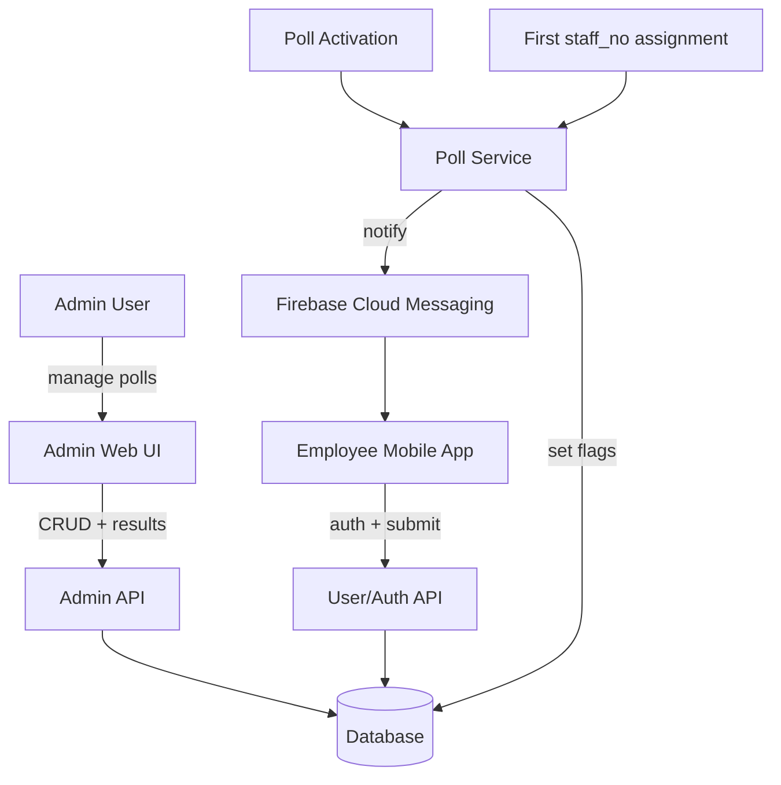
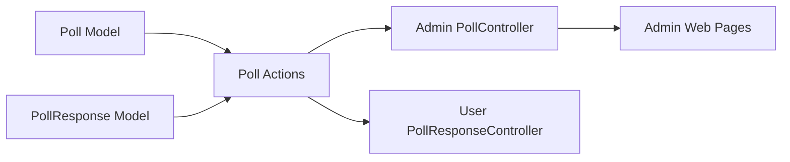
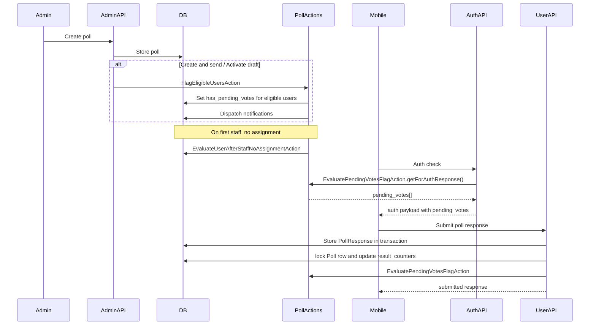

# Design Document: Vote/Feedback

## Overview

The Vote/Feedback feature uses a unified poll model: a single `polls` table and a single `poll_responses` table serve both vote and feedback types. Vote options reference candidate users; feedback options are embedded JSON objects with backend-generated stable IDs and multilingual labels. This repository covers backend APIs for employee mobile clients and the admin web UI for poll management and per-poll result viewing. Employee voting UI is out of scope here and is consumed through API payloads exposed by the backend.

### Design Goals
- Use one data model for vote and feedback to reduce duplication
- Keep employee-client integration API-focused and out of the admin web scope
- Evaluate eligibility only when it matters: poll activation and first `staff_no` assignment
- Provide efficient per-poll admin results without scanning all responses
- Keep admin routes and controllers simple by using one route family with `workplace_id` (null = global, non-null = workplace)

### Key Design Decisions
- Use a single `polls` + `poll_responses` table pair with a `type` discriminator
- Store feedback options in JSON with backend-generated ULID IDs
- Update `result_counters` inside the submission transaction after locking the poll row with `FOR UPDATE`
- Use `has_pending_votes` on `users` as the fast-path flag for employee auth responses
- Recalculate pending polls when a poll becomes active and when a user's `staff_no` changes from `null` to a value
- Keep admin results scoped to a single poll at a time; no participation-rate or cross-poll dashboard is included

## Architecture

### System Context



### High-Level Architecture



## Components and Interfaces

### Component 1: Poll Model

**Purpose**: Represents a unified poll created by an admin.

**Responsibilities**:
- Store poll metadata: type, titles, description, `workplace_id` (nullable, determines scope), required flag, expiry, `is_multiple`, and `max_choice`
- Store options as JSON
- Store denormalized `result_counters`
- Relate to creator and optional workplace

**Interfaces**:
- **Input**: Admin create/update requests
- **Output**: Poll data for admin pages, auth payloads, and result views
- **Dependencies**: User model, Workplace model

**Implementation Notes**:
- `type` is `vote` or `feedback`
- Vote options are stored as user ID arrays: `[10, 20, 30]`
- Feedback options are stored as objects: `[{ "id": "01J...", "label_vi": "...", "label_en": "...", "label_ja": "..." }]`
- `result_counters` is initialized to zero-counts at poll creation time:
  - Vote: `{ "10": { "yes": 0, "no": 0, "blank": 0 }, "20": { ... } }`
  - Feedback: `{ "01J...": 0, "01K...": 0 }`
- `scope` is derived from `workplace_id`: null = global, non-null = workplace
- Active poll means `is_active = true` and `expires_at IS NULL OR expires_at > now()`

### Component 2: PollResponse Model

**Purpose**: Records one user's answer for one poll config.

**Responsibilities**:
- Store type-specific answer data
- Store IP address and device info
- Enforce one response per user per config

**Interfaces**:
- **Input**: User submission payload
- **Output**: Individual responses for admin result pages
- **Dependencies**: Poll, User

**Implementation Notes**:
- `answer` JSON stores:
  - Vote: `{ "10": 1, "20": -1, "30": 0 }`
  - Feedback: `["01J...", "01K..."]`
- Unique index on `(user_id, poll_id)`

### Component 3: Poll Actions (Action Pattern)

**Purpose**: Encapsulates poll-related business logic in single-purpose Action classes following the project's Action pattern.

**Common Poll Actions** (`App\Actions\Common\Poll`):
- `GetPendingPollsAction` - Computes pending polls for a user with eligibility rules
- `EvaluatePendingVotesFlagAction` - Manages `has_pending_votes` flag for users
- `SerializePendingPollsAction` - Transforms poll data for API payloads
- `FlagEligibleUsersAction` - Bulk flags eligible users when poll becomes active
- `EvaluateUserAfterStaffNoAssignmentAction` - Evaluates pending polls after first staff_no assignment

**Admin Poll Actions** (`App\Actions\Admin\Poll`):
- `GetPollsAction` - Lists polls with filtering and pagination
- `GetPollAction` - Retrieves poll detail with resolved candidate users
- `CreatePollAction` - Creates poll with normalized options and result counters
- `UpdatePollAction` - Updates poll with locked field protection
- `DeletePollAction` - Deletes poll (prevented if responses exist)
- `ActivatePollAction` - Activates poll and flags eligible users
- `DeactivatePollAction` - Deactivates poll without flag recalculation
- `GetPollResponsesAction` - Retrieves paginated responses for a poll

**User Poll Actions** (`App\Actions\User\Poll`):
- `SubmitPollResponseAction` - Validates and records user poll response

**Interfaces**:
- **Input**: User model, poll data, answer payload, activation events
- **Output**: `ActionResult` with data/error/status
- **Dependencies**: Poll, PollResponse, User models

**Implementation Notes**:
- All actions return `ActionResult` for consistent error handling
- Actions are composed (e.g., `ActivatePollAction` calls `FlagEligibleUsersAction`)
- Eligibility rules encapsulated in `GetPendingPollsAction`
- Row locking via `lockForUpdate()` in `SubmitPollResponseAction`
- `has_pending_votes` derived from current active, eligible, unresponded polls

### Component 4: Auth Payload Integration

**Purpose**: Extends employee auth responses with pending poll payloads.

**Responsibilities**:
- Add `pending_votes` to employee auth responses
- Avoid expensive pending lookup when `has_pending_votes = false`
- Keep admin auth payload behavior unchanged

**Interfaces**:
- **Input**: Authenticated user
- **Output**: Auth response payload
- **Dependencies**: AuthController, PollService

**Implementation Notes**:
- Only employee-facing auth payloads include `pending_votes`
- Admin web auth payload remains unchanged
- When `has_pending_votes = true` but no pending configs are found (all expired or deactivated), reset the flag to `false` before returning the empty payload

### Component 5: Admin Web Poll Pages

**Purpose**: Provide admin-only management and per-poll results pages in the Next.js app.

**Responsibilities**:
- List and filter poll configs
- Create and edit vote/feedback configs
- Activate drafts
- View per-poll results and paginated responses

**Interfaces**:
- **Input**: Admin interactions
- **Output**: API calls to admin poll endpoints
- **Dependencies**: Mantine UI, React Query hooks, route configuration

**Implementation Notes**:
- Poll results live on a dedicated admin page such as `/admin/polls/[id]/results`
- No employee voting UI is implemented in this web app

## Data Models

### Entity 1: Poll

```typescript
// frontend/src/types/models/poll.d.ts
interface PollChoice {
    id: string; // ULID generated by backend
    label_vi: string;
    label_en: string;
    label_ja: string;
}

interface VoteResultCounters {
    [userId: string]: {
        yes: number;
        no: number;
        blank: number;
    };
}

interface FeedbackResultCounters {
    [choiceId: string]: number;
}

interface Poll {
    id: number;
    type: 'vote' | 'feedback';
    scope: 'global' | 'workplace'; // derived from workplace_id
    workplace_id: number | null;
    title_vi: string;
    title_en: string;
    title_ja: string;
    description_vi: string | null;
    description_en: string | null;
    description_ja: string | null;
    is_active: boolean;
    is_required: boolean;
    expires_at: string | null;
    is_multiple: boolean;
    max_choice: number;
    options: number[] | PollChoice[];
    result_counters: VoteResultCounters | FeedbackResultCounters;
    candidate_users?: User[];
    created_by: number;
    creator?: User;
    workplace?: Workplace;
    responses_count?: number;
    created_at: string;
    updated_at: string;
}
```

**Validation Rules**:
- `type`: required, enum `vote|feedback`
- `title_*`: required, max 255 characters
- `description_*`: optional, max 1000 characters
- `options`: required, non-empty array
  - Vote: array of existing user IDs
  - Feedback: array of objects with `label_vi`, `label_en`, `label_ja`; backend generates missing `id`
- Feedback option IDs must be unique within one poll
- `is_multiple`: required, boolean
- `max_choice`: integer, min 1, max option count; forced to `1` if `is_multiple = false`
- `expires_at`: nullable future date
- `workplace_id`: nullable; null means global scope, non-null means workplace scope

**Relationships**:
- BelongsTo: Workplace (optional), User (creator)
- HasMany: PollResponse

### Entity 2: PollResponse

```typescript
// frontend/src/types/models/poll_response.d.ts
interface PollResponse {
    id: number;
    user_id: number;
    poll_id: number;
    answer: Record<string, 1 | -1 | 0> | string[];
    ip_address: string;
    device_info: {
        model?: string;
        os?: string;
        app_version?: string;
    } | null;
    user?: User;
    poll?: Poll;
    created_at: string;
    updated_at: string;
}
```

**Validation Rules**:
- Vote answers must contain every candidate user ID from the poll
- Vote answer values must be `1`, `-1`, or `0`
- Vote yes count must not exceed `max_choice`
- Feedback answers must be a non-empty array of valid option IDs
- Feedback answer count must respect `is_multiple` and `max_choice`

### Data Flow



## API Design

### Endpoint 1: List Polls (Admin)

**Method**: `GET`  
**Path**: `/admin/polls`

**Query Parameters**: `type`, `workplace_id`, `page`, `per_page`

**Response**:
```json
{
    "data": [
        {
            "id": 1,
            "type": "vote",
            "scope": "global",
            "workplace_id": null,
            "title_vi": "...",
            "title_en": "...",
            "title_ja": "...",
            "is_active": true,
            "is_required": true,
            "expires_at": "2026-04-30T00:00:00Z",
            "is_multiple": true,
            "max_choice": 2,
            "responses_count": 15,
            "created_at": "...",
            "updated_at": "..."
        }
    ],
    "meta": {
        "current_page": 1,
        "last_page": 1,
        "total": 1
    }
}
```

### Endpoint 2: Get Poll Detail (Admin)

**Method**: `GET`  
**Path**: `/admin/polls/:id`

**Response**: `200` with full poll including options, `result_counters`, and resolved candidate users for vote type

### Endpoint 3: Create Poll (Admin)

**Method**: `POST`  
**Path**: `/admin/polls`

**Request**:
```json
{
    "type": "feedback",
    "title_vi": "...",
    "title_en": "...",
    "title_ja": "...",
    "description_vi": null,
    "description_en": null,
    "description_ja": null,
    "workplace_id": 12,
    "is_active": true,
    "is_required": true,
    "expires_at": "2026-04-30",
    "is_multiple": true,
    "max_choice": 2,
    "options": [
        {
            "label_vi": "...",
            "label_en": "...",
            "label_ja": "..."
        }
    ]
}
```

**Behavior**:
- Backend generates ULID IDs for feedback options that do not include `id`
- If `is_active = true`, activation logic runs immediately

### Endpoint 4: Update Poll (Admin)

**Method**: `PUT`
**Path**: `/admin/polls/:id`

**Behavior**:
- Same payload shape as create, except `is_active` is excluded (use dedicated activate/deactivate endpoints)
- Existing feedback option IDs are preserved
- New feedback options without IDs receive backend-generated ULIDs
- Options, `is_multiple`, and `max_choice` are immutable once responses exist

### Endpoint 5: Activate Poll (Admin)

**Method**: `POST`
**Path**: `/admin/polls/:id/activate`

**Behavior**: Sets `is_active = true`, flags eligible users, dispatches notifications
**Response**: `200` with activated poll summary

### Endpoint 5b: Deactivate Poll (Admin)

**Method**: `POST`
**Path**: `/admin/polls/:id/deactivate`

**Behavior**: Sets `is_active = false`. Does not recalculate `has_pending_votes` flags — stale flags are cleaned up on the next employee auth check.
**Response**: `200` with deactivated poll summary

### Endpoint 6: Delete Poll (Admin)

**Method**: `DELETE`  
**Path**: `/admin/polls/:id`

**Error Responses**:
- `422 Unprocessable Entity`: poll has responses

### Endpoint 7: Poll Responses (Admin)

**Method**: `GET`  
**Path**: `/admin/polls/:id/responses`

**Query Parameters**: `page`, `per_page`

**Response (vote type)**:
```json
{
    "data": [
        {
            "id": 1,
            "user_id": 5,
            "user": {
                "id": 5,
                "name": "..."
            },
            "answer": {
                "10": 1,
                "20": -1,
                "30": 0
            },
            "ip_address": "...",
            "device_info": null,
            "created_at": "..."
        }
    ],
    "meta": {
        "current_page": 1,
        "total": 15
    }
}
```

### Endpoint 8: Submit Poll Response (User)

**Method**: `POST`  
**Path**: `/user/polls/:id/respond`

**Request (feedback type)**:
```json
{
    "answer": ["01JABC...", "01JDEF..."],
    "device_info": {
        "model": "iPhone 15",
        "os": "iOS 18",
        "app_version": "2.1.0"
    }
}
```

**Response**:
```json
{
    "data": {
        "submitted": true,
        "has_pending_votes": false
    }
}
```

**Error Responses**:
- `422 Unprocessable Entity`: validation errors, duplicate response, expired poll, invalid options
- `403 Forbidden`: user not eligible

### Auth Response Extension

Employee auth responses include `pending_votes` when the authenticated user is an employee client:

```json
{
    "user": { "...": "..." },
    "roles": ["..."],
    "master": { "...": "..." },
    "unread_notifications": 5,
    "pending_votes": [
        {
            "id": 1,
            "type": "vote",
            "title_vi": "...",
            "title_en": "...",
            "title_ja": "...",
            "description_vi": null,
            "description_en": null,
            "description_ja": null,
            "is_required": true,
            "expires_at": "2026-04-30T00:00:00Z",
            "is_multiple": true,
            "max_choice": 2,
            "options": [
                { "id": 10, "name": "Nguyen Van A" },
                { "id": 20, "name": "Tran Thi B" }
            ]
        },
        {
            "id": 3,
            "type": "feedback",
            "title_vi": "...",
            "title_en": "...",
            "title_ja": "...",
            "description_vi": "...",
            "description_en": "...",
            "description_ja": "...",
            "is_required": false,
            "expires_at": null,
            "is_multiple": true,
            "max_choice": 2,
            "options": [
                {
                    "id": "01JABC...",
                    "label_vi": "...",
                    "label_en": "...",
                    "label_ja": "..."
                }
            ]
        }
    ]
}
```

## Security Considerations

### Authentication
- All poll endpoints require authenticated users
- Employee auth payload extension applies only to employee-facing auth responses

### Authorization
- Admin endpoints use permission middleware such as `PollList` and `PollEdit`
- User submission endpoints verify current eligibility based on `staff_no` and workplace membership
- Users cannot submit for inactive, expired, or already-answered polls

### Data Protection
- IP address and device info are stored for audit
- Responses are immutable after successful creation
- Admin result data is not exposed to non-admin users

### Input Validation
- All request payloads are validated with Laravel FormRequest classes
- Vote candidate IDs must exist
- Feedback options must contain multilingual labels
- Feedback option IDs must be unique and are backend-generated when omitted
- `max_choice` is enforced server-side

## Error Handling

### Poll Submission Errors

| Scenario | Handling |
|----------|----------|
| Config inactive or expired | Return `422` with an appropriate validation message |
| Already responded | Return `422` with "You have already submitted your response" |
| User not eligible | Return `403` |
| Vote answer missing candidate | Return `422` |
| Vote value not in `1`, `0`, `-1` | Return `422` |
| Vote yes count exceeds `max_choice` | Return `422` |
| Feedback answer contains invalid choice ID | Return `422` |
| Feedback answer count violates `is_multiple` / `max_choice` | Return `422` |

### Admin Config Errors

| Scenario | Handling |
|----------|----------|
| Modify locked fields after responses exist | Return `422` |
| Delete poll with responses | Return `422` |
| Duplicate feedback option IDs in one payload | Return `422` |

## Performance Considerations

### Expected Load
- Active poll configs are low-volume
- Individual polls may accumulate thousands of responses

### Optimization Strategies
- Use `users.has_pending_votes` as the fast-path check before loading pending polls
- Store aggregated counts in `polls.result_counters`
- Lock a single `polls` row with `FOR UPDATE` during response submission before incrementing counters
- Process activation flagging in chunks
- Use a unique `(user_id, poll_id)` index for duplicate protection

## Testing Strategy

### Unit Tests

**Poll Actions**
- `GetPendingPollsAction`: global and workplace poll eligibility, exclude expired/responded
- `SubmitPollResponseAction`: vote and feedback validation, eligibility checks, row locking
- `FlagEligibleUsersAction`: bulk flag eligible users, notification dispatch
- `EvaluateUserAfterStaffNoAssignmentAction`: first staff_no assignment evaluation
- `CreatePollAction`: feedback option normalization, result counter initialization
- `UpdatePollAction`: locked field protection after responses
- `ActivatePollAction`: calls FlagEligibleUsersAction

### Integration Tests

**Admin API**
- CRUD for vote and feedback polls
- Draft activation flow
- Poll detail includes result counters
- Responses endpoint returns paginated results
- Permission checks on all endpoints

**User API**
- Auth response includes `pending_votes` for employee users
- Submit vote as eligible user
- Submit feedback as eligible user
- Reject ineligible, duplicate, inactive, and expired submissions

**Eligibility Trigger Tests**
- Poll activation flags eligible users
- First `staff_no` assignment evaluates pending polls for that user
- Notification dispatch occurs when user becomes newly eligible

### Frontend Admin Tests

- Poll list page renders filters and actions
- Poll form validates type-specific fields
- Results page renders aggregated data and paginated responses
- New admin route is gated by permissions
