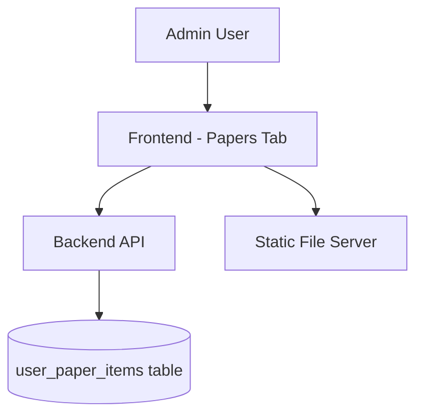
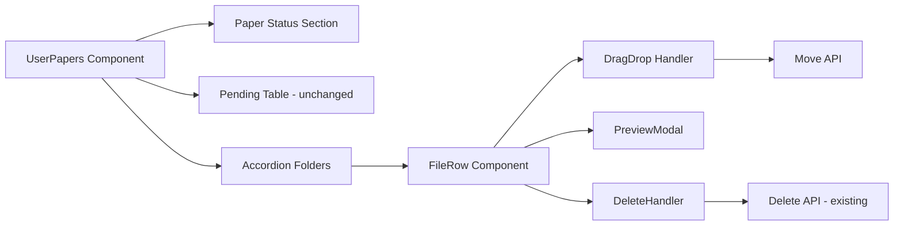
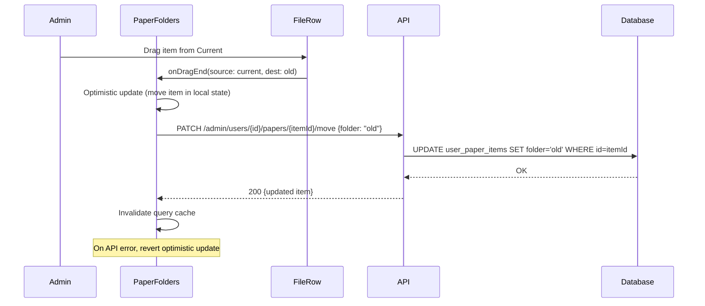
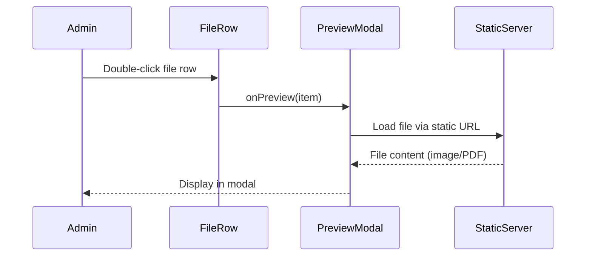

# Design Document: User Papers Folder View

## Overview

This feature replaces the flat "Processed papers" table in the admin user papers tab with an accordion-based folder view. Processed paper items are categorized into three folders (Current, Old, Rejected) using a new `folder` column on the `user_paper_items` table. The frontend uses Mantine's Accordion component with `@hello-pangea/dnd` for drag-and-drop between Current and Old folders. A preview modal renders images and PDFs inline on double-click.

### Design Goals
- Clear visual separation of current, outdated, and rejected documents
- Intuitive drag-and-drop reclassification between Current and Old folders
- Quick file verification via in-modal preview without leaving the page
- Minimal backend changes — single new column and one new API endpoint

### Key Design Decisions
- **Accordion over Kanban/Tabs**: Vertical accordion matches the existing page layout (scroll-inside-tab pattern) and provides better information density for a file-explorer-like experience
- **`@hello-pangea/dnd` reuse**: Already used in `workplace_position.tsx` — avoids adding a new dependency
- **New `folder` column vs. derived logic**: Explicit `folder` column gives admins manual control over classification, which was the user's stated preference over automatic derivation from timestamps
- **Optimistic UI for drag-and-drop**: Move the item visually first, then call the API. Revert on failure for a responsive feel
- **PDF preview via `<iframe>`**: Browsers natively render PDFs in iframes — no extra library needed

## Architecture

### System Context



### High-Level Architecture



## Components and Interfaces

### Component 1: PaperFolders (Accordion Container)

**Purpose**: Renders the three collapsible folder sections and manages drag-and-drop context.

**Responsibilities**:
- Group processed `UserPaperItem[]` into three lists by `folder` field
- Render Mantine `Accordion` with three `Accordion.Item` sections
- Wrap content in `DragDropContext` from `@hello-pangea/dnd`
- Handle `onDragEnd` to trigger folder move API
- Manage optimistic state updates and rollback on error

**Interfaces**:
- **Input**: `processedItems: UserPaperItem[]`, `userId: string`, `canDelete: boolean`
- **Output**: Rendered accordion with draggable file rows
- **Dependencies**: `@hello-pangea/dnd`, Mantine Accordion, `useMoveUserPaperMutation`

**Implementation Notes**:
- Each `Accordion.Item` wraps a `Droppable` area with `droppableId` matching the folder name (`current`, `old`, `rejected`)
- The `rejected` droppable has `isDropDisabled={true}` to prevent drops
- Items inside `rejected` folder are not wrapped in `Draggable` to prevent drag initiation
- `Accordion` uses `multiple` mode with `defaultValue={['current']}` so Current is expanded by default

### Component 2: FileRow (Draggable File Item)

**Purpose**: Renders a single paper item as a file-explorer-style row with metadata and actions.

**Responsibilities**:
- Display file-type icon, file name, paper type (translated), upload date, delete button
- Handle double-click to open preview modal
- Serve as a `Draggable` item within the drag-and-drop context (except in Rejected folder)

**Interfaces**:
- **Input**: `item: UserPaperItem`, `index: number`, `isDraggable: boolean`, `canDelete: boolean`, `onPreview: (item) => void`, `onDelete: (id) => void`
- **Output**: Rendered row with drag handle, metadata, and action button
- **Dependencies**: Mantine components (`Flex`, `Text`, `ActionIcon`), `react-icons`, `EnumHelper`, `DateHelper`

**Implementation Notes**:
- File icon determined by extension: `.jpg/.jpeg/.png/.gif/.webp` → image icon (`LuImage`), `.pdf` → document icon (`LuFileText`), others → generic file icon (`LuFile`)
- Row has `onDoubleClick` handler that calls `onPreview(item)`
- Drag handle icon (`LuGripVertical`) only visible when `isDraggable` is true
- Row uses `cursor: grab` when draggable, `cursor: default` when not

### Component 3: PreviewModal

**Purpose**: Displays image or PDF files inline in a modal dialog.

**Responsibilities**:
- Render image files using `` tag scaled to fit modal
- Render PDF files using `<iframe>` with the static file URL
- Show file name and paper type in the modal header
- Show download link for unsupported file types

**Interfaces**:
- **Input**: `opened: boolean`, `onClose: () => void`, `item: UserPaperItem | null`
- **Output**: Modal with file preview
- **Dependencies**: Mantine `Modal`, `UrlHelper`

**Implementation Notes**:
- Modal size: `xl` for images, `90%` width for PDFs (to give enough space for document viewing)
- Image: ``
- PDF: `<iframe src={staticUrl} style={{ width: '100%', height: '80vh', border: 'none' }} />`
- File type detection uses `file_name` extension via a simple helper function

### Component 4: Move API Hook (useMoveUserPaperMutation)

**Purpose**: Sends a PATCH request to update a paper item's folder assignment.

**Responsibilities**:
- Call the backend move endpoint
- Invalidate the `user-papers` query cache on success

**Interfaces**:
- **Input**: `userId: string` (closure), mutation data `{ itemId: number, folder: string }`
- **Output**: Promise resolving to API response
- **Dependencies**: `@tanstack/react-query`, `ApiHelper`

## Data Models

### Entity 1: UserPaperItem (Updated)

```typescript
// frontend/src/types/models/user_paper.d.ts
export interface UserPaperItem {
    id: number;
    user_paper_id: number;
    type: string;
    file_name: string;
    file_path: string;
    approved_at: string | null;
    rejected_at: string | null;
    created_at: string;
    folder: 'current' | 'old' | 'rejected' | null; // NEW — null for pending items
}
```

**Validation Rules**:
- `folder` must be one of: `current`, `old`, `rejected`, or `null`
- `folder` is `null` when the item has no `approved_at` and no `rejected_at` (pending)
- Moving to/from `rejected` folder is disallowed at the API level

**Relationships**:
- Belongs to `UserPaper` via `user_paper_id`

### Entity 2: UserPaperItemFolder (Backend Enum)

```php
// backend/app/Enums/UserPaperItemFolder.php
enum UserPaperItemFolder: string
{
    case Current = 'current';
    case Old = 'old';
    case Rejected = 'rejected';
}
```

### Data Flow





## API Design

### Endpoint 1: Move Paper Item to Folder

**Method**: `PATCH`
**Path**: `/api/admin/users/{user}/papers/{userPaperItem}/move`

**Request**:
```json
{
    "folder": "old"
}
```

**Response**:
```json
{
    "data": {
        "id": 42,
        "user_paper_id": 10,
        "type": "PASSPORT",
        "file_name": "passport.pdf",
        "file_path": "papers/abc123.pdf",
        "approved_at": "2025-01-15T10:00:00Z",
        "rejected_at": null,
        "created_at": "2025-01-10T08:00:00Z",
        "folder": "old"
    }
}
```

**Error Responses**:
- `403 Forbidden`: Admin lacks `USER_PAPER_APPROVE` permission
- `422 Unprocessable Entity`: Attempted to move to/from `rejected` folder, or item is still pending

**Validation Rules**:
- `folder` must be `current` or `old` (reject if `rejected`)
- Item's current `folder` must not be `rejected`
- Item must have either `approved_at` or `rejected_at` set (not pending)

### Existing Endpoints (Unchanged)

- `GET /api/admin/users/{user}/papers` — Returns `UserPaperWithItems` including the new `folder` field
- `POST /api/admin/users/{user}/papers/approve` — Updated to set `folder` automatically (approved → `current`, rejected → `rejected`)
- `DELETE /api/admin/users/{userId}/papers/{id}` — No changes needed

## Security Considerations

### Authentication
- All endpoints require authenticated admin session (existing middleware)

### Authorization
- Move operation requires `USER_PAPER_APPROVE` permission (same permission as the approve workflow, since it's reclassifying approved documents)
- Delete still requires `USER_PAPER_DELETE` permission

### Data Protection
- No new sensitive data introduced; `folder` is a classification label
- File URLs served through existing static URL mechanism with no changes

### Input Validation
- `folder` value validated against `UserPaperItemFolder` enum
- Backend prevents moving rejected items (server-side enforcement, not just frontend)

## Error Handling

### Drag and Drop Errors

| Scenario | Handling |
|----------|----------|
| API call fails during move | Revert item to original folder in local state, show error notification |
| Drop on rejected folder | `isDropDisabled` prevents the drop; no API call made |
| Drag from rejected folder | Items not wrapped in `Draggable`; drag cannot initiate |
| Network timeout | React Query retry policy applies; optimistic state reverted after final failure |

### Preview Errors

| Scenario | Handling |
|----------|----------|
| Image fails to load | Show broken image placeholder with file name and download link |
| PDF fails to load in iframe | Show fallback message with download link to open in new tab |
| Unsupported file type | Show file name with download link (no inline preview attempted) |

### Delete Errors

| Scenario | Handling |
|----------|----------|
| Delete API fails | Show error notification, keep item in folder (existing behavior) |
| Delete succeeds | Show success notification, remove item from folder, update count |

## Performance Considerations

### Expected Load
- Typical user has 5-15 paper items across all folders
- Maximum expected: ~50 items (unlikely but possible for long-tenured users with multiple resubmissions)

### Optimization Strategies
- **No pagination needed**: Item count is always small enough for a single render
- **Optimistic updates**: Drag-and-drop feels instant; no loading spinner needed
- **Lazy file preview**: Files are only fetched when the preview modal opens (not preloaded)
- **Single query**: All folders populated from the same `useGetUserPapersQuery` — no additional API calls for folder separation

## Testing Strategy

### Unit Tests

**PaperFolders grouping logic:**
- Items with `folder: 'current'` appear in Current section
- Items with `folder: 'old'` appear in Old section
- Items with `folder: 'rejected'` appear in Rejected section
- Items with `folder: null` are excluded (they appear in the pending table)
- Empty folders show count of 0

**FileRow rendering:**
- Correct icon displayed for jpg, png, pdf, and unknown extensions
- Paper type label is translated
- Date formatted with FORMAT_TIMESTAMP
- Delete button disabled when `canDelete` is false
- Drag handle hidden when `isDraggable` is false

**PreviewModal:**
- Image rendered for image extensions
- Iframe rendered for PDF extension
- Download link rendered for other extensions

### Integration Tests

**Backend - MovePaperItemAction:**
- Move from `current` to `old` succeeds
- Move from `old` to `current` succeeds
- Move from/to `rejected` returns 422
- Move pending item (no approved_at/rejected_at) returns 422
- Unauthenticated request returns 401
- Missing `USER_PAPER_APPROVE` permission returns 403

**Backend - ApprovePapersAction (updated):**
- Approved items get `folder: 'current'`
- Rejected items get `folder: 'rejected'`

### Test Configuration

```typescript
// Test helper for creating mock paper items
const createMockPaperItem = (overrides: Partial<UserPaperItem> = {}): UserPaperItem => ({
    id: 1,
    user_paper_id: 1,
    type: 'PASSPORT',
    file_name: 'passport.pdf',
    file_path: 'papers/test.pdf',
    approved_at: '2025-01-15T10:00:00Z',
    rejected_at: null,
    created_at: '2025-01-10T08:00:00Z',
    folder: 'current',
    ...overrides,
});
```
