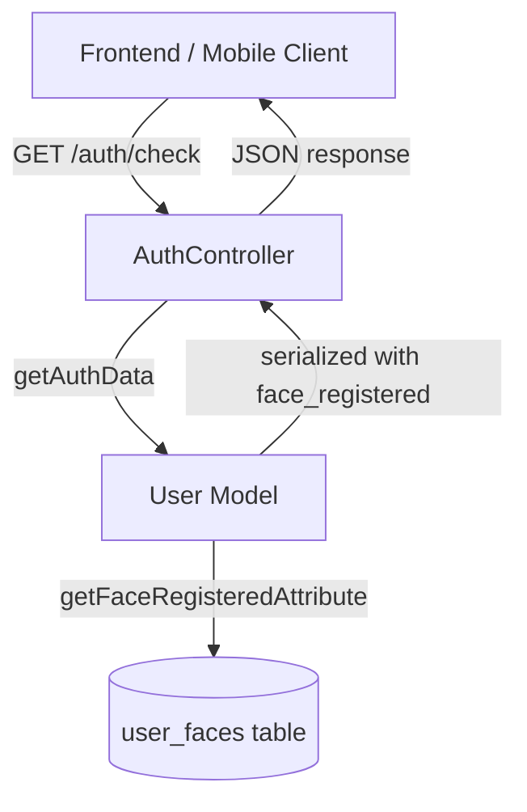
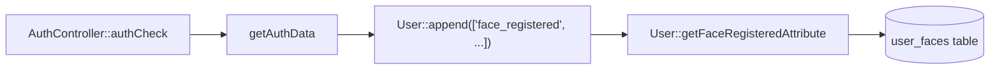
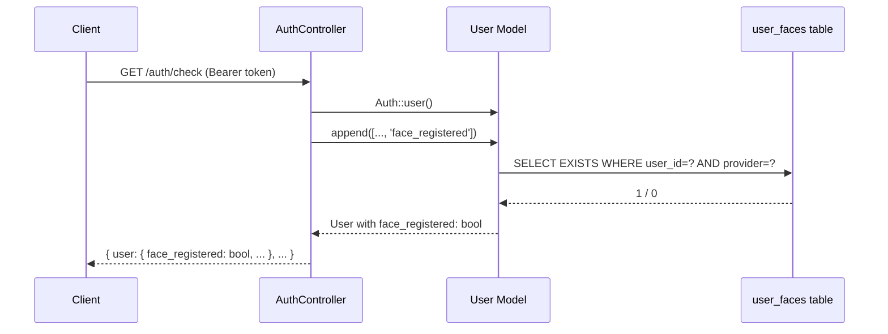

# Design Document: Include face_registered in /auth/check Response

## Overview

The implementation requires a single-line change in `AuthController::getAuthData()`: adding `'face_registered'` to the array of attributes appended to the `User` model before it is serialized into the response. The `getFaceRegisteredAttribute()` accessor on the `User` model already implements the correct logic (querying `UserFace` records for the current provider). No new components, database queries beyond the existing accessor, or data models are needed.

### Design Goals
- Minimal change — add `face_registered` to the existing `append()` call in `getAuthData()`
- Consistency — match the pattern used by `UserService::listUsers()` for `/admin/users`
- No frontend changes required

### Key Design Decisions
- **Append alongside existing attributes**: `face_registered` is added to the same `$user->append([...])` call in the `else` branch of `getAuthData()`, keeping the code consistent with how other dynamic attributes (`student_card_expiry_alert`, etc.) are appended
- **Reuse existing accessor**: No new logic is introduced; the existing `getFaceRegisteredAttribute()` is relied upon, avoiding duplication

### API Change Summary

**Before (GET /auth/check `user` object):**
```json
{
    "user": {
        "id": 1,
        "name": "NGUYEN VAN A",
        "student_card_expiry_alert": false,
        "residence_card_expiry_alert": false,
        "passport_expiry_alert": false
    },
    "roles": ["user"],
    "master": {},
    "unread_notifications": 0
}
```

**After:**
```json
{
    "user": {
        "id": 1,
        "name": "NGUYEN VAN A",
        "student_card_expiry_alert": false,
        "residence_card_expiry_alert": false,
        "passport_expiry_alert": false,
        "face_registered": true
    },
    "roles": ["user"],
    "master": {},
    "unread_notifications": 0
}
```

## Architecture

### System Context

The `/auth/check` endpoint is called by the frontend after login to hydrate user session state. The change adds one additional boolean field to an existing response with no architectural impact.



### High-Level Architecture



## Components and Interfaces

### Component 1: AuthController

**Purpose**: Handles auth check logic and assembles user context data for the response.

**Responsibilities**:
- Authenticate the request and verify the user role
- Call `getAuthData()` to build the response payload
- Append dynamic attributes to the `User` model before serialization

**Interfaces**:
- **Input**: Authenticated `User` instance via `Auth::user()`
- **Output**: JSON response containing `user`, `roles`, `master`, `unread_notifications`
- **Dependencies**: `User` model, `AuthService`, `NotificationService`

**Implementation Notes**:
- Change is confined to line 287 of `backend/app/Http/Controllers/AuthController.php`
- Add `'face_registered'` to the existing `$user->append([...])` call inside the `else` branch of `getAuthData()`

### Component 2: User Model

**Purpose**: Computes whether the user has a registered face for the current provider via a dynamic accessor.

**Responsibilities**:
- Query `user_faces` records filtered by `config('services.face_recognition.provider')`
- Return `true` if a matching record exists, `false` otherwise

**Interfaces**:
- **Input**: None (uses model's `userFaces()` `HasMany` relationship)
- **Output**: `bool`
- **Dependencies**: `UserFace` model, `services.face_recognition.provider` config value

**Implementation Notes**:
- No changes needed — `getFaceRegisteredAttribute()` already implements the correct logic

## Data Models

### Accessor: face_registered

```typescript
// frontend/src/types/models/user.d.ts (existing — no changes needed)
interface User {
    // ...existing fields...
    face_registered: boolean;
}
```

**Validation Rules**:
- Always a boolean — never null or undefined
- Determined at query time via EXISTS check; not stored on the `users` table

**Relationships**:
- Backed by the `user_faces` table via the `userFaces()` `HasMany` relationship on `User`

### Data Flow



## API Design

### Endpoint: GET /auth/check

**Method**: `GET`
**Path**: `/auth/check`
**Auth**: Bearer token (unchanged)

**Response (200 OK)**:
```json
{
    "user": {
        "id": 1,
        "name": "NGUYEN VAN A",
        "student_card_expiry_alert": false,
        "residence_card_expiry_alert": false,
        "passport_expiry_alert": false,
        "face_registered": true
    },
    "roles": ["user"],
    "master": {},
    "unread_notifications": 0
}
```

**Error Responses** (unchanged):
- `401 Unauthorized`: Unauthenticated request
- `403 Forbidden`: User does not have the regular user role

## Security Considerations

### Authentication
- Requires a valid Bearer token — unchanged from current behavior

### Authorization
- `face_registered` is only included for regular users (the `else` branch in `getAuthData()` excludes managers)

### Data Protection
- `face_registered` is a non-sensitive boolean; no PII is exposed

### Input Validation
- No new inputs — the change is purely in response construction

## Error Handling

### Accessor Errors

| Scenario | Handling |
|----------|----------|
| `services.face_recognition.provider` config is null/empty | `user_faces` WHERE clause matches nothing → `face_registered: false` |
| `user_faces` table query fails (DB error) | Laravel propagates exception → 500 response (existing behavior, unchanged) |

## Performance Considerations

### Expected Load
- Same as current `/auth/check` traffic
- One additional EXISTS query on `user_faces` per request

### Optimization Strategies
- The EXISTS query is lightweight; no caching strategy needed
- Assumes `user_faces` has an index on `(user_id, provider)` — standard for this access pattern

## Testing Strategy

### Unit Tests

**AuthController (`tests/Feature/Auth/AuthCheckTest.php` or equivalent):**
- `face_registered: true` is returned when user has a `UserFace` record matching the current provider
- `face_registered: false` is returned when user has no matching `UserFace` record
- `face_registered` is absent from the `/auth/check-manager` response (manager path unchanged)

### Integration Tests
- Authenticated regular user calling `GET /auth/check` receives `face_registered` in the `user` object
- The returned value reflects the actual `user_faces` table state
