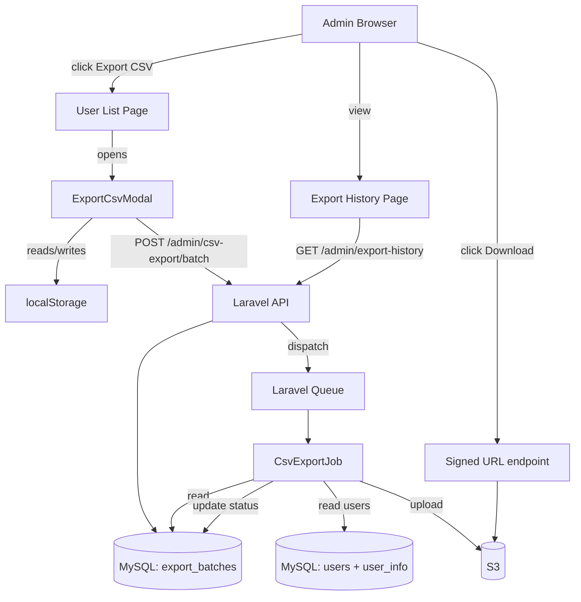
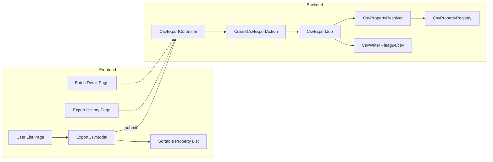
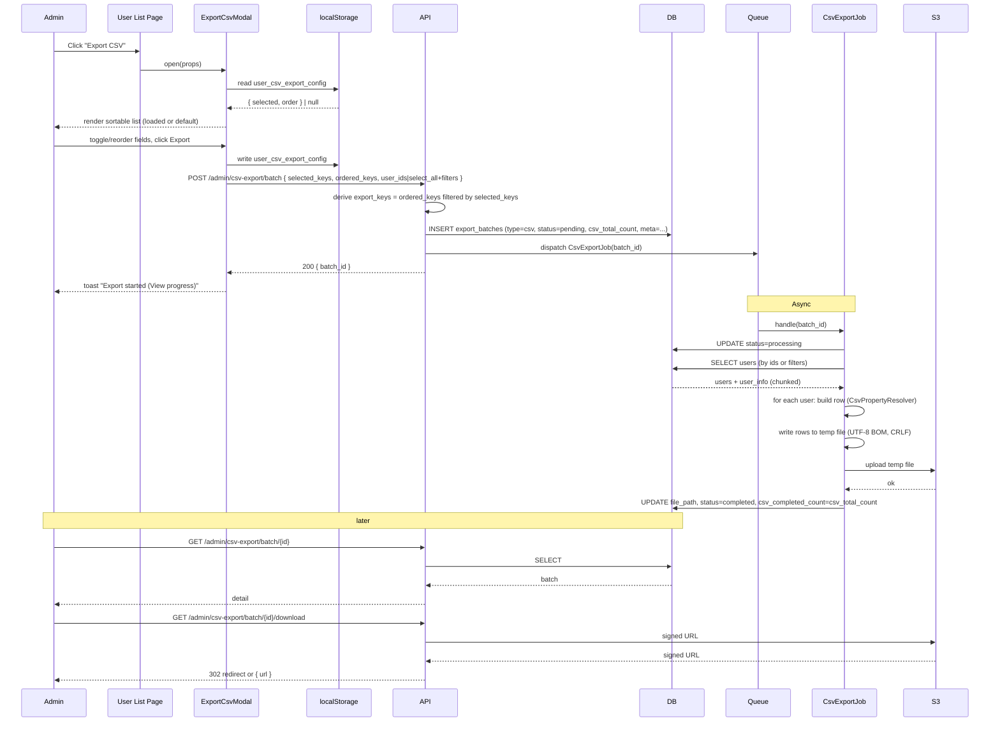

# Design Document: User CSV Export

## Overview

The User CSV Export feature lets administrators generate a single CSV file containing one row per user, with admin-selected columns drawn from the same set displayed on the user detail Information tab. The implementation reuses the existing `ExportBatch` table and queue infrastructure already powering PDF export, distinguishing batches via a new `type` column (`pdf` | `csv`). The frontend introduces an "Export CSV" button on the user list, a sortable property-selection modal whose state is persisted to localStorage, and an upgraded Export History page that lists both batch types behind a single Type filter. The Export History sidebar entry is moved from the "PDF Template" group to the "User" group to reflect its new cross-format scope.

### Design Goals

- **Reuse over rewrite**: extend `ExportBatch` and the existing async pipeline rather than introducing parallel infrastructure.
- **Predictable file format**: UTF-8 + BOM, CRLF, RFC 4180, always-Japanese headers — files are deterministic regardless of admin locale.
- **Fail closed on partial output**: a CSV that's missing rows is dangerous, so failures abort the file rather than upload a partial.
- **No new sources of truth**: the canonical property list is defined once in backend code (`CsvPropertyRegistry`); frontend reads it from an API and derives its default config from that response.
- **Whitelisted data access**: user-controlled property keys are validated against the registry before any DB read; arbitrary column injection is impossible.

### Key Design Decisions

- **Single `ExportBatch` table with a `type` column.** A new migration adds `type ENUM('pdf','csv') NOT NULL DEFAULT 'pdf'`, backfilling existing rows to `'pdf'`. The CSV-specific config (selected fields, order, user-selection payload) is stored in a new `meta` JSON column. _See `decisions.md#q1`._
- **Sibling modal, not shared modal.** `ExportCsvModal` is a new component next to `ExportPdfModal` rather than a polymorphic modal — the bodies have nothing in common (template picker vs sortable property list). _See `decisions.md#q5`._
- **`league/csv` writer with `setOutputBOM(BOM::UTF8)`.** Already in `composer.json`. Avoids hand-rolled escaping. _See `decisions.md#q10`._
- **No `ExportBatchItem` rows for CSV.** A CSV is a single transactional artifact. `csv_total_count` is set at batch creation; `csv_completed_count` mirrors it on success; per-item progress is meaningless for CSV. The public `total_count`, `completed_count`, and `failed_count` accessors keep their existing names, but for CSV rows they read from the CSV-specific stored columns. _See `decisions.md#q11`._
- **Always-Japanese headers from a backend translation map.** Headers are not derived from the request locale; they come from a `[propertyKey => japanese label]` map in the `CsvPropertyRegistry`. _See `decisions.md#q8`._
- **localStorage stores `{ selected: string[], order: string[] }` under one well-known key.** No multi-preset support; "Reset to default" replaces in-modal state but doesn't touch localStorage until submit. _See `decisions.md#q3`._
- **Drag-and-drop via `@hello-pangea/dnd`.** The frontend already depends on `@hello-pangea/dnd` and uses it for reorderable admin UI, so the CSV modal reuses that library instead of adding a second DnD dependency.

## Architecture

### System Context



### High-Level Architecture



## Components and Interfaces

### Component 1: CsvPropertyRegistry (backend)

**Purpose**: Single source of truth for the list of CSV-exportable user properties.

**Responsibilities**:
- Declare the 31 canonical property keys, their Japanese header labels, their data source (`User` field, `UserInfo` field, or computed), and their value type (`string` | `date` | `enum:GenderEnum` | `boolean`).
- Expose a method to validate a list of user-supplied keys (used by request validation).
- Provide a static ordered list used by the frontend to derive `Default_Csv_Config`.

**Interfaces**:
- **Input**: none for read; key list for `validateKeys()`.
- **Output**: `array<string, CsvPropertyDefinition>`, ordered.
- **Dependencies**: PHP enum classes (`GenderEnum`, `NationalityEnum`, `JapaneseLevelEnum`, `ResidenceStatusEnum`).

**Implementation Notes**:
- Lives at `backend/app/Services/Csv/CsvPropertyRegistry.php`.
- Property definitions are inline PHP arrays — no DB table — so adding a new field is a one-line code change reviewed via PR.

### Component 2: CsvExportController (backend)

**Purpose**: HTTP entry points for creating CSV exports and listing/downloading them.

**Responsibilities**:
- `POST /admin/csv-export/batch` — validate request, derive `export_keys`, create `ExportBatch`, dispatch `CsvExportJob`.
- `GET /admin/csv-export/batch/{id}` — return CSV-specific batch detail.
- `GET /admin/csv-export/batch/{id}/download` — return a signed S3 URL for the generated file.
- The unified `GET /admin/export-history` endpoint (existing controller, extended) returns both PDF and CSV batches with optional `?type=` filter.

**Interfaces**:
- **Input**: validated FormRequests (`CreateCsvExportRequest`, etc.).
- **Output**: JSON responses.
- **Dependencies**: `CreateCsvExportAction`, `CsvPropertyRegistry`, Laratrust middleware.

**Implementation Notes**:
- Permission middleware: backend permission value `user.csv.export` (frontend key `USER_EXPORT_CSV`) on property registry, POST, CSV detail, and CSV download.
- Lives at `backend/app/Http/Controllers/Admin/CsvExportController.php`.

### Component 3: CreateCsvExportAction (backend)

**Purpose**: Encapsulate the transactional creation of an `ExportBatch` and dispatch of the job.

**Responsibilities**:
- Validate property keys against `CsvPropertyRegistry`.
- Resolve `total_count` from either `user_ids.length` or a count query against the `select_all + filters` payload.
- Derive `export_keys` from request data as `ordered_keys` filtered to keys present in `selected_keys`; the frontend does not send `export_keys`.
- Insert one `ExportBatch` row with `type=csv`, `status=pending`, `meta` JSON containing `{ selected_keys, ordered_keys, export_keys, user_ids, select_all, filters }`.
- Dispatch `CsvExportJob` onto the existing queue.

**Interfaces**:
- **Input**: `CsvExportRequestDto { selected_keys, ordered_keys, user_ids?, select_all, filters? }`.
- **Output**: `ExportBatch`.
- **Dependencies**: `ExportBatch` model, `CsvPropertyRegistry`, queue.

**Implementation Notes**:
- Wraps `ExportBatch::create()` and `dispatch(...)` in a DB transaction so a job is never enqueued without a row.
- Lives at `backend/app/Actions/Csv/CreateCsvExportAction.php`.

### Component 4: CsvExportJob (backend)

**Purpose**: Asynchronously generate the CSV file and upload to S3.

**Responsibilities**:
- Set batch status to `processing`.
- Resolve target users from `meta.user_ids` or by re-applying `meta.filters` (paginated/chunked read).
- For each user, build a row by calling `CsvPropertyResolver` for each `export_keys` entry.
- Write rows via `league/csv` to a temp file (UTF-8 + BOM, CRLF) until complete.
- Upload temp file to S3 at `csv-exports/{batch_id}/users_export_{timestamp}.csv`. Retry up to 3× on transient errors.
- Update `ExportBatch.file_path`, `completed_count = total_count`, `status = completed`.
- On any unrecoverable error, set `status = failed` with `error_message`, delete temp file, do NOT upload.

**Interfaces**:
- **Input**: `ExportBatch` ID.
- **Output**: side effects (S3 file, DB updates).
- **Dependencies**: `CsvPropertyResolver`, `CsvPropertyRegistry`, S3 driver, league/csv.

**Implementation Notes**:
- `tries = 3`, `backoff = [10, 30, 60]` seconds.
- User chunking: read 500 users at a time using `User::query()->whereIn('id', ...)->cursor()` to bound memory.
- Temp file at `storage/app/tmp/csv-exports/{batch_id}.csv`; cleanup in `finally`.
- Lives at `backend/app/Jobs/CsvExportJob.php`.

### Component 5: CsvPropertyResolver (backend)

**Purpose**: Convert a `(User, propertyKey)` pair to a CSV-cell string.

**Responsibilities**:
- Look up the property definition in `CsvPropertyRegistry`.
- Read the value from `User` or `User->info` based on the definition.
- Format by type: `date` → `Y/m/d`, `enum:X` → translated Japanese label via `EnumHelper`, `boolean` → `はい`/`いいえ`/empty, `string` → as-is.
- Return empty string for null.

**Interfaces**:
- **Input**: `User`, `string $propertyKey`.
- **Output**: `string`.
- **Dependencies**: `CsvPropertyRegistry`, `EnumHelper`-equivalent.

**Implementation Notes**:
- Pure function; easy to unit-test.
- Lives at `backend/app/Services/Csv/CsvPropertyResolver.php`.

### Component 6: ExportCsvModal (frontend)

**Purpose**: Modal dialog for selecting/reordering CSV columns and submitting the export.

**Responsibilities**:
- On open, load `Csv_Export_Config` from localStorage; if absent or invalid, fall back to the default config derived from the backend registry response.
- Render a sortable list (one row per property in the canonical list) with checkboxes + drag handles.
- Provide "Reset to default" button (replaces in-modal state with a default config derived from the backend registry response).
- Disable Export button if zero properties selected or `userCount === 0`.
- On Export click, persist the current state to localStorage and call `useCreateCsvExportMutation`.
- On success, close the modal and toast a "View progress" link to the new batch detail page.

**Interfaces**:
- **Input** (props, identical shape to `ExportPdfModal`): `{ isOpened, onClose, selectedUserIds, selectAll, totalUsers, filters }`.
- **Output**: side effect (POST to API).
- **Dependencies**: `useCreateCsvExportMutation`, `@hello-pangea/dnd`, Mantine.

**Implementation Notes**:
- Lives at `frontend/src/pages/admin/user/partials/export_csv_modal.tsx`.
- Sortable rows use `DragDropContext`, `Droppable`, and `Draggable` from `@hello-pangea/dnd`, following the existing pattern in `frontend/src/pages/admin/workplace/partials/workplace_position.tsx`.
- localStorage key: `user_csv_export_config`.

### Component 7: Updated Export History Page (frontend)

**Purpose**: Unified history list for both PDF and CSV batches.

**Responsibilities**:
- Add a Type column (badge: PDF / CSV) and a Type filter (select: All / PDF / CSV).
- Hide/disable the existing template_id filter when Type === 'csv'.
- Render Template column as `-` for CSV rows.
- Link "View" to `ADMIN_PDF_EXPORT_BATCH_DETAIL` for PDF rows and a new `ADMIN_CSV_EXPORT_BATCH_DETAIL` route for CSV rows.

**Interfaces**:
- **Input**: query params `{ type?, template_id?, page }`.
- **Output**: rendered table.
- **Dependencies**: existing `useGetExportHistoryQuery` (extended to accept `type`).

**Implementation Notes**:
- Page file moves to `frontend/src/pages/admin/user/export-history/index.page.tsx` and route path becomes `/admin/user/export-history`. The old `/admin/pdf-template/export-history` route may be kept temporarily as a redirect/alias for existing links, but new navigation and route constants should use the user-export-history path.

### Component 8: CSV Batch Detail Page (frontend)

**Purpose**: Render details for a single CSV batch, including the download action.

**Responsibilities**:
- Display: ID, status badge, exported_by, total_count, created_at, completed_at, error_message (if failed), selected_keys/ordered_keys (in submission order, as a chip list), user-selection summary (specific N users vs select_all + filters).
- "Download CSV" button enabled only when `status === completed`. Clicking calls the signed-URL endpoint and triggers a download.
- Auto-poll while status is pending/processing (consistent with PDF detail page).

**Interfaces**:
- **Input**: route param `id`.
- **Output**: rendered detail view.
- **Dependencies**: `useGetCsvExportBatchQuery`, `useGetCsvExportDownloadUrlMutation`.

**Implementation Notes**:
- Lives at `frontend/src/pages/admin/csv-export/batch/[id].page.tsx` (new directory).

### Component 9: Sidebar Reorganization (frontend)

**Purpose**: Move "Export history" from "PDF Template" group to "User" group.

**Responsibilities**:
- In `frontend/src/configs/sidebar.config.ts`:
    - Add `{ route: ADMIN_USER_EXPORT_HISTORY, customName: 'Export history', icon: LuHistory }` to the "User" group, after "Face registration".
    - Remove the same entry from the "PDF Template" group.
- Update breadcrumbs on `export-history/index.page.tsx` and the detail pages: `Home → Users → Export history`.

**Interfaces**:
- **Input**: none.
- **Output**: rendered sidebar.

**Implementation Notes**:
- Rename the primary route constant to `ADMIN_USER_EXPORT_HISTORY` with path `/admin/user/export-history`; keep `ADMIN_PDF_EXPORT_HISTORY` only as a temporary compatibility alias or redirect if needed.

## Data Models

### Entity 1: ExportBatch (extended)

```typescript
// backend/app/Models/ExportBatch.php (PHP — TS shape shown for clarity)
interface ExportBatch {
    id: number;
    type: 'pdf' | 'csv';                       // NEW
    pdf_template_id: number | null;            // NULLABLE for csv (was NOT NULL)
    exported_by: number;
    status: 'pending' | 'processing' | 'completed' | 'failed';
    file_path: string | null;                  // NEW: single CSV S3 path; null for PDF (PDF uses zip_file_paths)
    zip_file_paths: string[] | null;           // existing PDF-only
    error_message: string | null;              // NEW: CSV failure messages (existing export_batch_items also has error_message for per-item PDF failures)
    total_count: number;                       // public accessor: csv stored value, pdf derived from items
    completed_count: number;                   // public accessor: csv stored value, pdf derived from items
    failed_count: number;                      // public accessor: csv stored value, pdf derived from items
    csv_total_count: number;                   // NEW: stored authoritative count for csv rows
    csv_completed_count: number;               // NEW: stored authoritative count for csv rows
    csv_failed_count: number;                  // NEW: stored authoritative count for csv rows
    meta: {                                    // NEW: JSON column for type-specific config
        // csv-specific:
        selected_keys?: string[];              // checked keys
        ordered_keys?: string[];               // all canonical keys in user-defined order
        export_keys?: string[];                // selected_keys sorted by ordered_keys; actual CSV columns
        user_ids?: number[];
        select_all?: boolean;
        filters?: Record<string, string>;
    } | null;
    created_at: string;
    updated_at: string;
}
```

**Validation Rules**:
- `type` ∈ {'pdf', 'csv'}.
- For `type=csv`: `pdf_template_id` must be null; `meta.ordered_keys` must be a non-empty subset of registry keys; `meta.selected_keys` must be a non-empty subset of `meta.ordered_keys`.
- For `type=pdf`: `pdf_template_id` must be set.

**Relationships**:
- `belongsTo PdfTemplate` (nullable for csv).
- `hasMany ExportBatchItem` — only populated for `type=pdf`.
- `belongsTo User as exporter`.

### Entity 2: CsvPropertyDefinition (PHP DTO, in registry)

```typescript
// backend/app/Services/Csv/CsvPropertyDefinition.php
interface CsvPropertyDefinition {
    key: string;                  // e.g., 'birthday'
    label_ja: string;             // e.g., '生年月日'
    source: 'user' | 'user_info'; // which model/relation to read from
    column: string;               // DB column name on that model
    type: 'string' | 'date' | 'boolean' | `enum:${string}`;
}
```

### Entity 3: localStorage Csv_Export_Config (frontend)

```typescript
// frontend/src/pages/admin/user/partials/export_csv_modal.tsx
interface CsvExportConfig {
    selected: string[];   // subset of canonical keys, currently checked
    order: string[];      // full canonical-key list in user-defined order (selected + unselected)
}
```

**Validation Rules**:
- On read: drop unknown keys, append missing canonical keys to end (deselected).
- On read: if JSON parse fails, fall back to the default config derived from the backend registry silently.

### Migration

```sql
-- backend/database/migrations/{ts}_extend_export_batches_for_csv.php
ALTER TABLE export_batches
    ADD COLUMN type ENUM('pdf','csv') NOT NULL DEFAULT 'pdf' AFTER id,
    ADD COLUMN file_path VARCHAR(500) NULL AFTER zip_file_paths,
    ADD COLUMN meta JSON NULL AFTER file_path,
    ADD COLUMN error_message TEXT NULL AFTER status,
    ADD COLUMN csv_total_count INT NOT NULL DEFAULT 0,
    ADD COLUMN csv_completed_count INT NOT NULL DEFAULT 0,
    ADD COLUMN csv_failed_count INT NOT NULL DEFAULT 0,
    MODIFY COLUMN pdf_template_id BIGINT UNSIGNED NULL;
-- existing rows get type='pdf' via the default; public *_count accessors keep using items() for pdf rows
```

> Note: The existing `ExportBatch` model already appends `total_count`, `completed_count`, and `failed_count` accessors. Do not add database columns with those same names because Eloquent accessor/appended-attribute behavior makes the implementation easy to misread and easy to break. Use CSV-specific stored columns (`csv_total_count`, `csv_completed_count`, `csv_failed_count`) and update the existing public accessors to return item counts for PDF rows and raw CSV-specific column values for CSV rows.

### Data Flow: CSV Export Submission



## API Design

### Endpoint 1: Create CSV Export Batch

**Method**: `POST`
**Path**: `/api/admin/csv-export/batch`
**Permission**: `USER_EXPORT_CSV`

**Request**:
```json
{
    "selected_keys": ["last_name", "first_name", "email"],
    "ordered_keys": ["last_name", "first_name", "last_name_kana", "first_name_kana", "..."],
    "user_ids": [12, 14, 27],
    "select_all": false,
    "filters": {}
}
```
or, for select_all:
```json
{
    "selected_keys": ["..."],
    "ordered_keys": ["..."],
    "select_all": true,
    "filters": { "search": "tanaka", "workplace_id": "5" }
}
```

**Response 200**:
```json
{
    "data": {
        "id": 1234,
        "type": "csv",
        "status": "pending",
        "meta": {
            "selected_keys": ["last_name", "first_name", "email"],
            "ordered_keys": ["last_name", "first_name", "last_name_kana", "..."],
            "export_keys": ["last_name", "first_name", "email"]
        },
        "total_count": 540,
        "created_at": "2026-05-03T10:21:00+09:00"
    }
}
```

**Error Responses**:
- `403 Forbidden`: missing `USER_EXPORT_CSV`.
- `422 Unprocessable Entity`: empty `selected_keys`, unknown keys, or both `user_ids` and `select_all=true` provided.

### Endpoint 2: Get CSV Batch Detail

**Method**: `GET`
**Path**: `/api/admin/csv-export/batch/{id}`
**Permission**: `USER_EXPORT_CSV`

**Response 200**:
```json
{
    "data": {
        "id": 1234,
        "type": "csv",
        "status": "completed",
        "total_count": 540,
        "completed_count": 540,
        "failed_count": 0,
        "exporter": { "id": 7, "name": "Yamada" },
        "meta": {
            "selected_keys": ["last_name", "first_name", "email"],
            "ordered_keys": ["last_name", "first_name", "..."],
            "export_keys": ["last_name", "first_name", "email"],
            "select_all": true,
            "filters": { "search": "tanaka" }
        },
        "file_path": "csv-exports/1234/users_export_20260503_102200.csv",
        "error_message": null,
        "created_at": "2026-05-03T10:21:00+09:00"
    }
}
```

### Endpoint 3: Download CSV

**Method**: `GET`
**Path**: `/api/admin/csv-export/batch/{id}/download`
**Permission**: `USER_EXPORT_CSV`

**Response 200**:
```json
{ "data": { "url": "https://s3...signed-url..." } }
```

**Error Responses**:
- `404 Not Found`: batch not found.
- `409 Conflict`: status not `completed`.

### Endpoint 4: List Export History (extended)

**Method**: `GET`
**Path**: `/api/admin/export-history`
**Permission**: `PDF_TEMPLATE_LIST` or `USER_EXPORT_CSV` (any history-viewing permission)

**Controller ownership**: Create a new `ExportHistoryController` (or equivalently move the existing `PdfExportController::exportHistory` logic into a shared action used by that controller) so the unified history endpoint is no longer conceptually owned by PDF export. The existing PDF history route can call the same action during migration, but the primary API/config naming should be export-history/user-export-history, not PDF-only.

**Query Params** (extended):
- `type`: `pdf` | `csv` (optional, omit for all)
- `template_id`: only meaningful with `type=pdf`
- `page`, `page_size`: existing

**Response**: existing format, `data` items now include `type` field. If the caller has only `PDF_TEMPLATE_LIST`, return only PDF rows. If the caller has only `USER_EXPORT_CSV`, return only CSV rows. If the caller has both permissions, return both row types unless a `type` filter is provided.

### Endpoint 5: Get CSV Property Registry (frontend bootstrap)

**Method**: `GET`
**Path**: `/api/admin/csv-export/properties`
**Permission**: `USER_EXPORT_CSV`

**Response 200**:
```json
{
    "data": [
        { "key": "last_name", "label_ja": "姓" },
        { "key": "first_name", "label_ja": "名" },
        ...
    ]
}
```

> Decision: backend returns the canonical property list rather than hardcoding it on the frontend so adding a property is a single backend change. Frontend uses its own translations (`t(...)`) for the in-modal display label, but the registry response confirms the keys are valid and supplies the Japanese label as a fallback for new keys not yet translated.

## Security Considerations

### Authentication
- All endpoints require an authenticated admin session via the existing auth middleware.

### Authorization
- `USER_EXPORT_CSV` permission gates: trigger button visibility, property registry endpoint, POST endpoint, CSV detail endpoint, and CSV download endpoint.
- Backend permission enum: `App\Enums\PermissionName::UserExportCsv = 'user.csv.export'`.
- Frontend permission enum: `PermissionNameEnum.USER_EXPORT_CSV = { value: 'user.csv.export', text: 'User CSV Export' }`, with `USER_EXPORT_CSV` added to the `PermissionName` union.
- Translation scanner entry: `t('role|user.csv.export')`.
- `PDF_TEMPLATE_LIST` gates PDF history rows and PDF batch detail visibility.
- `PDF_TEMPLATE_EXPORT` gates PDF export trigger and PDF download endpoints.
- Export History page is visible to users with either `PDF_TEMPLATE_LIST` or `USER_EXPORT_CSV`.
- Export History row visibility is permission-scoped: only PDF rows for PDF-only viewers, only CSV rows for CSV-only viewers, both row types for users with both permissions.
- Direct API calls must follow the same rules: list/detail endpoints return 403 when the caller lacks every relevant viewing permission, and download endpoints return 403 when the caller lacks the export/download permission for that batch type.

### Data Protection
- Generated CSV stored on S3 with no public ACL; downloads use signed URLs with TTL (e.g., 5 minutes), consistent with existing PDF download.
- Temp files in `storage/app/tmp/csv-exports/` deleted in `finally` block of the job.
- The `meta` JSON column may contain filter values; ensure no sensitive admin tokens are persisted there (filters are user-list filters only).

### Input Validation
- Property key whitelist via `CsvPropertyRegistry::validateKeys()`. Unknown keys → 422.
- `user_ids` validation matches the existing PDF export request: `array` of existing user IDs with no CSV-specific maximum. `select_all` uses the same filtered-user resolution behavior as PDF export.
- `filters` accepted as a string-keyed map; the same filter validation applied on the user list endpoint is reused.
- `select_all` and `user_ids` are mutually exclusive.

## Error Handling

### Request-time errors

| Scenario | Handling |
|----------|----------|
| User lacks `USER_EXPORT_CSV` | 403 Forbidden |
| `selected_keys` empty | 422 with field error: "Select at least one property" |
| Unknown property key | 422 with field error listing the unknown keys |
| `select_all=true` AND `user_ids` provided | 422: "Provide either user_ids or select_all, not both" |
| `select_all=false` AND `user_ids` empty | 422: "Select at least one user" |

### Job-time errors

| Scenario | Handling |
|----------|----------|
| User query throws | catch, set status=failed, error_message=exception message, no S3 upload |
| Row generation throws on a single user | catch, log, abort whole batch (failure semantics: all-or-nothing); status=failed |
| S3 upload fails | retry up to 3 times with exponential backoff; on final failure, status=failed |
| Worker crash (job killed) | Laravel queue retries up to 3 times; if all retries are exhausted, the job's `failed(Throwable $e)` handler sets status=failed |
| DB write of completion fails after S3 upload | log orphaned S3 object key for manual cleanup; mark batch failed |

### Download errors

| Scenario | Handling |
|----------|----------|
| Batch status ≠ completed | 409 Conflict with message |
| File not found on S3 | 404 with message; mark batch as failed |
| Signed URL generation fails | 500; log and surface generic error |

## Performance Considerations

### Expected Load
- **Concurrent batches**: existing queue handles ≥ 5 PDF jobs; CSV adds capacity demand only proportional to user count, not template complexity.
- **Typical CSV size**: 540 users × 31 columns × ~30 chars = ~500KB per file. Well under S3 single-PUT limits.
- **Upper bound considered**: 10,000 users → ~8MB file, completable within 60 seconds on the existing queue worker.

### Optimization Strategies
- Stream user records via `cursor()` (chunks of 500) rather than loading all into memory.
- Eager-load `user_info` to avoid N+1.
- Stream CSV rows directly to disk (league/csv writes incrementally) rather than building in memory.
- Use multipart upload only if file size exceeds 5MB (likely unnecessary at 10k users; keep simple single PUT).

### Frontend
- Property registry endpoint cached client-side via React Query (`staleTime: Infinity` — registry doesn't change at runtime).
- Sortable list handles 31 items; no virtualization needed.

## Testing Strategy

### Unit Tests

**`backend/tests/Unit/Services/Csv/CsvPropertyRegistryTest.php`:**
- Returns 31 canonical keys in the documented order.
- `validateKeys()` accepts known keys, rejects unknown keys.
- All keys map to a valid source/column/type.

**`backend/tests/Unit/Services/Csv/CsvPropertyResolverTest.php`:**
- String fields render as-is.
- Date fields render as `Y/m/d`; null → empty string.
- Enum fields render Japanese label via EnumHelper for each enum used.
- Boolean field renders はい/いいえ/empty for true/false/null.
- Comma, double quote, newline in values trigger correct RFC 4180 escaping (verified at writer level).

**`backend/tests/Unit/Jobs/CsvExportJobTest.php`:**
- Sets status to processing on start.
- Resolves users from `user_ids` payload.
- Resolves users from `select_all + filters` payload (mocked filter resolver).
- Writes UTF-8 + BOM + CRLF.
- Header row is Japanese, in `export_keys` order, matches `CsvPropertyRegistry` labels.
- On row resolution exception: status=failed, no S3 upload, temp file cleaned up.
- On S3 failure after retries: status=failed, no DB completion write.
- On success: file_path set, completed_count == total_count, status=completed.

### Integration Tests

**`backend/tests/Feature/Admin/CsvExportControllerTest.php`:**
- POST without permission → 403.
- POST with empty `selected_keys` → 422.
- POST with unknown key → 422.
- POST with both `select_all` and `user_ids` → 422.
- Successful POST creates ExportBatch with correct fields, dispatches job (assert on `Queue::fake()`), returns 200.
- GET detail returns batch with `meta` populated.
- GET download returns 409 when status≠completed; 200 with signed URL when completed.
- GET download without permission → 403.

**`backend/tests/Feature/Admin/ExportHistoryControllerTest.php`:**
- Returns both PDF and CSV rows for users with both viewing permissions.
- Returns PDF rows only for users with `PDF_TEMPLATE_LIST` but not `USER_EXPORT_CSV`.
- Returns CSV rows only for users with `USER_EXPORT_CSV` but not `PDF_TEMPLATE_LIST`.
- Filters correctly when `?type=csv` or `?type=pdf`.

**Frontend (vitest/react-testing-library, if existing):**
- `ExportCsvModal` renders rows in localStorage order when present, falls back to default when absent.
- Toggle checkbox updates in-modal state without writing to localStorage.
- Reset to default replaces in-modal state without writing to localStorage.
- Submit writes localStorage AND calls mutation.
- Drag-reorder updates the order array.
- Export button disabled when zero selected.

### End-to-End Tests (manual or Cypress, if existing)
- Login as admin with `USER_EXPORT_CSV` only → "Export PDF" hidden, "Export CSV" visible.
- Open modal, deselect 5 fields, drag one field to top, click Export. Verify toast appears with View progress link.
- Navigate to Export History under "User" sidebar group, filter Type=CSV, see new batch.
- Wait for completion, click Download, verify CSV opens in Excel with Japanese headers and correct values.

### Test Configuration

```php
// backend/phpunit.xml — already configured. New test directory:
// backend/tests/Unit/Services/Csv/
// backend/tests/Unit/Jobs/
// backend/tests/Feature/Admin/CsvExportControllerTest.php
// backend/tests/Feature/Admin/ExportHistoryControllerTest.php
```
