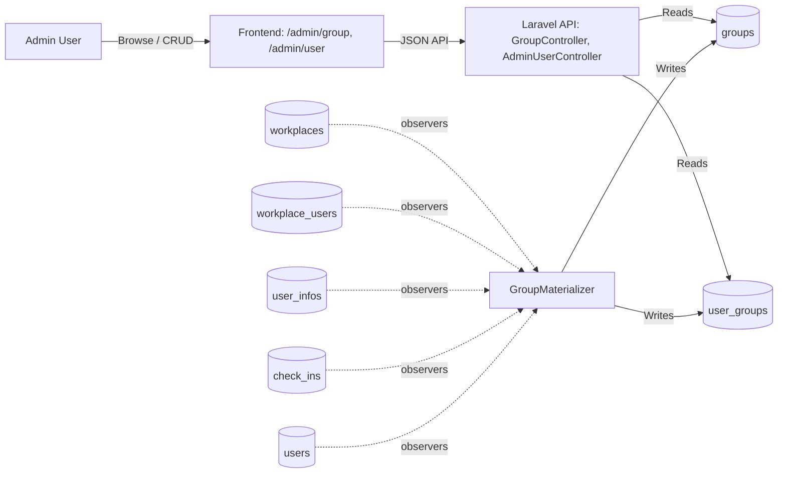
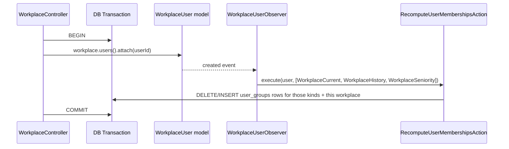
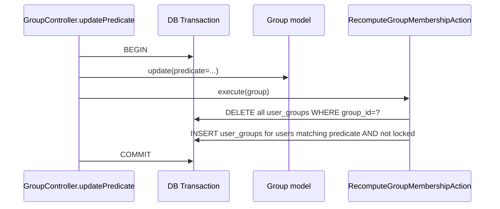

# Design Document: Employee Groups (Foundation)

## Overview

Introduce a single `groups` table that holds three kinds of group: **system** (auto-derived from existing data), **manual** (admin-curated members), and **rule_based** (admin-defined predicate). All memberships live in one `user_groups` join table. A `GroupMaterializer` service is the single writer to `user_groups`; it is invoked by Laravel **observers** on `Workplace`, `WorkplaceUser`, `UserInfo`, `ShiftUser`, and `User` and runs inside the triggering DB transaction so source data and membership cannot drift. The frontend gets a new `/admin/group` index + detail page, a Groups multi-select on `/admin/user`, and a Groups section on the user detail page. Display names for system groups are composed on the frontend via i18n keys interpolating workplace/prefecture/tier values returned by the backend.

### Design Goals
- One canonical place to write `user_groups` rows (the Materializer); no controller/action writes them directly.
- Structured group identity (`kind`, `source_workplace_id`, `source_prefecture`, `source_tier`) — never parse strings.
- Source-of-truth events stay synchronous; no background jobs in v1.
- Reuse the existing admin CRUD conventions (Action pattern + Mantine table page).
- Make the design extensible: adding a new system kind in v2 means a new Materializer method + listener wiring, not schema changes.

### Key Design Decisions

- **Single table for all kinds, structured columns + a NOT NULL `identity_key`.** Structured columns (`kind`, `source_workplace_id`, `source_prefecture`, `source_tier`) keep queries simple ("all groups for workplace X" is `WHERE source_workplace_id = ?`). However, MySQL/MariaDB unique indexes treat NULL as distinct, so a unique index on `(kind, source_workplace_id, source_prefecture, source_tier)` does NOT prevent duplicates for kinds that leave most source columns NULL (e.g., `worktime`, `shift_seniority`, `manual`, `rule_based`). To get real uniqueness we add a generated/computed NOT NULL column `identity_key VARCHAR(128) UNIQUE` whose value is `kind|source_workplace_id|source_prefecture|source_tier` with NULLs replaced by the literal `null` (e.g., `worktime|null|null|morning`, `workplace_seniority|4|null|veteran`). The Materializer sets `identity_key` on every insert; backfill computes it for existing rows. FK on `source_workplace_id` still cascades on workplace deletion.
- **Materializer + observers, in-transaction.** Each model that influences membership gets a Laravel observer in `App\Observers\Group\*Observer` that calls `GroupMaterializer`. The materializer mutates `user_groups` synchronously inside the same DB transaction. Observers only react to fields that matter (e.g., `UserInfoObserver::updated` only triggers when `prefecture`, `japanese_level`, `gender`, or `nationality` changed) to keep latency low. The `WorkplaceUserObserver` relies on Laravel's pivot-model events firing through `belongsToMany(...)->using(WorkplaceUser::class)`, which is already configured on both `User::workplaces()` and `Workplace::users()` — any new code path that mutates `workplace_users` MUST go through these relationships, not raw DB writes.
- **Recompute the affected `(user, kind)` bucket fully, don't diff.** When an observer fires, `GroupMaterializer` rebuilds membership for the `(user_id, kind)` (or `(user_id, kind, workplace_id)` for per-workplace kinds) and replaces all relevant `user_groups` rows for that bucket. Simpler than diffing and avoids missed updates.
- **Display names rendered on the frontend.** Backend returns `kind` + a `source` payload (resolved workplace name, prefecture string, or tier code) + admin-supplied `name`; frontend composes the localized string via fixed i18n keys. Backend stays presentation-free and locale-free.
- **Predicate stored as JSON array of `{field, value}`.** Whitelist enforced in the FormRequest. UI is a simple list of `Select(field) → Select(value)` rows. Same materializer evaluates the predicate via Eloquent's `where()` chain.
- **Backfill via an idempotent artisan command, no auto-boot.** `groups:backfill` ensures system group rows exist for every workplace and prefecture, then walks users to populate `user_groups`. It is run as a documented deploy step, NOT triggered automatically on application boot. The app must work correctly with empty group tables (catalog renders empty; user-list filter shows no options).
- **"Completed shift" = check-out, not status transition.** `shift_users.status` is only `pending|approved|rejected` in this codebase — there is no `completed` status, and no scheduled job advances shifts based on `end_time`. Seniority and worktime recomputation is therefore triggered by the **check-out write path** (a `CheckIn` row representing the shift's check-out being created/updated, with `shift_users.is_absent=false`). A `CheckInObserver` is the only trigger; shifts without check-outs do not contribute to seniority or worktime tiers in v1.
- **Locked users: rows preserved, queries filter.** Locking does NOT delete `user_groups` rows. Manual and rule-based memberships persist through a lock so they're restored automatically on unlock without admin intervention. Instead, every read site (catalog member counts, member-table endpoints, `/admin/user` `groups[]` filter, user-detail Groups section) joins to `users` and filters `users.is_disabled = false`. The Materializer's `is_disabled` short-circuit applies only on **insert** (don't add a row for a currently-locked user during recompute); existing rows for a locked user are left alone.
- **Permission scope is global in v1.** `GROUP_VIEW` / `GROUP_EDIT` are checked without honoring `team_id` / workplace scoping, even though the rest of the admin app uses workplace-scoped permissions. Workplace-scoped group visibility is deferred.

## Architecture

### System Context



### High-Level Architecture

```mermaid
graph TB
    subgraph Frontend
        IDX[/admin/group index page/]
        DET[/admin/group/:id detail/]
        UFLT[/admin/user filter chip/]
        UDET[/admin/user/:id Groups section/]
    end
    subgraph Backend
        GC[GroupController]
        GS[GroupService]
        GMA[Materialize Actions:<br/>BackfillGroupsAction<br/>RecomputeUserMembershipsAction<br/>RecomputeGroupMembershipAction]
        OBS[Observers:<br/>WorkplaceObserver<br/>WorkplaceUserObserver<br/>UserInfoObserver<br/>CheckInObserver<br/>UserObserver]
        UC[Existing AdminUserController<br/>+ groups[] filter]
    end
    subgraph DB
        GT[(groups)]
        UGT[(user_groups)]
    end
    IDX --> GC
    DET --> GC
    UFLT --> UC
    UDET --> GC
    GC --> GS
    GS --> GMA
    OBS --> GMA
    GMA --> GT
    GMA --> UGT
    UC --> UGT
```

## Components and Interfaces

### Component 1: GroupMaterializer (Action set)

**Purpose**: The single writer to `user_groups` and the only place that knows how to compute membership for each `Group_Kind`.

**Responsibilities**:
- Compute target memberships for `(user, kind[, workplace])` from current source data.
- Diff against existing `user_groups` rows in the affected bucket and apply minimal `INSERT` / `DELETE` statements (or `replace` semantics for simplicity in v1).
- Skip Locked_Users.
- Ensure system group rows exist for the relevant `Group_Identity` (lazily create `prefecture` rows; eagerly create `workplace_*` rows on workplace creation).

**Interfaces**:
- **Input**: events from observers; arguments to actions (e.g., `RecomputeUserMembershipsAction::__invoke(User $user, array $kinds)` — this codebase's Action convention is the `__invoke` magic method, NOT `execute()`; see `App\Actions\User\Auth\RequestPasswordResetUserAction` and the rest of `backend/app/Actions/`).
- **Output**: side-effect writes to `groups` and `user_groups`.
- **Dependencies**: `Group`, `UserGroup`, `User`, `UserInfo`, `Workplace`, `WorkplaceUser`, `ShiftUser`.

**Implementation Notes**:
- Implemented as Actions per `CLAUDE.md` ("Always use the Action pattern"). All Actions in this codebase expose their behavior via `__invoke(...)`, never `execute()` — keep the new actions consistent:
    - `BackfillGroupsAction::__invoke()` — one-shot full rebuild (used by `groups:backfill` artisan command + `groups:rebuild` for ops).
    - `RecomputeUserMembershipsAction::__invoke(User $user, ?array $kinds)` — recompute only the listed kinds for one user; defaults to all.
    - `RecomputeGroupMembershipAction::__invoke(Group $group)` — recompute one specific group (used after a Rule_Based_Group's predicate changes).
- Per-kind computation lives in private methods or pluggable strategy classes (`Strategies\WorkplaceCurrentStrategy`, etc.) — easy to add a new strategy in v2.
- Tier boundaries (shift_seniority, workplace_seniority) and worktime windows live in a `GroupTierConfig` value object so they are easy to tune without touching the materializer logic.

### Component 2: Observers (model event hooks)

**Purpose**: Translate model events into materializer calls without scattering group logic across controllers.

**Responsibilities**:
- Listen to relevant Eloquent events (`created`, `updated`, `deleted`, `attached`, `detached` for pivots).
- Filter on changed attributes so unrelated edits don't trigger work (e.g., `UserInfoObserver::updated` only fires when one of `prefecture`, `japanese_level`, `gender`, `nationality` is dirty).
- Call the appropriate `RecomputeUserMembershipsAction` with the narrowed kind set.

**Interfaces**:
- **Input**: Eloquent model events.
- **Output**: action invocations.
- **Dependencies**: `RecomputeUserMembershipsAction`, `RecomputeGroupMembershipAction`, `GroupMaterializer` strategies.

**Implementation Notes**:
- Registered in `AppServiceProvider::boot()` via `Workplace::observe(WorkplaceObserver::class)` etc.
- For `WorkplaceUser` (a pivot): observe `created` and `deleted` on the pivot model (already a real model: `App\Models\WorkplaceUser`). Both `User::workplaces()` and `Workplace::users()` already declare `->using(WorkplaceUser::class)`, which is what causes Laravel to dispatch pivot-model `created` / `deleted` events on `attach()` / `detach()`. A regression that drops `using()`, or a code path that writes to `workplace_users` via `DB::table(...)`, would silently break the observer — guard against this in code review.
- For shift completion: the trigger is `CheckInObserver::created` / `updated`, NOT `ShiftUserObserver`. The observer derives the shift and user from the `CheckIn` row, confirms `shift_users.is_absent=false`, and calls `RecomputeUserMembershipsAction` for `worktime`, `shift_seniority`, `workplace_history`, and `workplace_seniority` (scoped to the relevant workplace). `ShiftUserObserver` is NOT registered for membership purposes in v1.
- For locked users: `UserObserver::updated` reacts when `is_disabled` becomes `true` by short-circuiting future inserts (no row deletion); when `is_disabled` becomes `false` it calls `RecomputeUserMembershipsAction` for every system kind. Manual and rule-based rows are never touched by lock/unlock.
- All work happens inside the triggering transaction; if the observer throws, the transaction rolls back and the listener will retry on next attempt.

### Component 3: GroupController + GroupService

**Purpose**: REST API for the admin Group_Catalog and Group_Detail surfaces.

**Responsibilities**:
- Index, show, store, update, destroy for `manual` and `rule_based` groups.
- Read-only index/show for system groups (write attempts → 422).
- Member management for manual groups (`POST/DELETE /api/admin/groups/{id}/members`).
- Predicate update for rule-based groups, which triggers `RecomputeGroupMembershipAction`.

**Interfaces**:
- **Input**: HTTP requests (FormRequests with validation).
- **Output**: JSON responses via existing `ResponseHelper` patterns.
- **Dependencies**: `GroupService`, `GroupMaterializer` actions.

**Implementation Notes**:
- Lives at `App\Http\Controllers\Admin\GroupController`.
- Service at `App\Services\Admin\GroupService` aggregates queries and delegates writes to the materializer actions.
- FormRequests under `App\Http\Requests\Admin\Group\*` — `StoreManualRequest`, `StoreRuleBasedRequest`, `UpdatePredicateRequest`, `AttachMemberRequest`, etc.
- Wraps every write in `DB::transaction(...)` so observers' membership changes commit atomically with the controller's writes.

### Component 4: Existing AdminUserController extension

**Purpose**: Apply the Groups filter on the existing user list endpoint.

**Responsibilities**:
- Accept an optional `groups[]` query parameter.
- Apply `whereExists` against `user_groups` for each provided group id (AND semantics across selected groups).

**Implementation Notes**:
- No new endpoint. Extend the existing user-list FormRequest and query builder. Index on `user_groups (group_id, user_id)` covers the lookup.

### Component 5: Frontend pages

**Purpose**: Group Catalog, Group Detail, user-list filter, user-detail Groups section.

**Responsibilities**:
- `/admin/group/index.page.tsx` — Mantine table with kind filter chip, search input, "Create Group" button (gated by `GROUP_EDIT`).
- `/admin/group/[id].page.tsx` — Group_Detail. Branches by kind into:
    - `partials/group_system_view.tsx` — read-only header + members table.
    - `partials/group_manual_view.tsx` — header + members table + AddUserModal + per-row Remove.
    - `partials/group_rule_view.tsx` — header + predicate editor + members table.
- `/admin/group/create.page.tsx` — kind selector (manual / rule_based) + the matching form.
- `/admin/user/index.page.tsx` — extend filter row with a Groups multi-select; list bound to `?groups[]=` query.
- `/admin/user/[id].page.tsx` — add `partials/user_groups.tsx` showing memberships grouped by kind; each entry links to `/admin/group/[id]`.
- Display name resolution lives in `frontend/src/utils/group_display_name.ts` — pure function `(group) => string` using `i18n.t(...)`.

## Data Models

### Entity 1: Group

```typescript
// frontend/src/types/group.ts
export type GroupKind =
    | 'workplace_current'
    | 'workplace_history'
    | 'workplace_seniority'
    | 'prefecture'
    | 'worktime'
    | 'shift_seniority'
    | 'manual'
    | 'rule_based';

export type SourceTier =
    | 'newcomer' | 'regular' | 'veteran'   // seniority kinds
    | 'morning' | 'afternoon' | 'night';   // worktime kind

export interface Group {
    id: number;
    kind: GroupKind;
    name: string | null;                    // only set for manual / rule_based
    source_workplace_id: number | null;     // workplace_* kinds
    source_workplace?: { id: number; name: string } | null; // hydrated when relevant
    source_prefecture: string | null;       // prefecture kind
    source_tier: SourceTier | null;         // *_seniority and worktime kinds
    predicate: PredicateClause[] | null;    // rule_based only
    member_count: number;                   // computed in API responses
    created_at: string;
    updated_at: string;
}

export interface PredicateClause {
    field: 'prefecture' | 'japanese_level' | 'gender' | 'nationality';
    value: string;
}
```

```php
// backend/app/Enums/GroupKind.php
enum GroupKind: string
{
    use EnumTrait;
    case WorkplaceCurrent = 'workplace_current';
    case WorkplaceHistory = 'workplace_history';
    case WorkplaceSeniority = 'workplace_seniority';
    case Prefecture = 'prefecture';
    case Worktime = 'worktime';
    case ShiftSeniority = 'shift_seniority';
    case Manual = 'manual';
    case RuleBased = 'rule_based';
}
```

**Migration outline:**

```php
// backend/database/migrations/..._create_groups_table.php
Schema::create('groups', function (Blueprint $table) {
    $table->id();
    $table->string('kind', 32);
    $table->string('name')->nullable();
    $table->foreignId('source_workplace_id')->nullable()->constrained('workplaces')->cascadeOnDelete();
    $table->string('source_prefecture')->nullable();
    $table->string('source_tier', 16)->nullable();
    $table->json('predicate')->nullable();
    // identity_key = kind|source_workplace_id|source_prefecture|source_tier with NULLs replaced by 'null'.
    // Required because MySQL/MariaDB unique indexes treat NULL as distinct, so a unique on the four
    // structured columns alone would permit duplicates for kinds that leave source columns NULL
    // (worktime, shift_seniority, manual, rule_based). For manual/rule_based the name is appended too
    // (kind|null|null|null|<name>) so duplicate admin-supplied names are also caught here in addition
    // to the FormRequest validation. The column is set by the Materializer / Action layer on every
    // insert; it is not a stored generated column to keep the migration portable.
    $table->string('identity_key', 191)->unique();
    $table->index(['kind', 'source_workplace_id']);
    $table->timestamps();
});
```

**Validation Rules**:
- `kind` ∈ `GroupKind` enum.
- For `manual` / `rule_based`: `name` required, `source_*` and `predicate` (manual only) NULL.
- For `rule_based`: `predicate` is a non-empty JSON array; each clause's `field` is in the whitelist; each `value` is a non-empty string.
- For all system kinds: `name` MUST be NULL (UI computes display name); the appropriate source columns MUST be set per kind.
- `identity_key` MUST be NOT NULL and unique. Computed by the Materializer / Action layer on every insert as `kind|source_workplace_id|source_prefecture|source_tier` (NULLs → `null`), with `|<name>` appended for `manual` / `rule_based` to make admin name uniqueness an indexed constraint as well as a FormRequest rule.

**Relationships**:
- `belongsTo` `Workplace` (via `source_workplace_id`).
- `belongsToMany` `User` (through `user_groups`).

### Entity 2: UserGroup

```php
// backend/app/Models/UserGroup.php
class UserGroup extends Pivot
{
    protected $table = 'user_groups';
    public $incrementing = true;
    protected $guarded = [];
}
```

```php
// migration
Schema::create('user_groups', function (Blueprint $table) {
    $table->id();
    $table->foreignId('group_id')->constrained()->cascadeOnDelete();
    $table->foreignId('user_id')->constrained()->cascadeOnDelete();
    $table->timestamps();

    $table->unique(['group_id', 'user_id']);
    $table->index(['user_id', 'group_id']);  // covers reverse lookups
});
```

**Validation Rules**:
- `(group_id, user_id)` unique.
- A row is never inserted for a Locked_User (enforced in `GroupMaterializer`, not at DB level).

**Relationships**:
- `belongsTo` `Group` and `User`.

### Data Flow

**Workplace user attached:**



**Rule predicate updated:**



## API Design

All endpoints are under `/api/admin/groups`. Permission middleware: `GROUP_VIEW` for reads, `GROUP_EDIT` for writes. Response envelope follows existing `ResponseHelper` conventions.

### Endpoint 1: List groups

**Method**: `GET`
**Path**: `/api/admin/groups`

**Query**:
- `kind[]` (optional) — filter by one or more `GroupKind` values.
- `search` (optional) — case-insensitive substring match. Applied to admin-supplied `name` (for `manual` / `rule_based`), to the joined workplace name (for `workplace_*` kinds, via `JOIN workplaces ON groups.source_workplace_id = workplaces.id`), and to `groups.source_prefecture` (for `prefecture` kind). v1 search does NOT match localized tier strings (`veteran`, `morning`, …) — frontend documents this in the input's help text and points admins at the kind filter for tier-based narrowing. Implementing tier-string search would require either a denormalized `searchable_text` column populated per locale or a backend i18n round-trip; both are explicitly deferred.
- `per_page`, `page` — pagination per existing convention.

**Response** (`200`, paginated):
```json
{
    "data": [
        {
            "id": 17,
            "kind": "workplace_seniority",
            "name": null,
            "source_workplace": { "id": 4, "name": "Musashino" },
            "source_prefecture": null,
            "source_tier": "veteran",
            "predicate": null,
            "member_count": 12
        }
    ],
    "meta": { "...standard pagination..." }
}
```

### Endpoint 2: Show group + members

**Method**: `GET`
**Path**: `/api/admin/groups/{id}`

**Query**: `members_per_page`, `members_page`.

**Response** (`200`):
```json
{
    "data": {
        "id": 17,
        "kind": "workplace_seniority",
        "source_workplace": { "id": 4, "name": "Musashino" },
        "source_tier": "veteran",
        "predicate": null,
        "member_count": 12,
        "members": {
            "data": [
                {
                    "id": 88,
                    "name": "Tanaka Hiro",
                    "staff_no": "E-0042",
                    "current_workplaces": [
                        { "id": 4, "name": "Musashino" },
                        { "id": 7, "name": "Mitaka" }
                    ]
                }
            ],
            "meta": { "...pagination..." }
        }
        // Note: `current_workplaces` is the user's full set of currently-attached workplaces, NOT
        // a single primary workplace. The frontend joins names with `, ` to match how
        // /admin/user/index.page.tsx renders the existing workplace column. The members list
        // excludes Locked_Users (users.is_disabled = true) even though their user_groups rows are
        // retained in the database — see "Locked users" key design decision.
    }
}
```

### Endpoint 3: Create admin group

**Method**: `POST`
**Path**: `/api/admin/groups`

**Request** (manual):
```json
{ "kind": "manual", "name": "Holiday standby pool" }
```

**Request** (rule_based):
```json
{
    "kind": "rule_based",
    "name": "Tokyo N3 women",
    "predicate": [
        { "field": "prefecture", "value": "Tokyo" },
        { "field": "japanese_level", "value": "N3" },
        { "field": "gender", "value": "female" }
    ]
}
```

**Response** (`201`): the created group payload.

**Errors**: `422` for invalid kind, duplicate name, empty predicate, or non-whitelisted field.

### Endpoint 4: Update admin group

**Method**: `PATCH`
**Path**: `/api/admin/groups/{id}`

**Request** (any subset): `name`, `predicate` (rule_based only).
**Effect**: when `predicate` changes, the API runs `RecomputeGroupMembershipAction` synchronously.
**Errors**: `422` if attempting to write a system group; `409` on name conflict.

### Endpoint 5: Delete admin group

**Method**: `DELETE`
**Path**: `/api/admin/groups/{id}`

**Effect**: deletes the group row; `user_groups` cascades. `422` if the group is a system kind.

### Endpoint 6: Add / remove manual group member

**Method**: `POST` / `DELETE`
**Path**: `/api/admin/groups/{id}/members/{user_id}`

**Effect**: insert / delete a `user_groups` row. `422` if the group isn't `manual`, or the user is locked, or already a member (on POST).

### Existing endpoint extension: GET /api/admin/users

**Additional query**: `groups[]` — list of group ids; result is users matching all selected groups. No response shape changes.

## Error Handling

| Scenario | Handling |
|----------|----------|
| Write attempted against a system group | `GroupService` throws `SystemGroupReadonlyException` → controller returns `422` with key `errors.group.system_readonly` |
| Manual member add with locked user | FormRequest fails validation → `422` with `errors.group.locked_user` |
| Rule predicate references a non-whitelisted field | FormRequest validation fails → `422` with field-level message |
| Observer error during materialization | Triggering transaction rolls back; controller returns the original 500. Logged with the source event for triage |
| Backfill artisan command finds an orphan `user_groups` row | Logs and deletes the orphan; idempotent re-run is safe |

## Performance Considerations

### Expected Load
- Single-user materializer call after a workplace attach/detach: O(1) DB roundtrips per affected kind (3–4). Expected p95 < 200ms.
- Backfill of a 5,000-user dataset with ~20 workplaces, ~30 prefectures: a single `groups:backfill` run; expected runtime under 30s.
- Rule_Based_Group recompute: one `INSERT ... SELECT` followed by one `DELETE ... NOT IN`; bounded by the user_infos table (≤ 5,000 rows in current scale).

### Optimization Strategies
- Composite index `user_groups (user_id, group_id)` for "what groups does this user belong to" lookups; primary unique `(group_id, user_id)` for "who's in this group".
- Observer guards on `isDirty([...whitelisted fields])` to avoid redundant Materializer calls.
- For per-workplace kinds, keep computation scoped to the affected workplace — never touch other workplaces' rows.

## Testing Strategy

### Unit Tests

**`GroupMaterializer` strategies (`backend/tests/Unit/Actions/Admin/Group/RecomputeUserMembershipsActionTest.php`):**
- `WorkplaceCurrentStrategy` adds/removes membership when pivot rows change.
- `WorkplaceHistoryStrategy` adds membership on first completed shift, never removes.
- `WorkplaceSeniorityStrategy` returns the correct tier for each shift count boundary (0/4/5/29/30).
- `PrefectureStrategy` swaps membership when `user_infos.prefecture` changes; lazily creates new prefecture group rows.
- `WorktimeStrategy` returns the dominant bucket from a synthetic shift history; ties broken by latest shift.
- `ShiftSeniorityStrategy` boundaries at 10/11, 50/51.
- `RuleBasedStrategy` evaluates AND of clauses; NULL field excludes user.
- All strategies skip Locked_User.

**`GroupService` (`backend/tests/Unit/Services/Admin/GroupServiceTest.php`):**
- Rejects writes on system kinds.
- Rejects duplicate admin names.
- Validates predicate field whitelist.

### Feature / Integration Tests

**`backend/tests/Feature/Admin/GroupControllerTest.php`:**
- `testIndexFiltersByKindAndSearch()`
- `testShowReturnsMembersAndSourceLabels()`
- `testStoreManualGroupSuccess()`
- `testStoreRuleBasedGroupRecomputesMembership()`
- `testUpdatePredicateRefreshesMembers()`
- `testAttachMemberRejectsLockedUser()`
- `testSystemGroupWritesAreForbidden()`
- `testPermissionEnforced()` for both `GROUP_VIEW` and `GROUP_EDIT`.

**`backend/tests/Feature/Admin/UserListGroupFilterTest.php`:**
- `testUsersFilteredByMultipleGroupsAnd()`
- `testFilterIgnoresLockedUsers()` (already excluded from membership)

**`backend/tests/Feature/Console/GroupsBackfillCommandTest.php`:**
- Idempotency: two consecutive runs produce the same row counts.
- Locked users absent from `user_groups` after backfill.

**Observer integration (`backend/tests/Feature/Observers/GroupObserversTest.php`):**
- Workplace creation seeds the five system group rows for that workplace.
- Workplace deletion cascades.
- `WorkplaceUser` attach/detach reshapes membership.
- `UserInfo` prefecture change moves the user between prefecture groups.
- `ShiftUser` completion re-evaluates seniority + worktime kinds.
- User lock removes all memberships; unlock restores them.

### Frontend Tests

**Component-level** (`frontend/src/pages/admin/group/__tests__/`):
- `group_index.test.tsx` — kind filter, search, pagination, navigation to detail.
- `group_system_view.test.tsx` — read-only rendering, no edit affordances.
- `group_manual_view.test.tsx` — add/remove flow.
- `group_rule_view.test.tsx` — predicate editor commit triggers refetch.
- `group_display_name.test.ts` — i18n composition for each (kind, source) combination.

### Test Configuration

No additional configuration; uses existing PHPUnit and frontend test harnesses. Backend tests run inside the `php` Docker container per `CLAUDE.md`.
