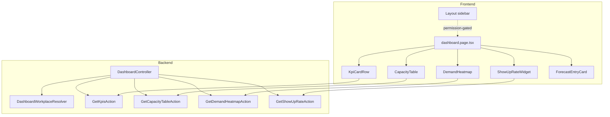

# Design Document: Admin Dashboard Overview

## Overview

The dashboard is a thin Next.js page composed of independent widgets, each backed by its own aggregate endpoint. The backend builds two workplace-ID sets per request (`Demand_Workplaces` and `Reliability_Workplaces`), then runs aggregate SQL constrained by those sets — no model hydration, no per-user rows ever leave the database. Each endpoint is one Action class returning a JSON-serializable shape; the frontend fans out parallel requests so a slow widget doesn't block KPI paint.

### Design Goals

- **Strict workplace-scoped aggregation.** Every aggregate query is constrained by the right workplace-ID set before it runs; no post-filter trust.
- **No user-level leakage.** Responses contain only counts, rates, dates, and workplace/slot identifiers. Enforced by a shared response-shape test helper.
- **Sub-500 ms p95 per endpoint.** Each widget is one indexed aggregate query; no N+1, no model hydration.
- **Independent widgets.** A failing or slow widget degrades alone, doesn't block the page.

### Key Design Decisions

- **Two workplace sets per request, resolved once.** A request-scoped resolver computes `Demand_Workplaces` (`shift.list`) and `Reliability_Workplaces` (`shift.list ∩ work_history.list`) using `User::getWorkplaceIdsByPermission`. Each Action declares which set it needs. Avoids re-querying permissions inside each Action and prevents the wrong set being used.
- **Raw aggregate SQL via `DB::query()` is allowed.** The `FiltersByWorkplace` Eloquent scope is fine for counts on `shifts`, but the heatmap and outcome-classification queries are easier and faster as raw SQL with `whereIn('workplace_id', ...)` directly. Per the Round 3 wording, the boundary is "constrain by accessible workplace IDs", not "use the scope".
- **Outcome classification at the SQL layer.** `Outcome_Class` is computed with `CASE WHEN exists(check_ins) THEN 'show' WHEN exists(shift_reports where is_absent = true) THEN 'no_show' ELSE 'missing_unreported'` inside the aggregate, not in PHP. `shift_users.is_absent` is ignored because it is a worktime-validation flag.
- **Capacity pressure lives only in the dedicated capacity widget.** `Active_Pool` is implemented as a shared query helper parameterised by Reliability_Workplaces + window, and capacity is evaluated per workplace/date with ratio-based utilization in `GetCapacityTableAction`. The KPI row uses an `avg_daily_check_ins` card in this position instead of a capacity-pressure summary — the dedicated capacity table already surfaces critical/tight workplace-days, so a KPI summary of the same data was redundant.
- **Reliability endpoint aggregates once at slot grain.** The endpoint returns both workplace and workplace-slot views, but the database query groups by `(workplace_id, workplace_shift_id)` once and PHP rolls those rows up to per-workplace totals. This avoids scanning the same 90-day assignment set twice.
- **Frontend widgets fetch in parallel via React Query.** Each widget has its own `useQuery` keyed by `(endpoint, workplaceIds, window)`. The page renders skeletons until each widget resolves, so KPI cards usually paint first.
- **No new domain tables.** Spec uses existing `shifts`, `shift_users`, `check_ins`, `shift_reports`, `workplace_shifts`, and `workplaces` only. Index-only migrations are allowed if profiling shows the aggregate queries need them.

## Architecture

### System Context

```mermaid
graph LR
    A[Admin browser] -->|GET /admin/dashboard| B[Next.js]
    B -->|parallel fetch| C[/api/admin/dashboard/*]
    C --> D[Laravel Actions]
    D --> E[(MySQL: shifts, shift_users, check_ins, shift_reports, workplace_shifts)]
    D --> F[User permissions]
    F -->|getWorkplaceIdsByPermission| E
```

### High-Level Architecture



## Components and Interfaces

### Component 1: DashboardWorkplaceResolver (backend)

**Purpose**: Single source of truth for which workplace IDs a caller may see, for each metric category.

**Responsibilities**:
- Compute `demand()` → list of workplace IDs (or `null` for global) via `getWorkplaceIdsByPermission('shift.list')`.
- Compute `reliability()` → intersection of `shift.list` and `work_history.list` accessible IDs. `null ∩ X = X`; `X ∩ null = X`; `null ∩ null = null`.
- Intersect either set with a user-supplied `workplace_ids[]` filter (silently drops out-of-scope IDs).
- Provide `isEmpty()` helpers so Actions can short-circuit with redacted responses.

**Interfaces**:
- **Input**: `User`, optional `int[] $requestedWorkplaceIds`.
- **Output**: `?array $demand`, `?array $reliability` (where `null` means "no restriction").
- **Dependencies**: `User::getWorkplaceIdsByPermission`.

**Implementation Notes**:
- Instantiated once per request by the controller, passed into each Action.
- Returns `[]` (vs. `null`) when the caller has zero accessible workplaces — Actions branch on this to render the redacted state from Requirement 1.4 / 1.5.

### Component 2: DashboardController (backend)

**Purpose**: Thin HTTP controller for `/api/admin/dashboard/*`. Delegates to Actions.

**Responsibilities**:
- Authorise via the existing permission middleware (`shift.list` required to enter the route group).
- Build `DashboardWorkplaceResolver` from `$request->user()` and `$request->query('workplace_ids')`.
- Validate `window ∈ {30, 60, 90}` (default 90) where applicable.
- Invoke the appropriate Action and return its `ActionResult` as JSON.

**Interfaces**:
- **Input**: Authenticated request with optional `workplace_ids[]` and `window` query params.
- **Output**: JSON response (shape varies per endpoint).
- **Dependencies**: `DashboardWorkplaceResolver`, the four Actions below.

### Component 3: GetKpisAction (backend)

**Purpose**: Compute the four KPI cards in a single response.

**Responsibilities**:
- Active worker pool: `COUNT(DISTINCT ci.user_id)` from `check_ins ci JOIN shift_users su ON su.id = ci.shift_user_id JOIN shifts s ON s.id = su.shift_id` where `s.workplace_id ∈ Reliability_Workplaces` and `s.date ∈ [today - window, today)` in Asia/Tokyo. Reuses the Active_Pool query helper.
- Show-up rate: aggregate over Approved_Assignment whose shift date is in the window, classifying via `Outcome_Class`. Returns shows ÷ approved.
- Average daily check-ins: `COUNT(ci.id) ÷ window_days` from `check_ins` joined to `shifts` over the Historical_Window scoped to Reliability_Workplaces, rounded to the nearest integer. Replaces the earlier capacity-pressure KPI (which duplicated the dedicated capacity widget on the same page).
- No-show risk: same denominator as show-up rate but window = last 30 days (fixed), and ratio = `no_show ÷ approved` where `no_show` is no check-in plus `shift_reports.is_absent = true`. Independent of the dropdown window.

**Interfaces**:
- **Input**: `User`, `DashboardWorkplaceResolver`, `int $window` (30 / 60 / 90).
- **Output**:
    ```typescript
    interface KpiResponse {
        active_pool:          { value: number | null; delta: number | null };
        show_up_rate:         { value: number | null; delta: number | null };
        avg_daily_check_ins:  { value: number | null; delta: number | null };
        no_show_risk:         { value: number | null; delta: number | null };
        reliability_available: boolean; // false ⇒ Reliability_Workplaces is empty
    }
    ```
- **Dependencies**: Active_Pool query helper, Outcome_Class CASE, daily-check-ins helper.

**Implementation Notes**:
- Four separate queries — combining them into one giant query would make EXPLAIN illegible and gives no real speedup since each hits a different index.
- When `reliability_available = false`, set `active_pool / show_up_rate / avg_daily_check_ins / no_show_risk` to `null` (no zero-divide). The capacity widget remains the dedicated surface for capacity pressure; it still sets `active_pool / free_bench / utilization / capacity_tag` to `null` per Requirement 4.6 when reliability is unavailable.

### Component 4: GetCapacityTableAction (backend)

**Purpose**: Return ratio-based workplace/date capacity pressure for the next 14 days.

**Responsibilities**:
- For each workplace/date with assignment pressure in the next 14 dates, return `active_pool`, `assigned`, `free_bench`, `utilization`, and `capacity_tag`.
- `assigned` = `COUNT(DISTINCT shift_users.user_id)` for Approved_Assignment rows on shifts where `workplace_id ∈ Demand_Workplaces` and `shifts.date = D`.
- `active_pool` = distinct check-in users for that workplace over the default 90-day Active_Pool window. When Reliability_Workplaces is empty, returns `null`.
- `free_bench` = `max(0, active_pool - assigned)`. It is supporting detail only; tags use utilization.
- `utilization` = `assigned / active_pool` when `active_pool > 0`.
- `capacity_tag` from a single constant such as `DashboardThresholds::CAPACITY_UTILIZATION = ['critical' => 0.90, 'tight' => 0.75]`. `active_pool = 0 AND assigned > 0` is critical with `capacity_reason = 'no_pool'`.

**Interfaces**:
- **Input**: `User`, `DashboardWorkplaceResolver`.
- **Output**:
    ```typescript
    interface CapacityRow {
        date: string;            // ISO date, Asia/Tokyo
        day_of_week: number;     // 0 = Sun … 6 = Sat
        workplace_id: number;
        workplace_name: string;
        active_pool: number | null;
        assigned: number;
        free_bench: number | null;
        utilization: number | null;
        capacity_tag: 'healthy' | 'tight' | 'critical' | null;
        capacity_reason?: 'no_pool' | null;
    }
    type CapacityResponse = {
        rows: CapacityRow[];
        summary: { critical_count: number | null; tight_count: number | null; worst: CapacityRow | null };
    };
    ```

**Implementation Notes**:
- Use a 14-row date series (`UNION ALL` of literal dates, generated in PHP and bound as params) crossed with selected workplaces only when one workplace is selected or when a full date series is explicitly needed. For the default all-workplace view, return the pressure rows sorted by severity and omit zero-assigned workplace/dates to avoid a noisy 1,000+ row matrix.

### Component 5: GetDemandHeatmapAction (backend)

**Purpose**: Day-of-week × shift-slot average check-in counts scoped to Reliability_Workplaces.

**Responsibilities**:
- Default mode groups by (`day_of_week(shifts.date)`, Slot_Group), where Slot_Group is a stable time-of-day bucket derived from `workplace_shifts.start_time`, constrained by Reliability_Workplaces.
- Top-slot mode groups by (`day_of_week(shifts.date)`, exact slot label) where `slot label = TIME_FORMAT(workplace_shifts.start_time, '%H:%i') + '–' + end_time`, sorts slot labels by occurrence/check-in volume, and caps rows by `limit` (default 12, max 20).
- Cell value = `AVG(check_ins_count_per_shift)` rounded to nearest integer. The query LEFT JOINs `check_ins` so a shift occurrence with zero check-ins contributes `0`; only missing shift occurrences become `null` cells after the PHP pivot.
- Cells with no occurrences in the window return `null`.

**Interfaces**:
- **Input**: `User`, `DashboardWorkplaceResolver`, `int $window`.
- **Output**:
    ```typescript
    interface HeatmapResponse {
        mode: 'groups' | 'top_slots';
        slots: string[]; // row labels, sorted by group order or top-slot rank
        cells: Record<string /* slot */, Array<number | null> /* index 0..6 = Mon..Sun */>;
    }
    ```

**Implementation Notes**:
- Two-pass: (1) select either grouped buckets or the top exact slot labels; (2) `SELECT row_label, day_of_week, COUNT(check_ins.id) / COUNT(DISTINCT shifts.id)` grouped, then PHP pivots into the matrix.
- Quantile bucketing happens in the **frontend** so the API stays simple.

### Component 6: GetShowUpRateAction (backend)

**Purpose**: Per-workplace and per-(workplace × slot) show-up rate.

**Responsibilities**:
- Per-workplace: one row per workplace in Reliability_Workplaces with at least one Approved_Assignment in the window. Computes `assigned_count`, `check_in_count`, `show_up_rate`, `low_sample = assigned_count < 5`.
- Per-(workplace × slot): same metrics, keyed by `(workplace_id, workplace_shift_id)`. Returned in the same response, sorted by `show_up_rate ASC`.

**Interfaces**:
- **Input**: `User`, `DashboardWorkplaceResolver`, `int $window`.
- **Output**:
    ```typescript
    interface ReliabilityRow {
        workplace_id: number;
        workplace_name: string;
        workplace_shift_id?: number;
        slot_label?: string;
        assigned_count: number;
        check_in_count: number;
        show_up_rate: number | null;
        low_sample: boolean;
    }
    interface ReliabilityResponse {
        by_workplace: ReliabilityRow[];
        by_workplace_slot: ReliabilityRow[];
    }
    ```

**Implementation Notes**:
- One database query grouped by `s.workplace_id, s.workplace_shift_id`; PHP rolls the same result set up to `by_workplace`. This is more important than query purity because production-data validation measured the reliability query above the 500 ms target when scanning the assignment set separately.
- The SQL should start from `shifts` filtered by date (and workplace IDs when scoped), join approved `shift_users`, then left join `check_ins` by `shift_user_id`. Join `workplaces` and `workplace_shifts` after aggregation where possible so names/labels do not affect the hot aggregate.

### Component 7: Frontend dashboard page (`frontend/src/pages/admin/dashboard/index.page.tsx`)

**Purpose**: Compose the widgets, manage workplace + window state.

**Responsibilities**:
- Read accessible workplace IDs from `masterAtom.workplace_access` when available, and fetch display names / global flags from `/api/admin/dashboard/workplaces`.
- Render `WorkplaceMultiSelect` and `WindowDropdown` controls.
- Issue parallel React Query requests, one per widget.
- Render an empty state when no Demand_Workplaces are accessible.

**Interfaces**:
- **Input**: Route `/admin/dashboard`. Permission gate via `RouteConfig.ADMIN_DASHBOARD.permissions = [PermissionNameEnum.SHIFT_LIST.value]`, enforced by the existing layout/router permission checks.
- **Output**: Mantine layout with the widgets below.
- **Dependencies**: Mantine `Grid`, `Card`, `MultiSelect`, `SegmentedControl`; `@tanstack/react-query`; existing i18n (`t()`).

### Component 8: Widget components

Each widget is a small client component in `frontend/src/pages/admin/dashboard/components/`:

- `KpiCardRow.tsx` — 4 KPI cards.
- `CapacityTable.tsx` — 14-row Mantine `Table`. Highlights rows 0–6.
- `DemandHeatmap.tsx` — CSS-grid heatmap, six-bucket quantile classifier.
- `ShowUpRateWidget.tsx` — bar chart (per workplace) with inline expansion into the per-slot drill-down.
- `ForecastEntryCard.tsx` — static card with a `Button` linking to `/admin/forecast` via `next/link`.

**Implementation Notes**:
- Each widget owns its `useQuery`. A failure renders an in-card error banner with a retry button; it does not unmount sibling widgets.
- All strings flow through `t()` keys added via `pnpm trans:prepare`.

## Data Models

No new entities. The Action queries reference existing tables:

- `shifts(id, workplace_id, workplace_shift_id, date, ...)`
- `shift_users(id, shift_id, user_id, status, is_absent, ...)` — `is_absent` is not used by dashboard metrics
- `check_ins(id, shift_user_id, shift_id, user_id, check_in_time, check_out_time, ...)`
- `shift_reports(id, shift_user_id, is_absent, ...)` — source of no-show reports
- `workplace_shifts(id, workplace_id, start_time, end_time, ...)`
- `workplaces(id, name, ...)`
- `shift_absent_notices(id, shift_user_id, ...)` — not used by V1 dashboard metrics unless product semantics change

## API Design

### Endpoint 1: List dashboard-accessible workplaces

**Method**: `GET`
**Path**: `/api/admin/dashboard/workplaces`

**Response**:
```json
{
    "demand_workplaces":      [{ "id": 1, "name": "Yokohama A" }, { "id": 2, "name": "Kawasaki Pack" }],
    "reliability_workplaces": [{ "id": 1, "name": "Yokohama A" }],
    "demand_is_global":        false,
    "reliability_is_global":   false
}
```

`*_is_global = true` mirrors the `null` resolver result (caller can see all workplaces under that permission).

### Endpoint 2: KPI cards

**Method**: `GET`
**Path**: `/api/admin/dashboard/kpis?window=90&workplace_ids[]=1&workplace_ids[]=2`

**Response**: see `KpiResponse` in Component 3.

### Endpoint 3: Capacity table

**Method**: `GET`
**Path**: `/api/admin/dashboard/capacity?workplace_ids[]=1`

**Response**: see `CapacityResponse` in Component 4.

### Endpoint 4: Demand heatmap

**Method**: `GET`
**Path**: `/api/admin/dashboard/demand-heatmap?window=90&mode=groups&limit=12&workplace_ids[]=1`

**Response**: see `HeatmapResponse` in Component 5.

### Endpoint 5: Show-up rate

**Method**: `GET`
**Path**: `/api/admin/dashboard/show-up-rate?window=90&workplace_ids[]=1`

**Response**: see `ReliabilityResponse` in Component 6.

### Common error responses

- `401 Unauthorized` — missing/invalid auth.
- `403 Forbidden` — user lacks `shift.list` on any workplace.
- `422 Unprocessable Entity` — `window` not in `{30, 60, 90}`, or malformed `workplace_ids`.

## Security Considerations

### Authentication

Existing API auth middleware. No changes.

### Authorization

- Route group requires `shift.list` permission.
- `DashboardWorkplaceResolver` recomputes both workplace sets on every request — no caller-supplied trust.
- User-supplied `workplace_ids[]` is intersected with the resolver's set before the SQL is built; out-of-scope IDs are silently dropped (no enumeration via error messages).

### Data Protection

- Response-shape test (`assertNoUserIdentifyingFields`) is applied to every endpoint test, blocking PR merges if any disallowed key appears.
- Reliability endpoints use `Reliability_Workplaces`, so a caller with `shift.list` but not `work_history.list` on a workplace cannot infer that workplace's check-in patterns.

### Input Validation

- `window`: `Rule::in([30, 60, 90])`.
- `workplace_ids`: `array`, each element `integer|min:1`.

## Error Handling

| Scenario | Handling |
|----------|----------|
| Reliability_Workplaces empty | Reliability metrics return `null`; capacity table returns `free_bench = null`. Frontend renders a "needs `work_history.list`" hint. |
| Demand_Workplaces empty | Demand/capacity endpoints return zeroed/empty payloads. Frontend renders empty state. |
| Single widget query fails | The widget renders an in-card error + retry. Sibling widgets remain functional. |
| `window` outside {30, 60, 90} | `422` with field-level error; frontend dropdown prevents this by construction. |

## Performance Considerations

### Expected Load

- **Concurrent users**: ≈30 admins peak. Dashboard auto-refresh is not enabled in V1.
- **Requests per page load**: 5 (`workplaces`, `kpis`, `capacity`, `demand-heatmap`, `show-up-rate`).

### Optimization Strategies

- Active_Pool query logic lives in one backend helper and is reused by `kpis` and `capacity` Actions with different window parameters.
- Each Action uses **aggregate SQL only**; no Eloquent model hydration on the hot path.
- The show-up endpoint uses one slot-grain aggregate query and PHP rollup instead of separate workplace and workplace-slot aggregate scans.
- The hot reliability query should start from date-filtered `shifts`, aggregate before joining names/labels, and only join `shift_reports` with an `EXISTS` or pre-aggregated subquery when no-show counts are requested.
- Production-data validation showed the existing indexes are not enough for the global reliability query shape. Profile these candidate indexes during implementation and add the ones EXPLAIN proves useful:
    - `shifts(date, workplace_id, id, workplace_shift_id)` for all-workplace date-window scans.
    - `shift_users(shift_id, status, user_id)` for approved-assignment joins and distinct assigned counts.
    - `shift_reports(shift_user_id, is_absent)` if no-show aggregates join reports directly.
- Frontend issues all five requests in parallel via React Query.

## Testing Strategy

### Unit Tests

**`DashboardWorkplaceResolver` (`backend/tests/Unit/Dashboard/DashboardWorkplaceResolverTest.php`):**
- `testDemandReturnsNullForGlobalAdmin`
- `testReliabilityIntersectsTwoNonNullSets`
- `testReliabilityHandlesNullOnEitherSide`
- `testIntersectWithRequestedDropsOutOfScope`
- `testIsEmptyWhenIntersectionResultsInEmptyArray`

### Feature Tests

**`GetKpisActionTest` (`backend/tests/Feature/Dashboard/GetKpisActionTest.php`):**
- `testActivePoolCountsDistinctCheckInUsers`
- `testShowUpRateUsesAllApprovedAsDenominator`
- `testShowUpRateExcludesExcusedAbsencesFromNumerator`
- `testAvgDailyCheckInsDividesByWindowDays`
- `testNoShowRateUsesFixed30DayWindow`
- `testReturnsNullsWhenReliabilityWorkplacesEmpty`
- `testDeltaCalculatesAgainstPriorWindow`
- `testResponseShapeContainsNoUserIdentifyingFields`

**`GetCapacityTableActionTest`:**
- `testReturnsFourteenRowsStartingToday`
- `testFreeBenchFlooredAtZero`
- `testCapacityTagThresholds`
- `testReturnsRowForDateWithZeroShifts`
- `testFreeBenchReturnsNullWhenReliabilityEmpty`

**`GetDemandHeatmapActionTest`:**
- `testAveragesCheckInsAcrossOccurrences`
- `testReturnsNullForEmptyDayOfWeekSlotPair`
- `testCollapsesIdenticalSlotLabelsAcrossWorkplaces`

**`GetShowUpRateActionTest`:**
- `testPerWorkplaceMetrics`
- `testPerWorkplaceSlotMetrics`
- `testLowSampleFlagBelowFive`
- `testRespondsOnlyWithWorkplaceLevelIdentifiers`

**`DashboardControllerTest`:**
- `testReturnsForbiddenWhenUserLacksShiftList`
- `testSilentlyDropsOutOfScopeWorkplaceIds`
- `testValidationRejectsInvalidWindow`
- `testAllEndpointsRespectAggregateOnlyShape` (shared helper, applied to each endpoint)

**Shared assertion helper (`backend/tests/Concerns/AssertsAggregateOnlyResponse.php`):**

```php
// backend/tests/Concerns/AssertsAggregateOnlyResponse.php
trait AssertsAggregateOnlyResponse
{
    private const DISALLOWED_KEYS = [
        'user_id', 'user_name', 'username', 'email',
        'staff_no', 'employee_no', 'phone',
        'first_name', 'last_name', 'full_name',
    ];

    protected function assertNoUserIdentifyingFields(array $payload): void
    {
        $this->walkKeys($payload, function (string $key): void {
            $this->assertNotContains(
                strtolower($key),
                self::DISALLOWED_KEYS,
                "Response leaked user-identifying key: {$key}"
            );
        });
    }
}
```

### Frontend tests

**`Dashboard` (`frontend/src/pages/admin/dashboard/__tests__/dashboard.test.tsx`):**
- Renders KPI skeletons before queries resolve.
- Renders the empty state when `demand_workplaces` is empty.
- Sidebar entry hides for a user without `shift.list`.
- Window dropdown refetches only the affected widgets.

### Integration Tests

- End-to-end: GlobalAdmin user sees all four KPIs populated against seeded data.
- Admin user with `shift.list` on workplace 1 but `work_history.list` only on workplace 2 sees demand widgets for {1, 2} and reliability widgets computed only on {2}.

### Test Configuration

The aggregate-only shape assertion is applied to **every** dashboard feature test via the shared trait, ensuring future endpoints inherit the constraint by convention.
