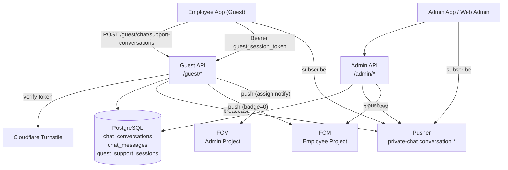
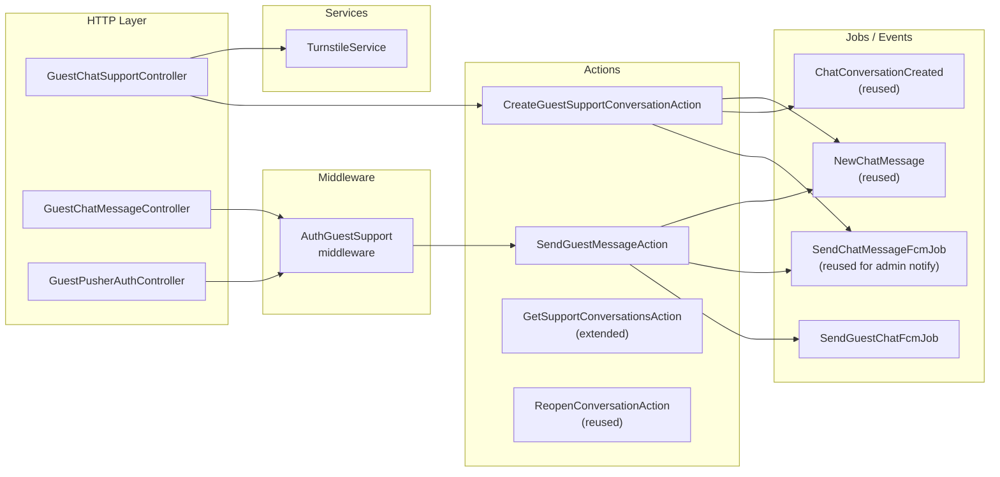
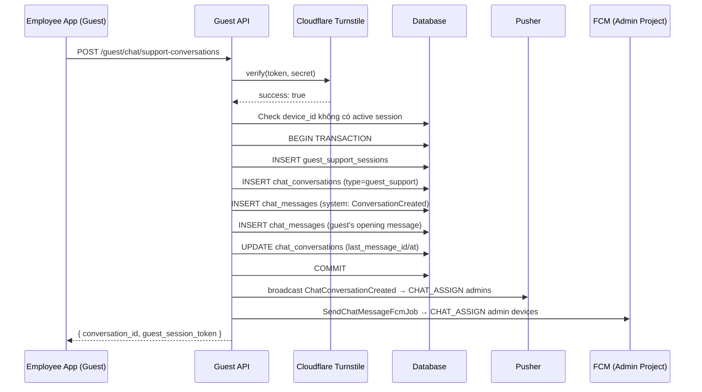
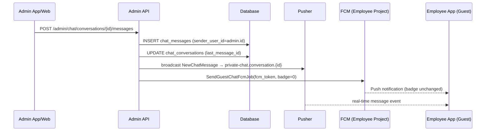

# Design Document: Guest Support Backend

## Overview

Feature này mở rộng hệ thống chat support hiện tại bằng cách thêm một bộ API độc lập cho guest (nhân viên chưa có tài khoản). Thiết kế theo hướng **tối giảm thay đổi schema hiện tại**: chỉ thêm 1 bảng mới (`guest_support_sessions`), 2 cột nullable vào các bảng hiện có (`chat_conversations`, `chat_messages`), và 1 enum value mới (`guest_support`). Toàn bộ luồng realtime (Pusher private channel) và FCM được tái sử dụng với các điểm mở rộng tối thiểu — thêm 1 middleware, 1 custom Pusher auth endpoint, và 1 FCM job riêng cho guest device.

### Design Goals
- Không phá vỡ bất kỳ API hay flow nào của authenticated support hiện tại
- Tái sử dụng tối đa infrastructure: Pusher channel, FCM job pattern, Action pattern, broadcast events
- Guest session token được lưu AES-256 encrypted (reversible) để hỗ trợ recovery sau khi app reinstall
- Bảo mật đủ mức cho guest context (không có tài khoản, không có dữ liệu nhạy cảm)

### Key Design Decisions
- **`type = 'guest_support'`** thay vì cờ boolean `is_guest`: nhất quán với cách hệ thống phân loại `support`, `admin_group`, v.v.; dễ filter và mở rộng
- **Không tạo `ChatParticipant` cho guest**: `chat_participants.user_id` là NOT NULL FK — thay vào đó, guest context được quản lý hoàn toàn qua `guest_support_sessions.conversation_id`
- **Dual-storage session token (AES + HMAC hash)**: `session_token` lưu AES-256 encrypted để `/active` trả lại plaintext token cho app sau reinstall; `session_token_hash` lưu `hash_hmac('sha256', $plaintext, $appKey)` với unique index để middleware tra cứu O(log n) — giống pattern Sanctum, tránh O(n) AES-decrypt trên endpoint public
- **`/active` yêu cầu Turnstile**: endpoint trả về bearer token nên phải được bảo vệ ngang hàng `store`, không thể public hoàn toàn
- **409 chỉ khi conversation đang open**: cho phép device tạo conversation mới sau khi conversation cũ đã closed — phù hợp với lifecycle thực tế
- **`GuestReopenConversationAction` riêng**: `ReopenConversationAction` yêu cầu `User $actor` là `ChatParticipant` — guest không có participant record nên cần action riêng thực hiện đầy đủ: reset close fields, ChatAuditLog, system message, broadcast, FCM
- **Endpoint Pusher auth riêng `/guest/pusher/auth`**: không sửa `routes/channels.php` hiện tại, giữ logic xác thực tách biệt
- **`SendGuestChatFcmJob` riêng**: tránh sửa `SendChatMessageFcmJob` vốn chỉ làm việc với `user_id`; job mới gửi trực tiếp đến 1 FCM token với `badge_count = 0`

### API Change Summary

**`GET /admin/chat/support-conversations` — before:**
```json
{
  "id": 1,
  "type": "support",
  "created_by_user_id": 42,
  "created_by_name": "Nguyen Van A"
}
```

**After (guest conversation):**
```json
{
  "id": 2,
  "type": "guest_support",
  "created_by_user_id": null,
  "created_by_name": null,
  "is_guest": true,
  "guest_name": "Tran Van B",
  "guest_email": "b@example.com"
}
```

## Architecture

### System Context

Guest support conversation tồn tại độc lập với user session. Guest được định danh bởi `device_id`; tất cả tương tác sau khi tạo đều dùng `guest_session_token` (AES-256 encrypted trong DB). Admin triage và assign giống hệt luồng support hiện tại; chỉ khác ở chỗ không có `ChatParticipant` phía guest.



### High-Level Architecture



## Components and Interfaces

### Component 1: `guest_support_sessions` Table

**Purpose**: Lưu trữ thông tin nhận dạng guest và session token, thay thế cho `User` model trong ngữ cảnh guest support.

**Responsibilities**:
- Liên kết `device_id` → `conversation_id` (1 active session per device tại một thời điểm)
- Lưu `session_token` dạng AES-256 encrypted để `/active` có thể trả lại plaintext token cho app
- Lưu `session_token_hash` (SHA-256 HMAC, unique index) để middleware tra cứu O(log n)
- Lưu `fcm_token` để gửi push notification trực tiếp đến device

**Interfaces**:
- **Input**: device_id, platform, fcm_token, guest_name, guest_email, session_token (encrypted), session_token_hash (HMAC), conversation_id
- **Output**: Model `GuestSupportSession` dùng trong middleware và actions
- **Dependencies**: `chat_conversations`

**Implementation Notes**:
- Column `session_token` dùng `$table->text()` vì AES-256 encrypted string dài hơn varchar(255)
- Column `session_token_hash`: `string(64)` (SHA-256 hex output), nullable (sessions cũ không có hash), unique index
- Column `fcm_token`: `string(500)` nullable (FCM registration token có thể dài hơn 255 chars)
- Không có `unique` trên `device_id` — cho phép device tạo session mới sau khi conversation cũ đã closed; 409 chỉ được check ở application layer với scope open conversations
- Index trên `device_id` để check nhanh khi tạo mới; index unique trên `session_token_hash` để auth middleware lookup O(log n)

---

### Component 2: `AuthGuestSupport` Middleware

**Purpose**: Xác thực `guest_session_token` từ Authorization header cho tất cả `/guest/chat/*` endpoint (trừ `store` và `active`).

**Responsibilities**:
- Parse `Authorization: Bearer <token>` header
- Compute `hash_hmac('sha256', $bearer, config('app.key'))` và query `WHERE session_token_hash = $hash` (O(log n) với unique index)
- Kiểm tra `conversation_id` trong route khớp với session (nếu có route param `{id}`)
- Inject `GuestSupportSession` vào request attributes

**Interfaces**:
- **Input**: HTTP Request với Authorization header
- **Output**: `$request->attributes->get('guestSession')` (GuestSupportSession instance)
- **Dependencies**: `GuestSupportSession` model

**Implementation Notes**:
- Không dùng `Crypt` facade — hash lookup thay thế hoàn toàn AES decrypt scan
- Trả về 401 nếu không tìm thấy session, 403 nếu conversation_id trong route không khớp
- Sessions cũ không có `session_token_hash` sẽ không match → tự động bị từ chối (behavior đúng: sessions cũ phải được tạo lại)

---

### Component 3: `TurnstileService`

**Purpose**: Wrap Cloudflare Turnstile verify API call.

**Responsibilities**:
- POST đến `https://challenges.cloudflare.com/turnstile/v0/siteverify` với secret key + token
- Parse response và kiểm tra `success` field
- Timeout sau 10 giây; trả `false` nếu `ConnectionException`

**Interfaces**:
- **Input**: `string $token` (từ client), `?string $remoteIp = null`
- **Output**: `bool` (pass/fail)
- **Dependencies**: Laravel `Http` facade, env `CAPTCHA_TURNSTILE_SECRET_KEY`

---

### Component 4: `CreateGuestSupportConversationAction`

**Purpose**: Tạo đồng thời `GuestSupportSession`, `ChatConversation` (type=`guest_support`), và opening `ChatMessage` trong một DB transaction.

**Responsibilities**:
- Check 409: chỉ reject nếu device_id đã có session với conversation đang **open** (không reject nếu closed) — dùng `whereHas('conversation', fn => where status = open)->first()`; gộp exists+first thành 1 query
- Tạo `$plaintext = Str::random(64)`, compute `$hash = hash_hmac('sha256', $plaintext, config('app.key'))`
- Tạo `GuestSupportSession` với `session_token = Crypt::encryptString($plaintext)` + `session_token_hash = $hash`
- Tạo `ChatConversation` với `type = guest_support`, `guest_support_session_id = session.id`, `created_by_user_id = null`
- Tạo system message (ConversationCreated)
- Tạo `ChatMessage` với `sender_user_id = null`, `guest_support_session_id = session.id`
- Cập nhật `last_message_id/at/last_activity_at` trên conversation
- Return `[$session, $message, $conversation]` từ transaction closure để tránh N+1 query sau đó
- Sau transaction: dispatch `ChatConversationCreated`, `NewChatMessage`, `forGuestSupportCreated`

**Interfaces**:
- **Input**: `array $params` (name, email, content, device_id, platform, fcm_token, client_message_id?)
- **Output**: `ActionResult` với `{ conversation_id, guest_session_token (plaintext) }`
- **Dependencies**: `RecordSystemMessageAction`, `NotifyChatRecipientsAction`

---

### Component 5: `SendGuestMessageAction`

**Purpose**: Tạo `ChatMessage` từ guest trong conversation đang mở.

**Responsibilities**:
- Kiểm tra conversation `status = open`
- Tạo `ChatMessage` với `sender_user_id = null`, `guest_support_session_id = session.id`
- Cập nhật `last_message_id/at/last_activity_at`
- Dispatch `NewChatMessage` broadcast
- Dispatch `forGuestMessage` FCM đến assigned admins (hoặc CHAT_ASSIGN admins nếu chưa assign)
- **Override `sender_name`** trong response payload: `$payload['sender_name'] = $session->guest_name` — áp dụng cho mọi return path (happy path, idempotency, race condition fallback) để response nhất quán với broadcast và message list API
- **Không** dispatch `SendGuestChatFcmJob` (guest tự gửi, không cần notify chính mình)

**Interfaces**:
- **Input**: `GuestSupportSession $session`, `array $params` (body, client_message_id?)
- **Output**: `ActionResult` với message payload trong đó `sender_name = $session->guest_name`
- **Dependencies**: `GuestSupportSession`, `ChatConversation`, `ChatMessage`, `NotifyChatRecipientsAction`

---

### Component 5b: `GuestReopenConversationAction`

**Purpose**: Mở lại guest support conversation với đầy đủ audit trail và realtime signals — tương đương `ReopenConversationAction` cho authenticated users nhưng không yêu cầu `ChatParticipant`.

**Responsibilities**:
- Kiểm tra `status = closed`; trả 422 nếu đã open
- Trong DB transaction:
  - Reset `closed_at`, `closed_by_user_id`, `close_reason` về null
  - Ghi `ChatAuditLog` với `actor_user_id = null`, `actor_role = 'guest'`
  - Gọi `RecordSystemMessageAction` để tạo system message `ConversationReopened`
- Sau transaction: dispatch `ChatConversationStateChanged`, `NewChatMessage`, call `notify->forGuestReopened`

**Interfaces**:
- **Input**: `GuestSupportSession $session`, `ChatConversation $conversation`
- **Output**: `ActionResult` với `{ id, status: 'open' }`
- **Dependencies**: `RecordSystemMessageAction`, `NotifyChatRecipientsAction`, `ChatAuditLog`

---

### Component 6: `SendGuestChatFcmJob`

**Purpose**: Gửi FCM push notification đến guest device khi admin gửi tin nhắn, với `badge_count = 0`.

**Responsibilities**:
- Nhận `fcm_token` và `platform` từ `GuestSupportSession`
- Dùng employee Firebase project (`app`) để gửi
- Set `badge` = 0 trong APNS (iOS) và không set badge trên Android payload
- Log lỗi nhưng không throw nếu FCM thất bại

**Interfaces**:
- **Input**: `string $fcmToken`, `int $conversationId`, `string $title`, `string $body`, `array $data`
- **Output**: void (fire-and-forget)
- **Dependencies**: `ResolveFirebaseMessagingAction`, Laravel queue

---

### Component 7: `GuestPusherAuthController`

**Purpose**: Cấp phép cho guest subscribe Pusher private channel của conversation.

**Responsibilities**:
- Validate Bearer token qua `AuthGuestSupport` middleware
- Parse `channel_name` từ request (`private-chat.conversation.{id}`)
- Xác minh `{id}` khớp với `session.conversation_id`
- Ký Pusher auth response bằng Pusher secret

**Interfaces**:
- **Input**: POST `/guest/pusher/auth` với `socket_id`, `channel_name`, Bearer token
- **Output**: Pusher auth response JSON `{ auth: "..." }`
- **Dependencies**: `AuthGuestSupport` middleware, Pusher PHP SDK

**Implementation Notes**:
- Dùng `app(\Pusher\Pusher::class)->socket_auth($channel, $socketId)` để tạo auth signature
- Channel phải match pattern `private-chat.conversation.*`

---

### Component 8: `GetSupportConversationsAction` (extended)

**Purpose**: Mở rộng action hiện tại để trả về cả `guest_support` conversations kèm guest metadata.

**Responsibilities**:
- Thêm `guest_support` vào query filter (thay vì chỉ `support`)
- Eager load `guestSupportSession` cho guest conversations
- Thêm `is_guest`, `guest_name`, `guest_email` vào response item khi type = `guest_support`

**Implementation Notes**:
- Thay `->where('type', ChatConversationType::Support->value)` thành `->whereIn('type', [Support, GuestSupport])`
- `created_by_name` sẽ là null cho guest conversations; frontend/app dùng `guest_name` thay thế

## Data Models

### Entity 1: `GuestSupportSession`

```typescript
// backend/app/Models/GuestSupportSession.php
interface GuestSupportSession {
    id: number;
    device_id: string;          // UUID từ device, max 255 chars
    platform: 'android' | 'ios';
    fcm_token: string | null;   // Firebase token để push notification
    guest_name: string;         // Tên người dùng nhập
    guest_email: string;        // Email người dùng nhập
    session_token: string;      // AES-256 encrypted plaintext token
    conversation_id: number;    // FK -> chat_conversations.id
    created_at: string;
    updated_at: string;
}
```

**Validation Rules**:
- `device_id`: required, string, max:255
- `platform`: required, in:android,ios
- `fcm_token`: nullable, string, max:255
- `guest_name`: required, string, max:100
- `guest_email`: required, email, max:255
- `session_token`: AES-256 encrypted via `Crypt::encryptString()`, stored as text

**Relationships**:
- `belongsTo(ChatConversation::class)` — mỗi session có đúng 1 conversation

---

### Entity 2: `ChatConversation` (modified)

```typescript
// Thêm 2 column mới (nullable)
interface ChatConversation {
    // ... existing fields ...
    type: 'support' | 'admin_group' | 'shift_group' | 'user_group' | 'guest_support'; // new value
    guest_support_session_id: number | null; // FK -> guest_support_sessions.id
    created_by_user_id: number | null;       // already nullable, null for guest
}
```

**Relationships**:
- Thêm: `hasOne(GuestSupportSession::class)` — chỉ có nếu type = guest_support

---

### Entity 3: `ChatMessage` (modified)

```typescript
// Thêm 1 column mới (nullable)
interface ChatMessage {
    // ... existing fields ...
    sender_user_id: number | null;              // null = system message OR guest message
    guest_support_session_id: number | null;    // non-null => tin nhắn do guest gửi
}
```

**Phân biệt loại message có `sender_user_id = null`**:
- `sender_user_id = null` + `guest_support_session_id = null` + `message_type = system` → system message
- `sender_user_id = null` + `guest_support_session_id != null` + `message_type = text` → guest message

---

### Data Flow

#### Flow 1: Guest tạo support conversation



#### Flow 2: Admin gửi tin nhắn đến guest conversation



## API Design

### Endpoint 1: Tạo Guest Support Conversation

**Method**: `POST`
**Path**: `/guest/chat/support-conversations`
**Middleware**: `throttle:5,1` (5 req/phút/IP)

**Request**:
```json
{
    "name": "Tran Van B",
    "email": "b@example.com",
    "content": "Tôi không thể đăng nhập vào hệ thống",
    "device_id": "550e8400-e29b-41d4-a716-446655440000",
    "platform": "android",
    "fcm_token": "dGhpcyBpcyBhIHRlc3Q...",
    "turnstile_token": "0.abc123...",
    "client_message_id": "uuid-v4-optional"
}
```

**Response** (201):
```json
{
    "data": {
        "conversation_id": 42,
        "guest_session_token": "64-char-random-plaintext-token"
    }
}
```

**Error Responses**:
- `409 Conflict`: device_id đã có active session → `{ "conversation_id": 42 }`
- `400 Bad Request`: Turnstile verification failed (`CAPTCHA_FAILED`)
- `422 Unprocessable`: validation failed (missing fields)
- `429 Too Many Requests`: vượt rate limit

---

### Endpoint 2: Kiểm tra Session Theo Device

**Method**: `POST`
**Path**: `/guest/chat/conversations/active`
**Middleware**: `throttle:30,1` (30 req/phút/IP)

**Request Body**:
```json
{
    "device_id": "550e8400-e29b-41d4-a716-446655440000",
    "turnstile_token": "0.abc123..."
}
```

**Response** (200) — session tồn tại và conversation đang open:
```json
{
    "data": {
        "has_active_session": true,
        "conversation_id": 42,
        "conversation_status": "open",
        "guest_session_token": "64-char-plaintext-token"
    }
}
```
Session tồn tại nhưng conversation đã closed:
```json
{
    "data": {
        "has_active_session": false,
        "conversation_id": 42,
        "conversation_status": "closed",
        "guest_session_token": "64-char-plaintext-token"
    }
}
```
Không có session:
```json
{
    "data": {
        "has_active_session": false,
        "conversation_id": null,
        "conversation_status": null,
        "guest_session_token": null
    }
}
```

**Error Responses**:
- `400`: Turnstile verification failed (`CAPTCHA_FAILED`)
- `422`: validation failed (device_id hoặc turnstile_token bị thiếu)

---

### Endpoint 3: Lấy Chi Tiết Conversation (Guest)

**Method**: `GET`
**Path**: `/guest/chat/conversations/{id}`
**Middleware**: `auth:guest_support`

**Response** (200):
```json
{
    "data": {
        "id": 42,
        "status": "open",
        "title": null,
        "participant_count": 1,
        "last_message_at": "2026-06-16T10:00:00+00:00",
        "guest_name": "Tran Van B",
        "guest_email": "b@example.com"
    }
}
```

---

### Endpoint 4: Lấy Danh Sách Tin Nhắn (Guest)

**Method**: `GET`
**Path**: `/guest/chat/conversations/{id}/messages`
**Middleware**: `auth:guest_support`
**Query Params**: `before_id` (cursor), `page_size` (default: 30)

**Response** (200): Cùng cấu trúc với `/admin/chat/conversations/{id}/messages`, ngoại trừ:
- Tin nhắn do guest gửi: `sender_user_id: null`, `sender_name: "Tran Van B"` (lấy từ guest session)
- Không có `sender_profile_picture` cho guest messages

---

### Endpoint 5: Gửi Tin Nhắn (Guest)

**Method**: `POST`
**Path**: `/guest/chat/conversations/{id}/messages`
**Middleware**: `auth:guest_support`

**Request**:
```json
{
    "body": "Cảm ơn, tôi đã nhận được hỗ trợ",
    "client_message_id": "uuid-v4-optional"
}
```

**Response** (201): Message payload (cùng format với admin message response)

**Error Responses**:
- `422`: conversation đang closed

---

### Endpoint 6: Reopen Conversation (Guest)

**Method**: `POST`
**Path**: `/guest/chat/conversations/{id}/reopen`
**Middleware**: `auth:guest_support`

**Response** (200): `{ "data": { "status": "open" } }`

**Error Responses**:
- `422`: conversation đang open

---

### Endpoint 7: Pusher Auth (Guest)

**Method**: `POST`
**Path**: `/guest/pusher/auth`
**Middleware**: `auth:guest_support`

**Request** (form-data, Pusher standard):
```
socket_id=123456.789
channel_name=private-chat.conversation.42
```

**Response** (200):
```json
{
    "auth": "APP_KEY:hmac-sha256-signature"
}
```

**Error Responses**:
- `403`: token không hợp lệ hoặc channel không khớp với session's conversation_id

## Security Considerations

### Authentication
- Guest endpoints không dùng `auth:api` middleware — middleware riêng `AuthGuestSupport` compute `hash_hmac('sha256', $bearer, $appKey)` và query `WHERE session_token_hash = $hash` (O(log n) với unique index); không AES-decrypt toàn bảng
- `POST /guest/chat/support-conversations` và `POST /guest/chat/conversations/active` được bảo vệ bởi Cloudflare Turnstile + rate limit; không cần Bearer token nhưng không public hoàn toàn

### Authorization
- `AuthGuestSupport` middleware double-check: `session.conversation_id === route {id}` — ngăn guest A access conversation của guest B dù có token hợp lệ
- Admin API không cần thay đổi authorization cho guest conversations — admin đã được authorize qua `CHAT_ASSIGN` permission

### Data Protection
- `session_token` lưu dưới dạng `Crypt::encryptString()` (AES-256-CBC + HMAC, dùng `APP_KEY`) — không lộ plaintext trong DB; chỉ dùng để trả lại cho app qua endpoint `/active`
- `session_token_hash` lưu `hash_hmac('sha256', $plaintext, $appKey)` với unique index — dùng để lookup trong middleware; không thể reverse vì HMAC với app key
- `guest_email` lưu plaintext (cần thiết để admin liên hệ ngoài hệ thống) — không encrypt
- Log không ghi `turnstile_token` hay `session_token` plaintext

### Input Validation
- `device_id`: max 255 ký tự, loại bỏ ký tự đặc biệt nguy hiểm qua Laravel validation `string`
- `guest_email`: validate format email chuẩn
- `body` của guest message: max 5000 ký tự (cùng với authenticated support)
- `channel_name` trong Pusher auth: phải match regex `^private-chat\.conversation\.\d+$`

## Error Handling

### Turnstile Errors

| Scenario | Handling |
|----------|----------|
| Token missing | 422 `{ "errors": { "turnstile_token": ["required"] } }` |
| Token invalid / expired | 400 `{ "error_code": "CAPTCHA_FAILED" }` |
| Cloudflare API timeout / ConnectionException | Trả `false` → 400 `CAPTCHA_FAILED` |
| Cloudflare API trả `success: false` | 400 `CAPTCHA_FAILED` + log warning |

### Session / Auth Errors

| Scenario | Handling |
|----------|----------|
| Missing Authorization header | 401 Unauthorized |
| Invalid / expired token (decrypt fail) | 401 Unauthorized |
| Token valid nhưng conversation_id không khớp | 403 Forbidden |
| device_id đã có active session | 409 Conflict + trả về `conversation_id` hiện tại |

### Message / Conversation Errors

| Scenario | Handling |
|----------|----------|
| Gửi tin nhắn vào closed conversation | 422 `{ "message": "conversation_closed" }` |
| Reopen conversation đang open | 422 `{ "message": "conversation_already_open" }` |

### FCM / Broadcast Errors

| Scenario | Handling |
|----------|----------|
| FCM token invalid / expired | Log warning, bỏ qua (không fail request) |
| Pusher broadcast fail | Log error, bỏ qua (message đã lưu DB) |
| `SendGuestChatFcmJob` exception | Log, không retry (best-effort) |

## Performance Considerations

### Expected Load
- **Guest support requests**: thấp hơn authenticated support (feature phụ trợ)
- **Concurrent guest sessions**: ước tính < 100 active sessions tại bất kỳ thời điểm nào
- **Turnstile latency**: ~200-500ms thêm vào create request

### Optimization Strategies
- Index `guest_support_sessions.device_id` để check active session nhanh (O(log n))
- `AuthGuestSupport` middleware: 1 DB query `WHERE session_token_hash = ?` với unique index — O(log n), không AES-decrypt; tránh O(n) scan toàn bảng khi `/guest/pusher/auth` không có route param `{id}`
- `SendGuestChatFcmJob` dispatch async qua queue — không block admin message response
- `GetSupportConversationsAction` mở rộng: eager load `guestSupportSession` chỉ khi cần (lazy eager: chỉ load nếu `type = guest_support`)

## Testing Strategy

### Unit Tests

**`TurnstileServiceTest` (`tests/Unit/Services/TurnstileServiceTest.php`):**
- Trả `true` khi Cloudflare API trả `success: true`
- Trả `false` khi `success: false`
- Trả `false` khi `ConnectionException` (không throw)

**`AuthGuestSupportMiddlewareTest` (`tests/Unit/Http/Middleware/AuthGuestSupportMiddlewareTest.php`):**
- Pass qua khi token hợp lệ và conversation_id khớp
- Trả 401 khi không có Authorization header
- Trả 401 khi token không decrypt được
- Trả 403 khi conversation_id trong route không khớp với session

**`CreateGuestSupportConversationActionTest` (`tests/Unit/Actions/Chat/GuestSupport/CreateGuestSupportConversationActionTest.php`):**
- Tạo đúng GuestSupportSession, ChatConversation (type=guest_support), 2 ChatMessages (system + opening)
- `session_token` lưu encrypted, plaintext được trả về trong ActionResult
- Trả 409 nếu device_id đã có session

**`SendGuestChatFcmJobTest` (`tests/Unit/Jobs/SendGuestChatFcmJobTest.php`):**
- Gọi employee Firebase project (không phải admin)
- Badge = 0 trong payload
- Log lỗi nhưng không throw khi FCM thất bại

### Integration Tests

**`GuestSupportApiTest` (`tests/Feature/GuestSupport/GuestSupportApiTest.php`):**
- Full flow: tạo session → gửi tin nhắn → lấy messages → reopen
- 409 khi tạo duplicate session cho cùng device_id
- 400 khi Turnstile fail (mock `TurnstileService::verify()` trả false)
- 429 khi vượt rate limit
- Endpoint check active session trả đúng `guest_session_token` sau khi tạo
- Admin API: `/admin/chat/support-conversations` trả `is_guest=true` cho guest conversations
- Pusher auth endpoint trả đúng signature cho channel hợp lệ, 403 cho channel sai

### Test Configuration

```php
// tests/Feature/GuestSupport/GuestSupportApiTest.php
// Mock TurnstileService để trả pass/fail trong test
$this->mock(TurnstileService::class)->shouldReceive('verify')->andReturn(true);

// Mock Pusher để không gọi thật trong test
$this->mock(\Pusher\Pusher::class)->shouldReceive('socket_auth')->andReturn('APP_KEY:mocked-sig');
```
