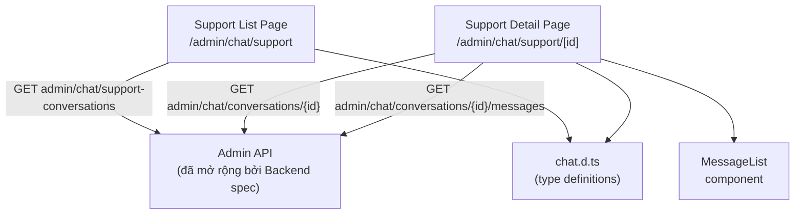
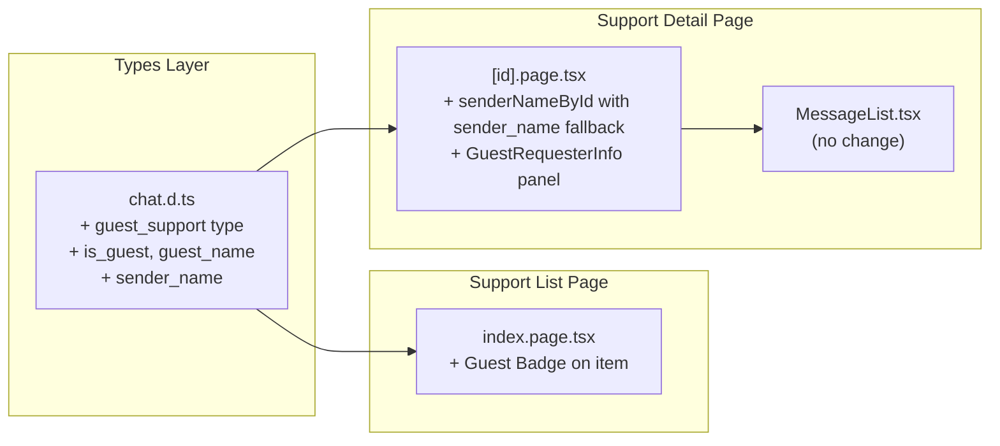
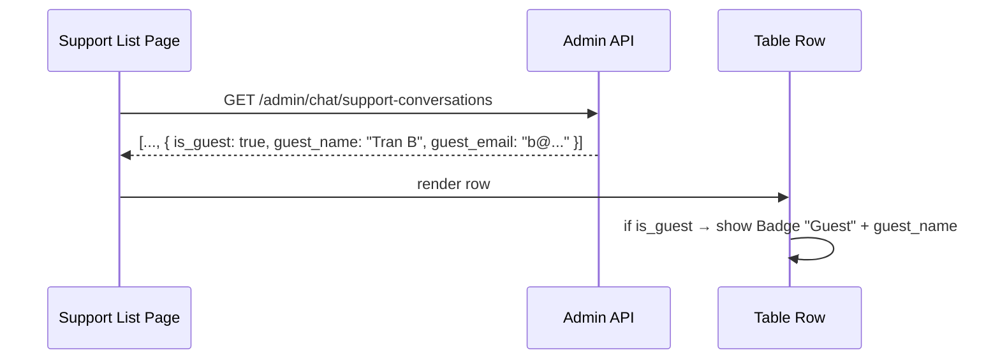
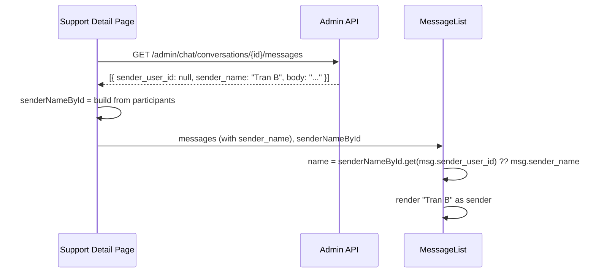

# Design Document: Guest Support — Web Admin

## Overview

Thay đổi web admin tập trung vào 4 điểm nhỏ, không tạo trang mới: (1) mở rộng TypeScript types, (2) thêm `Badge` "Guest" vào support list item, (3) thay Requester Info panel trên detail page cho guest conversations, (4) fix sender name resolution trong `MessageList` để đọc `message.sender_name` khi `sender_user_id` là null. Tất cả thay đổi backward-compatible — authenticated support conversations không bị ảnh hưởng.

### Design Goals
- Thay đổi tối thiểu: không tạo component mới, không tạo route mới
- Backward-compatible: tất cả logic hiện tại cho `type = 'support'` giữ nguyên
- i18n-first: không hardcode string, dùng translation flow chuẩn của project

### Key Design Decisions
- **`sender_name` trong `ChatMessage` type** thay vì truyền thêm prop vào `MessageList`: `MessageList` đã nhận `senderNameById: Map<number, string>` — thay vì thêm prop mới, detail page tự build map với fallback từ `message.sender_name` khi `sender_user_id` là null, giữ interface của `MessageList` không đổi
- **Mantine `Badge` với `variant="outline"`** cho Guest_Label: phân biệt với status badge (đang dùng `variant="filled"`) mà không cần thêm màu mới
- **`guest_info` là optional field trên `ChatConversationDetail`** thay vì subtype riêng: đơn giản hơn, tránh discriminated union phức tạp cho một trường hợp nhỏ

### Type Change Summary

**`ChatMessage` — before:**
```typescript
interface ChatMessage {
    sender_user_id: number | null;
    sender_profile_picture: string | null;
    // ...
}
```

**After:**
```typescript
interface ChatMessage {
    sender_user_id: number | null;
    sender_name: string | null;        // ← thêm mới
    sender_profile_picture: string | null;
    // ...
}
```

**`ChatSupportConversationListItem` — before:**
```typescript
interface ChatSupportConversationListItem {
    created_by_user_id: number;
    created_by_name: string | null;
    // ...
}
```

**After:**
```typescript
interface ChatSupportConversationListItem {
    created_by_user_id: number | null;  // ← null cho guest
    created_by_name: string | null;
    is_guest: boolean;                  // ← thêm mới
    guest_name: string | null;          // ← thêm mới
    guest_email: string | null;         // ← thêm mới
}
```

## Architecture

### System Context

Web admin không gọi thêm endpoint mới — chỉ đọc thêm fields từ các response hiện tại đã được backend mở rộng.



### High-Level Architecture



## Components and Interfaces

### Component 1: `chat.d.ts` (mở rộng types)

**Purpose**: Định nghĩa TypeScript types cho toàn bộ chat feature — cần mở rộng để bao gồm guest fields.

**Responsibilities**:
- Export `ChatConversationType` với value mới `'guest_support'`
- Mở rộng `ChatMessage` thêm `sender_name`
- Mở rộng `ChatSupportConversationListItem` thêm `is_guest`, `guest_name`, `guest_email`
- Thêm `ChatGuestSupportConversationDetail` type cho detail page

**Implementation Notes**:
- `created_by_user_id` trên `ChatSupportConversationListItem` cần đổi từ `number` sang `number | null` (guest không có user_id)
- Thêm `ChatGuestInfo` interface riêng để `ChatConversationDetail` có thể optional-extend

---

### Component 2: `support/index.page.tsx` (Guest Badge trên list)

**Purpose**: Hiển thị Guest_Label badge cạnh tên requester cho guest conversations.

**Responsibilities**:
- Render `<Badge variant="outline" size="xs">{t('Guest')}</Badge>` khi `item.is_guest === true`
- Dùng `item.guest_name` thay `item.created_by_name` khi cái sau là null

**Implementation Notes**:
- Vị trí badge: inline sau requester name, trong cùng table cell
- Không thay đổi columns, sorting, filtering logic

---

### Component 3: `support/[id].page.tsx` (Requester Info + sender name fix)

**Purpose**: Hiển thị đúng thông tin requester cho guest và fix sender name cho guest messages.

**Responsibilities**:

**3a — `senderNameById` map với fallback:**
```typescript
// Hiện tại — chỉ build từ participants
const senderNameById = useMemo(() => {
    const map = new Map<number, string>();
    participants.forEach(p => { if (p.user_id && p.name) map.set(p.user_id, p.name); });
    return map;
}, [participants]);

// Sau khi sửa — messages tự mang sender_name cho guest
// MessageList nhận thêm prop: messages đã có sender_name
// Trong MessageList, khi render: senderName = senderNameById.get(msg.sender_user_id) ?? msg.sender_name
```

**3b — Requester Info panel:**
- Nếu `detail.type === 'guest_support'`: render `GuestRequesterInfo` (tên + email + Guest badge, không có user profile link)
- Nếu không: giữ nguyên `EmployeeRequesterInfo` hiện tại

**Implementation Notes**:
- `GuestRequesterInfo` là inline JSX trong file, không tách thành file riêng (quá nhỏ)
- `guest_info` lấy từ `ChatConversationDetail.guest_info` (optional field)

---

### Component 4: `components/chat/MessageList.tsx` (sender name từ message payload)

**Purpose**: Hiển thị đúng sender name cho guest messages mà không thay đổi interface component.

**Responsibilities**:
- Khi render sender name: check `senderNameById.get(msg.sender_user_id) ?? msg.sender_name ?? null`
- Nếu cả hai đều null → đây là system message, không hiển thị sender name (behavior cũ)

**Implementation Notes**:
- Thay đổi duy nhất: 1 dòng trong phần resolve sender name
- `MessageList` props không thay đổi — `senderNameById` vẫn là `Map<number, string>`

## Data Models

### Updated Types

```typescript
// frontend/src/types/models/chat.d.ts

export type ChatConversationType =
    | 'admin_group'
    | 'shift_group'
    | 'user_group'
    | 'support'
    | 'guest_support';   // ← mới

export interface ChatMessage {
    id: number;
    conversation_id: number;
    sender_user_id: number | null;
    sender_name: string | null;           // ← mới
    sender_profile_picture: string | null;
    client_message_id: string | null;
    message_type: ChatMessageType;
    body: string | null;
    system_payload: ChatSystemPayload | null;
    attachments: ChatMessageAttachment[];
    created_at: string | null;
}

export interface ChatGuestInfo {
    name: string;
    email: string;
    device_id: string;
    platform: string;
}

export interface ChatSupportConversationListItem {
    id: number;
    type: ChatConversationType;
    status: ChatConversationStatus;
    title: string | null;
    created_by_user_id: number | null;   // ← nullable (was number)
    created_by_name: string | null;
    is_guest: boolean;                    // ← mới
    guest_name: string | null;            // ← mới
    guest_email: string | null;           // ← mới
    participant_count: number;
    last_message_at: string | null;
    last_message: ChatLastMessage | null;
}

// Extend ChatConversationDetail với guest_info (optional)
export interface ChatConversationDetail extends ChatConversationListItem {
    // ... existing fields ...
    guest_info: ChatGuestInfo | null;    // ← mới, null cho non-guest
}
```

### Data Flow





## API Design

Không có endpoint mới. Web admin chỉ đọc thêm fields từ:
- `GET /admin/chat/support-conversations` → thêm `is_guest`, `guest_name`, `guest_email`
- `GET /admin/chat/conversations/{id}` → thêm `guest_info`
- `GET /admin/chat/conversations/{id}/messages` → thêm `sender_name` trên mỗi message
- Realtime `chat.message.new` event payload → thêm `sender_name`

## Security Considerations

### Authorization
- Không thay đổi — guest conversations đã được authorize qua `CHAT_ASSIGN` permission như support thông thường

### Data Protection
- `guest_email` chỉ render dưới dạng plain text trong Requester Info panel — không tạo `mailto:` link

## Error Handling

### Data Edge Cases

| Scenario | Handling |
|----------|----------|
| `is_guest = true` nhưng `guest_info = null` | Requester Info hiển thị skeleton; không crash |
| `sender_user_id = null` và `sender_name = null` | Xử lý như system message — không hiển thị sender name |
| `created_by_name = null` và `guest_name = null` | Hiển thị em dash "—" làm fallback |

## Performance Considerations

### Optimization Strategies
- Không có thêm API call — chỉ đọc thêm fields từ response hiện tại
- `senderNameById` useMemo không thay đổi dependency array — không tốn thêm compute

## Testing Strategy

### Unit Tests
Không có unit test riêng cho web admin (project dùng e2e / manual testing cho UI).

### Checklist Manual Test
- Support list: guest conversation có Badge "Guest", hiển thị `guest_name`
- Support list: authenticated conversation không có Badge "Guest"
- Support detail: Requester Info panel hiển thị `guest_name` + `guest_email` cho guest
- Support detail: Requester Info panel giữ nguyên cho authenticated
- Chat messages: tin nhắn của guest hiển thị đúng `sender_name`
- Chat messages: tin nhắn của admin vẫn hiển thị đúng tên admin
- System messages vẫn render đúng (sender null + sender_name null)
- `pnpm typecheck` không có lỗi mới
