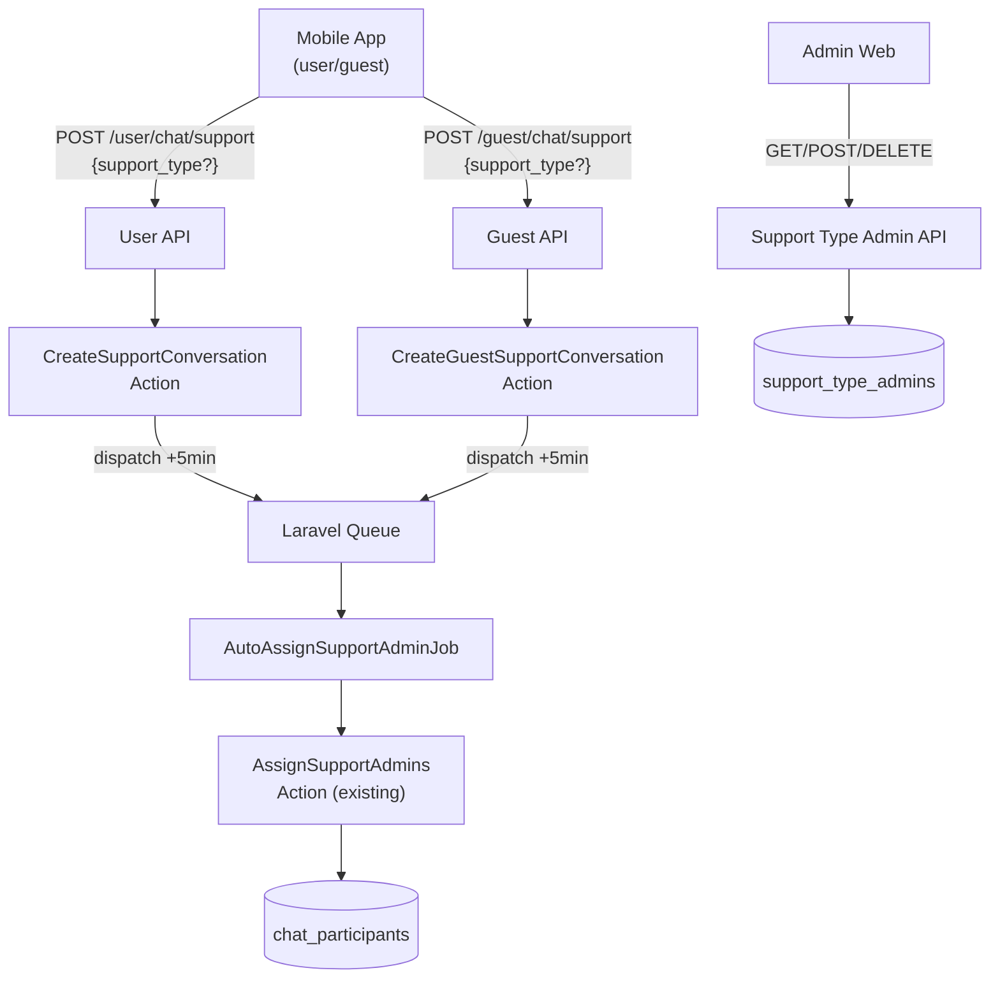
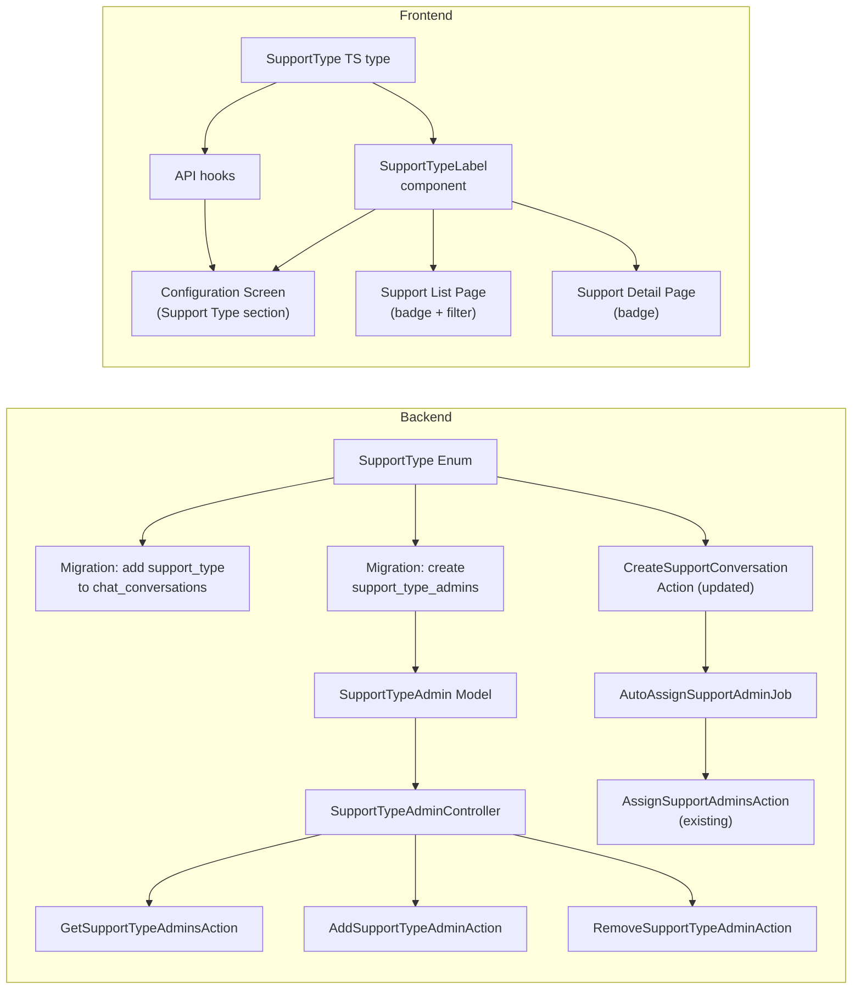
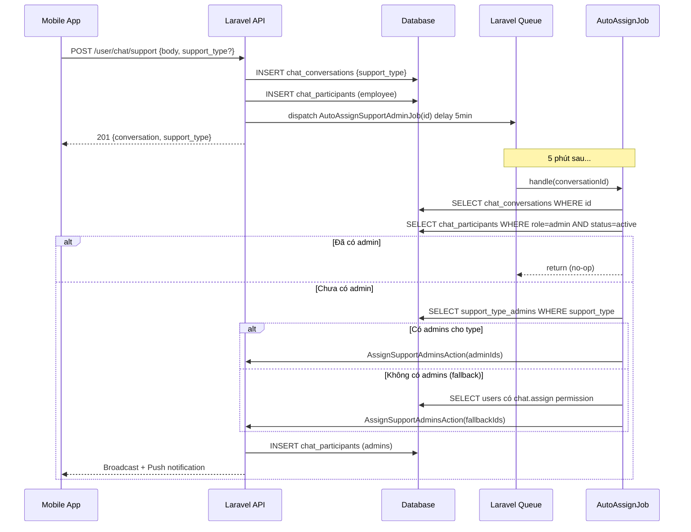
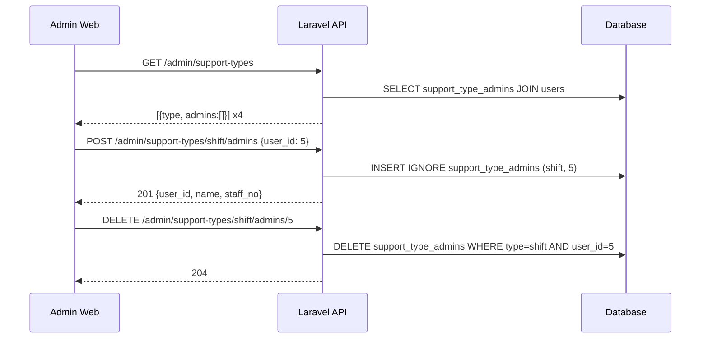

# Design Document: Support Type & Auto-Assignment

## Overview

Feature bổ sung `support_type` vào `chat_conversations`, tạo bảng `support_type_admins` để cấu hình admin phụ trách từng loại, và một delayed job tự động phân công sau 5 phút. Backend mở rộng 2 action tạo support (user + guest) để nhận `support_type` và dispatch job. Frontend thêm màn hình cấu hình trong `/admin/configuration`, badge màu sắc trên danh sách/chi tiết support, và dropdown filter theo loại. Không có breaking change — `support_type` là optional ở cả API lẫn hiển thị.

### Design Goals
- Không phá vỡ luồng support hiện tại (assignment thủ công vẫn hoạt động như cũ)
- Tái sử dụng `AssignSupportAdminsAction` cho cả manual và auto-assign
- `support_type` là optional — conversation không có type vẫn hoạt động bình thường
- Component `SupportTypeLabel` dùng chung giữa list và detail để nhất quán

### Key Design Decisions
- **Enum cố định, không runtime config**: 4 loại hardcode trong PHP enum và TS type — đơn giản, type-safe, không cần CRUD quản lý loại
- **Delayed job thay vì scheduler**: `AutoAssignSupportAdminJob::dispatch()->delay(5 min)` gắn với từng conversation, chính xác hơn scheduler chạy định kỳ
- **Fallback về tất cả ChatAssign users**: Khi type không có admin, dùng Fallback_Admins thay vì bỏ qua — đảm bảo không có support nào bị bỏ sót
- **Reuse `chat.assign` permission**: Không thêm quyền mới, tái sử dụng quyền có sẵn cho cả manual assign lẫn quản lý Support_Type_Admin
- **`shift_id` đã có sẵn**: Cột `chat_conversations.shift_id` đã tồn tại (nullable FK tới `shifts`) — chỉ cần expose trong request validation và response, không cần migration mới
- **`shift_id` chỉ áp dụng cho user (không phải guest)**: Guest không có tài khoản nên không có ca làm

---

## Architecture

### System Context



### High-Level Architecture



---

## Components and Interfaces

### Component 1: SupportType Enum (Backend)

**Purpose**: Source of truth cho 4 giá trị support type.

**Responsibilities**:
- Định nghĩa 4 case: `Document`, `Shift`, `Salary`, `Transportation`
- Cung cấp `values()` và `names()` qua `EnumTrait`

**Interfaces**:
- **Input**: N/A (static enum)
- **Output**: string values `document | shift | salary | transportation`
- **Dependencies**: `EnumTrait`

**Implementation Notes**:
- File: `backend/app/Enums/SupportType.php`
- Dùng `Rule::enum(SupportType::class)` trong validation

---

### Component 2: SupportTypeAdmin Model

**Purpose**: Ánh xạ quan hệ nhiều-nhiều giữa support type và user.

**Responsibilities**:
- CRUD trên bảng `support_type_admins`
- Eager load `user:id,name,staff_no,profile_picture` cho API response

**Interfaces**:
- **Input**: `support_type` (string), `user_id` (int)
- **Output**: Eloquent model với relation `user()`
- **Dependencies**: `User` model

**Implementation Notes**:
- File: `backend/app/Models/SupportTypeAdmin.php`
- Unique constraint trên `(support_type, user_id)` — idempotent insert dùng `firstOrCreate`

---

### Component 3: SupportTypeAdminController

**Purpose**: REST API để quản lý admin phụ trách từng loại.

**Responsibilities**:
- `GET /admin/support-types` — trả về tất cả 4 type kèm admins
- `POST /admin/support-types/{type}/admins` — thêm admin
- `DELETE /admin/support-types/{type}/admins/{userId}` — xoá admin

**Interfaces**:
- **Input**: HTTP request với `type` path param, `user_id` body param
- **Output**: JSON response
- **Dependencies**: `GetSupportTypeAdminsAction`, `AddSupportTypeAdminAction`, `RemoveSupportTypeAdminAction`

**Implementation Notes**:
- File: `backend/app/Http/Controllers/Admin/SupportTypeAdminController.php`
- Middleware `permission:chat.assign` trên toàn bộ route group
- `SupportType::from($type)` tự throw `ValueError` → Laravel trả 500; cần wrap bằng `try/catch` hoặc dùng `SupportType::tryFrom($type) ?? abort(422)`

---

### Component 4: AutoAssignSupportAdminJob

**Purpose**: Tự động phân công admin sau 5 phút nếu chưa có ai nhận.

**Responsibilities**:
- Kiểm tra conversation còn open và chưa có active admin
- Lấy danh sách admin theo `support_type`, fallback về tất cả `chat.assign` users
- Gọi `AssignSupportAdminsAction` để assign (kèm notifications, system messages)

**Interfaces**:
- **Input**: `conversationId` (int) — truyền qua constructor
- **Output**: void (side effects: ChatParticipant records, notifications, broadcasts)
- **Dependencies**: `AssignSupportAdminsAction`, `SupportTypeAdmin`, `User` model, `PermissionName::ChatAssign`

**Implementation Notes**:
- File: `backend/app/Jobs/AutoAssignSupportAdminJob.php`
- Implements `ShouldQueue`, dùng `Queueable` trait
- Dispatch: `AutoAssignSupportAdminJob::dispatch($conversation->id)->delay(now()->addMinutes(5))`
- Guard checks: conversation tồn tại + status open + chưa có active admin participant → skip nếu không thỏa
- Actor cho `AssignSupportAdminsAction`: lấy user đầu tiên có `chat.assign` permission (system actor)

---

### Component 5: SupportTypeLabel (Frontend)

**Purpose**: Badge hiển thị loại support, dùng chung giữa list và detail.

**Responsibilities**:
- Render Mantine `Badge` với màu và label đã dịch theo ngôn ngữ hiện tại
- Nhận `type: SupportType` và `size?: 'xs' | 'sm' | 'md'`

**Interfaces**:
- **Input**: `{ type: SupportType; size?: string }`
- **Output**: JSX Badge element
- **Dependencies**: `@mantine/core Badge`, `react-i18next`

**Implementation Notes**:
- File: `frontend/src/components/chat/SupportTypeLabel.tsx`
- Color map: `document→blue`, `shift→green`, `salary→orange`, `transportation→violet`

---

### Component 6: Support Type Config Section (Frontend)

**Purpose**: Giao diện quản lý admin phụ trách từng loại trong màn hình cấu hình.

**Responsibilities**:
- Hiển thị 4 type với danh sách admins hiện tại
- Cho phép thêm/xoá admin (nếu có `chat.assign`)
- Read-only nếu chỉ có `config.edit` mà không có `chat.assign`

**Interfaces**:
- **Input**: Data từ `useSupportTypeConfigsQuery()`
- **Output**: UI với add/remove controls
- **Dependencies**: `SupportTypeLabel`, `useAddSupportTypeAdminMutation`, `useRemoveSupportTypeAdminMutation`, user picker modal

**Implementation Notes**:
- Đặt trong `frontend/src/pages/admin/configuration/partials/support_type_config.tsx`
- Import và render trong `configuration_form.tsx` (hoặc trang configuration chính)
- Guard: kiểm tra `config.edit` để hiển thị section, kiểm tra `chat.assign` để hiển thị add/remove controls

---

## Data Models

### Entity 1: SupportType (PHP Enum)

```php
// backend/app/Enums/SupportType.php
enum SupportType: string
{
    use EnumTrait;

    case Document       = 'document';
    case Shift          = 'shift';
    case Salary         = 'salary';
    case Transportation = 'transportation';
}
```

### Entity 2: support_type_admins (DB Table)

```php
// Migration schema
Schema::create('support_type_admins', function (Blueprint $table) {
    $table->id();
    $table->string('support_type');           // SupportType enum value
    $table->foreignId('user_id')->constrained('users')->cascadeOnDelete();
    $table->timestamps();
    $table->unique(['support_type', 'user_id']);
});
```

**Validation Rules**:
- `support_type` phải là một trong 4 giá trị enum
- `user_id` phải tồn tại trong bảng `users`
- Cặp `(support_type, user_id)` là unique

### Entity 3: chat_conversations (thêm cột)

```php
// Migration
$table->string('support_type')->nullable()->after('type');
```

**Validation Rules**:
- `support_type` nullable; nếu có giá trị phải thuộc `SupportType` enum
- Chỉ có ý nghĩa khi `type` là `support` hoặc `guest_support`

### Entity 4: SupportType (TypeScript)

```typescript
// frontend/src/types/models/chat.d.ts
export type SupportType = 'document' | 'shift' | 'salary' | 'transportation';

export interface SupportTypeConfig {
  type: SupportType;
  admins: Array<{
    user_id: number;
    name: string;
    staff_no: string;
    profile_picture: string | null;
  }>;
}

// Extend existing ChatSupportConversationListItem:
// + support_type?: SupportType | null
```

### Data Flow — Tạo Support và Auto-Assign



### Data Flow — Quản lý Support Type Admins



---

## API Design

### Endpoint 1: GET /admin/support-types

**Method**: `GET`
**Path**: `/admin/support-types`
**Middleware**: `auth:sanctum`, `permission:chat.assign`

**Response**:
```json
[
  {
    "type": "document",
    "admins": [
      { "user_id": 1, "name": "Nguyen Van A", "staff_no": "NV001", "profile_picture": "https://..." }
    ]
  },
  { "type": "shift", "admins": [] },
  { "type": "salary", "admins": [] },
  { "type": "transportation", "admins": [] }
]
```

**Error Responses**:
- `401 Unauthorized`: Chưa đăng nhập
- `403 Forbidden`: Không có `chat.assign` permission

---

### Endpoint 2: POST /admin/support-types/{type}/admins

**Method**: `POST`
**Path**: `/admin/support-types/{type}/admins`
**Middleware**: `auth:sanctum`, `permission:chat.assign`

**Request**:
```json
{ "user_id": 5 }
```

**Response** (201):
```json
{ "user_id": 5, "name": "Tran Thi B", "staff_no": "NV002", "profile_picture": "https://..." }
```

**Error Responses**:
- `422 Unprocessable Entity`: `type` không hợp lệ hoặc `user_id` không tồn tại
- `403 Forbidden`: Không có `chat.assign` permission

---

### Endpoint 3: DELETE /admin/support-types/{type}/admins/{userId}

**Method**: `DELETE`
**Path**: `/admin/support-types/{type}/admins/{userId}`
**Middleware**: `auth:sanctum`, `permission:chat.assign`

**Response**: `204 No Content`

**Error Responses**:
- `422 Unprocessable Entity`: `type` không hợp lệ
- `403 Forbidden`: Không có `chat.assign` permission

---

### Endpoint 4: Cập nhật POST /user/chat/support

Thêm `support_type` (optional) và `shift_id` (optional, chỉ có ý nghĩa khi `support_type = shift`):

```json
{
  "body": "Tôi cần hỗ trợ về ca làm tuần này",
  "support_type": "shift",
  "shift_id": 42
}
```

**Validation rules bổ sung:**
- `support_type`: `nullable|string|Rule::enum(SupportType::class)`
- `shift_id`: `nullable|integer|exists:shifts,id` — chỉ validate sự tồn tại, không bắt buộc phải kèm `support_type=shift`

Response thêm `support_type` và `shift_id` trong conversation payload:
```json
{
  "id": 123,
  "type": "support",
  "support_type": "shift",
  "shift_id": 42,
  "status": "open"
}
```

> **Lưu ý**: `shift_id` đã có sẵn trong cột `chat_conversations.shift_id` (nullable FK tới `shifts`) — không cần migration mới.

---

### Endpoint 5: Cập nhật POST /guest/chat/support

Guest không có ca làm nên **không nhận `shift_id`**. Chỉ thêm `support_type`:

```json
{
  "body": "Tôi cần hỗ trợ",
  "support_type": "salary"
}
```

---

### Endpoint 6: Cập nhật GET /admin/chat/support-conversations

Thêm query param `support_type` (optional):

```
GET /admin/chat/support-conversations?status=all&support_type=salary
```

Response item thêm `support_type`:
```json
{
  "id": 123,
  "type": "support",
  "support_type": "salary",
  "status": "open"
}
```

---

## Security Considerations

### Authentication
- Tất cả admin API yêu cầu `auth:sanctum` middleware có sẵn

### Authorization
- `GET/POST/DELETE /admin/support-types/*`: require `chat.assign` permission
- Frontend config screen: require `config.edit` để render section; require `chat.assign` để hiển thị add/remove controls
- `AutoAssignSupportAdminJob` không expose HTTP endpoint — chỉ chạy qua queue worker nội bộ

### Data Protection
- `support_type` không chứa PII, không cần mã hoá
- User list trong add-admin modal dùng existing user list API với pagination — không expose toàn bộ user list một lần

### Input Validation
- `type` path param validate bằng `SupportType::tryFrom($type) ?? abort(422)`
- `user_id` validate `exists:users,id`
- `support_type` trong tạo support validate bằng `Rule::enum(SupportType::class)`

---

## Error Handling

### API Errors

| Scenario | Handling |
|----------|----------|
| `type` path param không hợp lệ | `422` với message "Invalid support type" |
| `user_id` không tồn tại | `422` validation error |
| Add admin trùng lặp | `firstOrCreate` — trả `201` như bình thường, không lỗi |
| Remove admin không tồn tại | `delete()` không throw — trả `204` |
| Thiếu `chat.assign` permission | `403 Forbidden` |

### Job Errors

| Scenario | Handling |
|----------|----------|
| Conversation không tồn tại khi job chạy | Early return, không throw |
| Conversation đã closed | Early return, không throw |
| Đã có active admin | Early return, không throw |
| Không tìm được actor user | Early return, không throw |
| `AssignSupportAdminsAction` throw | Job fail, Laravel queue retry theo policy |

### Frontend Errors

| Scenario | Handling |
|----------|----------|
| Add/remove admin thất bại | Toast error, không reload page |
| `useSupportTypeConfigsQuery` thất bại | Hiển thị error state trong section |
| `support_type` không hợp lệ trong response | Không render badge (optional chaining) |

---

## Performance Considerations

### Expected Load
- **Support Type Config API**: Low traffic (admin config, vài lần/ngày)
- **Auto Assign Job**: Chạy theo số lượng support conversation mới — thường < 100/ngày
- **Support List với filter**: Moderate — cùng tần suất với support list hiện tại

### Optimization Strategies
- Index trên `support_type_admins.support_type` để query nhanh khi job chạy
- Index trên `chat_conversations.support_type` để filter danh sách
- Job chạy trong queue riêng biệt để không ảnh hưởng request chính
- `GetSupportTypeAdminsAction` eager load `user:id,name,staff_no` để tránh N+1

---

## Testing Strategy

### Unit Tests (PHPUnit)

**`AutoAssignSupportAdminJobTest` (`tests/Unit/Jobs/AutoAssignSupportAdminJobTest.php`):**
- `testSkipsIfConversationNotFound` — job nhận ID không tồn tại → không throw, không assign
- `testSkipsIfConversationClosed` — conversation status=closed → không assign
- `testSkipsIfAlreadyHasActiveAdmin` — đã có ChatParticipant role=admin, status=active → không assign
- `testAssignsTypedAdminsWhenTypeSet` — conversation có `support_type=shift`, bảng `support_type_admins` có 2 user cho shift → assign đúng 2 user đó
- `testFallsBackToAllChatAssignUsersWhenTypeHasNoAdmins` — `support_type=shift` nhưng không có Support_Type_Admin → assign tất cả user có `chat.assign`
- `testFallsBackToAllChatAssignUsersWhenSupportTypeIsNull` — `support_type=null` → assign tất cả user có `chat.assign`
- `testDoesNothingWhenNoFallbackAdminsExist` — không có Support_Type_Admin và không có user có `chat.assign` → hoàn thành mà không lỗi

**`AddSupportTypeAdminActionTest` (`tests/Unit/Actions/Chat/Support/AddSupportTypeAdminActionTest.php`):**
- `testAddsSupportTypeAdmin` — thêm user vào type → row tồn tại trong DB
- `testIdempotentOnDuplicate` — gọi 2 lần → chỉ có 1 row, không throw

**`RemoveSupportTypeAdminActionTest` (`tests/Unit/Actions/Chat/Support/RemoveSupportTypeAdminActionTest.php`):**
- `testRemovesSupportTypeAdmin` — xoá user khỏi type → row không còn trong DB
- `testNoopWhenAdminNotAssigned` — xoá user không tồn tại trong type → không throw

**`GetSupportTypeAdminsActionTest` (`tests/Unit/Actions/Chat/Support/GetSupportTypeAdminsActionTest.php`):**
- `testReturnsAllFourTypesEvenWhenEmpty` — không có data → trả về 4 type với `admins: []`
- `testGroupsAdminsByType` — có data cho 2 type → group đúng, type còn lại có `admins: []`

---

### Feature Tests (PHPUnit)

**`SupportTypeAdminControllerTest` (`tests/Feature/Admin/SupportTypeAdminControllerTest.php`):**

*GET /admin/support-types*
- `testIndexRequiresAuthentication` — unauthenticated → 401
- `testIndexRequiresChatAssignPermission` — authenticated nhưng thiếu quyền → 403
- `testIndexReturnsAllFourTypesWithAdmins` — có quyền → trả về JSON đúng cấu trúc, 4 type

*POST /admin/support-types/{type}/admins*
- `testAddAdminRequiresChatAssignPermission` — thiếu quyền → 403
- `testAddAdminReturns201` — hợp lệ → 201, row tồn tại trong DB
- `testAddAdminIsIdempotent` — gọi 2 lần → 201 cả 2 lần, chỉ 1 row
- `testAddAdminReturns422ForInvalidType` — type không hợp lệ → 422
- `testAddAdminReturns422ForInvalidUserId` — user_id không tồn tại → 422

*DELETE /admin/support-types/{type}/admins/{userId}*
- `testRemoveAdminRequiresChatAssignPermission` — thiếu quyền → 403
- `testRemoveAdminReturns204` — hợp lệ → 204, row không còn trong DB
- `testRemoveAdminNoopWhenNotAssigned` — admin chưa được assign → 204 (no-op)
- `testRemoveAdminReturns422ForInvalidType` — type không hợp lệ → 422

**`CreateSupportConversationWithTypeTest` (`tests/Feature/User/ChatSupportControllerTest.php` — extend existing):**
- `testCreateSupportConversationWithSupportType` — gửi `support_type=salary` → conversation lưu đúng type, job dispatched
- `testCreateSupportConversationWithoutSupportType` — không gửi `support_type` → conversation lưu `null`, job dispatched
- `testCreateSupportConversationReturns422ForInvalidType` — `support_type=invalid` → 422
- `testResponseIncludesSupportType` — response payload chứa `support_type`

**`CreateGuestSupportConversationWithTypeTest` (`tests/Feature/Guest/ChatSupportControllerTest.php` — extend existing):**
- Tương tự 4 test case trên nhưng cho guest endpoint

**`GetSupportConversationsFilterTest` (`tests/Feature/Admin/GetSupportConversationsTest.php` — extend existing):**
- `testFilterBySupportType` — query param `support_type=salary` → chỉ trả về conversation có type=salary
- `testFilterBySupportTypeCombinedWithStatusFilter` — `support_type=shift&status=open` → kết hợp đúng 2 filter
- `testFilterBySupportTypeWithInvalidValue` → 422
- `testResponseIncludesSupportTypeField` — mỗi item trong response có field `support_type`

---

### Frontend Tests (Vitest)

**`SupportTypeLabel.test.tsx` (`frontend/src/components/chat/SupportTypeLabel.test.tsx`):**
- Render badge với đúng màu cho từng type (4 test case)
- Render đúng label tiếng Việt
- Prop `size` được truyền xuống Badge

**`support_type_config.test.tsx` (`frontend/src/pages/admin/configuration/partials/support_type_config.test.tsx`):**
- Hiển thị 4 section type
- Hiển thị admins đã gán
- Hiển thị empty state khi type không có admin
- Ẩn add/remove controls khi không có `chat.assign`
- Hiển thị add/remove controls khi có `chat.assign`
- Gọi mutation khi click remove

**`support_list.test.tsx` (extend existing support list test):**
- Hiển thị badge khi conversation có `support_type`
- Không hiển thị badge khi `support_type` là null
- Filter dropdown gọi API với đúng query param
