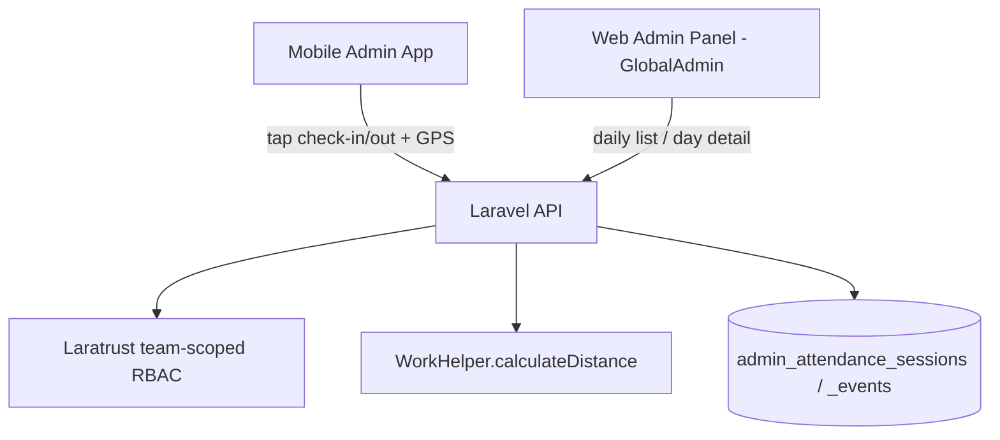
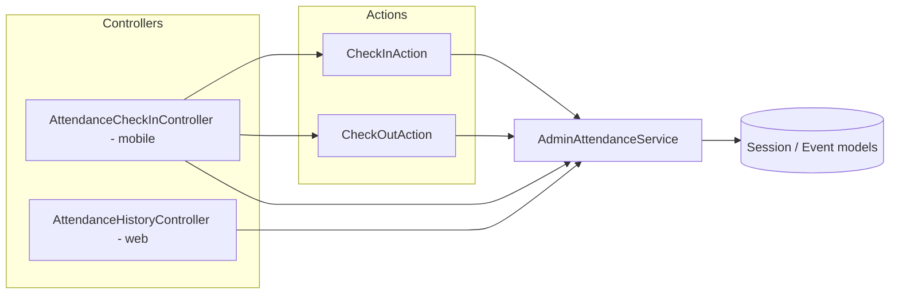
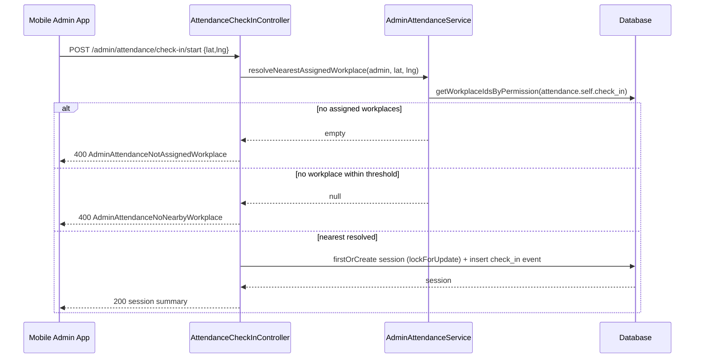
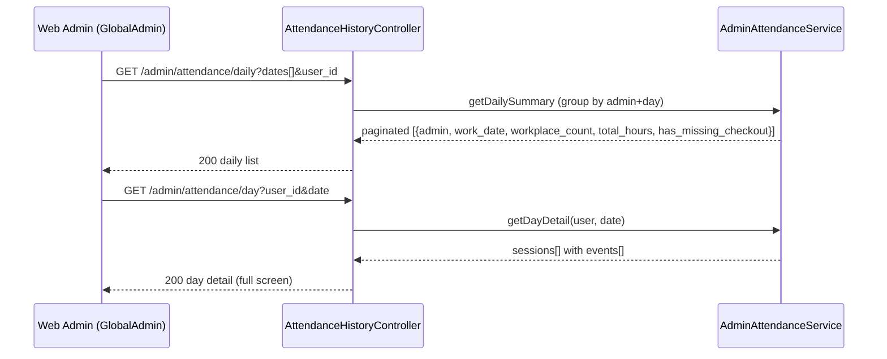

# Design Document: Admin Workplace Check-In

## Overview

This feature introduces a shift-independent attendance domain for managing admins who inspect factories. On mobile, an admin taps to check in/out; the app sends GPS coordinates and the server resolves the nearest assigned workplace (no face recognition, no photo). The server stores one Attendance_Session per (admin, workplace, day) plus an append-only Attendance_Event log (check-in/out with timestamp + coordinate). On the web panel, GlobalAdmin reviews attendance in two levels: Level 1 a paginated daily list (one row per admin + day), Level 2 a full-screen day-detail page listing each workplace with its inline check-in/out log. All new persistence is separate from the employee `check_ins` / `check_in_verifications` tables. Workplace scoping reuses Laratrust team-scoped RBAC (`User::getWorkplaceIdsByPermission()`).

### Design Goals

- Zero-friction mobile check-in: a single tap; GPS resolves the workplace; no face/photo step.
- Keep admin attendance data fully separate from employee shift-based check-in.
- Distinct, actionable mobile error codes ("not assigned to any workplace" vs "no nearby workplace").
- Worked-hours as raw duration (earliest check-in → latest check-out); no rounding/break/overtime/night logic.
- Support concurrent open sessions across multiple workplaces on the same day.

### Key Design Decisions

- **Two-table model**: `admin_attendance_sessions` (aggregate, one per admin+workplace+day) and `admin_attendance_events` (append-only log of every check-in/check-out). Worked-hours is derived on the session and recomputed on each check-out.
- **Superseded 2026-07-05**: worked-hours is no longer "earliest check-in → latest check-out." See [Addendum (2026-07-05): Interval-Based Worked-Hours Redesign](#addendum-2026-07-05-interval-based-worked-hours-redesign) below — Worked_Hours is now the sum of valid, non-interrupted Attendance_Intervals, computed per (user, work_date) across all of that admin's workplaces together, not per session in isolation.
- **No face recognition**: admin check-in/out only requires GPS. Events store only timestamp + coordinate. (Employee flow keeps its face pipeline; it is untouched.)
- **Nearest-workplace among Assigned_Workplaces only**: distance is computed over the admin's assigned workplaces using the shared `work.check_in.max_distance` (200m). GlobalAdmin resolves to all workplaces.
- **Eligibility via existing admin auth**: mobile endpoints sit behind the `manager.auth` gate (same as web admin login). Web history is gated by `role:global_admin`.
- **Web history two-level, read-only**: Level 1 daily summary → Level 2 full-screen day detail (own route, not a modal). Mobile admins see only their own history via self-scoped endpoints.

### Data Model Change Summary

**New tables (no change to existing `check_ins` / `check_in_verifications`):**

```
admin_attendance_sessions (id, user_id, workplace_id, work_date,
    first_check_in_at, last_check_out_at, work_minutes, timestamps)
    UNIQUE(user_id, workplace_id, work_date)

admin_attendance_events (id, session_id, type, event_time, coordinate, timestamps)
```

**Addendum (2026-07-05)**: `work_minutes` is redefined as the sum of valid Attendance_Intervals (see addendum below), no longer `last_check_out_at - first_check_in_at`. A new `admin_attendance_intervals` table is proposed to persist each committed interval explicitly (needed for the Day Detail UI, which must list intervals, not just first/last timestamps) — see the addendum's Data Model Change section.

## Architecture

### System Context



### High-Level Architecture



## Components and Interfaces

### Component 1: AdminAttendanceService

**Purpose**: Central domain logic — nearest-workplace resolution, session/event persistence, and history queries.

**Responsibilities**:
- Resolve the admin's Assigned_Workplaces via `User::getWorkplaceIdsByPermission(PermissionName::AttendanceSelfCheckIn->value)` and compute the Nearest_Workplace within `work.check_in.max_distance`.
- `persistCheckIn` / `persistCheckOut`: open/find the day's session (locked) and append events; recompute `last_check_out_at` + `work_minutes` on check-out.
- `getDailySummary`: Level 1 — paginated rows grouped by (user, work_date) with workplace_count, total_hours, has_missing_checkout.
- `getDayDetail`: Level 2 — all sessions (with event logs) for one (admin, day).

**Interfaces**:
- **Input**: acting/target `User`, GPS coordinates, filter params (date range, user_id, page).
- **Output**: `AdminAttendanceSession` models; a transformed `LengthAwarePaginator` (daily summary); a `Collection` of sessions with events (day detail).
- **Dependencies**: `WorkHelper::calculateDistance`, `Workplace`, `User`, the two new models.

**Implementation Notes**:
- Nearest resolution returns a typed outcome so actions map it to distinct `ErrorCode`s (empty-assignment vs no-nearby).
- `getDailySummary` uses a grouped query (`groupBy(user_id, work_date)`) + `paginate()` and `->through()` to shape rows.

### Component 2: CheckInAction / CheckOutAction (Mobile)

**Purpose**: Orchestrate a single tap check-in or check-out for the authenticated admin.

**Responsibilities**:
- Resolve Assigned_Workplaces → Nearest_Workplace; short-circuit with the correct `ErrorCode` when empty / no-nearby.
- Check-in: `firstOrCreate` the session (locked) and append a `check_in` event.
- Check-out: require an existing session (else `AdminAttendanceNotCheckedIn`); reject if now is not after the first check-in; append a `check_out` event and recompute worked-hours.

**Interfaces**:
- **Input**: `['latitude','longitude']`, acting `User`.
- **Output**: `ActionResult` (session summary or error).
- **Dependencies**: `AdminAttendanceService`. (No face/image services.)

**Implementation Notes**:
- Readonly Action classes; persistence wrapped in `DB::transaction` with `lockForUpdate` on the session row for concurrency safety.

### Component 3: AttendanceHistoryController (Web)

**Purpose**: Serve read-only history to GlobalAdmin.

**Responsibilities**:
- `daily`: Level 1 paginated summary (one row per admin + day), filtered by date range / user.
- `day`: Level 2 — sessions with event logs for one (admin, day).

**Interfaces**:
- **Input**: `dates[]`, `user_id`, `page`/`page_size` (daily); `user_id` + `date` (day).
- **Output**: JSON via `ResponseHelper` (`successPaginated` for daily).
- **Dependencies**: `AdminAttendanceService`. Route gated by `role:global_admin` (GlobalAdmin sees all — no per-workplace scoping).

### Component 4: Mobile CheckInController self-history

- `myHistory`: Level 1 daily summary scoped to `Auth::id()`.
- `myDay`: Level 2 day detail scoped to `Auth::id()`.

### Component 5: Frontend

- **Level 1 page** (`/admin/attendance`): daily list (Date, Admin via `UserWithAvatar` with profile link, Workplaces count, Total hours, Warning, detail action). Filters: date range + admin (`select-remote`). Row detail action navigates to the Level 2 route.
- **Level 2 page** (`/admin/attendance/day?user_id=&date=`): full screen; a vertically scrollable list of workplace cards, each with workplace link, first check-in, last check-out, hours (or warning), and an inline table of that session's events. Includes a Back control.
- Both pages gated by GlobalAdmin role via `RoleHelper.canAccessRoute` (route `roles: ['global_admin']`). All copy uses `t(...)`.

## Data Models

### Entity 1: AdminAttendanceSession

```typescript
// frontend/src/types/models/admin_attendance_session.d.ts
interface AdminAttendanceSession {
    id: number;
    user_id: number;
    workplace_id: number;
    work_date: string;
    first_check_in_at: string;
    last_check_out_at: string | null;
    work_minutes: number | null; // null => no check-out yet
    work_hours: string;
    user?: User;
    workplace?: Workplace;
    events?: AdminAttendanceEvent[];
}

// Level 1 row
interface AdminAttendanceDailySummary {
    user_id: number;
    work_date: string;
    user?: User;
    workplace_count: number;
    total_hours: string;
    has_missing_checkout: boolean;
}
```

### Entity 2: AdminAttendanceEvent

```typescript
// frontend/src/types/models/admin_attendance_event.d.ts
interface AdminAttendanceEvent {
    id: number;
    session_id: number;
    type: 'check_in' | 'check_out';
    event_time: string;
    coordinate: string; // "lat,lng"
    created_at: string;
}
```

**Validation / Rules**:
- `UNIQUE(user_id, workplace_id, work_date)` on sessions.
- `work_minutes` null until a check-out exists; else raw minutes from earliest check-in to latest check-out.
- Check-out `event_time` must be after the session's `first_check_in_at`.

### Data Flow — Mobile Check-In



### Data Flow — Web History Drill-Down



## API Design

All endpoints require `auth:api`. Mobile endpoints require the `manager.auth` gate; web endpoints require `role:global_admin`.

### Endpoint 1: Admin Check-In (Mobile)

**Method**: `POST` — **Path**: `/admin/attendance/check-in/start`
**Request**: `{ "latitude": 35.6812, "longitude": 139.7671 }`
**Response**: session summary (`workplace_id`, `work_date`, `first_check_in_at`, `last_check_out_at`, `work_minutes`).
**Errors**: `400 ADMIN_ATTENDANCE_NOT_ASSIGNED_WORKPLACE`, `400 ADMIN_ATTENDANCE_NO_NEARBY_WORKPLACE`, `422` (missing/invalid coordinates).

### Endpoint 2: Admin Check-Out (Mobile)

**Method**: `POST` — **Path**: `/admin/attendance/check-in/end`
**Request**: same as check-in.
**Response**: session summary with updated `last_check_out_at` + `work_minutes`.
**Errors**: not-assigned / no-nearby (as check-in); `400 ADMIN_ATTENDANCE_NOT_CHECKED_IN`; `400 CHECK_OUT_TIME_INVALID`.

### Endpoint 3: Daily Summary (Web / Mobile self)

**Method**: `GET` — **Path**: `/admin/attendance/daily` (web) or `/admin/attendance/my-history` (mobile self)
**Query**: `dates[]` (from, to; optional), `user_id` (optional; web only), `page`, `page_size`
**Response** (paginated; one row per admin + day):
```json
{
    "data": [
        { "user_id": 5, "work_date": "2026-07-03", "workplace_count": 3,
          "total_hours": "6.50", "has_missing_checkout": false,
          "user": { "id": 5, "name": "Admin A", "staff_no": "1001", "profile_picture": null } }
    ],
    "current_page": 1, "last_page": 1, "per_page": 15, "total": 1
}
```

### Endpoint 4: Day Detail (Web / Mobile self)

**Method**: `GET` — **Path**: `/admin/attendance/day` (web) or `/admin/attendance/my-history/day` (mobile self)
**Query**: `user_id` (required; web), `date` (required)
**Response**: array of sessions, each with `workplace`, `first_check_in_at`, `last_check_out_at`, `work_hours`, `work_minutes`, and `events[]` (type, event_time, coordinate). Read-only.

### Endpoint 5: Nearby Workplace Preview (Mobile) — added 2026-07-05

**Purpose**: the mobile check-in/out screen previously had no way to know which workplace it would resolve to, or whether the admin was in range, until after submitting a check-in/check-out and possibly getting an error. This endpoint lets the UI show workplace + distance proactively (disabling the action button when out of range) instead of "tap and see".

**Method**: `GET` — **Path**: `/admin/attendance/check-in/nearby`
**Request**: `{ "latitude": 35.6812, "longitude": 139.7671 }` (query params, validated by the same `SubmitRequest` as check-in/out)
**Response** (always resolves the nearest assigned workplace, even if out of range — unlike check-in/out, there is no "no nearby workplace" error here):
```json
{
    "data": {
        "workplace": { "id": 5, "name": "Workplace A", "address": "123 Main St" },
        "distance_meters": 45,
        "max_distance_meters": 200,
        "within_range": true
    }
}
```
**Errors**: `400 ADMIN_ATTENDANCE_NOT_ASSIGNED_WORKPLACE` (no assigned workplace at all), `422` (missing/invalid coordinates).
**Implementation**: `AdminAttendanceService::previewNearestWorkplace()`, sharing the assigned-workplace/distance resolution (`assignedWorkplaceDistances()`) with `assignedWorkplacesWithinRange()` used by the actual check-in/out actions — the only difference is this preview never filters out an over-threshold result, it just flags `within_range: false`. Read-only; persists nothing.

## Security Considerations

### Authentication
- All endpoints require `auth:api`. Mobile check-in/out and self-history sit behind `manager.auth` (same gate as web admin login).

### Authorization
- Mobile: workplace eligibility enforced by team-scoped RBAC (`getWorkplaceIdsByPermission(AttendanceSelfCheckIn)`); GlobalAdmin → all.
- Web history: gated by `role:global_admin`. GlobalAdmin sees all admins/workplaces (no per-workplace scoping).
- Mobile self-history is scoped to `Auth::id()`.

### Data Protection
- Only GPS coordinates are stored per event; no images or biometric data for admin attendance.

### Input Validation
- FormRequests validate `latitude`/`longitude` numeric within valid ranges (check-in/out); `dates[]`, `user_id`, `date`, `page` for history.

## Error Handling

| Scenario | Handling |
|----------|----------|
| Admin has no Assigned_Workplaces | `400 ADMIN_ATTENDANCE_NOT_ASSIGNED_WORKPLACE` |
| No assigned workplace within threshold | `400 ADMIN_ATTENDANCE_NO_NEARBY_WORKPLACE` |
| Missing/invalid GPS | `422` validation error |
| Check-out with no session today | `400 ADMIN_ATTENDANCE_NOT_CHECKED_IN` |
| Check-out time not after first check-in | `400 CHECK_OUT_TIME_INVALID` |
| Concurrent duplicate check-in | Unique constraint + `lockForUpdate`; second request appends to the same session |
| Caller is not GlobalAdmin (web) | `403` from `role:global_admin` gate |
| Session without check-out | Row/section shows a warning; `work_hours` omitted |
| Nearby-preview: admin has no Assigned_Workplaces | `400 ADMIN_ATTENDANCE_NOT_ASSIGNED_WORKPLACE` (same as check-in) |
| Nearby-preview: nearest assigned workplace is out of range | **Not an error** — `200` with `within_range: false` and the actual distance, so the UI can show it instead of guessing |

## Performance Considerations

- Low volume (a bounded set of managing admins, a handful of check-ins/day).
- Indexes on `(user_id, work_date)` and `(workplace_id, work_date)` for history; `(session_id, event_time)` for the event log.
- Nearest-workplace computation runs only over the admin's assigned workplaces.

## Testing Strategy

### Backend Feature Tests

**`AdminAttendanceCheckInTest`**:
- Happy check-in creates session + event; not-assigned → distinct error; no-nearby → distinct error; missing coordinates → 422.
- Check-out computes worked-hours; no-session → error; multiple check-outs use the latest; concurrent presence (check-in at B while A open) creates two sessions.
- Nearby preview (`/check-in/nearby`, added 2026-07-05): resolves the workplace + distance when in range; still resolves it (with `within_range: false`) when out of range instead of erroring; missing coordinates → 422; permission gate → 403.

**`AdminAttendanceHistoryTest`**:
- Daily summary returns one row per admin/day with workplace_count + total_hours; flags missing check-out; filters by user + date range.
- Day detail returns that day's sessions with event logs; requires user_id + date (422); role gate blocks non-GlobalAdmins (403).

### Frontend Tests

- **Level 1 page**: renders date-range + admin filters; one row per admin/day (workplace count, total hours); warning badge for missing check-out; detail action navigates to the day route.
- **Level 2 page**: renders each workplace session with its inline event log; warning when a session has no check-out.

### Test Configuration
- No face pipeline to fake — tests post GPS coordinates directly and seed sessions/events via the models.

## Addendum (2026-07-05): Interval-Based Worked-Hours Redesign

Implements Requirement 8 (`requirements.md`). Replaces the naive "earliest check-in → latest check-out" computation currently in `AdminAttendanceService::recomputeWorkedHours` (`backend/app/Services/Admin/AdminAttendanceService.php:304-324`) and the three duplicated missing-checkout implementations (SQL correlated subquery in `getDailySummary`, `AdminAttendanceSession::getHasMissingCheckoutAttribute()`, private `isSessionOpen()`).

### Rationale

The original computation let a switch-and-forget pattern (check into A, wander to B, eventually fire off a stale check-out at A) silently inflate A's hours to the full span. The business requirement is that only genuinely continuous, uninterrupted presence at a workplace counts, while stray/late check-outs remain in the audit log but credit zero minutes.

### Model (confirmed decisions, 2026-07-05)

- **Rule of thumb**: among concurrently open workplaces, whichever closes via an explicit check-out **first** wins full credit and simultaneously marks every other still-open workplace Interrupted; a later check-out at an Interrupted workplace is audit-only (zero credit). The one exception is closing via a Checkpoint_Commit (return check-in to the same workplace) — that also credits fully, but never marks other workplaces Interrupted (only an explicit check-out does).
- **Interrupt scope**: when any workplace validly closes an interval (an explicit check-out on a non-Interrupted interval), **every other** currently-open workplace for that admin/day is marked Interrupted — not just the one most recently left. A person can only be in one place, so a confirmed complete visit elsewhere invalidates *all* other dangling opens.
- **Live/ongoing hours**: an interval left open at the end of processing contributes **zero** to Worked_Hours and is **never** shown as a live/projected "elapsed so far" number. The UI shows only a status label (e.g., "(in progress)" for the Current_Focus, a warning badge otherwise). Daily/session totals are strictly `sum(closed, credited intervals)` — deterministic and auditable, never changing on page refresh.
- **Checkpoint scope**: a Checkpoint_Commit (return check-in to an already-open workplace) does **not** count as evidence of a completed foreign round-trip. Only an explicit check-out closing a valid interval marks *other* workplaces Interrupted. A same-workplace return check-in is a "still coming back here" signal, not proof of having fully visited elsewhere.
- **Focus exemption scope (confirmed 2026-07-05)**: the Current_Focus no-warning exemption applies **only when Work_Date is the current date** at the time the interval computation runs. For a past Work_Date, any still-open interval is flagged missing-checkout regardless of whether it was the day's last check-in — a finished day gives no reason to assume the admin is still there. Practical consequence: since there is no scheduled job that re-evaluates old days as the calendar rolls over (see "Out of Scope" below), a session that was legitimately exempted while `Work_Date` was still "today" keeps that persisted `has_missing_checkout = false` until something touches that (admin, work_date) again — it is not automatically re-flagged the instant midnight passes.

### State Machine — Definitions

Per (admin, work_date), merge every Attendance_Event across all of that admin's workplace sessions for the day into one chronological timeline. Maintain, per workplace:

- `open_start[wp]`: timestamp of the currently-open (uncredited) interval's start, or `null`.
- `interrupted[wp]`: boolean, whether a foreign valid closure occurred while this interval has been open.
- `credited[wp]`: accumulated valid minutes (sum of closed intervals so far).

Also track `focus`, the workplace of the most recent check-in event (used only to decide the missing-checkout exemption at the end).

### Pseudocode

```
function recomputeDay(userId, workDate, now):
    is_today = (workDate == now.toDateString())
    events = all Attendance_Events for this admin's sessions on workDate, across every workplace,
             sorted by event_time (tagged with workplace_id)
    open_start = {}       # workplace_id -> Carbon | null
    interrupted = {}      # workplace_id -> bool
    credited = {}         # workplace_id -> int minutes, default 0
    last_event = null

    for event in events:
        wp = event.workplace_id
        if event.type == CHECK_IN:
            if open_start[wp] is null:
                open_start[wp] = event.event_time
                interrupted[wp] = false
            else:
                # Checkpoint_Commit: return check-in while already open
                if not interrupted[wp]:
                    credited[wp] += minutesBetween(open_start[wp], event.event_time)
                # else: stale/interrupted interval — discard, zero credit
                open_start[wp] = event.event_time
                interrupted[wp] = false
        else: # CHECK_OUT
            if open_start[wp] is not null:
                if not interrupted[wp]:
                    credited[wp] += minutesBetween(open_start[wp], event.event_time)
                    for other_wp, start in open_start where other_wp != wp and start is not null:
                        interrupted[other_wp] = true   # valid closure interrupts every other open workplace
                # else: interrupted — audit-only, zero credit
                open_start[wp] = null
            # else: orphan check-out — audit-only, no state change
        last_event = event

    for wp in open_start.keys():
        is_open = open_start[wp] is not null
        is_current_focus = is_today and is_open and last_event.type == CHECK_IN and last_event.workplace_id == wp
        has_missing_checkout[wp] = is_open and not is_current_focus

    persist per workplace/session: work_minutes = credited[wp], has_missing_checkout = has_missing_checkout[wp]
```

`is_current_focus` is well-defined and singular: at most one workplace can be "the workplace of the last event, which was a check-in that left it open."

### Architecture Change

Worked-hours can no longer be computed per session in isolation — a check-out at workplace B can retroactively invalidate an already-open interval at workplace A. Replace the single-session `AdminAttendanceService::recomputeWorkedHours($session)` with a day-scoped recomputation:

- New method `AdminAttendanceService::recomputeDay(User $admin, Carbon $workDate)` (or a dedicated `AdminAttendanceIntervalCalculator` class, consistent with the Action-pattern preference for isolating business logic) loads **all** of that admin's sessions + events for `work_date`, runs the state machine above, and writes the result back to each session.
- `persistCheckIn` / `persistCheckOut` call `recomputeDay(...)` (not just the touched session) inside the existing `DB::transaction` + `lockForUpdate`, since sibling sessions for the same day must be locked/updated together to avoid races between concurrent check-ins at different workplaces.
- This is a correctness-driven change, not a performance concern — per-admin daily session counts are small (a handful of workplaces/day).

### Data Model Change

Two options were considered:

1. **Recompute-on-read**: keep only `work_minutes` / `has_missing_checkout` on `admin_attendance_sessions`, derive the interval list on-the-fly from `admin_attendance_events` whenever Day Detail is rendered.
2. **Persist intervals** (recommended): add `admin_attendance_intervals` (`session_id`, `started_at`, `ended_at`, `minutes`, timestamps; index `(session_id, started_at)`), written by `recomputeDay` alongside `work_minutes`/`has_missing_checkout`. Day Detail reads this table directly instead of re-deriving it, and audit-only/discarded check-outs remain visible only in the raw event log (unchanged).

Recommendation: **option 2**. The state machine is sequential/stateful and does not translate into a single SQL aggregate (unlike the old `SUM(work_minutes)`), so recomputing it at read time for every Day Detail request re-runs PHP-side logic that write-time computation already produced once. Persisting intervals also gives the Level 1 daily summary a trivial `SUM(work_minutes)` again, and removes the need to keep the three duplicated missing-checkout implementations in sync — `has_missing_checkout` becomes a plain persisted column with one writer (`recomputeDay`) and many readers.

### Out of Scope for This Redesign

- The existing cross-midnight session-resolution logic (`AdminAttendanceService::findOpenSession` / `findRecentSession`, the 24h rolling lookback vs. strict `work_date` fallback) is unchanged — it decides *which session* an event belongs to; this redesign only changes how minutes are computed *within* the events already assigned to a Work_Date's sessions.
- No scheduled job is introduced to auto-close sessions that are never checked out, or to re-evaluate the Current_Focus exemption as the calendar rolls past midnight. Two accepted consequences of this, both flagged as possible future enhancements rather than part of this change:
    - `has_missing_checkout` can remain `true` indefinitely for a truly abandoned session.
    - A session legitimately exempted while its Work_Date was still "today" keeps `has_missing_checkout = false` after midnight until something else triggers a `recomputeDay` for that (admin, work_date) — it is not instantly re-flagged the moment the day ends.

### Test Case Matrix

All times same Work_Date unless noted. "Credited" = final `work_minutes` per workplace after all events process. "Warning" = `has_missing_checkout` per workplace at end of day. Rows 3, 6, 7 assume Work_Date is still the current date when the sequence completes (needed for the Current_Focus exemption); row 8 is row 3's sequence reviewed after the day has passed.

| # | Sequence | A credited | B credited | Warnings | Notes |
|---|----------|-----------|-----------|----------|-------|
| 1 | A CI 09:00 → A CO 10:00 → A CI 11:00 → A CO 12:00 | 120 (60+60) | — | none | Two sequential valid intervals, same workplace (Req 8.1) |
| 2 | A CI 09:00 → B CI 10:00 → B CO 14:00 → A CO 18:00 | 0 | 240 | none | B's valid closure interrupts A; A's late CO is audit-only, 0 credit (Req 8.2–8.4) |
| 3 | A CI 09:00 → B CI 10:00 → A CI 11:00 | 120 | 0 | B | A's return CI is a Checkpoint_Commit crediting 09:00→11:00; A is Current_Focus (last event) so not flagged; B is open, unresolved, not focus → warned (Req 8.5, 8.8) |
| 4 | A CI 09:00 → B CI 10:00 → B CO 11:00 (nothing else happens) | 0 | 60 | A | B closes validly, which retroactively interrupts A (still open from 9:00); last event is a check-out, so there is no Current_Focus exemption — A is flagged (Req 8.4, 8.9) |
| 5 | A CI 09:00 → A CO 10:00 → A CO 12:00 (second check-out with nothing open) | 60 | — | none | Second check-out is an orphan/audit-only event; does not extend A to 180 min (Req 8.10) — **replaces the old expectation in `testMultipleCheckOutsUseLatestForWorkedHours`** |
| 6 | A CI 09:00 → B CI 10:00 → B CO 11:00 → A CI 13:00 (return after being interrupted) | 0 credited so far, fresh open interval starts 13:00 | 60 | none | A's stale 09:00 interval was Interrupted by B's closure; the return CI discards it (0 credit) and opens a clean interval at 13:00; A is now Current_Focus, unresolved but not warned (corollary of Req 8.3 + 8.5) |
| 7 | A CI 09:00 → B CI 10:00 → A CI 11:00 → B CI 12:00 | 120 (checkpoint at 11:00), fresh open from 11:00 | 120 (checkpoint at 12:00), fresh open from 12:00 | A | A's Checkpoint_Commit at 11:00 does NOT interrupt B — B is never marked Interrupted, so B's own return check-in at 12:00 is a normal Checkpoint_Commit crediting its full 10:00→12:00 span (not discarded to 0). B is Current_Focus (last event); A's fresh open interval from 11:00 is not, so A is flagged (Req 8.5, 8.6, 8.8) |
| 8 | Row 3's sequence (`A CI 09:00 → B CI 10:00 → A CI 11:00`), but Work_Date is a past day as of when this is computed | 120 | 0 | **A and B** | Same credited hours as row 3, but the Current_Focus exemption no longer applies once the day is over — A's still-open interval (from 11:00) is now flagged too, not just B's (Req 8.11) |

Rows 1–3 are the user-supplied acceptance sequences; rows 4–8 are derived edge cases exercising the confirmed decisions (interrupt scope = all other opens; no live/projected hours; checkpoints don't interrupt others; focus exemption is today-only) and must be added as new test cases (backend `AdminAttendanceHistoryTest`/`AdminAttendanceCheckInTest` or a new `AdminAttendanceIntervalCalculatorTest`) alongside updating the existing multiple-check-outs test (row 5) to its corrected expectation.
