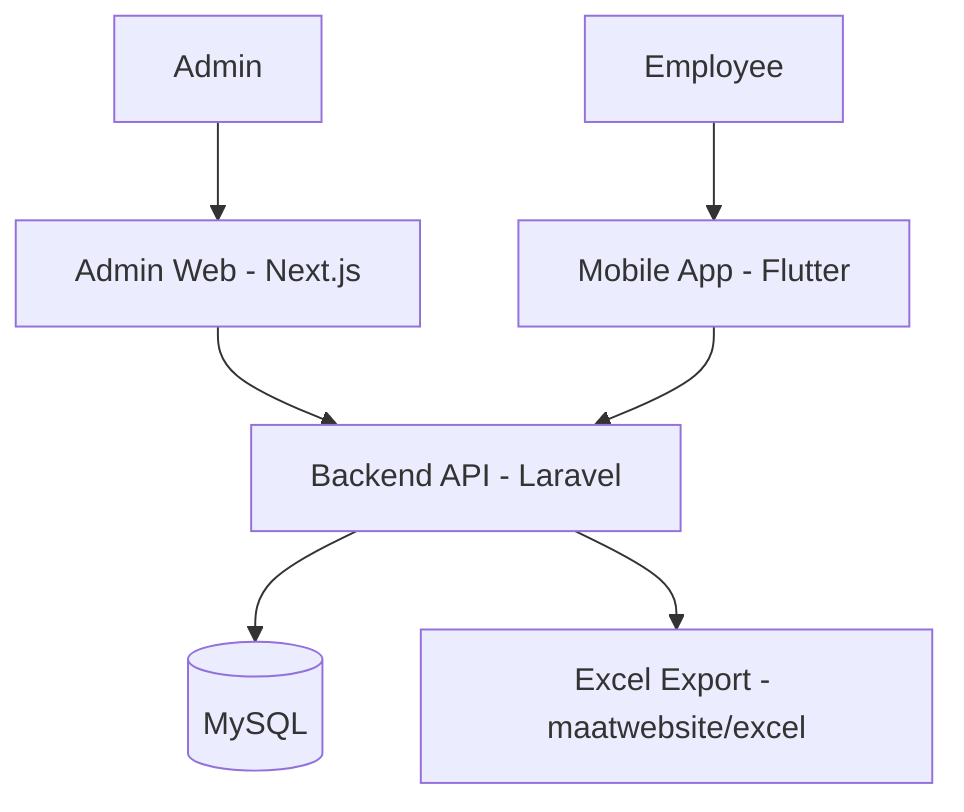
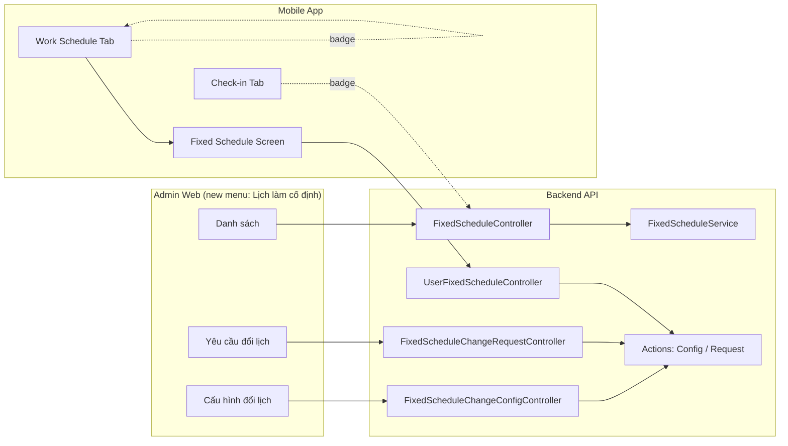
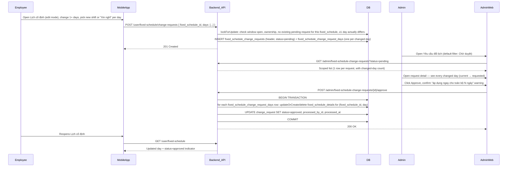
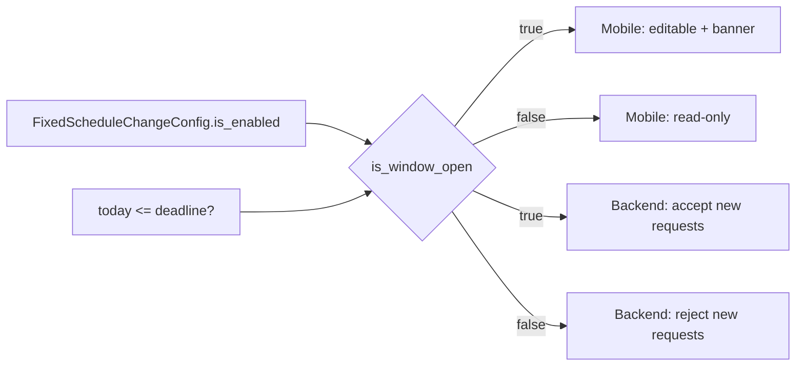

# Design Document: Fixed Schedule Change Request

## Overview

This feature splits the existing single-page Fixed Schedule admin screen into a three-page menu, retrofits workplace-scoping onto it, and adds two new domains: a per-workplace `Fixed_Schedule_Change_Config` (enable/deadline) and a `Fixed_Schedule_Change_Request` approval workflow that mutates the existing `fixed_schedules` / `fixed_schedule_details` tables on approval. The mobile app gains a read/write view of the employee's own fixed schedule and badges distinguishing fixed vs. temporary shifts in two existing screens. New backend logic follows the Action pattern per project convention; the existing `FixedScheduleService` (Service pattern, pre-dating this convention) is left in place and only extended with scoping — it is not migrated to Actions as part of this feature, to keep the change focused.

### Design Goals

- Reuse `fixed_schedules` / `fixed_schedule_details` as-is; no breaking migration.
- Make workplace-scoping enforcement a server-side guarantee, not just a UI filter (Requirement 2.3).
- Make approval atomic: a `Fixed_Schedule_Change_Request` never ends up `approved` without the corresponding `fixed_schedule_details` row also being updated, and vice versa (Reliability NFR).
- Reuse existing UI/backend patterns wherever one already exists (`DDataTable` multi-select, inline `Switch` column, bulk-confirm modal, `ShiftAbsentNotice`-style deadline validation, `SalaryRequestExport`-style Excel export) rather than inventing new ones.

### Key Design Decisions

- **Workplace scoping reuses the existing `FiltersByWorkplace` enforcement pattern, not `getAccessibleWorkplacesByPermissionGroup`.** Investigation confirmed two independent scoping mechanisms exist in the codebase: (1) `User::getAccessibleWorkplacesByPermissionGroup()`, consumed only by `GetMasterDataAction` to populate the frontend hint `masterData.workplace_access`, and used for real backend enforcement in exactly one feature (Workplace Document Read Config) — not used by Shift, CheckIn, or Work History; and (2) `User::getWorkplaceIdsByPermission(string $permission): ?array` (single-permission variant) plus the reusable `App\Traits\FiltersByWorkplace` trait (`scopeApplyWorkplaceFilter`), which is the pattern **actually enforcing** workplace scoping today for Shift/WorkplaceShift (list queries) and CheckIn/ShiftReport/WorkTimeReport (locally re-implemented same signature), with single-record writes checked via `$user->isAbleTo($permission, $workplaceId)` (see `ShiftService::createShift()`/`updateConfig()`). This feature adopts mechanism (2) for consistency with the rest of the admin app: `FixedSchedule` and the new `FixedScheduleChangeConfig`/`FixedScheduleChangeRequest` models gain `use FiltersByWorkplace;` and their list queries call `->applyWorkplaceFilter($user, PermissionName::X->value)`; single-record create/update/delete/approve/reject call `$user->isAbleTo($permission, $workplaceId)`.
- **This is also a genuine, pre-existing bug fix, not a hypothetical.** The investigation confirmed `FixedScheduleService` today has this exact gap — `listFixedSchedules()`/`store()`/`update()`/`destroy()` do no workplace filtering, and the routes only apply bare `permission:fixed_schedule.*` middleware without a team parameter, so (per `config/laratrust.php`'s `teams.strict_check = false` and `WorkplaceAwareUserChecker::isInSameTeam()`) any admin with the permission can currently act on any workplace's fixed schedules regardless of their assigned team/workplace. The same gap exists on `WorkplaceController` itself, but fixing that is out of scope for this feature — noted here only for awareness, not addressed by this spec.
- **The change window is derived, not stored as a boolean "closed" flag.** `Fixed_Schedule_Change_Config` stores only `is_enabled` and `deadline`; "is the window open" is computed as `is_enabled && today <= deadline` everywhere it's needed (Requirement 5), so a passed deadline auto-closes the window without a background job or an extra column to keep in sync.
- **A change request is a whole-week submission, not a single-day one — mirroring the admin's own "Sửa lịch làm" edit action.** `Fixed_Schedule_Change_Request` is a header row (status, processed-by/at) with one `Fixed_Schedule_Change_Request_Day` child per day that actually changed (unchanged days are never persisted, same as `FixedScheduleService::update()` only touches days present in the submitted `schedules` map). Approve/reject act on the whole header; there is no per-day resolution (Requirement 7).
- **Approval is a single DB transaction that both resolves the request and mutates the schedule.** It loops the request's `Fixed_Schedule_Change_Request_Day` rows and applies each one via the same diff-and-`updateOrCreate`/delete logic already present in `FixedScheduleService::update()`, extracted into a shared per-day method — all days succeed or the whole transaction rolls back.
- **No DB-level uniqueness for "one pending request per Fixed_Schedule".** MySQL cannot express a partial unique index (`WHERE status = 'pending'`) portably, so "at most one pending request per `Fixed_Schedule` at a time" (Requirement 6.5) is enforced at the Action layer inside the same transaction that creates the header row, using a locking read (`lockForUpdate`) to avoid a race between two rapid submissions. This check is now simpler than a per-day version would have been — one lock/check per `fixed_schedule_id`, not per day.
- **Fixed Schedule List's `started_at` field is left in the API response.** Removing it entirely risks breaking any other consumer; Admin_Web simply stops rendering the column (Requirement 3). This is the lower-risk option since the field is a derived accessor with no write path to worry about.

### API/Interface Change Summary

**Before** (`GET /user/schedules`, `GET /user/check-in/shift` — item shape):
```json
{
  "id": 1,
  "shift_id": 42,
  "status": "approved",
  "shift": { "date": "2026-07-20", "workplace_shift": { "start_time": "09:00", "end_time": "18:00" } }
}
```

**After:**
```json
{
  "id": 1,
  "shift_id": 42,
  "status": "approved",
  "is_fixed": true,
  "shift": { "date": "2026-07-20", "workplace_shift": { "start_time": "09:00", "end_time": "18:00" } }
}
```

## Architecture

### System Context



### High-Level Architecture



### Data Flow — Submit and Approve a Change Request



## Components and Interfaces

### Component: Workplace Scoping (backend, cross-cutting — reuses existing `FiltersByWorkplace`)

**Purpose**: Restrict every Fixed Schedule list/write to the admin's Managed_Workplaces, using the same mechanism already proven for Shift/WorkHistory/CheckIn.

**Responsibilities**:
- `FixedSchedule`, `FixedScheduleChangeConfig`, `FixedScheduleChangeRequest` models add `use FiltersByWorkplace;` (all three carry, or are given, a `workplace_id` column — see Data Models for `FixedScheduleChangeRequest`, which gets a denormalized `workplace_id` for this purpose).
- List queries call `->applyWorkplaceFilter($user, PermissionName::X->value)` (e.g. `PermissionName::FixedScheduleList`, `FixedScheduleChangeConfigList`, `FixedScheduleChangeRequestList`) — returns unrestricted for `null` (GlobalAdmin), zero rows for `[]` (no access), or `whereIn('workplace_id', $ids)` otherwise.
- Single-record create/update/delete/approve/reject calls `$user->isAbleTo($permission, $workplaceId)`, mirroring `ShiftService::createShift()`/`updateConfig()` — throws/returns `403` if the team-scoped permission check fails for that specific workplace.

**Interfaces**:
- **Input**: `Auth::user()`, target `workplace_id`(s), a `PermissionName` value
- **Output**: constrained `Builder` (list case) or `403 Forbidden` (single-record case)
- **Dependencies**: `App\Traits\FiltersByWorkplace`, `App\Models\User::getWorkplaceIdsByPermission`, `User::isAbleTo`

**Implementation Notes**:
- New `PermissionName` entries: `FixedScheduleList`/`Create`/`Edit`/`Delete` (already exist — just newly enforced), `FixedScheduleChangeConfigList`/`Edit`, `FixedScheduleChangeRequestList`/`Process`.
- `GetMasterDataAction`'s permission-group list optionally gains `'fixed_schedule'` (via `getAccessibleWorkplacesByPermissionGroup`) purely so `masterData.workplace_access.fixed_schedule` can pre-filter the three admin pages' dropdowns for UX — this is a separate, UI-only convenience and is **not** the enforcement mechanism; the real guarantee is the server-side `applyWorkplaceFilter`/`isAbleTo` calls above (Requirement 2.3).
- Passing `$user` into `FixedScheduleService`'s methods (currently they don't receive it) is a required small refactor of the existing service, not just additive code.

### Component: `FixedScheduleController` / `FixedScheduleService` (existing, modified)

**Purpose**: List/create/update/delete the weekly recurring template (Requirements 2, 3).

**Responsibilities**:
- `index()`/`listFixedSchedules()`: apply `->applyWorkplaceFilter($user, PermissionName::FixedScheduleList->value)` to the base query (requires passing `$user` into the service — currently absent).
- `store()`/`update()`/`destroy()`: call `$user->isAbleTo(PermissionName::FixedScheduleCreate->value, $data['workplace_id'])` (create) or the `Edit`/`Delete` permission against `$schedule->workplace_id` (update/destroy) before mutating.

**Interfaces**:
- **Input**: existing `StoreRequest`/`UpdateRequest`, unchanged shape.
- **Output**: existing `FixedSchedule` resource shape, unchanged (still includes `started_at`; Admin_Web simply stops rendering it).
- **Dependencies**: `FiltersByWorkplace` trait on `FixedSchedule`, `User::isAbleTo`.

**Implementation Notes**:
- No new columns, no new migration for this component — only added scoping calls in the existing Service methods.

### Component: `FixedScheduleChangeConfigController` (new)

**Purpose**: Per-workplace enable/deadline configuration (Requirement 4).

**Responsibilities**:
- `index()`: list configs for the admin's Managed_Workplaces (workplaces without a config row yet still appear, with `is_enabled = false`, `deadline = null` — a left join / "workplace ∪ config" view, not just an inner join on existing config rows, so an admin can enable a workplace that's never been configured before).
- `update(Workplace $workplace)`: upsert `is_enabled`/`deadline` for one workplace.
- `bulkUpdate()`: upsert the same `is_enabled`/`deadline` values for a list of `workplace_ids`.

**Interfaces**:
- **Input**: `workplace_id`(s), `is_enabled: bool`, `deadline: date|null`
- **Output**: `FixedScheduleChangeConfig` resource (see Data Models), including a computed `is_window_open` boolean
- **Dependencies**: `FiltersByWorkplace` trait on `FixedScheduleChangeConfig` (list), `User::isAbleTo` (single/bulk update)

**Implementation Notes**:
- `App\Actions\Admin\FixedSchedule\GetFixedScheduleChangeConfigsAction`, `UpsertFixedScheduleChangeConfigAction`, `BulkUpsertFixedScheduleChangeConfigAction` — Action pattern per `CLAUDE.md`.
- `deadline < today` is allowed to be saved (an admin might set a deadline that's already effectively closing the window); validation only rejects malformed dates, not past dates, since "extend a window that just closed" and "intentionally close immediately" are both legitimate admin actions.

### Component: `FixedScheduleChangeRequestController` (new, admin side)

**Purpose**: List, filter, approve, reject, bulk-resolve, and export change requests (Requirements 7, 8).

**Responsibilities**:
- `index()`: filter by `workplace_id` (scoped), employee name search, `status`; defaults to `pending`.
- `approve(FixedScheduleChangeRequest $request)` / `reject(...)`: single-row resolution.
- `bulkResolve()`: `{ ids: number[], action: 'approve' | 'reject' }`.
- `export()`: Excel download honoring current filters.

**Interfaces**:
- **Input**: filters (query params), resolution payload
- **Output**: paginated `FixedScheduleChangeRequest` resources; `.xlsx` stream for export
- **Dependencies**: `FiltersByWorkplace` trait on `FixedScheduleChangeRequest` (list/export), `User::isAbleTo` (approve/reject/bulk-resolve), `FixedScheduleService`-equivalent detail-mutation logic (extracted into a shared method so both the single-day admin edit modal and the approval Action produce identical `fixed_schedule_details` mutations)

**Implementation Notes**:
- `App\Actions\Admin\FixedSchedule\GetFixedScheduleChangeRequestsAction`, `ApproveFixedScheduleChangeRequestAction`, `RejectFixedScheduleChangeRequestAction`, `BulkResolveFixedScheduleChangeRequestsAction`, `ExportFixedScheduleChangeRequestsAction` + `FixedScheduleChangeRequestExport` (mirrors `SalaryRequestExport`'s `FromCollection`/`WithHeadings`/`ShouldAutoSize`).
- `ApproveFixedScheduleChangeRequestAction` is the only place that writes to `fixed_schedule_details` as a side effect of a change request; it loops the request's `FixedScheduleChangeRequestDay` rows and calls a shared method (e.g. `FixedSchedule::applyDetailForDay(int $day, ?int $workplaceShiftId)`, extracted from `FixedScheduleService::update()`'s existing per-day diff logic) for each one inside a single transaction, so both call sites (admin's own weekly edit, and change-request approval) stay in sync and a partial failure rolls back every day, not just one.
- `bulkResolve` loops each request ID through the same whole-request Action inside one outer transaction, so a failure partway rolls back the whole batch (simplest correct behavior; batches are admin-initiated and small). Each individual request within the batch is still all-or-nothing internally (Requirement 7.3).

### Component: `UserFixedScheduleController` (new, mobile-facing)

**Purpose**: Let an employee read their own fixed schedule (with change-window and request-status context) and submit a whole-week change request (Requirements 6, 9, 10, 11, 14.3, 14.4).

**Responsibilities**:
- `show(?int $workplaceId)`: return the authenticated user's `FixedSchedule` (all, or for one workplace if the user has more than one), each day's `Workplace_Shift`, whether the Change_Window is open for that workplace, and — for any day covered by the employee's current pending/most-recently-resolved `Fixed_Schedule_Change_Request` — that day's requested value and the request's status.
- `storeChangeRequest()`: create a request for `{ fixed_schedule_id, days: [{ day, requested_workplace_shift_id }, ...] }` (`requested_workplace_shift_id = null` means day-off for that day; only changed days are included in the payload).

**Interfaces**:
- **Input**: `Auth::id()`, optional `workplace_id`; create payload (array of changed days)
- **Output**: schedule + per-day status shape (see Data Models)
- **Dependencies**: none beyond ownership checks (`fixed_schedule.user_id === Auth::id()`)

**Implementation Notes**:
- `App\Actions\User\FixedSchedule\GetUserFixedScheduleAction`, `CreateFixedScheduleChangeRequestAction`.
- `CreateFixedScheduleChangeRequestAction` validates, in order: schedule belongs to the user; Change_Window open for that workplace (Requirement 6.4); every submitted day's `requested_workplace_shift_id` (if not null) belongs to the same workplace (Requirement 6.6); at least one submitted day actually differs from the current `fixed_schedule_details` (days matching the current value are dropped before persisting, Requirement 6.3); no existing `pending` request for this `fixed_schedule_id`, checked with `lockForUpdate` (Requirement 6.5) — then creates the header row plus one `FixedScheduleChangeRequestDay` per (post-diff) changed day, all inside one transaction.

### Component: Admin Web — Fixed Schedule Menu Restructure

**Purpose**: Requirement 1.

**Responsibilities**: Move the sidebar entry out of the Workplace group into a new top-level item with 3 children.

**Implementation Notes**:
- `frontend/src/configs/sidebar.config.ts`: remove the current "Fixed schedule" entry from wherever it's nested and add a new top-level group "Lịch làm cố định" with 3 children pointing at the routes below.
- `frontend/src/configs/route.config.ts`: keep `ADMIN_FIXED_SCHEDULE_LIST`, add `ADMIN_FIXED_SCHEDULE_CHANGE_CONFIG`, `ADMIN_FIXED_SCHEDULE_CHANGE_REQUEST`.
- New permission constants in `frontend/src/enums/permission_name.enum.ts`: `FIXED_SCHEDULE_CHANGE_CONFIG_LIST/EDIT`, `FIXED_SCHEDULE_CHANGE_REQUEST_LIST/PROCESS`, mirrored by new Laratrust permissions on the backend (seeded like the existing `fixed_schedule.*` set).
- Pages live under `frontend/src/pages/admin/fixed-schedule/`: existing `index.page.tsx` (List), new `change-config/index.page.tsx`, new `change-requests/index.page.tsx` — kept as sibling directories under the same parent, not tabs on one page, matching the "3 menu con" requirement.

### Component: Admin Web — Danh sách (List) page

**Purpose**: Requirements 2, 3.

**Implementation Notes**:
- Remove the "Bắt đầu từ" column definition from the existing table.
- `Xưởng` filter `Select` and the create/edit modal's `Xưởng` `Select` are populated from `masterData.workplace_access.fixed_schedule` when non-null, falling back to the full `masterData.workplaces` list for GlobalAdmin (`null` access = unrestricted) — same pattern already used by `masterData.workplace_access.shift` etc. elsewhere in the app (component to confirm exact existing usage during implementation; if no exact precedent is found, apply the straightforward `accessibleIds ? workplaces.filter(w => accessibleIds.includes(w.id)) : workplaces` logic).

### Component: Admin Web — Cấu hình đổi lịch page

**Purpose**: Requirement 4.

**Implementation Notes** (per the UI already agreed in conversation):
- `DDataTable` with `selectedRecords`/`onSelectedRecordsChange` (mirrors `admin/user/index.page.tsx`) for multi-select.
- "Trạng thái" column: inline Mantine `Switch` bound to `is_enabled` (mirrors `admin/chat/banned-keywords/index.page.tsx`), calling `UpdateFixedScheduleChangeConfigAction` on change.
- "Hạn cuối" column: inline editable date (either an inline `DatePickerInput` or opened via the row's "Sửa" action — implementation detail to settle during coding; either satisfies Requirement 4.3).
- Bulk toolbar: "Bật tính năng cho N xưởng đã chọn" / "Tắt cho N xưởng đã chọn", each opening a `BulkAssignModal`-style confirmation that also lets the admin set a shared deadline for the batch.
- Row whose `deadline` has passed shows "Đã hết hạn" (computed from `is_window_open = false` while `is_enabled = true`), visually distinct from the "Tắt" state (`is_enabled = false`) — satisfies Requirement 5.5.

### Component: Admin Web — Yêu cầu đổi lịch page

**Purpose**: Requirements 7, 8.

**Implementation Notes**:
- Filters: Xưởng (`Select`, scoped), Nhân viên (text search input, not a `Select`), Trạng thái (`Select`, default "Chờ duyệt"), Khoảng ngày gửi (`DatePickerInput` range).
- **Default date-range computation** (Requirement 8.7–8.9): when exactly one workplace is selected, the frontend fetches that workplace's `FixedScheduleChangeConfig` (already available from the Change Config list/endpoint, or fetched inline) and pre-fills the date-range filter with `[updated_at date, deadline]` before the first query fires — this excludes requests from a previous round (e.g. a workplace reconfigured on 2026-02-01 with a new deadline of 2026-02-15, after a prior round that closed 2026-01-10, defaults to showing only the Feb round). No default is applied when no single workplace is selected, or when the selected workplace has no config yet. The admin can always widen/clear the range manually to see older rounds — this is a UI default, not a hard filter the backend enforces.
- **List table** — one row per request (not per day): Nhân viên, Xưởng, Số ngày thay đổi (e.g. "3 ngày"), Gửi lúc, Trạng thái, Thao tác.
- **Detail view** (opened by clicking a row, or as the first step of the Approve action): a Monday–Sunday grid mirroring the "Sửa lịch làm" modal's layout, but read-only and annotated — each changed day shows "Ca hiện tại → Ca yêu cầu" (or "→ Xin nghỉ"), unchanged days show their current shift with no arrow. This is where Requirement 7.1 ("show every changed day before approve/reject is available") is satisfied.
- No "Lý do" field anywhere (removed per confirmed requirements).
- Approve action (row-level and bulk) requires opening the detail view first (or embeds it directly in the confirm dialog for the single-row case) and shows the warning "Toàn bộ N ngày thay đổi sẽ được áp dụng ngay khi bạn duyệt" before calling the API (Requirement 7.2).
- "Export Excel" button submits current filters to the export endpoint (one row per request, with a "Số ngày thay đổi" column; a secondary detail sheet or flattened "day" rows is a reasonable implementation choice, left open for the coding phase), mirroring the `SalaryRequestExport`/`Excel::download` pattern.

### Component: Mobile — Work Schedule Tab entry point

**Purpose**: Requirement 9.

**Implementation Notes**:
- `lib/ui/work_schedule/work_schedule_tab.dart`: resize the existing date-range picker row to share space with a new "Lịch cố định" button/icon on the same row.
- Tapping it navigates to a new `FixedScheduleScreen` (`lib/ui/fixed_schedule/fixed_schedule_screen.dart`), passing the workplace if the employee has exactly one `Fixed_Schedule`, or first showing a workplace picker if they have more than one (Requirement 9.4).

### Component: Mobile — Fixed Schedule Screen

**Purpose**: Requirements 9, 10, 11.

**Responsibilities**:
- Render a Monday–Sunday grid (mirrors the admin web "Sửa lịch làm" modal's layout) sourced from `GET /user/fixed-schedule`.
- If `is_window_open` for the shown workplace: show a top banner with the deadline and an "edit" affordance; entering edit mode lets the employee change any number of day cells (pick a different `Workplace_Shift`, or "Xin nghỉ ngày này") before a single "Gửi yêu cầu" action submits all changed days together as one request (Requirement 6/10 — not a per-cell submit).
- Render each day's own change-request status inline (`Chờ duyệt` / `Đã duyệt` / `Từ chối` badge) when that day is part of the employee's current/most-recent request.
- If `is_window_open` is false: render read-only, no edit affordance (Requirement 10.3).

**Interfaces**:
- **Input**: `GET /user/fixed-schedule?workplace_id=`
- **Output**: `POST /user/fixed-schedule/change-requests`
- **Dependencies**: new `lib/repositories/fixed_schedule_repository.dart`, new `lib/models/entities/work/fixed_schedule.dart` / `fixed_schedule_detail.dart`, new `lib/view_controllers/fixed_schedule_controller.dart`

### Component: Mobile — Fixed/Temp badges

**Purpose**: Requirements 12, 13.

**Implementation Notes**:
- Add `isFixed` (parsed from `is_fixed`) to `lib/models/entities/work/work_schedule.dart` — currently silently dropped despite the backend already sending it in some payloads.
- `lib/ui/work_schedule/components/work_schedule_item.dart`: render a small badge/label when `isFixed == true`, in all three status tabs (Đã duyệt/Chờ duyệt/Từ chối) since they share this same item component.
- `lib/ui/work_log/components/work_log_body.dart` (and/or `LogStart`/`LogEnd`): render the same badge treatment using the `is_fixed` field newly added to the `GET /user/check-in/shift` response (Requirement 13.2).

## Data Models

### Entity: FixedScheduleChangeConfig

```typescript
// frontend/src/types/models/fixed_schedule_change_config.d.ts
interface FixedScheduleChangeConfig {
    id: number | null; // null when no config row exists yet for this workplace
    workplace_id: number;
    workplace: Pick<Workplace, 'id' | 'name'>;
    is_enabled: boolean;
    deadline: string | null; // 'YYYY-MM-DD'
    is_window_open: boolean; // computed: is_enabled && deadline !== null && today <= deadline
}
```

**Backend schema** (`database/migrations/2026_07_15_000001_create_fixed_schedule_change_configs_table.php`):
```php
Schema::create('fixed_schedule_change_configs', function (Blueprint $table) {
    $table->id();
    $table->foreignId('workplace_id')->unique()->constrained()->cascadeOnDelete();
    $table->boolean('is_enabled')->default(false);
    $table->date('deadline')->nullable();
    $table->timestamps();
});
```

**Validation Rules**:
- `deadline` must be a valid date when present; no lower-bound restriction (see Design Decisions).
- `workplace_id` must be within the admin's Managed_Workplaces (Requirement 2.5, 4.6).

**Relationships**:
- `belongsTo(Workplace::class)`

### Entity: FixedScheduleChangeRequest (header) + FixedScheduleChangeRequestDay (detail)

One request covers the whole week's worth of changes — mirrors the header/detail shape of `FixedSchedule`/`FixedScheduleDetail` itself.

```typescript
// frontend/src/types/models/fixed_schedule_change_request.d.ts
interface FixedScheduleChangeRequest {
    id: number;
    fixed_schedule_id: number;
    user: Pick<User, 'id' | 'name' | 'staff_no'>;
    workplace: Pick<Workplace, 'id' | 'name'>;
    status: 'pending' | 'approved' | 'rejected';
    processed_by: Pick<User, 'id' | 'name'> | null;
    processed_at: string | null;
    created_at: string;
    days: FixedScheduleChangeRequestDay[]; // one entry per changed day, never all 7
}

interface FixedScheduleChangeRequestDay {
    id: number;
    day: number; // 0 (Sunday) – 6, matches fixed_schedule_details.day convention
    current_workplace_shift: WorkplaceShift | null;
    requested_workplace_shift: WorkplaceShift | null; // null = requesting the day off
}
```

**Backend schema** (`database/migrations/2026_07_15_000002_create_fixed_schedule_change_requests_table.php`):
```php
Schema::create('fixed_schedule_change_requests', function (Blueprint $table) {
    $table->id();
    $table->foreignId('fixed_schedule_id')->constrained()->cascadeOnDelete();
    $table->foreignId('workplace_id')->constrained()->cascadeOnDelete(); // denormalized from fixed_schedule.workplace_id
    $table->string('status')->default('pending');
    $table->foreignId('processed_by_id')->nullable()->constrained('users')->nullOnDelete();
    $table->timestamp('processed_at')->nullable();
    $table->timestamps();

    $table->index(['fixed_schedule_id', 'status']);
    $table->index(['workplace_id', 'status']);
});
```

**Backend schema** (`database/migrations/2026_07_15_000003_create_fixed_schedule_change_request_days_table.php`):
```php
Schema::create('fixed_schedule_change_request_days', function (Blueprint $table) {
    $table->id();
    $table->foreignId('fixed_schedule_change_request_id')->constrained()->cascadeOnDelete();
    $table->tinyInteger('day');
    $table->foreignId('current_workplace_shift_id')->nullable()->constrained('workplace_shifts')->nullOnDelete();
    $table->foreignId('requested_workplace_shift_id')->nullable()->constrained('workplace_shifts')->nullOnDelete();
    $table->timestamps();

    $table->unique(['fixed_schedule_change_request_id', 'day']);
});
```
`workplace_id` on the header is set once at creation from `fixed_schedule.workplace_id` (never changes afterward, same as the parent `FixedSchedule` never changes its workplace) — denormalized specifically so the header model can `use FiltersByWorkplace;` directly and so Requirement 8.2's workplace filter doesn't require a join. `status`/`processed_by_id`/`processed_at` live only on the header — a request is resolved as one atomic unit (Requirement 7.3–7.4), so per-day status doesn't exist.

**Validation Rules**:
- `day` between 0–6; unique per `(fixed_schedule_change_request_id, day)` — a request cannot list the same day twice.
- `requested_workplace_shift_id`, if present, must belong to the same `workplace_id` as the header's `fixed_schedule_id`'s workplace.
- A request must have at least one `FixedScheduleChangeRequestDay` (Requirement 6.3 — nothing changed ⇒ nothing to submit).
- At most one header row with `status = 'pending'` per `fixed_schedule_id` — enforced at Action layer with `lockForUpdate` on the header, not a DB constraint.
- Header `status` transitions only `pending → approved` or `pending → rejected`; no further transitions once resolved (Requirement 7.5).

**Relationships**:
- `FixedScheduleChangeRequest belongsTo(FixedSchedule::class)`, `belongsTo(Workplace::class)` (denormalized, used by `FiltersByWorkplace`), `belongsTo(User::class, 'processed_by_id')`, `hasMany(FixedScheduleChangeRequestDay::class)`
- `FixedScheduleChangeRequestDay belongsTo(FixedScheduleChangeRequest::class)`, `belongsTo(WorkplaceShift::class, 'current_workplace_shift_id')`, `belongsTo(WorkplaceShift::class, 'requested_workplace_shift_id')`

**New Enum**: `App\Enums\FixedScheduleChangeRequestStatus` — `Pending`, `Approved`, `Rejected` (mirrors `ShiftUserStatus`/`AbsentNoticeStatus` style), used on the header only.

### Data Flow — Deriving `is_window_open`



## API Design

### `GET /admin/fixed-schedules` (existing, modified)
Adds server-side workplace scoping; response shape unchanged.

### `GET /admin/fixed-schedule-change-configs`
**Response**: `FixedScheduleChangeConfig[]` (see Data Models), one entry per Managed_Workplace (config row optional).

### `PUT /admin/fixed-schedule-change-configs/{workplace}`
**Request**: `{ "is_enabled": true, "deadline": "2026-08-15" }`
**Response**: updated `FixedScheduleChangeConfig`
**Error Responses**: `403 Forbidden` — workplace outside Managed_Workplaces.

### `PUT /admin/fixed-schedule-change-configs/bulk`
**Request**: `{ "workplace_ids": [1,2,3], "is_enabled": true, "deadline": "2026-08-15" }`
**Response**: `FixedScheduleChangeConfig[]` for the updated workplaces
**Error Responses**: `403 Forbidden` — any ID outside Managed_Workplaces (whole batch rejected, nothing partially applied).

### `GET /admin/fixed-schedule-change-requests`
**Query params**: `workplace_id?`, `employee_name?`, `status? (pending|approved|rejected)`, `dates[0]?`, `dates[1]?` (submission date range, filters on `created_at`), `page`
**Response**: paginated `FixedScheduleChangeRequest[]` (each including its `days: FixedScheduleChangeRequestDay[]`, or a lighter `days_count` in the list variant with the full `days` array only loaded on a detail fetch — implementation choice, either satisfies Requirement 8.5)

The default-date-range computation (Requirement 8.7–8.9) is a **frontend-only** UI default — `dates[0]`/`dates[1]` are plain optional query params with no server-side default; the frontend computes and pre-fills them (from the selected workplace's `FixedScheduleChangeConfig.updated_at`/`deadline`) before firing the first request, exactly like other date-range filters elsewhere in the app (e.g. the mobile Work Schedule tab's `dates[0]`/`dates[1]` pattern on `GET /user/schedules`).

### `POST /admin/fixed-schedule-change-requests/{request}/approve`
**Response**: updated `FixedScheduleChangeRequest` (with `days`)
**Error Responses**: `409 Conflict` — request not `pending`; `403 Forbidden` — workplace outside scope.

### `POST /admin/fixed-schedule-change-requests/{request}/reject`
Same shape/errors as approve, without the schedule mutation.

### `POST /admin/fixed-schedule-change-requests/bulk-resolve`
**Request**: `{ "ids": [10,11,12], "action": "approve" }`
**Response**: `{ "resolved": FixedScheduleChangeRequest[] }`

### `GET /admin/fixed-schedule-change-requests/export`
Same query params as the list endpoint; streams an `.xlsx` file.

### `GET /user/fixed-schedule`
**Query params**: `workplace_id?` (required if the employee has more than one Fixed_Schedule)
**Response**:
```json
{
    "fixed_schedule_id": 5,
    "workplace": { "id": 3, "name": "DGF本社" },
    "change_window": { "is_open": true, "deadline": "2026-08-15" },
    "pending_request": { "id": 88, "status": "pending" },
    "days": [
        {
            "day": 1,
            "workplace_shift": { "id": 12, "start_time": "13:00", "end_time": "14:00" },
            "pending_or_recent_change": { "requested_workplace_shift": { "id": 15, "start_time": "16:00", "end_time": "18:00" }, "status": "pending" }
        }
    ]
}
```
`pending_request` is present whenever the employee has an unresolved request (regardless of which days it touches) so Mobile_App can disable "Gửi yêu cầu" entirely (Requirement 6.5); each day's `pending_or_recent_change` is populated only for days that are part of that request (or the most recently resolved one, for Requirement 3/11's status display).

### `POST /user/fixed-schedule/change-requests`
**Request**: `{ "fixed_schedule_id": 5, "days": [{ "day": 1, "requested_workplace_shift_id": 15 }, { "day": 3, "requested_workplace_shift_id": null }] }` (`null` = day off; only include days that differ from the current schedule)
**Response**: created `FixedScheduleChangeRequest` (with `days`)
**Error Responses**:
- `422 Unprocessable Entity` — window closed, an existing pending request for this `fixed_schedule_id`, no day actually differs from the current schedule, or a requested shift not in the workplace's catalog.
- `403 Forbidden` — schedule does not belong to the authenticated user.

### `GET /user/schedules`, `GET /user/check-in/shift` (existing, modified)
Both add `is_fixed: boolean` to each item, sourced from the existing `shift_users.is_fixed` column already present in the DB but currently unused in these responses.

## Security Considerations

### Authentication
- No change — existing Sanctum-based admin/user auth guards apply unchanged to all new routes.

### Authorization
- Admin endpoints continue to require the relevant Laratrust permission (`fixed_schedule.*`, new `fixed_schedule_change_config.*`, `fixed_schedule_change_request.*`) via existing route middleware, **plus** the `FiltersByWorkplace`/`isAbleTo` enforcement described above, applied inside each Action/Service method (Requirement 2.3) — route-level permission alone is not sufficient (it doesn't check team/workplace, per the `teams.strict_check = false` finding), so workplace membership is independently checked in code, not just at the middleware layer.
- User endpoints verify the `FixedSchedule`/`FixedScheduleChangeRequest` belongs to `Auth::id()` before any read/write.

### Data Protection
- No new PII introduced; requests reference existing `user_id`/`workplace_id`/`workplace_shift_id` only.

### Input Validation
- New `FormRequest` classes for each new endpoint following the existing `App\Http\Requests\{Admin,User}\...` convention, reusing the existing `UserInWorkplace`-style custom rule pattern where applicable (e.g. validating `requested_workplace_shift_id` belongs to the schedule's workplace).

## Error Handling

### Workplace Scoping

| Scenario | Handling |
|----------|----------|
| Admin without access acts on a workplace outside their scope (create/update/delete schedule, config, approve/reject request) | `403 Forbidden` via `isAbleTo()` check, no data mutated |
| Admin lists data for workplaces outside their scope | Rows silently excluded via `applyWorkplaceFilter` (`whereIn`/`whereRaw('1 = 0')`), not a 403 — consistent with existing Shift/WorkHistory list behavior |
| GlobalAdmin | No restriction applied (`getWorkplaceIdsByPermission` returns `null` → unconstrained query) |

### Change Config

| Scenario | Handling |
|----------|----------|
| `deadline` passed but `is_enabled` still `true` | Treated as closed (`is_window_open = false`); admin sees "Đã hết hạn"; no auto-flip of `is_enabled` |
| Bulk update includes a non-Managed workplace | Entire batch rejected with `403`, nothing applied |

### Change Requests

| Scenario | Handling |
|----------|----------|
| Submission while window closed | `422`, nothing created |
| Employee already has a pending request for this `fixed_schedule_id` | `422`, new submission rejected; existing pending request unaffected |
| Submission where no day actually differs from the current schedule | `422`, nothing created |
| Any requested shift in the submission not in the schedule's workplace | `422`, entire submission rejected (no partial day creation) |
| Approve/reject a non-`pending` request | `409`, no state change |
| Approval transaction fails partway through applying its days (e.g. one day's mutation throws) | Whole transaction rolled back; request remains `pending`, no days applied |

## Performance Considerations

### Expected Load
- Internal workforce-management tool; low concurrency (tens of admins, low thousands of employees). No special scaling design needed beyond existing pagination conventions (`getPaginateFiltered`).

### Optimization Strategies
- Index `(fixed_schedule_id, status)` on `fixed_schedule_change_requests` to make the "one pending per schedule" check cheap; `unique(fixed_schedule_change_request_id, day)` plus its implicit index on `fixed_schedule_change_request_days` makes the per-day join in `GET /user/fixed-schedule` cheap.
- `GET /admin/fixed-schedule-change-configs` is a small, bounded list (one row per workplace); no pagination needed there.

## Testing Strategy

### Unit Tests

**`CreateFixedScheduleChangeRequestActionTest` (`backend/tests/Unit/Actions/User/FixedSchedule/`):**
- `testCreatesRequestWithOneDayPerChangedDay`
- `testCreatesRequestCoveringMultipleChangedDaysInOneSubmission`
- `testOmitsUnchangedDaysFromTheCreatedRequest`
- `testCreatesRequestDayForDayOff`
- `testRejectsWhenWindowClosed`
- `testRejectsWhenDeadlinePassedEvenIfEnabledStillTrue`
- `testRejectsWhenNoDayActuallyDiffersFromCurrentSchedule`
- `testRejectsWhenAnExistingPendingRequestForThisScheduleAlreadyExists`
- `testAllowsNewRequestAfterPriorOneResolved`
- `testRejectsEntireSubmissionWhenAnyDayUsesAShiftFromAnotherWorkplace`
- `testRejectsWhenScheduleNotOwnedByUser`

**`ApproveFixedScheduleChangeRequestActionTest` / `RejectFixedScheduleChangeRequestActionTest` (`backend/tests/Unit/Actions/Admin/FixedSchedule/`):**
- `testApprovalUpdatesFixedScheduleDetailForEveryDayInTheRequest`
- `testApprovalRemovesFixedScheduleDetailForDayOffRequestDays`
- `testApprovalAppliesAllDaysAtomicallyRollsBackOnPartialFailure`
- `testApprovalSetsProcessedByAndProcessedAt`
- `testRejectionDoesNotChangeAnyFixedScheduleDetail`
- `testRejectsActionOnAlreadyResolvedRequest`
- `testForbidsAdminOutsideManagedWorkplace`

**`BulkUpsertFixedScheduleChangeConfigActionTest`:**
- `testAppliesSameValuesToAllSelectedWorkplaces`
- `testCreatesConfigWhenNoneExistedForAWorkplace`
- `testRejectsBatchContainingUnmanagedWorkplace`

### Integration Tests (HTTP layer — permissions, validation, happy path)

- `backend/tests/Feature/Admin/FixedSchedule/IndexScopingTest` — non-GlobalAdmin only sees Managed_Workplaces; GlobalAdmin sees all.
- `backend/tests/Feature/Admin/FixedScheduleChangeConfig/*` — list/update/bulk-update, permission-gated, scope-gated.
- `backend/tests/Feature/Admin/FixedScheduleChangeRequest/*` — index filters (workplace/name/status), approve, reject, bulk-resolve, export, permission-gated, scope-gated.
- `backend/tests/Feature/User/FixedSchedule/*` — `GET /user/fixed-schedule` shape and window state; `POST .../change-requests` validation errors and happy path.
- `backend/tests/Feature/User/Schedule/*`, `backend/tests/Feature/User/CheckIn/*` — assert `is_fixed` present in `GET /user/schedules` and `GET /user/check-in/shift` responses.

### Frontend Tests (Vitest)

- `frontend/src/pages/admin/fixed-schedule/change-config/index.page.test.tsx` — inline switch toggles call the update mutation; bulk toolbar appears only with a selection; bulk modal submits combined payload (mirrors the existing `support_type_config.test.tsx` style).
- `frontend/src/pages/admin/fixed-schedule/change-requests/index.page.test.tsx` — approve action shows the immediate-effect warning before confirming; filters call the API with expected params.

### Mobile Tests

- Follow whatever test conventions already exist in `dgf_connect_app` (not covered by this repo's `CLAUDE.md`); at minimum, widget/unit tests for the day-off vs. shift-change request payload construction and for the `isFixed` badge rendering condition. Flag to the user if the mobile repo has no established test setup, per the "don't go overboard" guidance — mobile test scope to be confirmed during implementation.
