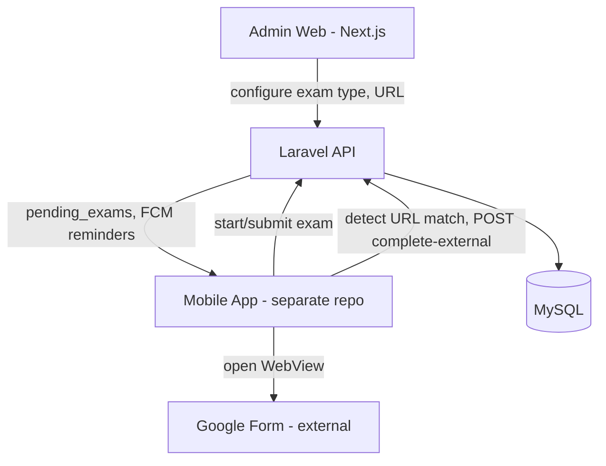

# Design Document: External-Linked Exam (External_Form_Prep_Exam)

> **DRAFT** — bản nháp sơ bộ, chưa chốt 100%. See Open Questions in requirements.md for what's still open. Locked in: `Exam.type` (nullable, `null` = `assessment`); external-completion tracking reuses the existing `ExamResultStatus` enum (new case `PendingExternal`) instead of a parallel `external_step_status` field; `external_complete_pattern` is a pure server config value, not an `Exam` column; `min_score`/`retry_limit`/`time_limit` are hidden from the admin UI and always server-assigned safe defaults for `external_form_prep`; `is_required` is forced `true` server-side for `external_form_prep`.

## Overview

This design extends the existing Exam feature with a second mode, `external_form_prep`, that turns an Exam into pure reference material for a mandatory external Google Form. It reuses the existing `Exam` → `Question` → `QuestionOption` → `ExamResult` data model and Action-based flow, adding: (1) a `type` discriminator on `Exam`, (2) one new external-tracking field on `Exam` (`external_url` — the completion-detection pattern is a pure server config value, not a column), (3) one new case (`PendingExternal`) on the existing `ExamResultStatus` enum plus one new column on `ExamResult` (`external_completed_at`), and (4) one new endpoint for the mobile client to report external-form completion. All changes are additive and branch on `Exam.type`, so `assessment`-type exams keep their exact current behavior.

### Design Goals
- Reuse the existing Exam/ExamResult schema and Action pattern instead of building a parallel feature.
- Make `assessment` behavior byte-for-byte unchanged — every new code path is gated behind `type === external_form_prep`.
- Keep the external-completion detection rule (URL substring pattern) server-configured, so changing it never requires a mobile app release.
- Make external completion, not internal score, the source of truth for "is this required exam satisfied."
- Track the external step through the existing `status` lifecycle instead of introducing a second, parallel status field.

### Key Design Decisions
- **Single `type` enum on Exam, not a separate model.** An `ExternalFormPrepExam` subtype/table was considered but rejected — it would duplicate `questions`/`translations`/`workplaces` relations for no benefit. A discriminator field with conditional logic in the existing Actions is simpler and keeps one place to manage exam content. `type` is nullable; `null` is treated as `assessment` so existing rows need no backfill.
- **External-step tracking reuses `ExamResult.status` via one new enum case (`PendingExternal`), not a separate `external_step_status` field.** A parallel field/enum was considered and rejected: `external_form_prep` results only ever need one extra lifecycle point ("submitted internally, external form not yet confirmed"), and folding that into the existing `status` column means every consumer of `status` (pending-exam gating, admin filters/exports, answer-reveal gating) keeps reading a single column instead of two. Concretely, this was also necessary to avoid a real collision: `ExamResultCalculation` (`routes/console.php`, runs every minute) sweeps every `ExamResult` still at `status = InProgress` whose `expires_at` has passed and force-finalizes it to `Completed`/`Failed` by score. If an `external_form_prep` result were left at `InProgress` after submission (as a naive "keep tracking externally" approach might do), this job would incorrectly grade and finalize it by score before the external form is ever completed. Moving to a dedicated `PendingExternal` value sidesteps that job entirely — it only matches `InProgress` — with no changes needed to the job itself.
- **`ExamResult` gains one timestamp column (`external_completed_at`), not a status/timestamp pair.** It exists purely for audit/display (Requirement 7.1); gating logic never reads it — only `status` decides whether the exam is satisfied. A separate join table for the external step was also rejected (exactly one external step per exam, 1:1; a table would only be justified for multiple external steps per exam, which is out of scope — see Open Questions).
- **`external_complete_pattern` is a pure server config value, never a per-exam field.** An optional per-exam column with a config fallback was the original idea; simplified after review — there is no product need for admins to override this substring per exam, so an admin-facing field/validation/UI surface for it doesn't earn its keep. `Exam` has no `external_complete_pattern` column at all; every consumer (submit/result response) reads `config('exam.default_external_complete_pattern')` directly.
- **`min_score`/`retry_limit`/`time_limit` are hidden from the admin UI for `external_form_prep` and always persisted as safe server-assigned defaults (`0`/`0`/config default), never `null`.** This is a correctness requirement, not cosmetic polish: `exams.min_score` and `exams.time_limit` are `NOT NULL` columns with no schema default (`2025_07_08_185600_create_elearning_tables.php:17-19`) — omitting them on create/update fails at the database level. Independently, even if they were nullable, existing code reads them without null-guards (`StartOrResumeExamAction`'s `addMinutes($exam->time_limit)`, `$exam->result->score >= $exam->min_score`), and PHP's comparison rules convert a `null`-vs-number comparison into a `bool` comparison — so `$score >= null` evaluates `true` unconditionally, a silent-wrong-answer trap rather than a crash. `Admin\ExamService::create()`/`update()` is the single place that assigns these defaults, applied unconditionally whenever `type === external_form_prep`, regardless of what the client payload contains.
- **`is_required` is forced to `true` server-side for `external_form_prep`, in `Admin\ExamService::create()`/`update()`**, not just defaulted in the UI. This type exists specifically to enforce a mandatory external step, so an optional instance would contradict its own purpose; forcing it server-side means the constraint holds even if a client omits or falsifies `is_required`.
- **Score/retry bypass is implemented as early-return branches in existing Actions**, not new Actions, to minimize duplication of the shuffle/hide-answer/expiry logic already in `StartOrResumeExamAction` and `SubmitExamAnswerAction`.
- **Completion is client-reported and idempotent**, with an admin manual-override as the reliability backstop, since there is no way to independently verify a Google Form submission server-side.
- **`ExamNotificationService::getRecipientsForExam` needs its own `type` branch, not just `GetPendingRequiredExamsAction`.** It independently re-implements the "already satisfied" check (`score >= min_score`) to decide who receives the FCM activation notification; left unchanged, it would incorrectly exclude an `external_form_prep` employee the moment they merely start the exam (`min_score` defaults to `0`, and a fresh `ExamResult` also starts at `score = 0`). This was found by tracing every `min_score`/`time_limit` reference in the codebase, not by inspection of the pending-exam gating logic alone — a reminder that "gating" for this feature exists in two independent places, not one.

## Architecture

### System Context



### High-Level Architecture

```mermaid
graph LR
    A[StartOrResumeExamAction] --> B[SubmitExamAnswerAction - status: InProgress to PendingExternal]
    B --> C[GetExamResultAction]
    C -->|external_url + pattern when status=PendingExternal| D[Mobile WebView]
    D -->|URL contains pattern| E[CompleteExternalExamStepAction]
    E --> F[ExamResult.status: PendingExternal to Completed]
    F --> G[GetPendingRequiredExamsForAuthAction]
    G --> H[AuthController.getAuthData - pending_exams]
```



## Components and Interfaces

### Component 1: Exam model + `ExamType` enum

**Purpose**: Discriminate assessment vs. external-form-prep exams and carry the external link configuration.

**Responsibilities**:
- Store `type`, `external_url`. No `external_complete_pattern` column — it's a pure config value, read directly wherever needed (Components 3/4), no accessor on `Exam`.

**Interfaces**:
- **Input**: Admin create/edit request payload.
- **Output**: `Exam` model consumed by all existing exam Actions/Services.
- **Dependencies**: New `config/exam.php` entries `default_external_complete_pattern` and `default_external_time_limit`, both read directly by consumers (the latter by Component 1b).

**Implementation Notes**:
- `ExamType` enum (`assessment`, `external_form_prep`) alongside existing `ExamResultStatus` in `app/Enums/`.
- Validation (`Http/Requests/Admin/Exam/CreateUpdateExamRequest.php`): `external_url` required when `type = external_form_prep`; `min_score`/`retry_limit`/`time_limit`/`is_required` are **not** part of the request contract for this type (the admin UI never submits them) — `validateMinScore`/`validateQuestions`-style checks that assume a submitted `min_score` must be skipped when `type = external_form_prep`.

### Component 1b: Admin\ExamService::create()/update() (modified)

**Purpose**: Guarantee `external_form_prep` exams are always persisted with safe, non-null values — this is the single enforcement point, independent of whatever the admin UI does or doesn't send.

**Responsibilities**:
- WHEN `type === external_form_prep`: overwrite `min_score = 0`, `retry_limit = 0`, `time_limit = config('exam.default_external_time_limit')`, `is_required = true` unconditionally, regardless of the incoming `$data` array.
- WHEN `type === assessment` (or `null`): behave exactly as today (`$data['min_score']`/`$data['retry_limit']`/`$data['time_limit']`/`$data['is_required'] ?? false` passed through unchanged).

**Interfaces**:
- **Input**: validated admin request data (`array $data`), existing `Exam` (for `update`).
- **Output**: persisted `Exam` row — never null in the `NOT NULL` `min_score`/`time_limit` columns.
- **Dependencies**: `ExamType` enum, `config/exam.php`.

**Implementation Notes**: This is the load-bearing fix for the NOT NULL constraint on `exams.min_score`/`exams.time_limit` (`2025_07_08_185600_create_elearning_tables.php:17-19`) — the admin UI hiding these inputs is not sufficient on its own; a request crafted without them (or a future non-UI API caller) must still resolve to safe values here, not fail at the database.

### Component 2: StartOrResumeExamAction (modified)

**Purpose**: Unchanged purpose; only retry-limit enforcement becomes conditional.

**Responsibilities**:
- Skip `retry_limit`/`ExamAlreadyPassed`-style blocking when `exam.type === external_form_prep`.
- No special initialization needed for new `ExamResult` rows — they still start at `status = InProgress` exactly as today, regardless of exam type; the `PendingExternal` transition only happens on first final submit (see Component 3).

**Interfaces**:
- **Input**: `exam_id`, authenticated user.
- **Output**: `ExamResult` (existing shape).
- **Dependencies**: `Exam.type`.

**Implementation Notes**: Existing shuffle/expiry logic untouched; only the retry-limit guard clause gets an added `if ($exam->type === ExamType::Assessment)` condition.

### Component 3: SubmitExamAnswerAction (modified)

**Purpose**: Unchanged purpose; scoring becomes informational-only and answer-reveal becomes immediate for external_form_prep.

**Responsibilities**:
- On final submit (`isFinal = true`): always compute score (for stats) but set completion state without score-gating when `type === external_form_prep`.
- Set `status = PendingExternal` (never `Failed`) on first final submit for external_form_prep exams — this is the only new terminal-ish value on the existing `status` column, not a separate field.

**Interfaces**:
- **Input**: `exam_id`, `result_id`, answers payload, `isFinal` flag.
- **Output**: `ExamResult` (existing shape) + (new) resolved `external_url`/`external_complete_pattern` when applicable.
- **Dependencies**: `ExamService::calculateExamScore` (unchanged, still runs).

**Implementation Notes**: The existing branch `score >= min_score ? Completed : Failed` is only applied when `type === assessment`; for `external_form_prep`, `status` is set to `PendingExternal` unconditionally once submitted (score still stored on the row for stats). Never transitions to `Completed` here — only `CompleteExternalExamStepAction` (Component 5) does that.

### Component 4: GetExamResultAction (modified)

**Purpose**: Unchanged purpose; answer-reveal gate becomes conditional on exam type.

**Responsibilities**:
- Reveal `correct_option_id` per question immediately for `external_form_prep` once `status` is `PendingExternal` or `Completed`, bypassing the existing `end_at`-passed gate (that gate still applies unchanged for `assessment`).
- Include `external_url`/resolved `external_complete_pattern` in the response when `status = PendingExternal`.

**Interfaces**:
- **Input**: `exam_id`, `result_id`, authenticated user.
- **Output**: Existing result shape + conditional `external` sub-object.
- **Dependencies**: `config('exam.default_external_complete_pattern')`, read directly (no per-exam column or accessor).

### Component 5: CompleteExternalExamStepAction (new)

**Purpose**: Record that the mobile client detected the external form's completion URL.

**Responsibilities**:
- Validate the `ExamResult` belongs to the authenticated user.
- Idempotently transition `status` `PendingExternal` → `Completed`, stamping `external_completed_at`.
- No-op (success) if already `Completed` or if the exam is `assessment` type (its results never reach `PendingExternal`, so the conditional update simply matches zero rows).

**Interfaces**:
- **Input**: `exam_id`, `result_id` (route-bound), authenticated user.
- **Output**: Updated `status`/`external_completed_at`.
- **Dependencies**: None beyond `ExamResult`.

**Implementation Notes**: A conditional `UPDATE ... WHERE id = ? AND user_id = ? AND status = 'pending_external'` keeps the transition safe without needing a DB transaction or lock (consistent with the project's conditional-update convention for state machines). Reusing the existing `status` column also means this update needs no extra index beyond the one already on `status`.

### Component 5b: Admin\Exam\CompleteExternalExamStepOverrideAction (new)

**Purpose**: Admin-facing manual override backstop for Requirement 7.3, following the project's Action-pattern convention for new business logic (`Actions/Admin/Exam/`, not the existing `Services/Admin/ExamResultService`).

**Responsibilities**:
- Reject with a 422 if the target `ExamResult`'s exam is `assessment` type (no external step to override).
- **Revised** (was: unconditionally set `status = Completed`): conditional `UPDATE ... WHERE id = ? AND status = 'pending_external'` — an `in_progress` row (user hasn't submitted yet) or an already-`completed` row (would overwrite the real `external_completed_at`/`external_completed_by` audit trail) both match zero rows and return 422 (`ExamResultNotAvailable`), same convention as Component 5.

**Interfaces**:
- **Input**: `ExamResult` (route-bound), authenticated admin.
- **Output**: Updated `status`/`external_completed_at`.
- **Dependencies**: `Auth::id()` for the acting admin; wired into `Http/Controllers/Admin/ExamResultController::completeExternalOverride()`, route `POST /exam-results/{examResult}/complete-external-override`, permission `exam.edit` (`PermissionName::ExamEdit`) — **revised** from the originally-shipped `exam.result.list`: this is a write action (force-completes another user's result), and gating it behind a read-only list permission let any role granted read access to exam results (e.g. leader/HR lookup) escalate to a write. See Security Considerations below.

### Component 6: GetPendingRequiredExamsAction / GetPendingRequiredExamsForAuthAction (modified)

**Purpose**: Unchanged purpose; "is this required exam satisfied" now branches by exam type.

**Responsibilities**:
- For `assessment` exams: unchanged (`score >= min_score`, equivalent to `ExamResult.status = Completed`).
- For `external_form_prep` exams: satisfied only when `ExamResult.status = Completed` (reached exclusively via Component 5, never via Component 3).

**Interfaces**:
- **Input**: authenticated user (or user in job context for `NotifyRequiredExamActivationJob`-style flows).
- **Output**: List of outstanding required exams, unchanged shape.

**Implementation Notes**: Both branches read the same `status` column — the query adds an `orWhere` keyed on `exams.type` rather than joining a second column, so no new index is required beyond the existing one on `exam_results.status`.

### Component 7: Admin Exam UI (Next.js) (modified)

**Purpose**: Let admins configure `type`/`external_url` and see external-completion status.

**Responsibilities**:
- Exam form (`pages/manage/exam/partials/exam_form.tsx`): type selector; `external_url` input only (no pattern field); `min_score`/`retry_limit`/`time_limit` inputs removed entirely (not merely disabled) when `type = external_form_prep`; `is_required` toggle force-checked and disabled for this type.
- Exam list (`pages/manage/exam/index.page.tsx`): type badge/column; the existing `retry_limit`/`min_score` columns (`index.page.tsx:166,170`) hidden/blank for `external_form_prep` rows.
- Exam detail (`pages/manage/exam/partials/InfoExam.tsx:56-75`): the `Retry limit`/`Min score`/`Time limit` block hidden for `external_form_prep` exams.
- Exam-result list/detail (`pages/manage/exam-result/index.page.tsx`, `[id]/index.page.tsx`): `status` column/filter gains the `PendingExternal` value via `enums/exam_status.enum.ts` (list/detail both derive their options and labels from this single enum, so no separate wiring is needed per page). **Correction**: `components/ExamStatusBadge.tsx` is the *Exam schedule* status badge (scheduled/active/ended) and is unrelated to `ExamResultStatus` — the `pending_external` color mapping instead lives in the detail page's own `getStatusBadge()` colorMap (`[id]/index.page.tsx`). `external_completed_at` display and the manual override button are also on that detail page, shown only when the exam is `external_form_prep` and `status = pending_external`; the existing `min_score`/`time_limit` display there is replaced with the Google Form link + external-completion time for this type.

**Interfaces**:
- **Input**: existing exam create/edit/list/result API responses, extended with new fields.
- **Output**: form submissions to existing admin exam endpoints (extended payload). `frontend/src/pages/manage/exam/api.ts` (`ExamResponse.retry_limit`/`min_score`/`time_limit`) documented as server-defaulted for `external_form_prep`; the manual override call lives in `pages/manage/exam-result/api.ts` (`useCompleteExternalOverrideMutation`), not the exam API module.
- Admin exam list/detail filtering by `type` requires whitelisting `type` on `Http/Requests/Admin/Exam/IndexRequest.php` — `ExamFilter::type()` alone is not reachable otherwise, since `ExamService::list()` only receives whitelisted query params.

### Component 8: ExamNotificationService::getRecipientsForExam (modified)

**Purpose**: Fix the FCM activation-notification recipient query so it doesn't rely on `min_score`, which is meaningless (and defaulted to `0`) for `external_form_prep`.

**Responsibilities**:
- For `assessment` exams: unchanged (`whereDoesntHave('examResults', where exam_id=X and score >= min_score)`).
- For `external_form_prep` exams: exclude only `whereDoesntHave('examResults', where exam_id=X and status = Completed)` — mirrors Component 6's gating rule exactly, so a user who has merely started (or submitted internally but not completed the external form) still receives reminders.
- `serializeExam()` (same file) and `GetPendingRequiredExamsForAuthAction` both gain a `type` field in their output payload, so the mobile client can distinguish this exam type (e.g. to know it should open a WebView / call Complete_External_Endpoint rather than the normal exam flow).

**Interfaces**:
- **Input**: `Exam` (with `type`).
- **Output**: `Collection<User>` (recipients) — same shape, different query per type.
- **Dependencies**: `ExamType` enum; same `status` column used throughout.

**Implementation Notes**: This was found by tracing every reference to `min_score`/`time_limit` across the codebase (`grep`), not by inspecting the pending-exam gating Actions alone — `getRecipientsForExam` independently re-implements the same "already satisfied" check and would silently under-notify if left as-is.

## Data Models

### Entity 1: Exam (extended)

```typescript
// backend/app/Models/Exam.php (conceptual shape, not literal TS)
interface Exam {
    id: number;
    title: TranslatableString;
    type: 'assessment' | 'external_form_prep'; // new
    is_required: boolean;           // forced true server-side when type = external_form_prep
    min_score: number;              // NOT NULL; server-assigned 0 when type = external_form_prep, not user-editable for this type
    time_limit: number;             // NOT NULL; server-assigned config default when type = external_form_prep, not user-editable for this type
    retry_limit: number;            // server-assigned 0 when type = external_form_prep, not user-editable for this type
    external_url: string | null;    // new; required when type = external_form_prep
    start_at: string | null;
    end_at: string | null;
    notified_at: string | null;
}
```

No `external_complete_pattern` field exists on `Exam` — it is exclusively a server config value (`config('exam.default_external_complete_pattern')`).

**Validation Rules**:
- `type` required, enum.
- `external_url` required (URL format) when `type = external_form_prep`; disallowed/ignored otherwise.
- `min_score`/`retry_limit`/`time_limit`/`is_required` are not accepted from the client when `type = external_form_prep` (admin UI never submits them); `Admin\ExamService::create()`/`update()` assigns `min_score = 0`, `retry_limit = 0`, `time_limit = config('exam.default_external_time_limit')`, `is_required = true` unconditionally for this type, regardless of payload.

**Relationships**: Unchanged (`workplaces`, `documents`, `questions`, `results`).

### Entity 2: ExamResult (extended)

```typescript
// backend/app/Models/ExamResult.php (conceptual shape)
interface ExamResult {
    id: number;
    user_id: number;
    exam_id: number;
    score: number | null;
    total_questions: number;
    correct_answers: number;
    status: 'in_progress' | 'completed' | 'failed' | 'pending_external'; // extended: one new case, same column
    external_completed_at: string | null; // new — audit/display only, not used for gating
    external_completed_by: number | null; // new — admin user id, set only by the manual override (Component 5b); null for the mobile-reported path (Component 5)
    started_at: string;
    completed_at: string | null;
    expires_at: string | null;
}
```

**Validation Rules**:
- `status` only ever takes `pending_external` for `external_form_prep` exams (set by `SubmitExamAnswerAction` on first final submit); `assessment` exams never produce this value.
- `external_completed_at` set only when `status` transitions from `pending_external` to `completed` via `CompleteExternalExamStepAction` or the admin override.
- `external_completed_by` (added during implementation — was missing from the original design despite Requirement 7.3 requiring it) is a nullable FK to `users`, set only by `CompleteExternalExamStepOverrideAction`; left `null` when the mobile client reports completion itself.

**Relationships**: Unchanged (`exam`, `user`, `questions`). New: `externalCompletedBy(): BelongsTo` (`ExamResult` → `User`, via `external_completed_by`).

### Data Flow

```mermaid
sequenceDiagram
    participant Employee
    participant Mobile
    participant API as Laravel API
    participant DB
    participant GForm as Google Form (WebView)

    Employee->>Mobile: Start exam
    Mobile->>API: POST /exams/{exam}/start
    API->>DB: create/resume ExamResult
    API-->>Mobile: questions (shuffled, no answers)

    Employee->>Mobile: Submit answers (final)
    Mobile->>API: POST /exams/{exam}/submit
    API->>DB: score/completed_at stored; status = pending_external (unconditional, external_form_prep only)
    API-->>Mobile: correct answers + external_url + resolved pattern

    Mobile->>GForm: open external_url in WebView
    Employee->>GForm: fill and submit form
    GForm-->>Mobile: navigate to URL containing pattern
    Mobile->>API: POST /exams/{exam}/results/{result}/complete-external
    API->>DB: status = completed, external_completed_at = now()
    API-->>Mobile: 200 OK

    Note over API,DB: Later login: GetPendingRequiredExamsForAuthAction<br/>excludes this exam only once status = completed
```

## API Design

### Endpoint 1: Complete External Step

**Method**: `POST`
**Path**: `/exams/{exam}/results/{result}/complete-external`

**Request**: (no body required)
```json
{}
```

**Response**:
```json
{
    "id": "123",
    "status": "completed",
    "external_completed_at": "2026-07-22T10:15:00Z"
}
```

**Error Responses**:
- `403 Forbidden`: `result.user_id` does not match the authenticated user.
- `404 Not Found`: exam/result does not exist or does not belong to the exam.
- (No error for already-completed or non-external exams — idempotent success per Requirement 4.3.)

**Client contract (important)**: `200 OK` means the request was accepted, *not* that the row is now `completed`. The conditional `UPDATE` matches zero rows — and still returns `200`, unchanged — for every status other than `pending_external`: already-`completed` (idempotent replay, intentional), but also `in_progress` (nothing submitted yet) and `failed` (session expired and was swept by `ExamResultCalculation` before this call landed). The mobile client MUST read the response `status` field and only treat the exam as satisfied when it is `completed`; a `200` alone is not sufficient. This is a deliberate trade-off (see Error Handling table) rather than a 422, to keep the already-`completed` replay case a true no-op without special-casing it against the `failed`/`in_progress` cases.

### Endpoint 2: Submit/Get Exam Result (extended, existing endpoints)

`POST /exams/{exam}/submit` and `GET /exams/{exam}/result` responses gain, when applicable:

**Response (additional fields when `exam.type = external_form_prep` and `status = pending_external`)**:
```json
{
    "external": {
        "url": "https://docs.google.com/forms/d/e/.../viewform",
        "complete_pattern": "formResponse"
    }
}
```

`complete_pattern` here is always `config('exam.default_external_complete_pattern')` — identical across every `external_form_prep` exam, never per-exam.

### Endpoint 3: Admin manual override (new)

**Method**: `POST`
**Path**: `/exam-results/{examResult}/complete-external-override`

**Response**:
```json
{
    "id": "123",
    "status": "completed",
    "external_completed_at": "2026-07-22T10:20:00Z"
}
```

**Error Responses**:
- `403 Forbidden`: admin lacks `exam.edit`.
- `422 Unprocessable Entity`: exam is `assessment` type (no external step to override), or the result's `status` isn't `pending_external` (`in_progress` — nothing submitted yet — or already `completed`, per the conditional update above).

## Security Considerations

### Authentication
- All employee-facing endpoints use existing Sanctum/session auth (unchanged).
- Admin override endpoint uses existing admin auth guard + permission middleware, gated on `exam.edit` (`PermissionName::ExamEdit`) — **revised**, was `exam.result.list`. A write action must not ride on a read permission: `exam.result.list` is granted to read-only roles (leader/HR lookup), and reusing it here would let those roles force-complete another employee's required exam. Covered by `ExternalFormPrepExamAdminTest::testAdminOverrideRejectsRoleWithOnlyExamResultListPermission`.

### Authorization
- `Complete_External_Endpoint` MUST verify `ExamResult.user_id === auth()->id()` before mutating (403 otherwise) — prevents one employee marking another's result complete.

### Data Protection
- No new PII introduced; `external_url` is an admin-configured, non-sensitive string. `external_complete_pattern` is not admin input at all — it's a fixed server config value, so there's no per-exam injection surface for it.

### Input Validation
- `external_url`: validate as a well-formed URL on the admin side; no server-side fetch/validation against the URL (avoid SSRF surface — the URL is never requested server-side, only stored and handed to the mobile client).
- `external_complete_pattern`: treated as an opaque config string; explicitly not evaluated as a regex on the server (avoids ReDoS) and documented as a plain substring for the mobile client. Since it's config-only, there's no per-request validation surface for it at all.

## Error Handling

### External Step Errors

| Scenario | Handling |
|----------|----------|
| Complete-external called for someone else's result | 403 Forbidden |
| Complete-external called twice (already completed) | 200 OK, no-op (idempotent) |
| Complete-external called on an `assessment`-type exam's result | 200 OK, no-op (its `status` is never `pending_external`, so the conditional `UPDATE` matches zero rows) |
| Complete-external called while still `in_progress`, or after `ExamResultCalculation` already swept it to `failed` | 200 OK, no-op — response `status` reflects the real (unchanged) state; client must check it, see Endpoint 1's client contract note |
| Admin override called on `assessment`-type exam | 422 Unprocessable Entity |
| Admin override called on a result that isn't `pending_external` (`in_progress` or already `completed`) | 422 Unprocessable Entity — conditional update, doesn't overwrite an in-progress session or an existing completion audit trail |
| Exam created as `external_form_prep` without `external_url` | 422 Unprocessable Entity (validation) |

## Performance Considerations

### Expected Load
- Same order of magnitude as existing exam traffic (one `complete-external` call per employee per external exam, a single-row conditional update).

### Optimization Strategies
- `complete-external` uses a single conditional `UPDATE` (`WHERE id=? AND user_id=? AND status='pending_external'`) — no read-then-write race window, consistent with the project's state-machine testing rules (no check-then-act).
- Pending-exam evaluation for `external_form_prep` reads the same `status` column already used for `assessment` exams (no second column, no new index, no new join) — no new N+1 risk if implemented via the existing eager-loaded relation (matching the recent `loadMissing('translations')` fix pattern).

## Testing Strategy

### Unit Tests

**`ExamTest` (`backend/tests/Unit/Models/ExamTest.php`):**
- `type` accessor treats `null` as `assessment`.

**`Admin\ExamServiceTest` (create/update):**
- Creating an `external_form_prep` exam with no `min_score`/`retry_limit`/`time_limit`/`is_required` in the payload persists `min_score = 0`, `retry_limit = 0`, `time_limit = config('exam.default_external_time_limit')`, `is_required = true` — no NOT NULL database error.
- Submitting an `external_form_prep` payload that *does* include `min_score`/`retry_limit`/`time_limit`/`is_required` still ignores them and applies the same server defaults (defends against a crafted/non-UI request).
- `assessment` exam create/update behavior unchanged (regression): submitted `min_score`/`retry_limit`/`time_limit`/`is_required` persist as-is.

**`SubmitExamAnswerActionTest`:**
- `external_form_prep` exam: submitting with a low score still sets `status = pending_external` (never `failed`) and reveals answers.
- `assessment` exam: existing score-gated `Completed`/`Failed` behavior unchanged (regression).

**`CompleteExternalExamStepActionTest`:**
- Transitions `pending_external` → `completed` and stamps `external_completed_at`.
- No-op when already `completed`.
- No-op when exam is `assessment` type (status never reaches `pending_external`, so the conditional update matches nothing).
- Rejects when result belongs to a different user.

**`ExamResultCalculationTest` (regression):**
- An `external_form_prep` result at `status = pending_external` whose `expires_at` has passed is **not** picked up or force-finalized by the job (it only queries `status = in_progress`) — this is the concrete reason `PendingExternal` was introduced instead of leaving these rows at `InProgress`.

**`ExamNotificationServiceTest` (`getRecipientsForExam`):**
- `external_form_prep` exam: a user who has only started (any `status` other than `Completed`) is still included as a recipient — not excluded just because their (defaulted) `score = 0 >= min_score = 0`.
- `external_form_prep` exam: a user whose result is `Completed` (external form done) is excluded.
- `assessment` exam: existing `score >= min_score` exclusion unchanged (regression).

### Integration Tests

- **Full lifecycle (per project's Test Design Rules — real flow, not fixture-inserted state)**: start → submit final → assert answers revealed + `status = pending_external` → call complete-external → assert `status = completed` → assert exam disappears from `pending_exams` in `AuthController::getAuthData()`.
- **Accumulated history**: employee with a previously `completed` external_form_prep exam from an earlier config version, re-run against updated exam content — assert prior completion is respected (no forced re-do), consistent with Requirement 5.
- **Retry/re-submission for `external_form_prep`**: submitting multiple times before external completion does not re-block on score/retry — assert no `ExamAlreadyPassed`/retry-limit error.
- **Assessment regression**: full existing assessment lifecycle (start → submit → retry-limit block → result after `end_at`) unchanged, including `ExamResultCalculation`'s auto-finalize-on-expiry behavior for abandoned `InProgress` sessions.
- **Manual admin override**: admin override sets `status = completed` and is reflected in `pending_exams` on next login.

### Test Configuration

Extend `ExamFactory`/`ExamResultFactory` with `type`/`external_*` states (e.g. `Exam::factory()->externalFormPrep()`), and make that factory state itself apply the same safe defaults (`min_score=0`, `retry_limit=0`, `time_limit=config default`, `is_required=true`) that `Admin\ExamService` applies in production, so tests exercise the real invariant rather than an idealized fixture.
