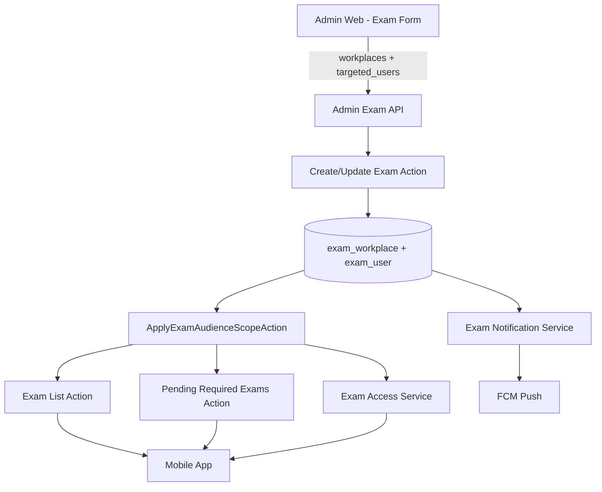
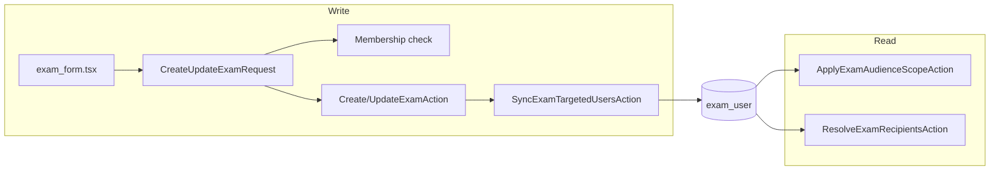
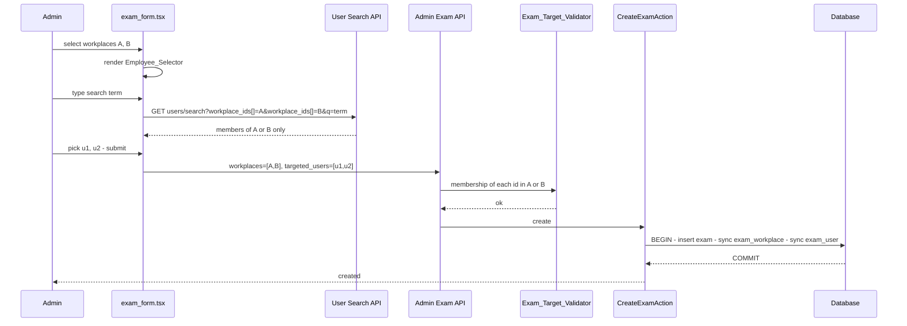
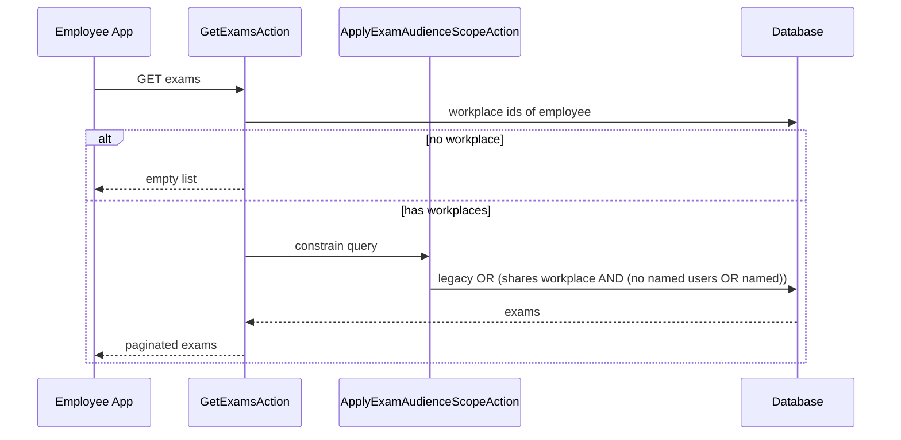

# Design Document: Exam Targeted Employees

## Overview

Exam targeting stays anchored on workplaces. A new `exam_user` table records the employees explicitly named for an exam; the absence of rows means every member of the exam's workplaces is targeted. Because the four places that decide "is this employee an audience member of this exam" have historically drifted apart, this design collapses the rule into a single reusable query constraint (`ApplyExamAudienceScopeAction`) that the exam list, the pending-mandatory list, and the single-exam access check all consume, so they cannot disagree by construction. The notification recipient query is the inverse direction (exam → users) and therefore needs its own implementation, which is kept honest by a paired test asserting both directions agree.

Targeting is **exam-wide**, not per workplace — see DDR 1 in `requirements.md`. That decision is what keeps the audience constraint a set of flat `EXISTS` clauses instead of a subquery correlated on two levels.

### Design Goals

- Express the audience rule exactly once for the employee → exams direction, and reuse it at every decision point.
- Store the "everybody" default as the absence of data, so no extra flag column can fall out of sync with the rows.
- Change nothing about how existing exams behave, apart from the deliberate workplace-less correction in Requirement 6.5.
- Keep the admin payload backward compatible by adding a field rather than reshaping `workplaces`.
- Keep an admin able to save an exam whose stored targeting has gone stale.

### Key Design Decisions

- **`exam_user` holds `{exam_id, user_id}` only.** Per-workplace modes are out of scope (DDR 1). _Requirements: Scope, DDR 1_
- **Mode is derived, not stored.** An exam is in All_Members_Mode when it has no `exam_user` rows. A stored boolean would be a second source of truth that can contradict the rows. _Requirements: 1.2, 8.1_
- **Delivery_Mode is a form control, not an API field.** The admin picks the audience explicitly, but the server still infers it from whether any employee is named. This keeps the request contract unchanged and keeps the "no second source of truth" property above; the price is that the server cannot distinguish "whole workplaces" from "named employees with nobody named", which is why the latter is blocked in the form. _Requirements: 1.1, 1.4, 9.1_
- **`canUserViewExam` is reimplemented as an existence query using the shared scope.** It currently duplicates the rule in PHP against a loaded relation (`ExamService.php:55`). Rewriting it as `Exam::whereKey(...)->tap(scope)->exists()` makes Requirement 6.4 structurally true instead of merely tested. The cost is one extra query per exam open, which is negligible on this path. _Requirements: 6.3, 6.4_
- **The employee → exams scope short-circuits to "no results" for workplace-less employees.** This single guard delivers Requirement 6.5 for all three consumers at once. _Requirements: 5.1, 6.5_
- **Result reading is exempted from the audience gate.** `GetExamResultAction` is the one of the four `canUserViewExam` call sites where denial punishes rather than protects: the employee is reading a result they already earned. It gets an explicit "audience member **or** owns a result for this exam" check. _Requirements: 6.6_
- **Validation exempts pre-existing stale links only.** Membership is verified for every submitted user id except those already unreachable under the exam's *saved* workplaces. Without the exemption, an exam holding a stale link cannot be saved at all; with it measured against the saved scope rather than the whole linked set, a request that replaces the workplaces still has its inherited chips re-checked. _Requirements: 4.4, 4.4a, 4.4b, 8.3_
- **The admin payload gains `targeted_users` alongside the unchanged `workplaces` array.** An additive flat id array mirrors how `workplaces` and `documents` already work on this endpoint. _Requirements: 1.7, 8.6_
- **Update replaces the whole `exam_user` set.** Delete every row for the exam and re-insert from the payload. _Requirements: 3.2_
- **The user-search endpoint gains a `workplace_ids` array filter** rather than overloading the existing `workplace_id` integer filter, so no current consumer changes behaviour. _Requirements: 2.1_
- **`targeted_users` is serialised with the plain `name`, not `toDisplayArray()`'s `short_name`.** The search endpoint (`MasterDataController::searchUser`) returns plain `name`, so using the short-name serialisation for restored chips would make the same control show two different name forms. _Requirements: 3.4_

### API Change Summary

**Before** (create/update exam request):
```json
{
    "workplaces": [1, 2],
    "documents": [5]
}
```

**After:**
```json
{
    "workplaces": [1, 2],
    "documents": [5],
    "targeted_users": [10, 11]
}
```

`workplaces` and `documents` are unchanged. `targeted_users` is optional; omitting it or sending `[]` means every member of the selected workplaces is targeted.

## Architecture

### System Context

The feature sits between the admin exam form and the four consumers of exam audience data. Nothing outside the exam domain is touched; the Document feature has its own independent `document_user` mechanism, with additive semantics, and is unaffected.



### High-Level Architecture



## Components and Interfaces

### Component 1: Exam_User_Link storage (`exam_user`)

**Purpose**: Record which employees are explicitly named for which exam.

**Responsibilities**:
- Hold one row per `{exam_id, user_id}` pair.
- Cascade-delete when the exam or the user is deleted.
- Support fast lookups in both directions.

**Interfaces**:
- **Input**: rows written by `SyncExamTargetedUsersAction`
- **Output**: rows read by `ApplyExamAudienceScopeAction` and `ResolveExamRecipientsAction`
- **Dependencies**: `exams`, `users`

**Implementation Notes**:
- New migration `create_exam_user_table`; no backfill, no data migration. _Requirements: 8.5_
- Unique constraint on the pair makes Requirement 4.5 (duplicate user id in payload) a no-op, provided the sync de-duplicates before insert.
- `unique(exam_id, user_id)` serves the exam → users direction; `index(user_id, exam_id)` serves the read-heavy employee → exams direction. _Requirements: NFR Performance_
- No `workplace_id` column, no `workplace_users` foreign key: membership is re-derived at query time, never denormalised here.

### Component 2: `Exam::targetedUsers()` relation

**Purpose**: Expose Exam_User_Link rows through Eloquent.

**Responsibilities**:
- Provide `belongsToMany(User::class, 'exam_user')`.

**Implementation Notes**:
- Named `targetedUsers`, not `users`, so it cannot be mistaken for "employees who took the exam" (`results`).
- No `withPivot`; the pivot carries nothing beyond the two keys.

### Component 3: `ApplyExamAudienceScopeAction`

**Purpose**: Single expression of Exam_Visibility_Rule in the employee → exams direction.

**Responsibilities**:
- Constrain an `Exam` query builder to the exams a given employee is an audience member of.
- Short-circuit to an empty result for an employee belonging to no workplace.
- Admit Legacy_Untargeted_Exam rows, All_Members_Mode exams whose workplaces include one of the employee's, and Named_Members_Mode exams where the employee is named **and** still a member.

**Interfaces**:
- **Input**: `Builder $query`, `int $userId`, `Collection $workplaceIds`
- **Output**: the same builder, constrained
- **Dependencies**: `exam_workplace`, `exam_user`, `workplace_users`

**Implementation Notes**:
- Membership is always re-derived from `workplace_users` at query time, which is what makes Requirement 5.6 (employee left the workplace) hold without any cleanup job and what makes a Stale_Link inert.
- The workplace half and the named half are **independent** `whereHas` clauses — no correlated subquery, no nesting of one inside the other. This is the whole benefit of DDR 1.

Shape of the constraint:

```php
// backend/app/Actions/Common/Exam/ApplyExamAudienceScopeAction.php
public function __invoke(Builder $query, int $userId, Collection $workplaceIds): Builder
{
    if ($workplaceIds->isEmpty()) {
        return $query->whereRaw('1 = 0'); // Requirement 5.1 / 6.5
    }

    return $query->where(function (Builder $outer) use ($userId, $workplaceIds) {
        $outer
            // Legacy_Untargeted_Exam
            ->doesntHave('workplaces')
            ->orWhere(function (Builder $targeted) use ($userId, $workplaceIds) {
                $targeted
                    // shares a workplace with the employee
                    ->whereHas(
                        'workplaces',
                        fn(Builder $w) => $w->whereIn('workplaces.id', $workplaceIds)
                    )
                    ->where(function (Builder $mode) use ($userId) {
                        $mode
                            // All_Members_Mode: no named employees at all
                            ->doesntHave('targetedUsers')
                            // Named_Members_Mode: this employee is named
                            ->orWhereHas(
                                'targetedUsers',
                                fn(Builder $u) => $u->where('users.id', $userId)
                            );
                    });
            });
    });
}
```

### Component 4: Exam_List_Action, Pending_Exam_Action, Exam_Access_Service

**Purpose**: Consume the shared scope so all three agree.

**Responsibilities**:
- `GetExamsAction`: replace its inline `whereHas('workplaces') / orDoesntHave('workplaces')` block with the scope, keeping the existing early return for workplace-less employees as a query-saving short-circuit whose result the scope would produce anyway.
- `GetPendingRequiredExamsAction`: replace its inline block with the scope; the existing `paper_status` / `is_disabled` guard and the "already satisfied" exclusion stay untouched.
- `ExamService::canUserViewExam`: replace the PHP loop with `Exam::whereKey($exam->id)->tap(scope)->exists()`.

**Implementation Notes**:
- No other filter in these three call sites changes: date windows, `is_required`, ordering, pagination, and result-satisfaction exclusions are preserved verbatim. _Requirements: 8.3_
- `canUserViewExam` gates four actions: `GetExamAction`, `StartOrResumeExamAction`, `SubmitExamAnswerAction`, `GetExamResultAction`. The first three keep the strict gate. `GetExamResultAction` gets the own-result exception below.

### Component 5: Own-result exception in `GetExamResultAction`

**Purpose**: Keep an employee's earned result readable after they leave the audience.

**Implementation Notes**:
- `ExamService` gains `canUserViewExamResult(int $userId, Exam $exam): bool` returning `canUserViewExam(...) || $exam->results()->where('user_id', $userId)->exists()`.
- Only `GetExamResultAction` switches to it. Keeping the two methods separate is what stops the exception leaking into the start/submit paths. _Requirements: 6.6_

### Component 6: `ResolveExamRecipientsAction` (exam → employees)

**Purpose**: Express Exam_Visibility_Rule in the inverse direction for push notifications.

**Responsibilities**:
- Given an exam, produce the set of employees who are audience members.
- Exclude employees who belong to no workplace, including for a Legacy_Untargeted_Exam.

**Interfaces**:
- **Input**: `Exam $exam`
- **Output**: `Builder` (or `Collection<User>`) of qualifying users
- **Dependencies**: `exam_workplace`, `exam_user`, `workplace_users`

**Implementation Notes**:
- Extracted out of `ExamNotificationService::getRecipientsForExam`, which keeps the notification-only filters (approved paper status, not disabled, already-satisfied exclusion) and the `with('devices')` eager-load. The audience concern and the notification concern stay separable, in line with the project's Action-pattern rule. _Requirements: 7.2_
- Shape:

```php
$exam->loadMissing(['workplaces', 'targetedUsers']);

$query
    ->when(
        $exam->workplaces->isNotEmpty(),
        // shares a workplace with the exam
        fn($q) => $q->whereHas(
            'workplaces',
            fn($w) => $w->whereIn('workplaces.id', $exam->workplaces->pluck('id'))
        ),
        // Legacy_Untargeted_Exam: any workplace at all. Requirements 7.4, 8.2
        fn($q) => $q->whereHas('workplaces')
    )
    ->when(
        $exam->targetedUsers->isNotEmpty(),
        fn($q) => $q->whereIn('users.id', $exam->targetedUsers->pluck('id'))
    );
```

- One query, no `orWhere` branch per workplace, so the cost is independent of both the number of targeted workplaces and the number of targeted employees. _Requirements: NFR Performance_
- Named employees are still membership-checked by the first clause, so a Stale_Link is dropped from the recipient set. _Requirements: 5.6_

### Component 7: `Exam_Target_Validator`

**Purpose**: Reject targeting payloads that name employees outside the selected workplaces.

**Responsibilities**:
- Validate the structure of `targeted_users`.
- Reject a non-empty `targeted_users` when `workplaces` is empty.
- Verify each submitted user id against current `workplace_users` membership for the submitted workplaces, exempting only ids that are already stale against the exam's saved workplaces.

**Implementation Notes**:
- Rules added to `CreateUpdateExamRequest`:
    - `targeted_users` → `array`
    - `targeted_users.*` → `integer`, `exists:users,id`
- The cross-field checks go in `withValidator`, where both `workplaces` and `targeted_users` are available:
    1. If `targeted_users` is non-empty and `workplaces` is empty → fail. _Requirements: 4.2_
    2. Load `exam_user.user_id` for the route's exam (empty on create), then drop the ids still holding membership in one of the exam's *saved* workplaces → the exempt set. An exam with no saved workplace exempts nothing. _Requirements: 4.4, 4.4a, 4.4b_
    3. One query: `workplace_users` rows for `user_id IN (submitted minus exempt)` and `workplace_id IN (submitted workplaces)`; any submitted id with no row is reported by name. _Requirements: 4.3_
- Membership is validated server-side even though the picker already filters, because the picker's filter is a client-side convenience and the payload is attacker-controllable. _Requirements: NFR Security_
- Import all classes at the top of the file; no inline fully qualified names.

### Component 8: `SyncExamTargetedUsersAction`

**Purpose**: Persist the targeting payload.

**Responsibilities**:
- Replace the exam's `exam_user` set with the de-duplicated ids from the payload.

**Implementation Notes**:
- `$exam->targetedUsers()->sync(array_unique($ids))` covers delete, insert, and de-duplication in one call. _Requirements: 3.1, 3.2, 4.5_
- Called from inside the existing transaction in `CreateExamAction` and `UpdateExamAction`, immediately after `workplaces()->sync(...)`, so a failure anywhere in the transaction rolls back targeting along with everything else. _Requirements: 3.7_
- A missing `targeted_users` key is treated as `[]`, which clears targeting. _Requirements: 8.7_

### Component 9: Admin read path

**Purpose**: Return saved targeting so the form can be repopulated, with stale entries marked.

**Implementation Notes**:
- `ExamService::show()` eager-loads `targetedUsers` with an explicit column list — `id`, `first_name`, `last_name`, `first_name_kana`, `last_name_kana`, `staff_no` — so the response carries what the chips need and nothing more. The kana columns are included because `$appends` contains `name_kana`, whose accessor reads them. Without the column list the endpoint would serialise every non-hidden `users` column (email, phone, `paper_status`, `settings`, …) for each targeted employee.
- Each returned user gets a dynamic `is_current_member` boolean: true when the user has a `workplace_users` row for any of the exam's workplaces. Resolved in one extra query over the exam's workplace ids and targeted user ids. _Requirements: 3.5_
- `ExamService::list()` is deliberately left unchanged: the admin exam list renders workplaces only, and loading targeting there would cost a join on every page for no rendered value.

### Component 10: User search `workplace_ids` filter

**Purpose**: Let one selector search across every selected workplace.

**Implementation Notes**:
- `UserFilter::workplaceIds(array $ids)` → `whereHas('workplaces', fn($q) => $q->whereIn('workplace_id', $ids))`, sitting next to the existing `workplace()` and `workplaceNone()`.
- `SearchUserRequest` gains `workplace_ids` → `nullable`, `array` and `workplace_ids.*` → `integer`.
- The existing `workplace_id` filter is untouched, so the workplace-user screen, shift screens, and the document modals keep their current behaviour.
- `MasterDataController::searchUser` already forces `is_disabled = false`, so disabled employees never reach the picker.

### Component 11: `Exam_Form`, Delivery_Mode and `Employee_Selector` (frontend)

**Purpose**: Let the admin state which audience they want, then name employees if that is the answer.

**Responsibilities**:
- Render a two-option Delivery_Mode control beneath the workplace field, defaulting to "whole workplaces".
- Render one `DUserSelectRemoteMultiple` only in "named employees" mode.
- Repopulate mode and selection from `targeted_users` when editing, marking stale entries.

**Implementation Notes**:
- **Delivery_Mode never reaches the API.** It is form state only; the payload difference is `targeted_users: []` versus a non-empty array. Keeping it out of the request is what leaves the API contract unchanged and stops a second source of truth appearing next to the rows. _Requirements: 1.2, 1.7, Glossary_
- Mantine `Radio.Group` with two options, or a `SegmentedControl`; the labels must name the audience, not the control. _Requirements: 9.1_
- **The form is `mode: 'uncontrolled'`** (`exam_form.tsx:179`). `getInputProps` alone does not re-render on change, so showing/hiding the selector, disabling the mode option, and re-scoping the search when `workplaces` changes all require an explicit subscription: `form.watch('workplaces', ...)` feeding component state, or lifting the value into state. The same applies to Delivery_Mode itself, which must re-render its sibling. This is the single most likely place for the frontend work to go wrong.
- "Named employees" is disabled while no workplace is selected, with an explanatory hint — the selector has nothing to search otherwise. _Requirements: 1.5_
- Switching to "whole workplaces" drops the named employees from the submitted payload. Whether the chips are cleared immediately or merely hidden is an implementation choice; what must hold is that the payload carries `[]`. _Requirements: 1.6_
- "Named employees" with an empty selector is a client-side validation error, not an empty submit — the API reads an empty list as All_Members_Mode and cannot distinguish the two. _Requirements: 1.4_
- The selector passes `extraParams={{ workplace_ids: selectedWorkplaceIds }}`. `CommonHelper.urlQueryToString` already serialises arrays as `workplace_ids[]=1&workplace_ids[]=2`, which Laravel parses as an array.
- `minSearchLength` stays at the component default of 3, matching the endpoint's `q` → `min:3` rule.
- **Repopulation needs `initialOptions`**, not just a value array: `DSelectRemoteMultiple` renders a chip's label from its cached options, so setting only the value would show raw ids. Map `targeted_users` to `{ value: id, label: name (staff_no) }` and pass it as `initialOptions`. A stale entry gets a marker in its label.
- Changing the workplace selection does **not** prune already-named employees — the client cannot know memberships. A named employee who no longer qualifies is rejected on submit by name (Requirement 2.5, 4.3).
- Mode labels, hint, placeholder, audience summary, and stale marker must all go through the translation layer. _Requirements: 1.8, 9.1, 9.2_

## Data Models

### Entity 1: Exam_User_Link

```sql
-- backend/database/migrations/xxxx_create_exam_user_table.php
CREATE TABLE exam_user (
    exam_id BIGINT UNSIGNED NOT NULL,  -- FK exams(id)  ON DELETE CASCADE
    user_id BIGINT UNSIGNED NOT NULL,  -- FK users(id)  ON DELETE CASCADE
    UNIQUE (exam_id, user_id),
    INDEX (user_id, exam_id)
);
```

**Validation Rules**:
- `user_id` must be a current member of one of the exam's workplaces at write time, unless the row already exists *and* was already unreachable under the exam's saved workplaces (Requirement 4.4). Enforced by Exam_Target_Validator, not by a database constraint.

**Relationships**:
- Many-to-one with `exams` and `users`; no timestamps, matching `exam_workplace` and `document_user`.

### Entity 2: Admin request payload

```typescript
// frontend/src/pages/manage/exam/partials/exam_form.tsx
type DeliveryMode = 'workplaces' | 'users';

interface ExamFormType {
    // ...existing fields
    workplaces: string[];
    delivery_mode: DeliveryMode; // form state only, never submitted
    targeted_users: string[]; // submitted as [] whenever delivery_mode is 'workplaces'
}
```

**Validation Rules**:
- `delivery_mode: 'users'` requires a non-empty `targeted_users` (client-side only — the API cannot tell the modes apart).
- `delivery_mode: 'users'` requires a non-empty `workplaces`; the option is disabled until then.
- Non-empty `targeted_users` requires non-empty `workplaces`; re-validated server-side.
- On edit, `delivery_mode` is derived: `targeted_users.length > 0 ? 'users' : 'workplaces'`.

### Entity 3: Admin exam detail response addition

```typescript
// frontend/src/types/models/exam.d.ts
interface ExamTargetedUser {
    id: number;
    name: string;
    name_kana: string;
    staff_no: string | null;
    is_current_member: boolean;
}

interface ExamWithRelation {
    // ...existing fields
    targeted_users: ExamTargetedUser[];
}
```

### Data Flow: creating an exam with named employees



### Data Flow: employee opens the exam list



## API Design

### Endpoint 1: Create exam

**Method**: `POST`
**Path**: `admin/exams`

```json
{
    "workplaces": [1, 2],
    "targeted_users": [10, 11]
}
```

**Error Responses**:
- `422 Unprocessable Entity`: `targeted_users` non-empty while `workplaces` is empty; a user id does not exist; a user is not a member of any submitted workplace (message names the employee).

### Endpoint 2: Update exam

**Method**: `PUT`
**Path**: `admin/exams/{id}`

Same payload and errors as create, with two differences:
- A user id already linked to this exam skips the membership check only when it is a Pre_Existing_Stale_Link (Requirement 4.4); one that the submitted workplaces newly push out of scope is rejected (Requirement 4.4a).
- An omitted `targeted_users` clears all targeting, returning the exam to All_Members_Mode. This matches `workplaces` and `documents`, and differs from `external_url`, which is preserved when omitted.

### Endpoint 3: Show exam (admin)

**Method**: `GET`
**Path**: `admin/exams/{id}`

**Response** (additive field only):
```json
{
    "workplaces": [{ "id": 1, "name": "Workplace A" }],
    "targeted_users": [
        { "id": 10, "name": "NGUYEN VAN A", "name_kana": "", "staff_no": "NV001", "is_current_member": true },
        { "id": 11, "name": "TRAN THI B", "name_kana": "", "staff_no": "NV002", "is_current_member": false }
    ]
}
```

### Endpoint 4: Employee search

**Method**: `GET`
**Path**: `admin/master/users/search`

Gains an optional `workplace_ids[]` array filter. `workplace_id`, `q`, `key`, `staff_no`, and `permission` are unchanged. `q` still requires at least three characters and still matches `first_name`, `last_name`, `email`, and `staff_no` independently. _Requirements: 2.1, 2.2_

## Security Considerations

### Authentication
- Unchanged. Admin endpoints keep their existing authentication and permission middleware; employee endpoints keep theirs.

### Authorization
- The audience rule is the authorization boundary for exam content. Because `canUserViewExam` is rebuilt on the shared scope, an employee who is not an audience member cannot read the exam or its questions even with a direct id.
- The single exception is `GetExamResultAction`, which additionally admits an employee who owns a result for that exam. It exposes that employee's own result only. _Requirements: 6.6_
- Workplace membership is never taken from the request; it is always read from `workplace_users` for the authenticated user.
- The Requirement 4.4 exemption does not widen the attack surface: it applies only to `{exam, user}` pairs already persisted for that exam *and* already unreachable under its saved workplaces, so the exempted link grants nothing that the audience rule would honour. It never applies on create, nor to an exam with no saved workplace (Requirement 4.4b).

### Data Protection
- `exam_user` stores a user id reference only.
- The admin exam detail response exposes name, kana name, employee code, and a membership flag for each targeted employee — enforced by the explicit column list in the eager-load, not by `$hidden`.

### Input Validation
- `targeted_users` is validated for structure, referential existence, presence of at least one workplace, and membership of every newly named employee.
- A payload naming an employee outside the selected workplaces is rejected outright rather than filtered, so the admin is never silently given a narrower audience than the one they submitted. _Requirements: 4.3_

## Error Handling

### Validation errors (admin write path)

| Scenario | Handling |
|----------|----------|
| `targeted_users` non-empty, `workplaces` empty | 422; nothing persisted |
| A user id does not exist | 422 from the `exists` rule |
| A newly named user is not a member of any submitted workplace | 422 naming the employee; nothing persisted |
| A previously saved user is no longer a member of the exam's **saved** workplaces | Accepted (Requirement 4.4); the link persists but grants nothing |
| A previously saved user is still a member, but the **submitted** workplaces exclude them | Rejected, naming the employee (Requirement 4.4a) |
| The exam has no saved workplace and the request supplies a new scope | Every submitted id is checked against the new scope (Requirement 4.4b) |
| Several submitted ids fail the check | One message naming all of them (Requirement 4.7) |
| Duplicate user id | Accepted; de-duplicated by `sync()` |
| `targeted_users` omitted or empty | Accepted; exam returns to All_Members_Mode |

### Persistence errors

| Scenario | Handling |
|----------|----------|
| Failure after `exam_user` rows are written | Enclosing transaction rolls back exam, workplaces, documents, questions, and targeting together |
| Workplace deleted while the form is open | A later save re-validates and rejects the missing workplace; already-named employees of that workplace become stale links |
| Employee deleted while the form is open | `exists` rule rejects the save; cascade removes rows for already-saved exams |

### Read path

| Scenario | Handling |
|----------|----------|
| Employee belongs to no workplace | Empty list, empty pending set, access denied, not a notification recipient |
| Employee left every targeted workplace mid-attempt | Access denied on subsequent requests; an in-progress attempt becomes unfinishable, matching current behaviour for workplace removal. Their existing result stays readable |
| Exam is in Named_Members_Mode and every named employee has left | Nobody qualifies; the exam simply has no audience. Reopening the form still shows those employees, marked stale, so the state is visible rather than silently reverting to "everyone" |

## Performance Considerations

### Expected Load
- Admin exam writes: a handful per day; payload size bounded by tens of employees.
- Employee exam list: one paginated query per app session, per employee.
- Notification job: runs on the scheduler, processes at most 50 exams per tick.

### Optimization Strategies
- `index(user_id, exam_id)` on `exam_user` serves the `orWhereHas('targetedUsers', ...)` branch of the employee → exams direction; `unique(exam_id, user_id)` serves `doesntHave('targetedUsers')` and the exam → users direction.
- The audience constraint is three independent `EXISTS` subqueries inside one `where` group, so the paginated exam list stays one query regardless of how many exams or targeted employees exist. No per-row lookup is introduced. _Requirements: NFR Performance_
- `ResolveExamRecipientsAction` adds at most two `whereIn`/`whereHas` clauses to the existing recipients query — no branch per workplace.
- `ExamService::list()` keeps its current eager-loads so the admin list query is unchanged; `show()` adds one relation load plus one membership query.

## Testing Strategy

### Unit Tests

**`ApplyExamAudienceScopeAction` (`backend/tests/Unit/Actions/Common/Exam/ApplyExamAudienceScopeActionTest.php`):**
- Legacy_Untargeted_Exam qualifies an employee with at least one workplace
- Employee with no workplace qualifies for nothing, including a Legacy_Untargeted_Exam
- All_Members_Mode exam qualifies every member of every targeted workplace
- Named_Members_Mode exam qualifies only named members
- Named_Members_Mode exam does not qualify a non-named member of the same workplace
- Multi-workplace exam qualifies a member of any one of its workplaces
- An employee named but no longer a member of any targeted workplace does not qualify
- An employee named on an exam whose workplaces they never belonged to does not qualify

**`ResolveExamRecipientsAction` (`backend/tests/Unit/Actions/Common/Exam/ResolveExamRecipientsActionTest.php`):**
- Same matrix as above, asserted from the exam → employees direction
- A single consistency test asserting, over a shared fixture set, that the recipient set equals the set of employees the scope qualifies (minus the notification-only filters), guarding against the two directions drifting apart

**`SyncExamTargetedUsersAction`:**
- Creates rows for the submitted ids
- Replaces the previous set on update rather than accumulating
- De-duplicates repeated ids
- An empty payload clears the set

**`ExamService::canUserViewExamResult`:**
- Grants an audience member
- Grants a non-audience employee who owns a result
- Denies a non-audience employee with no result

### Integration Tests

**Admin write path (`backend/tests/Feature/Api/Admin/ExamTargetedEmployeesTest.php`):**
- Create an exam naming a subset of one workplace, then assert the persisted rows
- Update the exam to a different subset and assert replacement, not accumulation
- Reject a payload naming an employee who is not a member of any selected workplace
- Reject a non-empty `targeted_users` with an empty `workplaces`
- Accept an omitted `targeted_users` and assert All_Members_Mode behaviour
- Remove a named employee from the workplace, then re-save the exam untouched: the save succeeds, the rows are unchanged, and the audience is unchanged (Requirements 4.4, 8.3)
- Keep a still-valid named employee but replace the exam's workplaces with one they do not belong to: the save is rejected naming that employee (Requirement 4.4a)
- Delete the exam's last workplace, then re-scope it while keeping the inherited chip: the chip is checked against the new scope (Requirement 4.4b)
- Reopen the exam via the show endpoint and assert `targeted_users` carries `is_current_member` and no unexpected user columns

**Employee read path (lifecycle):**
- Create the exam through the real admin endpoint, then assert visibility through the real employee endpoints (list, pending, single-exam access) rather than through fixtures, at least once per mode
- Assert the three decision points agree for the same employee and exam
- Remove the employee from the workplace through the real workplace endpoint and assert access is revoked afterwards, while their existing result stays readable
- Seed an exam that already has results from a previous lifecycle and assert the new targeting selects and ignores the right rows

**Notification (`backend/tests/Unit/Services/ExamNotificationServiceTest.php`, extended):**
- Named employees are recipients; non-named members of the same workplace are not
- Workplace-less employees are not recipients of a Legacy_Untargeted_Exam
- A named employee who left every targeted workplace is not a recipient
- Existing tests for paper status, disabled, and already-satisfied filters continue to pass unchanged

**User search (`SearchUserRequest` / `UserFilter`):**
- `workplace_ids[]` returns members of any listed workplace and excludes everyone else
- `workplace_id` alone behaves exactly as before

### Frontend Tests

**`exam_form.test.tsx`:**
- Delivery_Mode defaults to "whole workplaces" and no Employee_Selector is rendered
- Choosing "named employees" reveals the Employee_Selector
- "Named employees" is disabled while no workplace is selected
- Choosing "named employees" and naming nobody blocks submission
- Switching back to "whole workplaces" submits `targeted_users: []` even after employees were named
- The selector queries with `workplace_ids[]` covering every selected workplace
- The submitted payload carries `targeted_users` as a flat id array, and `delivery_mode` is not sent
- Editing an exam with named employees opens in "named employees" mode with visible labels
- Editing an exam without named employees opens in "whole workplaces" mode
- A `targeted_users` entry with `is_current_member: false` is rendered with the stale marker
