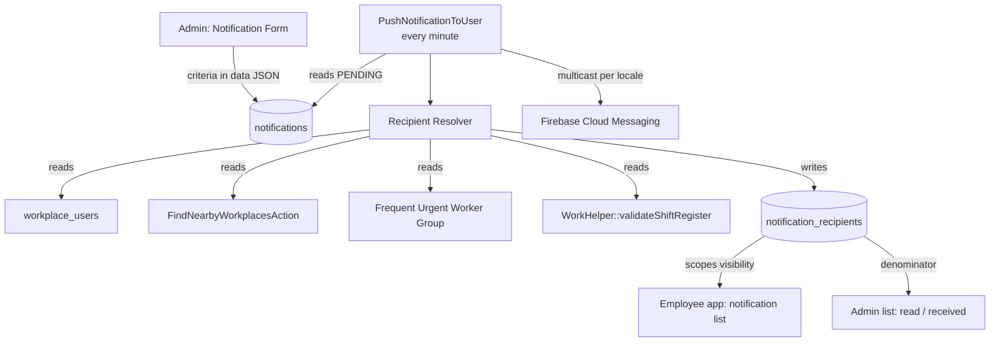
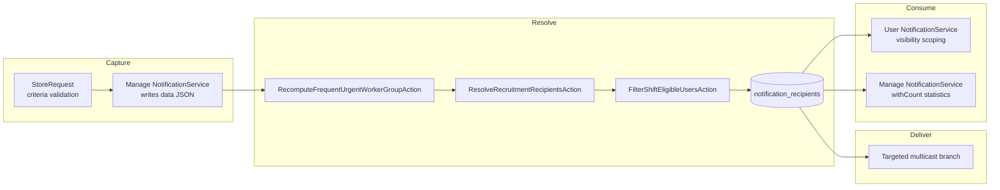
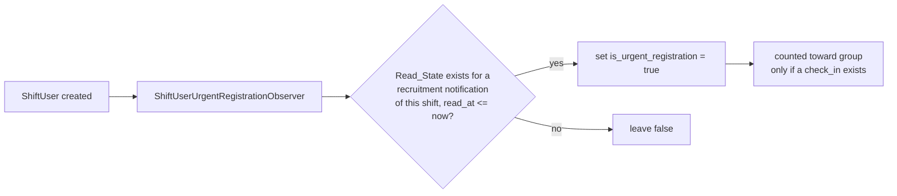
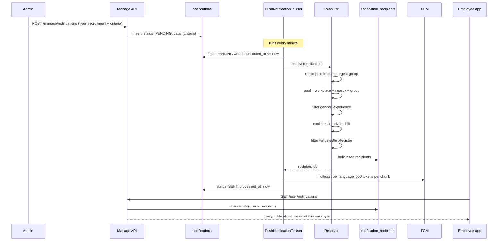

# Design Document: Recruitment Notification Targeting

## Overview

The design keeps the existing notification record as the single unit an admin creates and manages, and layers targeting on top of it in two places: the **criteria** the admin chooses are stored in the already-existing `notifications.data` JSON column, and the **resolved recipients** are stored in one new two-column join table. Recipient resolution runs inside the existing `PushNotificationToUser` job at the moment a notification transitions from `PENDING` to `SENT`, which is the single point in the system where "sending" actually happens and therefore the only place where scheduled and immediate notifications behave identically. The job gains a third delivery path — targeted multicast — alongside its current topic-broadcast and single-user paths. Urgent registrations are detected by a `ShiftUser` observer rather than by editing each registration action, and the frequent-urgent-worker group is computed set-based over the whole population rather than through the existing per-user strategy pattern, because its membership decays with the passage of time and must be refreshed on demand before a send.

### Design Goals

- Add targeting without changing the behavior, delivery, or visibility of any non-recruitment notification.
- Reuse existing infrastructure wherever it already solves the problem: `FindNearbyWorkplacesAction` for proximity, `WorkHelper::validateShiftRegister` for eligibility, the `Group`/`user_groups` system for the frequent-worker group, and `notifications.data` for the criteria.
- Require no change to the employee mobile application: no new request parameter, no new endpoint it must call.
- Make the read/received statistic stable over time, so a historical notification always reports the same figures.
- Keep every added query set-based, since the candidate pool can span many workplaces.

### Key Design Decisions

- **Criteria in JSON, recipients in a table.** The criteria are written once and read as a unit, so `notifications.data` is sufficient and avoids a migration. The recipient list is the denominator of a statistic, the authority for visibility, and must be joined against `notification_read_states`; none of that works acceptably from JSON, which cannot be indexed for `whereExists` on the employee's hot notification-list query.
- **Resolve at send time, inside `PushNotificationToUser`.** The job already polls `status = PENDING AND scheduled_at <= now()` every minute. Resolving there means an immediately-sent notification and one scheduled for next week follow exactly the same code path, and the resolved list reflects eligibility, experience, and group membership as of delivery — which the eligibility filter requires, since a candidate's schedule changes continuously.
- **A third delivery path rather than a rewrite.** `PushNotificationToUser` currently branches on `user_id === null`. A recruitment notification keeps `user_id = null` (so the existing admin list query `whereNull('user_id')` is untouched) but is routed to a new targeted branch selected by notification type. The topic branch is left byte-for-byte intact for every other type.
- **Group computed set-based, not through the per-user strategy pattern.** The existing `AbstractMembershipStrategy` computes *which groups a given user belongs to*, driven by observers reacting to events. Frequent-urgent-worker membership expires purely through the passage of time — a user silently stops qualifying when their second-most-recent urgent shift falls out of the 90-day window, and no event fires. A single `GROUP BY user_id HAVING COUNT(*) >= 2` recompute solves both that decay problem and the requirement to refresh membership immediately before a send.
- **Urgent registration detected by an observer.** Marking happens on `ShiftUser::created`, so every creation path — employee self-registration, admin assignment, bulk assignment — is covered by one implementation, and no existing action needs its transaction reshaped.
- **`SENT` means the recipient list is committed, not that every push succeeded.** For the targeted path, in-app delivery is guaranteed once recipients are persisted, so per-device push failures are logged and do not flip the notification to `FAILED`. This differs deliberately from the single-user path, where the push is the only delivery channel.
- **A nullable `notifications.recipients_resolved_count` column marks resolution, rather than inferring it from the absence of recipient rows.** "No recipient rows" is ambiguous: it describes both a notification that predates this feature and one that legitimately resolved to zero recipients. Conflating them would make a notification aimed at nobody visible to everybody. An explicit `null` (never resolved) versus `0` (resolved to nobody) removes the ambiguity, and as a side effect it also serves the statistic's denominator directly and removes a correlated subquery from the employee's visibility check.
- **Recruitment notifications are excluded from the globally cached system-notification list.** `getLatestSystemNotifications` caches the latest five broadcast notifications under one cache key shared by every user; anything served from it bypasses per-user scoping entirely. Targeted notifications are therefore kept out of that endpoint, and remain available through the regular notification list, which is scoped per user.

### API/Interface Change Summary

**Before** — `notifications.data` for a recruitment notification:

```json
{ "shift_id": 123, "workplace_id": 45 }
```

**After:**

```json
{
    "shift_id": 123,
    "workplace_id": 45,
    "gender_target": "both",
    "requires_experience": true,
    "include_nearby_workplaces": true,
    "nearby_radius_km": 10,
    "include_frequent_urgent_group": true,
    "hot_bonus_amount": 5000
}
```

## Architecture

### System Context

Recruitment notification targeting sits between the admin notification screen and the existing Firebase delivery job, and reads from three existing subsystems it does not modify.



### High-Level Architecture



### Urgent Registration Flow



## Components and Interfaces

### Component 1: ShiftUserUrgentRegistrationObserver

**Purpose**: Marks a newly created `shift_users` row as an urgent registration when the employee had already read a recruitment notification for that shift.

**Responsibilities**:

- React to `ShiftUser::created` and evaluate the read-before-register condition exactly once per row.
- Leave every other aspect of registration untouched.

**Interfaces**:

- **Input**: the created `ShiftUser` model.
- **Output**: sets `is_urgent_registration` on that row when the condition holds.
- **Dependencies**: `notifications`, `notification_read_states`.

**Implementation Notes**:

- The lookup **drives from `notification_read_states`, not from `notifications`**. `notifications.shift_id` was removed as a column in migration `2025_02_14_131127` and now lives inside the `data` JSON, so a predicate on `data->>'$.shift_id'` cannot use an index and would scan the whole notifications table on every registration — multiplied by the number of rows a bulk assignment creates. Starting from the read states of one user uses the existing `user_id` index, reduces the candidate set to that user's handful of read notifications, and only then evaluates the JSON predicate:

    ```php
    NotificationReadState::query()
        ->where('notification_read_states.user_id', $shiftUser->user_id)
        ->join('notifications', 'notifications.id', '=', 'notification_read_states.notification_id')
        ->where('notifications.type', NotificationType::RECRUITMENT->value)
        ->whereRaw("JSON_EXTRACT(notifications.data, '$.shift_id') = ?", [$shiftUser->shift_id])
        ->exists();
    ```

- Because the observer fires on creation, every surviving read state necessarily has `read_at <= ` the registration time, so no explicit time comparison is needed.
- Registered under `app/Observers/` following the existing observer registration pattern.
- The write uses `saveQuietly()` to avoid re-entering observers.
- Criterion 1.5 (no retroactive marking) falls out naturally: the observer only ever runs on `created`.
- Criterion 1.6 (approval/rejection does not change the marking) also falls out naturally, since the observer does not handle `updated`.

### Component 2: RecomputeFrequentUrgentWorkerGroupAction

**Purpose**: Rebuilds the membership of the single global frequent-urgent-worker group from scratch.

**Responsibilities**:

- Compute the qualifying user set with one aggregate query.
- Diff against current membership and apply the difference, mirroring the chunked insert/delete approach already used by `RecomputeGroupMembershipAction`.

**Interfaces**:

- **Input**: none; the group is a global singleton.
- **Output**: `user_groups` rows for the group are made to match the computed set.
- **Dependencies**: `shift_users`, `shifts`, `check_ins`, `groups`, `user_groups`.

**Implementation Notes**:

- The group is resolved through the existing identity mechanism: `Group::firstOrCreateByIdentity(new GroupIdentity(kind: GroupKind::FrequentUrgentWorker))`, producing the identity key `frequent_urgent_worker|null|null|null`.
- Qualifying query shape:

    ```sql
    SELECT shift_users.user_id
    FROM shift_users
    JOIN shifts ON shifts.id = shift_users.shift_id
    JOIN check_ins ON check_ins.shift_user_id = shift_users.id
    WHERE shift_users.is_urgent_registration = 1
      AND shifts.date >= :ninetyDaysAgo
    GROUP BY shift_users.user_id
    HAVING COUNT(*) >= 2
    ```

- Disabled users are excluded, consistent with `AbstractMembershipStrategy`.
- Called immediately before recipient resolution when group inclusion is enabled, and additionally wired into the existing scheduled group maintenance so the group is not stale for admins browsing the group screens.
- The rule-based coverage cap in `RecomputeGroupMembershipAction` does not apply here; this is a system group, not an admin-authored rule.

### Component 3: FilterShiftEligibleUsersAction

**Purpose**: Reduces a set of candidate user IDs to those who could actually register for a given shift.

**Responsibilities**:

- Fetch work-hour data for all candidates in one batched call.
- Run the existing eligibility gate per candidate and drop anyone it rejects.

**Interfaces**:

- **Input**: `Shift $shift`, `array $userIds`.
- **Output**: `array` of the user IDs that pass.
- **Dependencies**: `WorkHelper::getWorkHours`, `WorkHelper::validateShiftRegister`, `SystemConfig`, `UserConfig`.

**Implementation Notes**:

- Mirrors the sequence already used in `RegisterShiftAction`:

    ```php
    $rangeStart = $startTime->clone()->subDays(6)->startOfDay();
    $rangeEnd = $startTime->clone()->addDays(6)->endOfDay();
    $workHours = WorkHelper::getWorkHours($userIds, $rangeStart, $rangeEnd);
    ```

    `getWorkHours` already accepts an array of user IDs and returns data keyed by user, so one call covers the whole pool.

- `SystemConfig` is loaded once. `UserConfig` rows are loaded for all candidates in one query and keyed by `user_id`, so each candidate is evaluated against their own weekly limit via the existing `getMaxHourPerWeek` precedence. A candidate with no `UserConfig` row falls back to system then global config, exactly as today.
- `validateShiftRegister` returns `null` when eligible and an array containing an `ErrorCode` otherwise; any non-null result excludes the candidate. All four of its rules therefore apply without being reimplemented.
- Candidates are processed in chunks so that a very large pool does not build one oversized work-hour result set.

### Component 4: ResolveRecruitmentRecipientsAction

**Purpose**: Produces and persists the final recipient list for a recruitment notification.

**Responsibilities**:

- Build the candidate pool, apply criteria filters, apply exclusions, and persist the result.

**Interfaces**:

- **Input**: `Notification $notification` (recruitment type, with criteria in `data`).
- **Output**: `array` of recipient user IDs, persisted to `notification_recipients`.
- **Dependencies**: Components 2 and 3, `FindNearbyWorkplacesAction`, `workplace_users`, `user_infos`, `check_ins`, `shift_users`.

**Implementation Notes**:

The pipeline runs in the order below; each stage narrows the previous one.

| Stage | Operation |
|-------|-----------|
| 1 | If group inclusion is enabled, invoke Component 2 to refresh group membership. |
| 2 | Seed the pool with `workplace_users.user_id` for the notification's `workplace_id`. |
| 3 | If nearby inclusion is enabled, call `FindNearbyWorkplacesAction($workplace, $radiusKm)` and union the `workplace_users` of the returned workplaces. |
| 4 | If group inclusion is enabled, union the group's `user_groups.user_id` with no distance restriction. |
| 5 | De-duplicate; exclude disabled users. |
| 6 | Gender filter: when the target is `male` or `female`, keep users whose `user_infos.gender` matches **or is null**. When `both`, skip. |
| 7 | Experience filter: when enabled, keep users with at least one `check_ins` row joined to a shift dated within the trailing 3 months. Assignment without a check-in does not qualify. |
| 8 | Exclude every user who already has a `shift_users` row for the target shift. |
| 9 | Apply Component 3. |
| 10 | Bulk-insert the survivors into `notification_recipients` in chunks, and write their count to `notifications.recipients_resolved_count` in the same transaction. |

- Stages 2 through 8 are expressed as a single query where practical, using `whereIn` against the accumulated pool rather than loading user models.
- Stage 9 is applied last because it is the most expensive filter, so it runs against the smallest possible set.
- The whole resolution plus the recipient insert runs inside one transaction, so a failure cannot leave a partially populated list (Reliability requirement).

### Component 5: PushNotificationToUser (extended)

**Purpose**: Adds a targeted delivery branch without disturbing the existing two.

**Responsibilities**:

- Detect recruitment notifications and route them to the targeted branch.
- Resolve recipients, then multicast to their devices grouped by language.

**Interfaces**:

- **Input**: unchanged — the job polls `PENDING` notifications due for sending.
- **Output**: `notification_recipients` rows plus FCM multicasts; notification status updated.
- **Dependencies**: Component 4, `ResolveFirebaseMessagingAction`, `NormalizeFirebaseMessageDataAction`, `CalculateUserBadgeCountAction`.

**Implementation Notes**:

- Branch selection becomes: `user_id !== null` → existing single-user path; else `type === recruitment` → new targeted path; else → existing topic path. The topic path is not modified.
- After resolution, recipients' devices are loaded with a non-null `fcm_token`, grouped by the user's `settings.lang` so the matching `notification_translations` row is used for each language, exactly as the single-user path already does.
- Tokens are chunked to at most 500 per `sendMulticast` call, which is the Firebase per-request limit.
- iOS badge counts are computed for the recipient subset through the existing `CalculateUserBadgeCountAction::executeForUsers`.
- Status handling: once recipients are committed the notification is marked `SENT`, and individual multicast failures are logged without aborting the remaining chunks. Only a failure of resolution itself marks the notification `FAILED`.
- An empty recipient list still marks the notification `SENT` with zero recipients and sends nothing — there is no fallback to topic broadcast.

### Component 6: User NotificationService (visibility scoping)

**Purpose**: Restricts recruitment notifications in the employee-facing API to their recipients.

**Responsibilities**:

- Apply the same scoping rule to the list, the unread count, the single-read endpoint, and the bulk read-all action.
- Keep targeted notifications out of the globally cached system-notification endpoint.

**Interfaces**:

- **Input**: the authenticated user.
- **Output**: filtered notification queries.
- **Dependencies**: `notification_recipients`, `notifications.recipients_resolved_count`.

**Implementation Notes**:

- A single reusable query scope is added and applied in all four places, so the rule cannot drift between them:

    ```php
    $query->where(function (Builder $q) use ($userId) {
        $q->where('type', '!=', NotificationType::RECRUITMENT->value)
          ->orWhereNull('recipients_resolved_count')
          ->orWhereExists(fn ($sub) => $sub->from('notification_recipients')
              ->whereColumn('notification_recipients.notification_id', 'notifications.id')
              ->where('notification_recipients.user_id', $userId));
    });
    ```

- The `orWhereNull('recipients_resolved_count')` clause is the legacy fallback: a recruitment notification that was never resolved — meaning it predates this feature — stays visible to everyone, so historical notifications do not vanish from employees' lists. Crucially it is **not** expressed as "has no recipient rows", because a notification that legitimately resolved to zero recipients also has no rows, and would then become visible to everyone despite having been aimed at nobody. The column distinguishes `null` (never resolved) from `0` (resolved to nobody), and the latter is visible to nobody.
- Testing this distinction is mandatory: a resolved-to-zero notification and a legacy notification must be asserted to behave in opposite ways.
- Because the first clause short-circuits on notification type, non-recruitment rows never touch `notification_recipients`. Only recruitment rows — a handful per day — pay for the `whereExists`, which is served by the `(user_id, notification_id)` index.
- `countUnread` gains the same scope. It has no pagination and already runs a correlated `whereDoesntHave('readStates')` over the whole broadcast set, so the added cost is one further correlated subquery evaluated only on recruitment rows. This is bounded by recruitment volume rather than by total notification volume.
- `readNotification` gains the same check and returns the existing `ErrorCode::Forbidden` with status 403 when it fails, matching how that method already rejects another user's personal notification.
- `getLatestSystemNotifications` is handled separately and **must not** simply receive the scope. It wraps its query in `Cache::rememberForever` under a single global key shared by every user, so any row it caches is served to everyone regardless of per-user filtering. Recruitment notifications are therefore excluded from that query outright with `->where('type', '!=', NotificationType::RECRUITMENT->value)`. Recipients still see the notification through the regular, per-user-scoped list endpoint.
- As a consequence, the targeted delivery branch does not need to invalidate `SYSTEM_NOTIFICATIONS_CACHE_KEY`, since a recruitment notification can no longer enter that cache.

### Component 7: Manage NotificationService (statistics)

**Purpose**: Supplies the read/received figures to the admin list.

**Responsibilities**:

- Attach both counts to each row of the paginated list using aggregates.

**Interfaces**:

- **Input**: the existing list filter conditions.
- **Output**: each notification carries `recipient_count` and `read_count`.
- **Dependencies**: `notification_recipients`, `notification_read_states`.

**Implementation Notes**:

- The denominator is read straight from `notifications.recipients_resolved_count`, which is written once at send time. No aggregate is needed for it, and the figure is immune to later `notification_recipients` cascade deletions when a user account is removed — it records how many people were messaged at the time, which is the historically correct answer.
- Only the numerator needs an aggregate, added with `withCount` on the existing query so no per-row query is introduced:

    ```php
    ->withCount([
        'readStates as read_count' => fn ($q) => $q->whereIn(
            'user_id',
            fn ($sub) => $sub->select('user_id')->from('notification_recipients')
                ->whereColumn('notification_recipients.notification_id', 'notifications.id')
        ),
    ])
    ```

- Constraining the read count to actual recipients guarantees the fraction can never exceed 100%, even though `readAllNotifications` historically created read states for users who were never targeted.
- A `null` denominator means the notification has not been resolved yet, which the frontend renders as "not yet sent" rather than as `0 / 0`. A `0` denominator means it was resolved and reached nobody.

### Component 8: Frontend — Notification Form

**Purpose**: Collects the criteria when the type is recruitment.

**Implementation Notes**:

- `formInitialValue` in `notification_form.ts` gains `gender_target` (default `both`), `requires_experience` (`false`), `include_nearby_workplaces` (`false`), `nearby_radius_km` (`10`), `include_frequent_urgent_group` (`false`), and `hot_bonus_amount` (`null`).
- Validation follows the existing `requiredIf` idiom already used for `workplace_id` and `shift_id`, so criteria are only required when the type is recruitment, and `nearby_radius_km` is only required when nearby inclusion is checked.
- The inputs render conditionally in `notification_create_update.tsx` on the same condition that already shows the workplace and shift selects, so switching type shows and hides them without a reload.
- All labels, helper text, and validation messages go through `t(...)` and are added to the English, Vietnamese, and Japanese locale files through the standard translation flow.

### Component 9: Frontend — Notification List Column

**Purpose**: Displays the read/received statistic.

**Implementation Notes**:

- A column is added to `index.page.tsx` alongside the existing `Shift` column. It renders `read_count / recipient_count` when the row's type is recruitment, a "not yet sent" indicator when the notification is still pending, and nothing at all for other types.
- `NotificationWithRelation` in `src/types/models/notification.d.ts` gains the two optional count fields.

## Data Models

### Entity 1: Recruitment Criteria (stored in `notifications.data`)

```typescript
// frontend/src/types/models/notification.d.ts
export type GenderTarget = 'male' | 'female' | 'both';

export interface RecruitmentCriteria {
    shift_id: number;
    workplace_id: number;
    gender_target: GenderTarget;
    requires_experience: boolean;
    include_nearby_workplaces: boolean;
    nearby_radius_km: number | null;
    include_frequent_urgent_group: boolean;
    hot_bonus_amount: number | null;
}
```

**Validation Rules**:

- `gender_target`: required when type is recruitment; one of `male`, `female`, `both`; defaults to `both`.
- `requires_experience`, `include_nearby_workplaces`, `include_frequent_urgent_group`: required booleans when type is recruitment.
- `nearby_radius_km`: required and greater than 0 when `include_nearby_workplaces` is true; ignored otherwise.
- `hot_bonus_amount`: nullable integer, minimum 0. Null and absent both mean "no hot bonus advertised".
- Any criteria submitted with a non-recruitment type are discarded server-side rather than rejected, mirroring how `icon` and `url` are already dropped for recruitment notifications.

**Relationships**:

- Stored inside the existing `notifications.data` column, which is already cast to `array` on the `Notification` model, so no schema change is needed.
- Reading a notification created before this feature yields only `shift_id` and `workplace_id`; a value object applies the documented defaults for every missing key.

### Entity 2: `notification_recipients` (new table)

```typescript
// conceptual shape — backend/database/migrations/*_create_notification_recipients_table.php
interface NotificationRecipient {
    id: number;
    notification_id: number; // FK → notifications, cascade on delete
    user_id: number; // FK → users, cascade on delete
}
```

**Validation Rules**:

- Unique composite index on `(notification_id, user_id)`; a user cannot be a recipient of the same notification twice.
- Index on `(user_id, notification_id)` to serve the employee-side visibility `whereExists`.
- No timestamps: the row's meaning is fully captured by the pair, and the send time already lives on `notifications.processed_at`.

**Relationships**:

- `Notification hasMany NotificationRecipient`; deleting a notification cascades.
- Deleting a user cascades, which slightly reduces a historical recipient count. This is accepted as consistent with `notification_read_states`, which already cascades the same way.

### Entity 3: `notifications.recipients_resolved_count` (new column)

```typescript
// added to the existing notifications table
interface NotificationResolutionFields {
    recipients_resolved_count: number | null; // null = never resolved, 0 = resolved to nobody
}
```

**Validation Rules**:

- Nullable unsigned integer, defaulting to `null`, so every pre-existing notification reads as "never resolved".
- Written exactly once, inside the same transaction that inserts the recipient rows, and never updated afterwards. Notifications cannot be edited once `SENT`, which the existing `createOrUpdateNotification` already enforces, so the value cannot drift out of step with the criteria that produced it.
- Only ever set for recruitment notifications; it stays `null` for every other type, which is also why the visibility scope short-circuits on type before consulting it.

**Relationships**:

- Serves two purposes that would otherwise each need a query: it is the denominator of the admin statistic, and it is the flag that separates a legacy notification from one that resolved to zero recipients.

### Entity 4: `shift_users.is_urgent_registration` (new column)

```typescript
// added to the existing shift_users table
interface ShiftUserUrgentFields {
    is_urgent_registration: boolean; // default false
}
```

**Validation Rules**:

- Set only by the observer at creation time; never edited afterwards by approval, rejection, or cancellation.
- Non-nullable with a default of `false`, so every pre-existing row reads as a normal registration.

**Relationships**:

- Combined with the row's `checkIn` relation, this is the input to the frequent-urgent-worker computation: the marking alone makes a registration urgent, but only a marked registration that was actually checked in counts toward the group threshold.
- Composite index on `(is_urgent_registration, user_id)` to serve the grouped 90-day count.

### Data Flow



## API Design

### Endpoint 1: Create Recruitment Notification

**Method**: `POST`
**Path**: `/api/manage/notifications` (existing endpoint, extended body)

**Request**:

```json
{
    "type": "recruitment",
    "title": "Urgent staff needed",
    "content": "Evening shift, bonus paid on the day",
    "is_manually_scheduled": false,
    "shift_id": 123,
    "gender_target": "both",
    "requires_experience": true,
    "include_nearby_workplaces": true,
    "nearby_radius_km": 10,
    "include_frequent_urgent_group": true,
    "hot_bonus_amount": 5000
}
```

**Response**: unchanged in shape; the persisted notification carries the criteria in `data`.

**Error Responses**:

- `422 Unprocessable Entity`: unknown `gender_target`; `nearby_radius_km` missing or not greater than 0 while `include_nearby_workplaces` is true; negative `hot_bonus_amount`; `shift_id` not found.
- `400 Bad Request`: `NotificationAlreadySent` when updating a notification that has already been sent — existing behavior, which also guarantees criteria cannot change after recipients are resolved.

### Endpoint 2: List Notifications (admin)

**Method**: `GET`
**Path**: `/api/manage/notifications` (existing endpoint, extended response)

**Response** (per row, added fields only):

```json
{
    "id": 10,
    "type": "recruitment",
    "status": "sent",
    "recipient_count": 50,
    "read_count": 12
}
```

**Error Responses**: unchanged.

### Endpoint 3: Employee Notification List

**Method**: `GET`
**Path**: `/api/user/notifications` (existing endpoint, unchanged contract)

The response shape does not change. Only the set of returned rows narrows for recruitment notifications, which is why the mobile application needs no update.

### Endpoint 4: Mark Notification Read

**Method**: `POST`
**Path**: `/api/user/notifications/{notification}/read` (existing endpoint)

**Error Responses**:

- `403 Forbidden`: the notification is a recruitment notification with a resolved recipient list that does not include the caller. Returned through the existing `ErrorCode::Forbidden` path.

## Security Considerations

### Authentication

- Unchanged. All endpoints keep their current authentication middleware.

### Authorization

- Recruitment notification creation and listing continue to be guarded by the existing administrative permission checks; no new permission is introduced.
- Recipient membership becomes an authorization boundary on the employee side: it gates the list, the unread count, and the read endpoint. Enforcement lives in a single shared query scope so the four call sites cannot diverge.
- The legacy fallback deliberately leaves pre-feature recruitment notifications world-readable. This is a visibility decision, not a data-protection one — those notifications were already visible to everyone.

### Data Protection

- The recipient table stores only foreign keys, adding no personal data beyond the association itself.
- The gender and experience criteria are targeting inputs stored on the notification. They describe the shift's requirements, not any individual's attributes, so no personal data is copied into `notifications.data`.

### Input Validation

- All criteria are validated server-side in `StoreRequest` under the same `type === recruitment` condition that already governs `shift_id`, so a client cannot smuggle criteria onto another notification type.
- `nearby_radius_km` is validated as a bounded positive number to prevent a pathological radius from pulling in every workplace in the country.

## Error Handling

### Recipient Resolution

| Scenario | Handling |
|----------|----------|
| Notification's workplace has no latitude/longitude | `FindNearbyWorkplacesAction` returns no neighbours; resolution proceeds with the primary workplace only, and the omission is logged. |
| Nearby inclusion enabled but radius missing on a legacy row | Treated as disabled per the documented defaults; no neighbours added. |
| Frequent-urgent group does not exist yet | Created empty through `firstOrCreateByIdentity`; contributes no members. |
| Candidate pool is empty after filtering | `recipients_resolved_count` is set to `0` and the notification is marked `SENT`; nothing is pushed; no fallback to broadcast; the notification is visible to nobody. |
| Resolution throws partway | Transaction rolls back, leaving no recipient rows and `recipients_resolved_count` still `null`; notification marked `FAILED`. Because `FAILED` notifications are excluded by the employee list's existing `status = SENT` filter, the still-null column does not make it world-visible. |

### Delivery

| Scenario | Handling |
|----------|----------|
| A recipient has no device with an FCM token | Skipped for push; still recorded as a recipient and still sees the notification in-app. |
| `sendMulticast` fails for a chunk | Logged with the notification id and the affected user ids; remaining chunks still sent; notification stays `SENT`. |
| Firebase messaging cannot be resolved at all | Logged; notification stays `SENT` because in-app delivery is already guaranteed by the persisted recipients. |
| Job re-runs over a notification already `SENT` | Not possible: the job only selects `PENDING` rows, and status is updated in the same run. |

### Employee Access

| Scenario | Handling |
|----------|----------|
| Non-recipient opens a recruitment notification by id | `403 Forbidden` via the existing error path. |
| Non-recipient triggers "mark all as read" | The recruitment notification is excluded from the query, so no read state is created for it. |
| Recruitment notification predating this feature | Its `recipients_resolved_count` is `null`, so the fallback clause keeps it visible and readable for everyone. |
| Recruitment notification that resolved to zero recipients | Its `recipients_resolved_count` is `0`, so it is visible to nobody — deliberately the opposite of the legacy case. |
| Recruitment notification appears in the cached system-notification endpoint | Cannot happen: recruitment notifications are excluded from that query before it is cached. |

## Performance Considerations

### Expected Load

- **Notification volume**: a handful of recruitment notifications per day; the delivery job already processes up to 500 notifications per minute-long run.
- **Candidate pool**: bounded by the number of employees registered to the target workplace, its neighbours within the radius, and the frequent-urgent group. Low thousands in the realistic worst case.
- **Employee list endpoint**: the highest-frequency query in the system, called on every app open.

### Optimization Strategies

- Every pipeline stage is a set operation over user IDs; no user model is hydrated during filtering.
- The eligibility filter is applied last, after cheaper filters have shrunk the pool, and fetches work-hour data for all remaining candidates through one batched `getWorkHours` call rather than per user.
- `UserConfig` rows for candidates are loaded once and keyed by user id, avoiding a per-candidate configuration lookup.
- Recipient inserts are chunked, following the existing 1,000-row chunking convention in `RecomputeGroupMembershipAction`.
- The employee visibility check is an indexed `whereExists` on `(user_id, notification_id)`, and the short-circuit `type != recruitment` means non-recruitment rows never touch the new table.
- The admin statistic uses two `withCount` aggregates on the already-paginated query, so the added cost is independent of page size.

## Testing Strategy

### Unit and Feature Tests

**`ShiftUserUrgentRegistrationObserverTest`:**

- A registration created after the employee read a recruitment notification for that shift is marked urgent.
- A registration created with no prior read state is not marked.
- A read state created after the registration does not retroactively mark it.
- A read state for a recruitment notification of a *different* shift does not mark it.
- A read state produced by "mark all as read" does mark it.
- Approving, rejecting, and cancelling the registration leave the marking unchanged.
- An admin-created assignment is marked on the same terms as a self-registration.

**`RecomputeFrequentUrgentWorkerGroupActionTest`:**

- A user with two checked-in urgent registrations inside 90 days joins the group.
- A user with two urgent registrations but no check-ins does not join.
- A user with one qualifying registration does not join.
- A user whose second qualifying shift ages past 90 days is removed on the next recompute — seeded with history from a previous window rather than a clean database.
- A disabled user never joins.
- Re-running the action twice is idempotent.

**`FilterShiftEligibleUsersActionTest`:**

- Each of the four rejection reasons — overlap, minimum rest hours, maximum shifts per day, weekly hour limit — excludes a candidate.
- A candidate with a `UserConfig` weekly limit different from the system default is judged against their own limit.
- A fully eligible candidate survives.
- Batch evaluation of many candidates returns the same result as evaluating each individually.

**`ResolveRecruitmentRecipientsActionTest`:**

- Pool composition: primary workplace only; plus nearby within radius; a workplace outside the radius is excluded; group members are included irrespective of distance.
- Gender filtering keeps matching users and users with null gender, and drops the opposite gender; `both` drops nobody.
- Experience filtering keeps only users with a check-in inside the window and drops users assigned but never checked in.
- Group-contributed users are still subject to gender, experience, and eligibility filters.
- Users already holding a `shift_users` row for the target shift are excluded.
- An empty result sets `recipients_resolved_count` to `0`, persists no recipient rows, and does not broadcast.
- A mid-resolution failure leaves no recipient rows and leaves `recipients_resolved_count` null.
- Bulk-assigning many users to a shift does not issue a query per user against the whole notifications table, guarding the observer's index usage.

**`PushNotificationToUserRecruitmentTest`:**

- A recruitment notification resolves recipients and is marked `SENT`.
- A non-recruitment broadcast still goes to topics and is untouched by this feature.
- A per-user notification still follows the single-user path.
- A push failure for one chunk leaves the notification `SENT` and the recipients intact.
- A scheduled recruitment notification resolves its recipients at send time, verified by changing a candidate's eligibility between creation and the scheduled moment.

**`UserNotificationVisibilityTest`:**

- A recipient sees the notification in the list; a non-recipient does not.
- The unread count matches the visible set for both.
- A non-recipient receives 403 when marking it read.
- "Mark all as read" creates no read state for a non-recipient.
- A legacy recruitment notification (`recipients_resolved_count` is null) stays visible to everyone.
- A recruitment notification that resolved to zero recipients is visible to **nobody** — asserted against the legacy case above in the same test class, since these two states are indistinguishable by recipient rows alone and only the column separates them.
- A recruitment notification never appears in `GET /user/notifications/system`, for a recipient and a non-recipient alike, and is still returned by the regular list for the recipient. Asserted with the notification as the most recent broadcast, so it would occupy the cached top-five slot.
- The system-notification cache, once warmed by a non-recipient's request, still does not leak the notification to any later caller.
- Non-recruitment notifications remain visible to all employees and still appear in the system-notification endpoint.

**`ManageNotificationStatisticsTest`:**

- Counts are reported for recruitment rows and absent for other types.
- The read count excludes read states from users outside the recipient list, so the fraction never exceeds 100%.
- Counts do not change after additional employees register for the shift following delivery.
- A pending notification is reported as not yet resolved rather than as zero out of zero.
- Listing a page issues no per-row queries.

### Lifecycle Test

One end-to-end test drives the whole feature through real endpoints rather than fixtures: an admin creates a recruitment notification with every criterion enabled; the delivery job runs; an eligible recipient reads the notification through the read endpoint and then registers for the shift through the registration endpoint; the registration is confirmed as urgent; the group is recomputed and the employee joins it after a second such cycle; and a subsequent notification for a different workplace reaches that employee through group inclusion alone.

### Frontend Tests

- `notification_form.ts` validation: criteria required only for the recruitment type; `nearby_radius_km` required only when nearby inclusion is checked.
- The list column renders the fraction only for recruitment rows.

### Coverage Note

Two areas are intentionally left uncovered: the Firebase transport itself, which is mocked at the messaging-instance boundary as the existing tests already do, and the migrations, which contain no logic.
