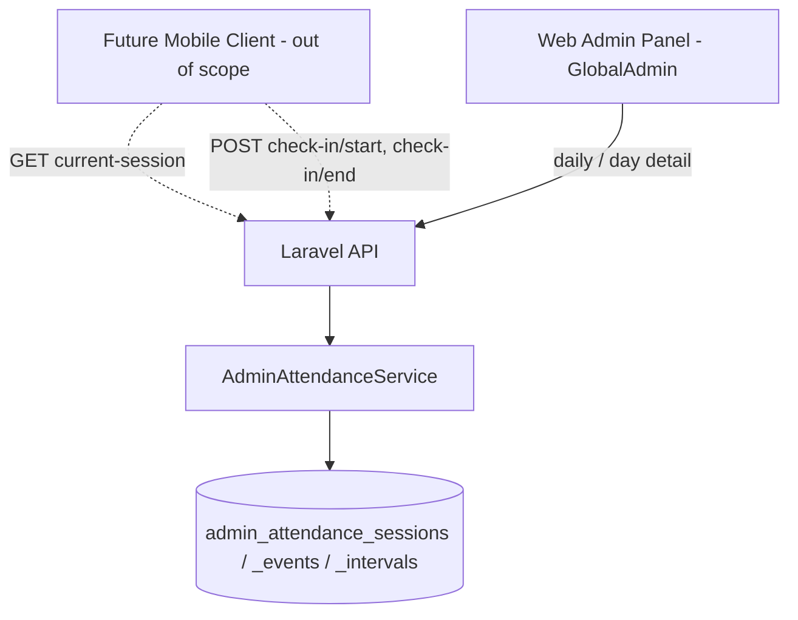
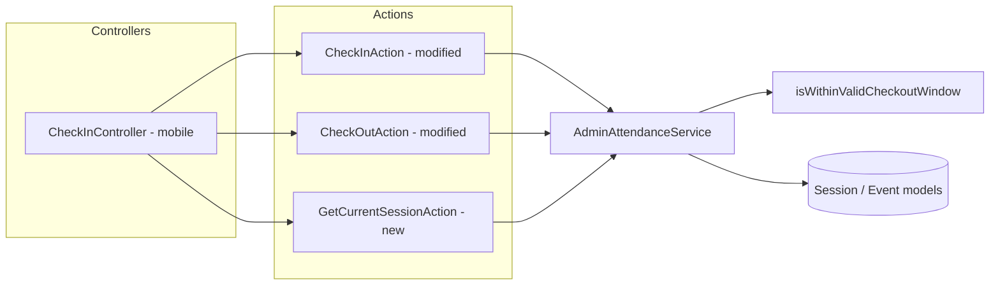
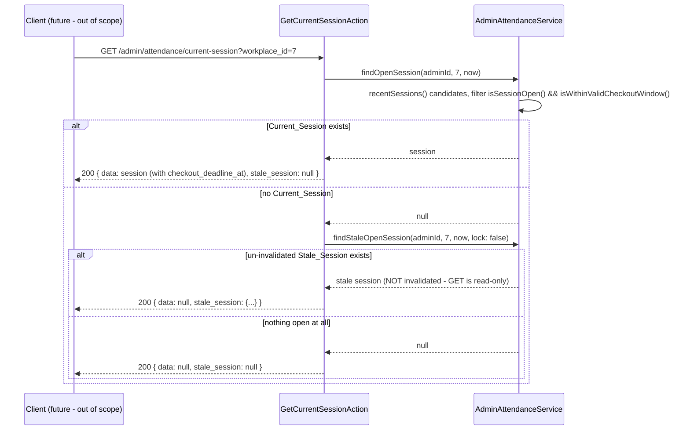
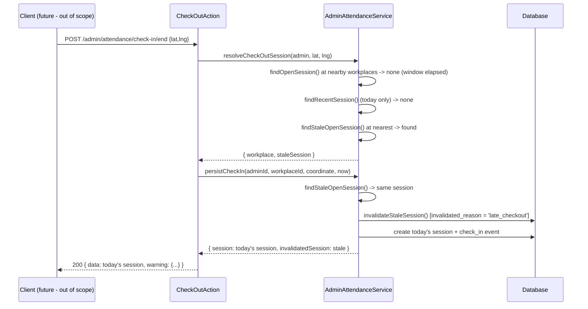

# Design Document: Overnight Checkout Fix

## Overview

The mobile app's button-state bug (button-state currently comes from a calendar-day-bucketed history query, `/admin/attendance/my-history/day?date=`, so a genuinely open Attendance_Session from the previous evening disappears the instant `Work_Date` rolls to a new day) is the motivating problem, but this spec covers only the backend API fix the mobile team will build against later (see requirements.md Scope). Separately from the button-state bug, the backend function that actually resolves which session a checkout should close (`AdminAttendanceService::findOpenSession`, via `resolveCheckOutSession`) already ignores calendar-day boundaries — it uses an unconditional rolling 24-hour lookback — but that lookback has no concept of what counts as a legitimate overnight shift, so a checkout arriving very late would still be resolved and fully credited.

This design: (1) adds a small, read-only `GET /admin/attendance/current-session` endpoint that reuses `findOpenSession` so a client can ask "do I have an open session here" independent of any date bucket; (2) replaces the unconditional 24-hour lookback with a precise `Valid_Checkout_Window` (Requirement 2); and (3) adds lazy Stale_Session detection to `persistCheckIn`, reused by both a genuine check-in and a checkout arriving after the window has elapsed (which is transparently converted into a fresh check-in), always surfacing a warning in the API response when this happens. Mobile integration (consuming this endpoint for button state, rendering the warning) is out of scope — tracked as a follow-up spec in `dgf-connect-app-admin`.

### Design Goals

- Fix button state without introducing a second date-bucketing scheme — reuse and extend the resolution logic (`findOpenSession`) that already ignores calendar boundaries correctly.
- Make the overnight cutoff an explicit, testable rule instead of an implicit "24 hours from now" side effect of a query filter.
- Never silently drop or over-credit a stale session: invalidate it, keep its event log, and tell the admin.
- No new scheduled job — everything is evaluated at the next check-in/check-out request (per Requirement 2/3 constraints), consistent with how `has_missing_checkout` already behaves for abandoned sessions today.
- Keep the change additive at the API boundary: existing `/my-history/day`, `/daily`, `/day` endpoints and their response shapes are unchanged.

### Key Design Decisions

- **Reuse `findOpenSession`, don't duplicate it.** The endpoint for Requirement 1 is a thin wrapper around the existing, already-correct-for-midnight resolution function, made stricter by Requirement 2's window instead of its current flat 24h bound.
- **The window lives in one function.** `isWithinValidCheckoutWindow(Carbon $checkInAt, Carbon $now): bool` is the single source of truth for Requirement 2, called from both `recentSessions()`'s candidate filtering and the new stale-detection path — no duplicated date arithmetic.
- **Invalidation is centralized in `persistCheckIn`.** Rather than teaching both `CheckInAction` and `CheckOutAction` how to detect and invalidate a Stale_Session, `persistCheckIn` does it internally as its first step. A checkout that finds no valid session but does find a stale one simply calls `persistCheckIn` (via `CheckOutAction`) — the invalidation and the warning fall out of the same code path a real check-in already uses. This directly satisfies Requirement 3 AC2/AC3 with one implementation, not two.
- **Warning is structured data, not a pre-rendered string.** The backend returns `{ code, invalidated_session_id, invalidated_check_in_at, workplace_id }` and leaves message rendering to whichever client consumes it later (mobile integration is a separate follow-up spec), consistent with this app's existing i18n ownership split (backend never emits user-facing copy elsewhere in this feature).
- **The endpoint reports a Stale_Session without invalidating it.** `current-session` is a GET and stays side-effect free, but it must still tell a client *why* there is no current session — "you never checked in" and "your evening session just expired" need different UI. So the response carries `stale_session` alongside a null `data`; the actual invalidation still happens only on the next check-in/check-out POST. A consequence worth stating: the same Stale_Session is reported on every screen load until the admin acts, which is the desired behavior (the warning persists rather than flashing once).
- **`checkout_deadline_at` is computed server-side and returned on every session.** It is a pure function of the check-in currently keeping the session open (the same rule as `isWithinValidCheckoutWindow`) — its *latest* check-in event, not `first_check_in_at`, so a same-day re-check-in after an earlier checkout (Checkpoint_Commit) gets its own 20:00/08:00 evaluation instead of inheriting the day's first, possibly daytime, check-in. Exposed as an appended model attribute (`AdminAttendanceSession::windowCheckInAt()`) so it appears anywhere a session is serialized. Clients display it verbatim and never re-derive the 20:00/08:00 rule — changing the rule later becomes a backend-only change with no client release.
- **`is_overnight` and `next_action` remove the last two places a client would otherwise infer backend logic.** Originally the plan left two things for a client to derive itself: whether a session is "overnight" (by comparing `checkout_deadline_at` against a check-in date) and which button to show (by checking whether `data` is null). Both are now stated directly — `is_overnight` (boolean, same `windowCheckInAt()`-anchored rule) and `next_action` (`'check_in'` | `'check_out'`, on `current-session` only) — so a client never re-implements even rule-*shape* knowledge, only reads flags.
- **`invalidated_reason` is a new persisted column**, not a derived value. Even though a stale session's `work_minutes` is already `null` today (an interval only gets credited when explicitly closed, and the window change prevents that from happening late), a persisted reason is needed so Requirement 4's reporting distinction (invalidated vs. plain missing-checkout) doesn't depend on re-deriving "was this ever actually attempted-and-rejected" after the fact.

### API/Interface Change Summary

**Before** (`POST /admin/attendance/check-in/end`, success):
```json
{ "data": { "id": 41, "work_date": "2026-08-05", "last_check_out_at": "2026-08-06 08:30:00", "work_minutes": 630, "...": "..." } }
```

**After** (same endpoint, late-checkout case — window elapsed at 08:00, admin taps "Check Out" at 08:30):
```json
{
    "data": { "id": 57, "work_date": "2026-08-06", "first_check_in_at": "2026-08-06 08:30:00", "last_check_out_at": null, "work_minutes": null, "...": "..." },
    "warning": {
        "code": "stale_session_invalidated",
        "invalidated_session_id": 41,
        "invalidated_check_in_at": "2026-08-05T21:00:00+09:00",
        "workplace_id": 7
    }
}
```
`data` is now a freshly-created check-in session (Work_Date = today), not the closed session the admin thought they were checking out of.

## Architecture

### System Context



Dashed edges mark the future mobile consumer of this API — not built in this spec.

### High-Level Architecture



## Components and Interfaces

### Component 1: AdminAttendanceService (modified)

**Purpose**: Adds the Valid_Checkout_Window rule and Stale_Session handling to the existing session-resolution and check-in/out persistence logic.

**Responsibilities** (additions only; existing responsibilities from the Admin Workplace Check-In design are unchanged):
- `isWithinValidCheckoutWindow(Carbon $checkInAt, Carbon $now): bool` — pure function implementing Requirement 2: if `$checkInAt->hour >= 20`, valid until 08:00 the following calendar day; otherwise valid only until 00:00 the following calendar day (same Work_Date as `$checkInAt`).
- `recentSessions()` (existing, `AdminAttendanceService.php:482-492`): widen the SQL bound from `first_check_in_at >= now()->subDay()` to `first_check_in_at >= now()->copy()->subDay()->startOfDay()` (covers all of yesterday, a safe superset), then let callers filter precisely with `isWithinValidCheckoutWindow`.
- `findOpenSession()` (existing, `:77-88`): after `isSessionOpen($session)`, additionally require `isWithinValidCheckoutWindow($session->first_check_in_at, $now)`. A session outside the window is no longer "open" from this method's perspective — it is a Stale_Session, not a Current_Session.
- `findStaleOpenSession(int $adminId, int $workplaceId, Carbon $now, bool $lock = true): ?AdminAttendanceSession` — **new**. Same candidate pool as `findOpenSession`, but returns the session where `isSessionOpen()` is true and `isWithinValidCheckoutWindow()` is **false**. **Must also filter `invalidated_reason IS NULL`** — an already-invalidated session stays open-looking forever (invalidation deliberately never writes `last_check_out_at`), so without this filter the same session would be re-detected and re-warned on every subsequent request. `$lock` controls `lockForUpdate`: true for the mutating check-in/check-out paths, false for the read-only `current-session` endpoint.
- `invalidateStaleSession(AdminAttendanceSession $session, string $reason): void` — **new**. Sets `invalidated_reason` on the session. Does not touch `work_minutes`, `last_check_out_at`, or the event log — the session's own `Work_Date` was already processed by `recomputeDay` when it was last touched, and this feature never re-triggers `recomputeDay` for a past Work_Date.
- `persistCheckIn()` (existing, `:94-123`): **modified** to call `findStaleOpenSession()` first; if found, `invalidateStaleSession()` it before proceeding with the existing find-or-create-today's-session logic. Return type changes from `AdminAttendanceSession` to `array{session: AdminAttendanceSession, invalidatedSession: ?AdminAttendanceSession}` so callers can build a warning.
- `resolveCheckOutSession()` (existing, `:49-70`): **modified** so that when no nearby workplace has a valid open session (per the now-stricter `findOpenSession`) and the today-only `findRecentSession` fallback also finds nothing, it checks `findStaleOpenSession()` at the nearest candidate workplace before giving up. If found, return `['workplace' => $nearest, 'staleSession' => $staleSession]` instead of the `AdminAttendanceNotCheckedIn` error.
- `staleSessionWarningPayload(AdminAttendanceSession $session): array` — **new**. Builds the structured warning body (`code`, `invalidated_session_id`, `invalidated_check_in_at`, `workplace_id`) shared by `CheckInAction` and `CheckOutAction`.
- `checkoutDeadlineFor(Carbon $checkInAt): Carbon` — **new**. The deadline half of the window rule, extracted so `isWithinValidCheckoutWindow()` becomes `$now->lt(checkoutDeadlineFor($checkInAt))` and the model's `checkout_deadline_at` accessor reuses the identical arithmetic. One rule, one implementation.
- `getDailySummary()` (existing, `:151-184`): **modified** SQL — two changes that must land together:
    1. `SUM(CASE WHEN has_missing_checkout THEN 1 ELSE 0 END)` becomes `SUM(CASE WHEN has_missing_checkout AND invalidated_reason IS NULL THEN 1 ELSE 0 END)`, so an invalidated session is no longer double-reported as an unresolved missing checkout (Requirement 4 AC2).
    2. A new `SUM(CASE WHEN invalidated_reason IS NOT NULL THEN 1 ELSE 0 END) as invalidated_count`, surfaced on each row as `has_invalidated_session` (bool) via the existing `->through()` transform (Requirement 4 AC3).
  Change 1 without change 2 is a **visibility regression**: a day whose only anomaly was an unclosed night session currently shows a missing-checkout badge, and would afterwards show nothing at all despite the admin having lost those hours. The daily-summary row is where a reviewer scans for problems, so the flag has to survive the reclassification.

**Interfaces**:
- **Input**: admin id, workplace id, `Carbon $now` (injectable for tests, matching the existing method signatures).
- **Output**: `AdminAttendanceSession` models, or `null` when no matching session exists.
- **Dependencies**: unchanged (`AdminAttendanceSession`, `AdminAttendanceEvent` models).

**Implementation Notes**:
- All Stale_Session detection and invalidation happens under the same `lockForUpdate` + `DB::transaction` discipline already used by `persistCheckIn`/`persistCheckOut`, satisfying the Reliability NFR.
- `findStaleOpenSession` and `findOpenSession` share the same candidate query; consider extracting the shared "sessions still `isSessionOpen()`" step into a small private helper to avoid duplicating the `recentSessions()` + open-filter logic twice.

### Component 2: CheckInAction (modified)

**Purpose**: Orchestrate a single check-in tap; now also surfaces a warning when it silently resolves a Stale_Session first.

**Responsibilities**:
- Unchanged: resolve Nearest_Workplace, short-circuit with `ErrorCode` when empty/no-nearby.
- **New**: after `persistCheckIn()` returns `{session, invalidatedSession}`, if `invalidatedSession` is non-null, attach `AdminAttendanceService::staleSessionWarningPayload($invalidatedSession)` to the `ActionResult`'s new `meta` field.

**Interfaces**:
- **Input**: unchanged (`['latitude','longitude']`, acting `User`).
- **Output**: `ActionResult` — `meta: ['warning' => ...]` when a Stale_Session was resolved, absent otherwise.

### Component 3: CheckOutAction (modified)

**Purpose**: Orchestrate a single check-out tap; now transparently converts a too-late checkout into a fresh check-in instead of erroring.

**Responsibilities**:
- Unchanged: resolve which session to close via `resolveCheckOutSession`; reject if `now` is not after `first_check_in_at`.
- **New**: if `resolveCheckOutSession()` returns `staleSession` (no valid Current_Session, but a Stale_Session exists), do not attempt a checkout at all — call `AdminAttendanceService::persistCheckIn()` for that workplace instead (using the request's coordinate/time), and return its session + warning exactly as `CheckInAction` would. `persistCheckIn`'s own stale-detection performs the actual invalidation; `CheckOutAction` does not invalidate anything itself.

**Interfaces**:
- **Input**: unchanged.
- **Output**: `ActionResult` with either a closed session (normal path, unchanged) or a freshly created session + warning (Stale_Session path).

### Component 4: GetCurrentSessionAction (new)

**Purpose**: Read-only lookup answering "does this admin currently have an open, valid session at this workplace" for Requirement 1 — the sole capability a future mobile button-state screen would need.

**Responsibilities**:
- Validate `workplace_id` belongs to a real workplace (via `CurrentSessionRequest`).
- Call `AdminAttendanceService::findOpenSession($admin->id, $workplaceId, now())` (now window-aware) for `data`.
- When that returns `null`, call `findStaleOpenSession(..., lock: false)` and, if one exists, report it as `stale_session` so the client can tell "never checked in" from "previous session expired" (Requirement 1 AC4).
- Include `next_action` (`'check_out'` when `data` is non-null, else `'check_in'`) so the client reads the button decision directly (Requirement 1 AC7) instead of re-deriving it from `data`'s presence.
- No invalidation side effects — a GET never mutates state, including for a Stale_Session it reports (Requirement 1 AC5). Invalidation remains exclusive to the check-in/check-out POST paths.

**Interfaces**:
- **Input**: `workplace_id` (query param), acting `User`.
- **Output**: `ActionResult` with `data` = session array or `null`, plus `meta: ['next_action' => ..., 'stale_session' => ...]`.
- **Dependencies**: `AdminAttendanceService::findOpenSession`, `::findStaleOpenSession`.

### Component 5: ActionResult / ResponseHelper (extended)

**Purpose**: Let an otherwise-successful response carry a non-error `warning` alongside `data`, without a breaking change to any existing caller.

**Implementation Notes**:
- `ActionResult` gains an optional 4th constructor param `?array $meta = null`; `toResponse()` passes `$this->meta ?? []` through to `ResponseHelper::success()`.
- `ResponseHelper::success(mixed $data = null, int $status = 200, array $extra = [])` merges `$extra` into the top-level JSON object alongside `data`. Every existing call site omits `$extra` and is unaffected.

### Deferred: Mobile Integration

Consuming Endpoint 1 (`current-session`) for button state and rendering `warning` from the check-in/check-out response is intentionally not designed here — it is a separate, follow-up spec in `dgf-connect-app-admin`, to be written once this API contract has shipped and been tested. The response shapes above (Entity 1, Entity 2, Endpoint 1-3) are the contract that spec will build against.

## Data Models

### Entity 1: AdminAttendanceSession (extended)

```typescript
// Existing model, one new persisted field + two new appended (derived) fields
interface AdminAttendanceSession {
    id: number;
    user_id: number;
    workplace_id: number;
    work_date: string;
    first_check_in_at: string;
    last_check_out_at: string | null;
    work_minutes: number | null;
    work_hours: string;
    has_missing_checkout: boolean;
    invalidated_reason: string | null; // NEW (persisted) — e.g. "late_checkout"; null for every session unaffected by this feature
    checkout_deadline_at: string; // NEW (appended, derived from the session's latest check-in event) — ISO 8601 absolute deadline
    is_overnight: boolean; // NEW (appended) — true when that check-in qualified for the 08:00-next-day branch
    user?: User;
    workplace?: Workplace;
    events?: AdminAttendanceEvent[];
    intervals?: AdminAttendanceInterval[];
}
```

**Validation Rules**:
- `invalidated_reason` is set exactly once, by `invalidateStaleSession()`, and never cleared.
- An invalidated session's `work_minutes` remains whatever it was before invalidation (typically `null`, since an open interval was never credited) — invalidation never modifies credited history from earlier the same Work_Date.
- `checkout_deadline_at` and `is_overnight` are never persisted; both are recomputed on serialization from the same `windowCheckInAt()` helper (the session's latest check-in event, falling back to `first_check_in_at` when there are no events yet), so they stay correct for historical rows even if the rule changes later.

**Derived-field note**: `is_overnight` is the intended way for a client to decide whether to show its "check out before {deadline}" reminder — read directly, not derived. (An earlier revision of this design had clients detect it by comparing `checkout_deadline_at` against a check-in date; `is_overnight` replaces that so a client compares nothing and knows nothing about the 20:00 cutoff.)

**Relationships**: unchanged.

### Entity 2: Stale_Session_Warning (new, API response only — not persisted)

```typescript
// Returned inline in the check-in/check-out response body, sibling to `data`
interface StaleSessionWarning {
    code: 'stale_session_invalidated';
    invalidated_session_id: number;
    invalidated_check_in_at: string; // ISO 8601, the Stale_Session's first_check_in_at
    workplace_id: number;
}
```

### Entity 3: Stale_Session_Report (new, API response only — not persisted)

```typescript
// Returned by current-session alongside a null `data`, when an un-invalidated Stale_Session exists.
// Distinct from StaleSessionWarning: this reports a session that HAS NOT been invalidated yet
// (a GET never mutates), whereas the warning reports one that just WAS invalidated by a POST.
interface StaleSessionReport {
    id: number;
    workplace_id: number;
    work_date: string;
    first_check_in_at: string; // ISO 8601
    checkout_deadline_at: string; // ISO 8601 — the deadline it missed
}
```

### Data Flow — Button State (Requirement 1)



### Data Flow — Late Checkout Auto-Converts to Check-In (Requirement 3)



## API Design

All endpoints require `auth:api` + `manager.auth` + `ManagerAttendanceCheckIn` permission, same as existing mobile attendance endpoints.

### Endpoint 1: Current Session (mobile-facing, consumer built in a follow-up spec) — new

**Method**: `GET` — **Path**: `/admin/attendance/current-session`
**Query**: `workplace_id` (required, integer, must be a real workplace)

Three distinguishable outcomes — this is the whole point of the endpoint:

**(a) An open, still-valid session exists** → `next_action` says Check Out directly (plus a deadline reminder when `is_overnight` is true):
```json
{
    "next_action": "check_out",
    "data": {
        "id": 41, "user_id": 5, "workplace_id": 7, "work_date": "2026-08-05",
        "first_check_in_at": "2026-08-05 21:00:00", "last_check_out_at": null,
        "work_minutes": null, "has_missing_checkout": false, "invalidated_reason": null,
        "checkout_deadline_at": "2026-08-06T08:00:00+09:00", "is_overnight": true,
        "workplace": {"...": "..."}
    },
    "stale_session": null
}
```

**(b) Nothing open, but a previous session expired** → `next_action` says Check In directly, **plus** the expired-session notice:
```json
{
    "next_action": "check_in",
    "data": null,
    "stale_session": {
        "id": 41, "workplace_id": 7, "work_date": "2026-08-05",
        "first_check_in_at": "2026-08-05T21:00:00+09:00",
        "checkout_deadline_at": "2026-08-06T08:00:00+09:00"
    }
}
```

**(c) Nothing open, nothing expired** → `next_action` says Check In directly:
```json
{ "next_action": "check_in", "data": null, "stale_session": null }
```

**Errors**: `422` (missing/invalid `workplace_id`).
**Note**: read-only — outcome (b) does not invalidate the reported session, so it is returned identically on every call until the admin checks in or out.

### Endpoint 2: Check-In (mobile-facing) — modified

**Method**: `POST` — **Path**: `/admin/attendance/check-in/start` (unchanged)
**Response**: unchanged shape, with an optional sibling `warning` (see API/Interface Change Summary) when a Stale_Session was invalidated as a side effect.
**Errors**: unchanged (`ADMIN_ATTENDANCE_NOT_ASSIGNED_WORKPLACE`, `ADMIN_ATTENDANCE_NO_NEARBY_WORKPLACE`, `422`).

### Endpoint 3: Check-Out (mobile-facing) — modified

**Method**: `POST` — **Path**: `/admin/attendance/check-in/end` (unchanged)
**Response**: unchanged shape when a valid Current_Session is closed. When only a Stale_Session exists, returns a **200** with a freshly created check-in session as `data`, plus `warning` — this is not an error response.
**Errors**: unchanged for the "truly never checked in, no stale session either" case (`ADMIN_ATTENDANCE_NOT_CHECKED_IN`); `CHECK_OUT_TIME_INVALID` unchanged for the valid-session path.

## Frontend Copy (Web)

Two new user-facing strings. Following this repo's convention the English text *is* the key, resolved through `t(...)` and stored in `src/locales/{en,vi,ja}/translation.json`. Terminology matches the existing neighbouring entry `"Missing check-out"` (vi `"Thiếu check-out"`, ja `"チェックアウト未完了"`), which is why the Vietnamese here says "check-out" rather than the mobile app's "lượt ra" — the two products already word this differently and each stays internally consistent.

| Key (en) | vi | ja |
|---|---|---|
| `Passed deadline` | Quá hạn check-out | 期限切れ |
| `This check-in passed its check-out deadline, so its hours were not counted. The log below is retained for reference.` | Lượt check-in này đã quá hạn check-out nên không được tính giờ làm. Nhật ký bên dưới vẫn được giữ lại để đối chiếu. | このチェックインはチェックアウト期限を過ぎたため、勤務時間に計上されませんでした。以下のログは記録として保持されます。 |

The badge string is reused by both history levels (Level 2 session card, Level 1 daily row); the explanatory sentence appears only on Level 2, matching how `"Missing check-out"` already pairs a short badge with a longer note.

New strings go through the standard flow (`CLAUDE.md`): `pnpm trans:prepare` → translate the batch → `pnpm trans:apply`. Both keys are static literals, so no `for_scanner.ts` registration is needed.

## Security Considerations

### Authentication
- Unchanged: all endpoints require `auth:api` + `manager.auth`.

### Authorization
- `current-session` is scoped to `Auth::id()` inside `findOpenSession`'s query — no cross-admin data is reachable regardless of which `workplace_id` is passed, so no additional per-workplace assignment check is required (consistent with how `myHistory`/`myDay` are already scoped).

### Data Protection
- No new PII; `invalidated_reason` is a short enum-like string, no coordinates or biometric data involved.

### Input Validation
- New `CurrentSessionRequest` FormRequest validates `workplace_id` (`required|integer|exists:workplaces,id`), following the existing `MyHistoryRequest`/`DayDetailRequest` pattern.

## Error Handling

| Scenario | Handling |
|----------|----------|
| Admin requests current-session with no open session anywhere | `200 { data: null, stale_session: null }` |
| Admin requests current-session where the only open session is stale | `200 { data: null, stale_session: {...} }` — never reported as current, but reported separately so the client can explain it; not invalidated by the GET |
| Admin requests current-session where the only open session is stale **and already invalidated** | `200 { data: null, stale_session: null }` — `findStaleOpenSession` filters `invalidated_reason IS NULL`, so a resolved session is not re-warned forever |
| Checkout arrives while Valid_Checkout_Window is still open | Unchanged: closes the session, credits Worked_Hours |
| Checkout arrives after the Valid_Checkout_Window has elapsed | **Not an error** — `200` with a new check-in session as `data` and a `warning` |
| Check-in arrives while a Stale_Session exists at the same workplace | Stale session invalidated as a side effect; check-in proceeds normally; `warning` included |
| Neither a valid nor a stale session exists, and checkout is attempted | Unchanged: `400 ADMIN_ATTENDANCE_NOT_CHECKED_IN` |
| Missing/invalid `workplace_id` on current-session | `422` validation error |
| Day detail rendering an invalidated session | Shown distinctly (Requirement 4 AC1), not as an ordinary missing checkout |
| Daily summary row whose only anomaly is an invalidated session | Excluded from `has_missing_checkout`, but flagged by the new `has_invalidated_session` so the day is not silently clean (Requirement 4 AC3/AC4) |

## Performance Considerations

### Expected Load
- Same order of magnitude as existing check-in/out traffic (a bounded set of managing admins, a handful of taps/day); `current-session` adds one lightweight indexed lookup per screen load/refresh, comparable to the existing `check-in/nearby` preview call.

### Optimization Strategies
- `findStaleOpenSession`/`findOpenSession` share the same indexed candidate query (`(user_id, workplace_id, first_check_in_at)` — reuses the index already used by `recentSessions()`); no new indexes required.
- The widened `recentSessions()` bound (start of yesterday vs. `now - 24h`) returns at most a couple of extra rows per admin/workplace; filtering the precise window in PHP is negligible at this volume.

## Testing Strategy

### Backend Feature Tests

**`AdminAttendanceCheckInTest`** (extends existing test class):
- Check-in at 21:00, checkout at 07:00 next day: valid, credited to the original Work_Date, no warning.
- Check-in at 21:00, checkout at 08:30 next day (past the 08:00 deadline): checkout call instead creates a new check-in for today; original session's `invalidated_reason` = `'late_checkout'`; `work_minutes` unaffected (was already `null`); response includes `warning` with the original session's id and check-in time.
- Check-in at 15:00 (before 20:00), checkout at 00:01 next day: invalidated immediately (same-day-only rule), even though under 24h has not elapsed — the case the flat rolling-24h window previously handled incorrectly.
- Check-in at 21:00, admin reopens the app and taps "Check In" again at 09:00 next day (past window): existing session invalidated, new check-in created, `warning` present; existing check-in flow (not just checkout) exercises invalidation.
- `current-session`: returns the open session (with a correct `checkout_deadline_at` and `next_action: 'check_out'`) when within window; returns `data: null` **plus** a populated `stale_session` and `next_action: 'check_in'` when the only open session is stale; returns both null (with `next_action: 'check_in'`) when nothing is open; returns both null when the stale session has already been invalidated (not re-warned); `422` on missing `workplace_id`.
- `current-session` at 03:00 with no prior activity at all for the admin returns `next_action: 'check_in'`, `data: null`, `stale_session: null` — nothing left over from `recentSessions()`'s "since start of yesterday" candidate bound leaks into the response.
- `current-session` is side-effect free: calling it while a Stale_Session exists must leave that session's `invalidated_reason` still `null` afterwards (assert this explicitly — it is the guard against a GET silently destroying attendance state).
- `checkout_deadline_at` / `is_overnight`: 08:00 next day / `true` for a 21:00 check-in; 00:00 next day / `false` for a 15:00 check-in; boundary case at exactly 20:00 resolves to the overnight branch.
- Same-day Checkpoint_Commit re-check-in (check-in 09:00, checkout 10:00, re-check-in 23:00, checkout 03:00 next day): the 23:00 re-check-in — not the 09:00 first check-in — decides the window, so the 03:00 checkout is credited (not invalidated) and `work_date` on the resulting session is still the original day (the shift's start date), not the day the checkout happened to land on.
- Regression: on-time check-in/out flows unaffected (existing test cases for same-day check-in/out continue to pass unmodified).

**`AdminAttendanceHistoryTest`** (extends existing test class):
- Daily summary excludes an invalidated session from `missing_checkout` count while still counting a genuine, non-invalidated missing checkout.
- Daily summary sets `has_invalidated_session` true for a day containing an invalidated session — including the regression case where that is the day's *only* anomaly, so `has_missing_checkout` is false and the row would otherwise look clean.
- Day detail response includes `invalidated_reason` for an invalidated session.

### Frontend Tests (Web)
- Level 2 day-detail page renders a distinct badge/label for a session with `invalidated_reason` set, instead of (or alongside) the generic missing-checkout warning.
- Level 1 daily list renders the invalidated badge for a row with `has_invalidated_session`, and renders both badges independently when a day has one of each.

### Test Configuration
- Time-dependent scenarios use `Carbon::setTestNow()` (existing pattern already used for `recomputeDay`/Requirement 8 tests) to freeze `now()` at precise minutes around the 20:00/08:00/00:00 boundaries.
