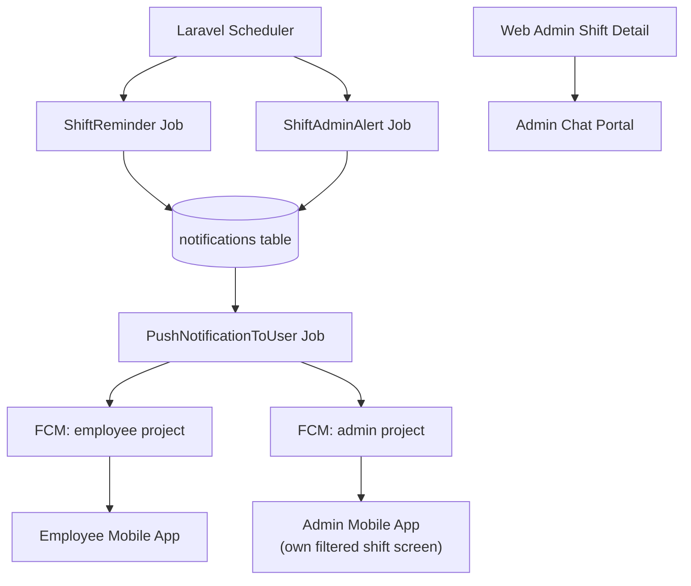
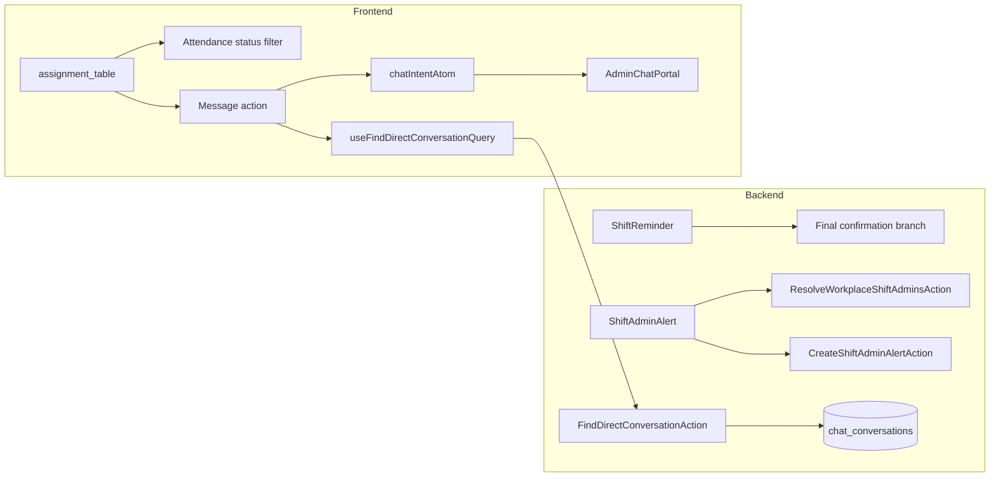
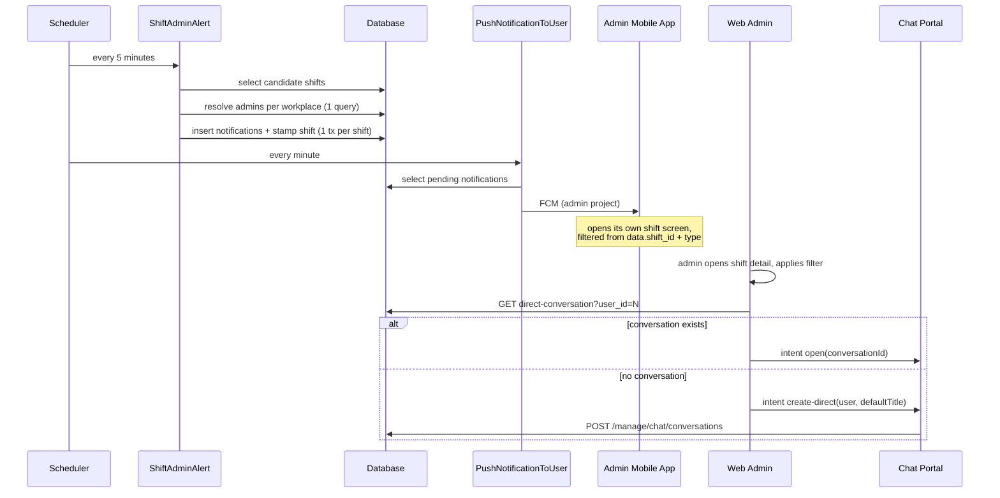

# Design Document: Shift Reminder Escalation and Admin Messaging Shortcut

## Overview

The escalation logic is split across two scheduled jobs rather than one. The existing `ShiftReminder` job gains a single new branch for the employee-facing final confirmation reminder (Requirement 1), because that reminder is per-assignment and fits the job's existing per-user loop. The two administrator-facing alerts (Requirements 2 and 3) move into a new `ShiftAdminAlert` job, because they are per-shift, aggregate across assignments, resolve a different recipient set, and would otherwise have to thread through two early `continue` statements in `ShiftReminder` that were written for a different purpose. On the web admin, the shift detail employee list gains a client-side attendance filter and a per-row message action; the message action consults a new lookup endpoint for an existing two-participant `admin_group` conversation and, failing that, hands a prefilled creation intent to the already-mounted admin chat portal through a Jotai atom.

### Design Goals

- Add escalation without altering the timing, payload, or guard semantics of any existing reminder.
- Keep every alert idempotent under job retries and the five-minute schedule, using persisted timestamps rather than in-memory state.
- Resolve administrator recipients per workplace in a single batched query, never per shift.
- Reuse the existing chat creation endpoint and conversation model; introduce no new conversation type.
- Keep the attendance filter entirely client-side so it costs no additional request.

### Key Design Decisions

- **Separate `ShiftAdminAlert` job instead of extending `ShiftReminder`.** `ShiftReminder` short-circuits with `continue` when a shift has ended, when a shift has started and is nearing its end, and when a shift is too early to remind. Requirement 3 fires ten minutes after start, which collides with the second of those branches for short shifts. Threading admin alerts through that control flow would make both features fragile; a sibling job on the same five-minute schedule keeps each independently testable and lets one fail without suppressing the other.
- **Per-shift timestamps for admin alert idempotency, per-assignment timestamp for the employee reminder.** This mirrors the granularity of each notification: one alert per shift, one reminder per assignment.
- **Alert timestamp is written after notification creation, inside the same transaction.** If notification creation throws, the transaction rolls back and the timestamp stays null, so the next run retries the shift. This satisfies the reliability requirement without a separate retry ledger.
- **Administrator resolution reads the Laratrust pivot directly.** `User::getAccessibleWorkplacesByPermissionGroup` answers "which workplaces can this user reach", but the alert needs the inverse: "which users can reach this workplace". A direct `role_user` → `permission_role` → `permissions` join answers the inverse for every workplace in the batch at once. Global admins and unscoped (`team_id IS NULL`) roles are deliberately excluded so that a workplace-level alert does not fan out system-wide.
- **One-to-one chat stays an `admin_group` with two participants.** A dedicated conversation type would require migrations, a unique pair index, and changes across the chat list, participant drawer, and access resolution. The two-participant convention costs one lookup query and no schema change.
- **The chat portal is commanded through a Jotai atom.** `AdminChatPortal` is mounted once in `Layout.tsx` and owns its own selection state. A transient `chatIntentAtom` lets a distant page request "open conversation N" or "start a manual group with user X" without lifting that state or prop-drilling through the layout.

### Configuration Change Summary

**Before** (`backend/config/work.php`):

```php
'reminder' => [
    'check_in' => ['before_minute' => (int) env('CHECK_IN_REMINDER_BEFORE_MINUTE', 15)],
    'check_out' => ['before_minute' => (int) env('CHECK_OUT_REMINDER_BEFORE_MINUTE', 15)],
    'shift' => ['before_minute' => (int) env('SHIFT_REMINDER_BEFORE_MINUTE', 360)],
    'confirmation' => ['before_day' => (int) env('CONFIRM_SHIFT_REMINDER_BEFORE_DAY', 2)],
],
```

**After:**

```php
'reminder' => [
    'check_in' => ['before_minute' => (int) env('CHECK_IN_REMINDER_BEFORE_MINUTE', 15)],
    'check_out' => ['before_minute' => (int) env('CHECK_OUT_REMINDER_BEFORE_MINUTE', 15)],
    'shift' => ['before_minute' => (int) env('SHIFT_REMINDER_BEFORE_MINUTE', 360)],
    'confirmation' => [
        'before_day' => (int) env('CONFIRM_SHIFT_REMINDER_BEFORE_DAY', 2),
        'final_before_minute' => (int) env('CONFIRM_SHIFT_FINAL_REMINDER_BEFORE_MINUTE', 180),
    ],
    'unconfirmed_alert' => [
        'before_minute' => (int) env('SHIFT_UNCONFIRMED_ALERT_BEFORE_MINUTE', 120),
    ],
    'missing_check_in_alert' => [
        'after_minute' => (int) env('SHIFT_MISSING_CHECK_IN_ALERT_AFTER_MINUTE', 10),
    ],
],
```

## Architecture

### System Context

The feature sits between the existing shift scheduling data and the two existing delivery channels: the FCM push pipeline for both mobile applications, and the web admin shift detail screen. It introduces no new external dependency.



### High-Level Architecture



## Components and Interfaces

### Component 1: `ShiftReminder` — Final Confirmation Branch

**Purpose**: Emit the second confirmation reminder to an employee who has not confirmed an approved shift starting within the final window.

**Responsibilities**:

- Evaluate `final_before_minute` against the remaining minutes to `Shift_Window_Start`.
- Create one `confirm_reminder` notification with translations, and stamp `final_confirmation_reminded_at`.

**Interfaces**:

- **Input**: The existing per-shift `$shiftUsers` collection, already joined against `shifts`, `workplace_shifts`, and `check_ins`.
- **Output**: `notifications` rows plus a mutated `shift_users.final_confirmation_reminded_at`.
- **Dependencies**: `WorkHelper::getShiftTimes`, `Locale::getTranslationLocales`, `config('work.reminder.confirmation.final_before_minute')`.

**Implementation Notes**:

- The branch belongs inside the existing `foreach ($shiftUsers as $shiftUser)` loop, alongside the `shift_reminded_at` and `check_in_reminded_at` branches.
- The select list must be widened to include `shift_users.confirmed_at` and `shift_users.final_confirmation_reminded_at`; both are currently absent and would otherwise be undefined on the projected model.
- The existing "too early to remind" guard compares only against `shift.before_minute` and `check_in.before_minute`. It must also admit `confirmation.final_before_minute`, otherwise a deployment that raises the final window above 360 minutes would silently drop the reminder. The guard becomes a comparison against the maximum of the three windows.
- The guard for a not-yet-started shift is `$minutesUntilStart >= 0`; a shift already underway must not produce a confirmation reminder.

### Component 2: `ShiftAdminAlert` Job

**Purpose**: Emit the two aggregated administrator alerts, one per shift per administrator.

**Responsibilities**:

- Select candidate shifts in the same calendar window `ShiftReminder` uses, restricted to those with at least one approved assignment.
- Compute `Shift_Window_Start` and `Shift_Window_End` per shift.
- For each shift, decide whether the unconfirmed condition, the missing check-in condition, both, or neither apply.
- Delegate recipient resolution and notification creation, and stamp the corresponding shift-level timestamp.

**Interfaces**:

- **Input**: None (scheduled).
- **Output**: `notifications` rows; mutated `shifts.unconfirmed_alerted_at` and `shifts.missing_check_in_alerted_at`.
- **Dependencies**: `ResolveWorkplaceShiftAdminsAction`, `CreateShiftAdminAlertAction`, `WorkHelper::getShiftTimes`.

**Implementation Notes**:

- Scheduled in `routes/console.php` as `Schedule::job(new ShiftAdminAlert())->everyFiveMinutes()->withoutOverlapping(60);`, immediately after the existing `ShiftReminder` registration.
- The query filters `whereNull('shifts.unconfirmed_alerted_at')->orWhereNull('shifts.missing_check_in_alerted_at')` so shifts that have already produced both alerts are excluded before any per-shift computation.
- Each shift is processed in its own `DB::transaction`, not one transaction for the whole batch. A failure on one shift must not roll back alerts already committed for other shifts, and must leave only that shift's timestamp unset.
- Administrator resolution runs once per batch for the distinct set of workplace identifiers, producing a `workplace_id => user_id[]` map consumed by every shift in the batch.
- The unconfirmed condition requires `$minutesUntilStart >= 0` in addition to being within the window, so a started shift never emits it.
- The missing check-in condition requires `$minutesUntilStart <= -$afterMinute` and `$minutesUntilEnd > 0`, so it fires only after the configured delay and never after the shift has ended.

### Component 3: `ResolveWorkplaceShiftAdminsAction`

**Purpose**: Answer "which users administer shifts at these workplaces" for a batch of workplaces in one query.

**Responsibilities**:

- Join `role_user` to `permission_role` to `permissions`, filtering on permission names prefixed `shift.` and on `role_user.team_id` within the requested workplace set.
- Restrict to the `User` morph type and return a map keyed by workplace identifier.

**Interfaces**:

- **Input**: `int[] $workplaceIds`
- **Output**: `array<int, int[]>` mapping workplace identifier to a distinct list of administrator user identifiers.
- **Dependencies**: The Laratrust pivot schema (`role_user.user_id`, `role_user.user_type`, `role_user.team_id`).

**Implementation Notes**:

- Rows with `team_id IS NULL` are excluded by the `whereIn` on the workplace set, which is the intended behaviour: unscoped shift access does not subscribe a user to every workplace's alerts.
- Users holding only the `global_admin` role are not returned, because that role's grant is not expressed as a workplace-scoped pivot row.
- A workplace with no matching administrator yields an absent key; callers treat that as an empty list and still stamp the alert timestamp, so the shift is not reprocessed every five minutes forever.

### Component 4: `CreateShiftAdminAlertAction`

**Purpose**: Create one aggregated notification per recipient for a given shift and alert kind, with translations.

**Responsibilities**:

- Build the title and content from the alert kind, workplace name, shift start time, and affected employee count.
- Create one `notifications` row per recipient and attach translation rows for every non-default locale.

**Interfaces**:

- **Input**: `Shift $shift`, `NotificationType $type`, `int[] $recipientUserIds`, `int[] $affectedUserIds`, `Carbon $startAt`
- **Output**: The number of notifications created.
- **Dependencies**: `Locale::getTranslationLocales`, the `lang.alert.*` translation keys.

**Implementation Notes**:

- The `data` payload is `['shift_id' => …, 'user_ids' => …, 'workplace_id' => …]`. The admin mobile application reads `shift_id` and the notification type to open its own shift screen with the matching filter already applied; no navigation contract beyond these payload fields is owned by this repository.
- The notification icon is `NotificationIcon::WARNING` for both alert kinds.
- Content interpolation uses `:workplace`, `:time`, and `:count` placeholders so translators control word order.

### Component 5: `FindDirectConversationAction`

**Purpose**: Locate the existing one-to-one conversation between the acting administrator and a target employee.

**Responsibilities**:

- Search `admin_group` conversations where both users are active participants and the total active participant count is exactly two.
- Return the most recently active match, or null.

**Interfaces**:

- **Input**: `User $actor`, `int $targetUserId`
- **Output**: `ActionResult` carrying `['conversation_id' => int|null]`
- **Dependencies**: `chat_conversations`, `chat_participants`.

**Implementation Notes**:

- The active participant count is asserted with a correlated subquery rather than by loading participants, so the query stays a single round trip.
- Ordering is `last_activity_at DESC` with `id DESC` as the tie-break, since `last_activity_at` is null for a conversation that has never received a message.
- Conversations whose status is closed are still returned; the portal can reopen them, and returning null would create a duplicate conversation alongside the closed one.
- The action never inspects conversations the actor is not an active participant of, which is what enforces the security requirement.

### Component 6: `assignment_table.tsx` — Attendance Filter and Message Action

**Purpose**: Let an administrator narrow the roster to problem employees and contact one directly.

**Responsibilities**:

- Render a segmented attendance filter and apply it in composition with the existing debounced text search.
- Render a per-row message action gated on the `chat.create` permission.
- Prune row selections that the active filter has hidden.

**Interfaces**:

- **Input**: The existing `UserRow[]`, the auth permission list, and an optional initial filter from the page query string (which makes a filtered roster shareable as a link; it is not part of any mobile navigation contract).
- **Output**: Rendered rows; a `Chat_Intent` written to the shared atom on message activation.
- **Dependencies**: `useFindDirectConversationQuery`, `chatIntentAtom`.

**Implementation Notes**:

- The filter is a third predicate in the existing `filteredRecords` memo, which already composes `searchText` against the debounced query. No new request is issued.
- `record.confirmedAt` and `record.checkInStart` are already projected in `useShiftDetail.ts`; no API change is required.
- Selection pruning reuses the existing effect that intersects `selectedRecords` against the current identifier set; extending its dependency list to the filter value is sufficient.
- All new labels pass through `t(...)` per the project translation rules, and are added to the Vietnamese and Japanese locale files through `pnpm trans:prepare` / `pnpm trans:apply`.

### Component 7: `chatIntentAtom` and `AdminChatPortal`

**Purpose**: Let any page open the chat portal on a specific conversation, or on a prefilled manual-group creation form.

**Responsibilities**:

- Hold a transient intent describing either an existing conversation or a set of participants to prefill.
- Cause `Layout.tsx` to open the portal, and `AdminChatPortal` to honour the intent once and clear it.

**Interfaces**:

- **Input**: A `ChatIntent` value written by any component.
- **Output**: Portal open state and initial panel selection.
- **Dependencies**: Jotai, the existing `CreateChatPanel` state setters.

**Implementation Notes**:

- The atom lives in `frontend/src/pages/global.state.ts` beside `authAtom` and `masterAtom`, matching the established pattern; the project has no other global store.
- The intent is cleared by the portal after it is applied, so reopening the portal manually does not replay a stale intent.
- `CreateChatPanel` already holds `type`, `title`, and `selectedUsers` state; the intent seeds those three through an effect rather than through new props, keeping the component's existing interface intact.

## Data Models

### Entity 1: Shift Assignment Additions

```php
// backend/database/migrations/2026_08_07_000001_add_final_confirmation_reminded_at_to_shift_users_table.php
Schema::table('shift_users', function (Blueprint $table) {
    $table->dateTime('final_confirmation_reminded_at')->nullable()->after('confirmation_reminded_at');
});
```

**Validation Rules**:

- Null means no final confirmation reminder has been sent for this assignment.
- Written only by `ShiftReminder`; never reset when an employee later confirms, so a confirmation does not re-arm the reminder.

**Relationships**:

- Sits alongside the existing `confirmation_reminded_at`, `shift_reminded_at`, `check_in_reminded_at`, and `check_out_reminded_at` guards on the same table.

### Entity 2: Shift Additions

```php
// backend/database/migrations/2026_08_07_000002_add_admin_alert_timestamps_to_shifts_table.php
Schema::table('shifts', function (Blueprint $table) {
    $table->dateTime('unconfirmed_alerted_at')->nullable();
    $table->dateTime('missing_check_in_alerted_at')->nullable();
});
```

**Validation Rules**:

- Null means the corresponding alert has not been emitted for this shift.
- Set inside the same transaction as the notification rows, so a rollback leaves both null.

**Relationships**:

- Per-shift, not per-assignment, matching the one-alert-per-shift aggregation rule.

### Entity 3: Notification Types

```php
// backend/app/Enums/NotificationType.php
case SHIFT_UNCONFIRMED_ALERT = 'shift_unconfirmed_alert';
case SHIFT_MISSING_CHECK_IN_ALERT = 'shift_missing_check_in_alert';
```

**Validation Rules**:

- Both are administrator-facing and are always addressed to a concrete `user_id`; neither uses the recruitment-style null-recipient broadcast path.

**Relationships**:

- Consumed by `PushNotificationToUser`, which routes them to the admin Firebase project because every recipient holds `manager.auth`.

### Entity 4: Chat Intent

```typescript
// frontend/src/pages/global.state.ts
export type ChatIntent =
    | { kind: 'open'; conversationId: number }
    | { kind: 'create-direct'; user: User; defaultTitle: string };

export const chatIntentAtom = atom<ChatIntent | null>(null);
```

**Validation Rules**:

- Consumed exactly once; the portal writes null back after applying it.
- `defaultTitle` is a suggestion only and remains editable in the creation form.

**Relationships**:

- Read by `Layout.tsx` (to open the portal) and by `AdminChatPortal` (to select the panel).

### Entity 5: Attendance Filter

```typescript
// frontend/src/pages/manage/shift/partials/assignment_table.tsx
export type AttendanceFilter = 'all' | 'unconfirmed' | 'not_checked_in';
```

**Validation Rules**:

- An unrecognised query-string value falls back to `all` rather than rendering an empty table.

### Data Flow: Administrator Alert to Direct Message



## API Design

### Endpoint 1: Find Direct Conversation

**Method**: `GET`
**Path**: `/api/manage/chat/direct-conversation`
**Middleware**: `permission:chat.view`

**Request** (query string):

```
user_id=1234
```

**Response** (`200 OK`):

```json
{
    "data": {
        "conversation_id": 87
    }
}
```

When no direct conversation exists:

```json
{
    "data": {
        "conversation_id": null
    }
}
```

**Error Responses**:

- `403 Forbidden`: The requester lacks `chat.view`.
- `422 Unprocessable Entity`: `user_id` is absent, non-numeric, or does not reference an existing user.

**Notes**:

- Creation continues to use the existing `POST /manage/chat/conversations` endpoint with `type: "admin_group"` and `participant_user_ids: [employeeId]`; the creator is added as an admin participant by `CreateChatConversationAction`. No new creation endpoint is introduced.

## Security Considerations

### Authentication

- Both the new lookup endpoint and the existing creation endpoint sit behind the established admin authentication middleware group; no change.

### Authorization

- The lookup endpoint requires `chat.view`. The creation path continues to require `chat.create`, enforced by route middleware independently of the client-side button gating.
- The message action is hidden without `chat.create`, but hiding it is a usability measure only; the backend re-checks on every request.
- Administrator alert recipients are restricted to workplace-scoped shift administrators. Global admins and unscoped roles are excluded, which both limits notification noise and prevents attendance data for one workplace from reaching administrators of another.

### Data Protection

- Alert content includes an aggregate count and the workplace name, not employee names. Individual identities travel only in the `data.user_ids` payload, which the admin application resolves through its own authenticated shift detail request.

### Input Validation

- `user_id` on the lookup endpoint is validated as `required|integer|exists:users,id`.
- The attendance filter query-string value is validated client-side against the known union and falls back to `all`.

## Error Handling

### Job Execution

| Scenario | Handling |
|----------|----------|
| Notification creation throws mid-shift | The per-shift transaction rolls back; the alert timestamp stays null and the next run retries that shift. |
| A workplace has no shift administrator | Stamp the timestamp, create nothing, log at debug level. Prevents the shift being reconsidered every five minutes indefinitely. |
| A shift's workplace shift row is missing start or end time | Skip the shift and log a warning; `WorkHelper::getShiftTimes` cannot produce a window without them. |
| Previous invocation still running | The `withoutOverlapping(60)` guard suppresses the run; no duplicate alerts. |
| An employee confirms between threshold and execution | The condition is re-evaluated at execution time against live data, so no alert is emitted. |

### Web Admin

| Scenario | Handling |
|----------|----------|
| Direct conversation lookup fails | Show an error notification and leave the portal closed; the row remains actionable for a retry. |
| Conversation creation fails | The existing `CreateChatPanel` error path applies: show `t('error|Could not create chat')` and keep the form populated. |
| Attendance filter yields no rows | Render the table's existing empty state. |
| The URL carries an unknown attendance value | Fall back to the `all` filter. |

## Performance Considerations

### Expected Load

- **Shifts scanned per run**: up to roughly 200 in the two-day window.
- **Assignments scanned per run**: up to roughly 2,000.
- **Administrators per workplace**: single digits.
- **Job frequency**: every five minutes, guarded by `withoutOverlapping(60)`.

### Optimization Strategies

- Administrator resolution is one query per batch, not per shift, producing a `workplace_id => user_id[]` map reused across shifts.
- Candidate shifts are pre-filtered on the two new nullable timestamps, so a shift that has already emitted both alerts is excluded in SQL rather than in PHP.
- The attendance filter and the row message action are client-side; the shift detail endpoint is unchanged and issues no extra query.
- The direct conversation lookup runs only on message activation, not on table render, so a roster of 200 rows costs zero lookups until a button is pressed.

## Testing Strategy

### Unit Tests

**`ShiftReminderTest` (`backend/tests/Feature/Jobs/ShiftReminderTest.php`):**

- Creates a final confirmation reminder for an approved, unconfirmed assignment inside the final window.
- Does not create one when `confirmed_at` is set.
- Does not create one when the assignment status is pending or rejected.
- Does not create a second one when `final_confirmation_reminded_at` is already set.
- Creates one for an overnight shift using the real start timestamp, not the calendar date.
- Does not create one once the shift has started.
- Still creates one when the two-day reminder never ran because the shift was approved late.
- Continues to emit the existing shift, check-in, and check-out reminders unchanged.

**`ShiftAdminAlertTest` (`backend/tests/Feature/Jobs/ShiftAdminAlertTest.php`):**

- Emits one unconfirmed alert per workplace-scoped administrator when at least one assignment is unconfirmed inside the window.
- Emits exactly one notification per administrator when three employees are unconfirmed, with a count of three in the content and three identifiers in `data.user_ids`.
- Emits nothing when every assignment is confirmed.
- Emits nothing a second time once `unconfirmed_alerted_at` is set.
- Emits the missing check-in alert only after the configured delay past start, and not before it.
- Does not emit the missing check-in alert after the shift has ended.
- Does not emit either alert to a global admin, to a user whose shift role has `team_id` null, or to an administrator scoped to a different workplace.
- Stamps the timestamp and creates nothing when the workplace has no scoped administrator.
- Leaves the timestamp null when notification creation fails mid-transaction, and emits on the following run.
- Handles an overnight shift's start and end window correctly for both alerts.

**`ResolveWorkplaceShiftAdminsActionTest`:**

- Returns administrators keyed by workplace for a multi-workplace batch in one query.
- Excludes users whose role grants no `shift.` permission.
- Excludes `team_id` null rows and global admins.

**`FindDirectConversationActionTest`:**

- Returns the conversation when exactly two active participants match.
- Returns null when a third active participant exists.
- Returns null when the employee's participant status is removed.
- Returns null for a shift group or user group conversation with the same two members.
- Returns the most recently active conversation when two candidates exist.
- Returns null when the actor is not a participant.

**`assignment_table.test.tsx`:**

- Renders the attendance filter and narrows rows to unconfirmed entries.
- Narrows rows to entries without a check-in start time.
- Composes the filter with the text search.
- Renders the empty state when the filter matches nothing.
- Drops hidden rows from the selection when the filter changes.
- Renders the message action with `chat.create` and hides it without.
- Writes an open intent when a direct conversation is found, and a create intent when it is not.

### Integration Tests

- **Lifecycle: unconfirmed escalation.** Register a shift through the real registration action, approve it through the real approval path, advance time into the final window, run `ShiftReminder`, assert the employee reminder; advance into the two-hour window, run `ShiftAdminAlert`, assert the administrator alert; confirm through the real confirmation endpoint; advance past shift start, run both jobs again and assert no further notification.
- **Lifecycle: missing check-in escalation.** Same setup through approval and confirmation, then advance past start without checking in, run `ShiftAdminAlert`, assert the alert; check in through the real endpoint, run again, assert nothing new.
- **Accumulated history.** Seed a prior shift for the same employee and workplace that already carries both alert timestamps and a completed check-in, then run a new shift's escalation and assert the old rows are neither reprocessed nor counted.
- **Chat shortcut round trip.** From the shift detail screen, activate the message action for an employee with no prior conversation, create the manual group through the real endpoint, then activate the action again for the same employee and assert the existing conversation is opened rather than a second one created.

### Test Configuration

```php
// Freeze time so window boundaries are deterministic.
$this->travelTo(Carbon::parse('2026-08-10 06:00:00'));
config([
    'work.reminder.confirmation.final_before_minute' => 180,
    'work.reminder.unconfirmed_alert.before_minute' => 120,
    'work.reminder.missing_check_in_alert.after_minute' => 10,
]);
```

Per project convention, all test methods use camelCase, and no multi-threaded concurrency tests are written; duplicate suppression is verified through the persisted timestamp guards and the conditional update rather than by racing jobs.
