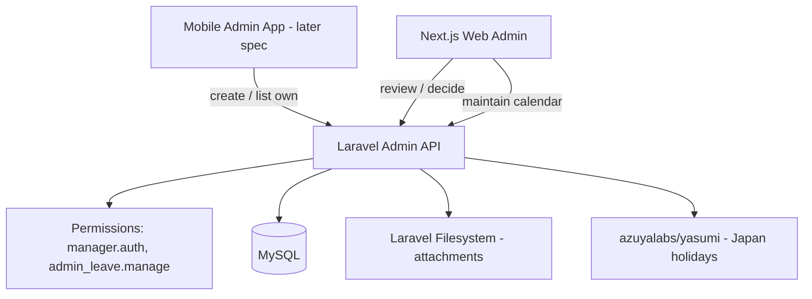
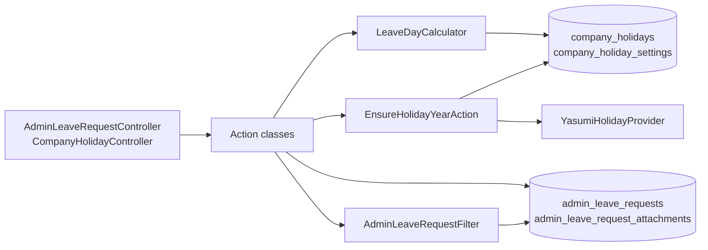
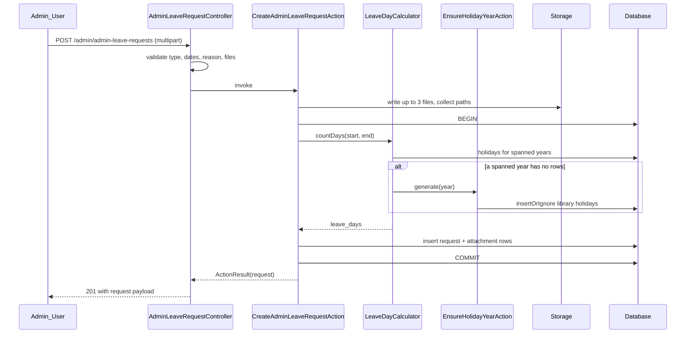
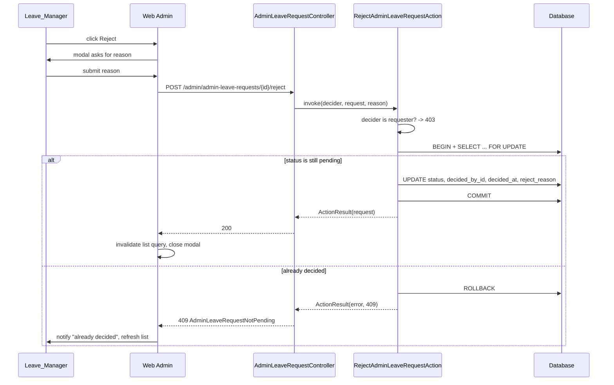

# Design Document: Admin Leave Request

## Overview

The feature adds two independent but connected subsystems. The first is a leave-request record owned by an Admin_User, created through the admin API, reviewed by a Leave_Manager on the web admin, and carrying up to three uploaded files. The second is a company holiday calendar, maintained per year by the same Leave_Manager, seeded from the `azuyalabs/yasumi` Japan provider and freely editable afterwards. The calendar exists to serve the first subsystem: it determines how many working days a request consumes. Both follow the project's established shape — Eloquent models with `AbstractFilter`-based query filters, invokable Action classes returning `ActionResult`, thin controllers, `permission:` route middleware, and Next.js pages built from `CommonSearchBox` + `DDataTable` + `usePermissions`.

### Design Goals

- Reuse the absent-notice and fixed-schedule-change-request patterns end to end, so the code reads like the rest of the repository rather than introducing a parallel style.
- Keep the day-count rule in one place (`LeaveDayCalculator`) so the mobile spec, the API, and any later payroll consumer all agree.
- Make every decision auditable and irreversible: who decided, when, and why, never overwritten.
- Ship the holiday calendar as a general-purpose primitive, not something private to leave requests.

### Key Design Decisions

- **Day count is a stored snapshot, not a derived value.** `leave_days` is computed once at creation and never recomputed. Editing the 2027 calendar in December 2027 must not silently rewrite the day count of a request approved in March. The cost is that a calendar correction does not propagate; the mitigation is on-demand generation (below) so the common cause of a wrong count never occurs.
- **Missing calendar years are generated on demand, inside the same transaction as the request.** Without this, the snapshot rule freezes a wrong number forever the first time someone requests leave in an ungenerated year. `EnsureHolidayYearAction` is idempotent and inserts only missing dates, so it is safe to call from both the manual button and the calculation path.
- **Overlap is advisory, not blocking.** The list query computes an `has_overlap` flag with a single self-join rather than rejecting at creation, because legitimate overlaps exist (a 有休 inside a pre-approved 長期休み) and the manager is better placed to judge than a validation rule.
- **Attachments live in their own table, not JSON columns.** A dedicated `admin_leave_request_attachments` table matches how `chat_attachments` already stores disk/path/original_name/mime_type/size_bytes, and keeps per-file cleanup on rollback straightforward.
- **The weekend flag is per-year with inheritance, not a global config row.** Storing it per year lets a policy change take effect from a given year without rewriting history, and inheriting from the most recent earlier year prevents a silent reset every January.
- **A single permission (`admin_leave.manage`) gates both screens.** Splitting list/process/holiday into three permissions was considered and rejected: the reviewing population is small and the operational cost of maintaining three permissions exceeds the benefit.
- **Row-level locking, not check-then-act, guards the decision transition.** `ApproveAdminLeaveRequestAction` re-fetches under `lockForUpdate()` inside the transaction and re-checks `pending`, exactly as `ApproveFixedScheduleChangeRequestAction` does.

## Architecture

### System Context

The feature sits inside the existing admin API surface. Requesters reach it from the mobile admin app (built later, against the same endpoints); reviewers reach it from the Next.js web admin. It reads the existing users/permissions tables and writes only its own four tables. Nothing in shift planning, attendance, or salary consumes it yet.



### High-Level Architecture



## Components and Interfaces

### Component 1: AdminLeaveType / AdminLeaveRequestStatus Enums

**Purpose**: Give the four request types and three statuses a single typed definition shared by validation, casting, and the frontend contract.

**Responsibilities**:

- Define `paid_leave`, `day_off`, `long_leave`, `expense_claim`.
- Define `pending`, `approved`, `rejected`.
- Expose `requiresDateRange()` on the type enum so validation and calculation ask one question instead of repeating a three-way comparison.

**Interfaces**:

- **Input**: string values from requests and database columns.
- **Output**: typed enum cases.
- **Dependencies**: `EnumTrait` (provides `values()` used by validation rules).

**Implementation Notes**:

- `app/Enums/AdminLeaveType.php`, `app/Enums/AdminLeaveRequestStatus.php`, following `AbsentNoticeStatus` exactly.
- `requiresDateRange()` returns `false` only for `ExpenseClaim`.

### Component 2: LeaveDayCalculator

**Purpose**: Turn a date range into a working-day count using the company calendar.

**Responsibilities**:

- Iterate every date in `[start, end]` inclusive.
- Exclude dates present in `company_holidays`.
- Exclude Saturdays/Sundays when the year's `exclude_weekends` setting is on.
- Resolve the setting per date's own year, so a range crossing 31 December applies each year's own rules.

**Interfaces**:

- **Input**: `CarbonInterface $start, CarbonInterface $end`.
- **Output**: `int` day count (`0` is a valid result).
- **Dependencies**: `company_holidays`, `company_holiday_settings`, `EnsureHolidayYearAction`.

**Implementation Notes**:

- `app/Services/AdminLeave/LeaveDayCalculator.php`.
- Loads holiday dates for the whole span in one query keyed by `Y-m-d`, then iterates in memory. A 366-day maximum range bounds the loop.
- Calls `EnsureHolidayYearAction` for each year in the span that has zero rows, before loading. Because generation happens inside the caller's transaction, a failure rolls back the request too.
- Weekend settings for the spanned years are loaded in one query and resolved with the inheritance rule (nearest earlier year, else `false`).

### Component 3: EnsureHolidayYearAction

**Purpose**: Guarantee a calendar year has holiday rows, whether triggered by the UI button or by a day calculation.

**Responsibilities**:

- Ask `YasumiHolidayProvider` for the year's Japanese public holidays.
- Insert only dates not already present; never update or delete an existing row.
- Mark inserted rows `source = 'library'`.

**Interfaces**:

- **Input**: `int $year`.
- **Output**: `ActionResult` carrying the number of rows inserted.
- **Dependencies**: `YasumiHolidayProvider`, `CompanyHoliday`.

**Implementation Notes**:

- `app/Actions/Admin/CompanyHoliday/EnsureHolidayYearAction.php`.
- Idempotent by construction: it reads existing dates for the year, diffs, and inserts the remainder. Safe to call repeatedly.
- Uses `insertOrIgnore` against the unique index on `date` so a concurrent generation cannot produce duplicates.

### Component 4: YasumiHolidayProvider

**Purpose**: Isolate the third-party library behind one seam.

**Responsibilities**:

- Return `array<string $date => string $name>` for a given year using Yasumi's Japan provider.
- Translate holiday names into the display language stored on the row.

**Interfaces**:

- **Input**: `int $year`.
- **Output**: date-keyed name map.
- **Dependencies**: `azuyalabs/yasumi` (new Composer dependency).

**Implementation Notes**:

- `app/Services/AdminLeave/YasumiHolidayProvider.php`.
- Stores the Japanese holiday name (`ja_JP` locale) since the calendar describes Japanese statutory holidays; the manager can rename any row afterwards.
- Bound in the container by interface so tests can substitute a fake year without invoking the library.

### Component 5: CreateAdminLeaveRequestAction

**Purpose**: Persist a request with its attachments and computed day count atomically.

**Responsibilities**:

- Store uploaded files, then create the request and attachment rows in one transaction.
- Compute and persist `leave_days` via `LeaveDayCalculator` when the type carries dates.
- Delete every written file if the transaction fails.

**Interfaces**:

- **Input**: `User $requester`, validated payload, `UploadedFile[]`.
- **Output**: `ActionResult` carrying the created request with attachments.
- **Dependencies**: `LeaveDayCalculator`, `AdminLeaveRequest`, filesystem.

**Implementation Notes**:

- `app/Actions/Admin/AdminLeave/CreateAdminLeaveRequestAction.php`.
- Follows the rollback shape of `UploadDocumentStepAction`: collect `$storedPaths` while writing, and on `Throwable` call `Storage::delete($storedPaths)` before rethrowing.
- Files are written under `admin-leave/{requester_id}/{uuid}.{ext}` on the default private disk.

### Component 6: GetAdminLeaveRequestsAction

**Purpose**: Serve the manager list with filters, pagination, and the overlap flag.

**Responsibilities**:

- Apply `AdminLeaveRequestFilter`.
- Eager-load requester, decider, and attachment counts.
- Compute `has_overlap` per row without a per-row query.
- Shape rows into the flat structure the table consumes.

**Interfaces**:

- **Input**: validated filter conditions.
- **Output**: `ActionResult` carrying a paginator.
- **Dependencies**: `AdminLeaveRequest`, `AdminLeaveRequestFilter`.

**Implementation Notes**:

- `app/Actions/Admin/AdminLeave/GetAdminLeaveRequestsAction.php`, modelled on `GetAbsentNoticesAction`.
- Loads relations with `with([...])` and `withCount('attachments')`.
- Overlap is resolved after pagination: collect the page's `(requester_id, start_date, end_date)` triples, run one query for the same requesters' other `pending`/`approved` requests intersecting any of those spans, and mark matches in memory. This keeps the cost at one extra query per page regardless of page size.

### Component 7: ApproveAdminLeaveRequestAction / RejectAdminLeaveRequestAction

**Purpose**: Apply a decision exactly once, recording who and when.

**Responsibilities**:

- Refuse when the decider is the requester.
- Refuse when the request is no longer `pending`.
- Write status, `decided_by_id`, `decided_at`, and (for rejection) `reject_reason`.

**Interfaces**:

- **Input**: `User $decider`, `AdminLeaveRequest $request`, and for rejection a reason string.
- **Output**: `ActionResult` carrying the updated request.
- **Dependencies**: `AdminLeaveRequest`.

**Implementation Notes**:

- `app/Actions/Admin/AdminLeave/`, both mirroring `ApproveFixedScheduleChangeRequestAction`.
- Both open `DB::transaction`, re-fetch with `lockForUpdate()`, re-check `pending`, then update — so two concurrent decisions serialize and the second returns `409`.
- The self-approval check runs before the lock, since it needs no consistency guarantee.

### Component 8: AdminLeaveRequestFilter

**Purpose**: Translate query parameters into constraints, including the dual-mode date filter.

**Responsibilities**:

- `dateFrom` / `dateTo`: match on the leave period when present, otherwise on `created_at`.
- `requesterId`, `status`, `type`: direct column matches.

**Interfaces**:

- **Input**: filter array from the request.
- **Output**: constrained query builder.
- **Dependencies**: `AbstractFilter`.

**Implementation Notes**:

- `app/ModelFilters/AdminLeaveRequestFilter.php`.
- The dual-mode date filter is a single `where(fn ($q) => ...)` group: `(start_date IS NOT NULL AND period overlaps range) OR (start_date IS NULL AND created_at within range)`. Expressing it as one group keeps it composable with the other filters.
- Overlap semantics: `start_date <= :date_to AND end_date >= :date_from`.

### Component 9: Web Admin — Leave Request List Page

**Purpose**: The reviewer's primary screen.

**Responsibilities**:

- Render the four filters and the paginated table.
- Open the detail modal on row click.
- Show the no-permission state when `admin_leave.manage` is absent.

**Interfaces**:

- **Input**: `router.query` filters, `usePermissions(['ADMIN_LEAVE_MANAGE'])`.
- **Output**: rendered table; mutations to approve/reject.
- **Dependencies**: `CommonSearchBox`, `DDataTable`, `DUserSelectRemote`.

**Implementation Notes**:

- `frontend/src/pages/admin/admin-leave/index.page.tsx` plus `api.ts` and `partials/request_detail_modal.tsx`, matching the `admin/fixed-schedule/change-requests` layout.
- The requester filter uses the `select-remote` element against `ADMIN_MASTER_USER_SEARCH` with `permission=manager.auth` appended, so only Admin_Users are offered.
- Filters live in the URL query string, as on the absent-notice screen.

### Component 10: Web Admin — Holiday Calendar Page

**Purpose**: Maintain the calendar the day count depends on.

**Responsibilities**:

- Select a year; list its holidays with a source badge.
- Offer generation when the year is empty.
- Add, edit, delete a holiday; toggle the weekend setting.

**Interfaces**:

- **Input**: selected year from the URL query.
- **Output**: rendered table; CRUD and toggle mutations.
- **Dependencies**: `DDataTable`, Mantine modal and switch.

**Implementation Notes**:

- `frontend/src/pages/admin/admin-leave/holidays/index.page.tsx`.
- The weekend toggle writes immediately and shows a confirmation notification; it does not require a save button.
- Deleting a holiday asks for confirmation, since it changes future day counts.

## Data Models

### Entity 1: AdminLeaveRequest

```typescript
// frontend/src/types/models/admin_leave_request.ts
export interface AdminLeaveRequest {
    id: number;
    requester_id: number;
    requester_name: string;
    requester_staff_no: string | null;
    type: 'paid_leave' | 'day_off' | 'long_leave' | 'expense_claim';
    start_date: string | null; // YYYY-MM-DD
    end_date: string | null; // YYYY-MM-DD
    leave_days: number | null; // null when the request carries no date range
    reason: string;
    status: 'pending' | 'approved' | 'rejected';
    attachments_count: number;
    has_overlap: boolean;
    created_at: string; // ISO 8601, submission timestamp
    decided_by_name: string | null;
    decided_at: string | null; // ISO 8601
    reject_reason: string | null;
}
```

**Validation Rules**:

- `type`: required, one of the four enum values.
- `start_date`, `end_date`: required when `type !== 'expense_claim'`; optional otherwise.
- `end_date`: `after_or_equal:start_date`.
- `start_date`: `after_or_equal:today` when `type !== 'expense_claim'`; `after_or_equal:today-366days` when it is.
- Span from `start_date` to `end_date`: at most 366 days.
- `reason`: required, string, 1–1000 characters.
- All date comparisons evaluate in `Asia/Tokyo`.

**Relationships**:

- `belongsTo(User::class, 'requester_id')` — the Admin_User who submitted.
- `belongsTo(User::class, 'decided_by_id')` — the Leave_Manager who decided, null while pending.
- `hasMany(AdminLeaveRequestAttachment::class)`.

**Table** (`admin_leave_requests`):

| Column           | Type                | Notes                                            |
| ---------------- | ------------------- | ------------------------------------------------ |
| `id`             | bigint PK           |                                                  |
| `requester_id`   | FK → users          | `cascadeOnDelete`                                |
| `type`           | string              | `AdminLeaveType`                                 |
| `start_date`     | date, nullable      |                                                  |
| `end_date`       | date, nullable      |                                                  |
| `leave_days`     | unsigned smallint, nullable | snapshot at creation                     |
| `reason`         | text                |                                                  |
| `status`         | string, default `pending` |                                            |
| `decided_by_id`  | FK → users, nullable | `nullOnDelete`                                  |
| `decided_at`     | timestamp, nullable |                                                  |
| `reject_reason`  | text, nullable      |                                                  |
| `created_at` / `updated_at` | timestamps |                                             |

Indexes: `(requester_id, status)`, `(status, created_at)`, `(start_date, end_date)`.

### Entity 2: AdminLeaveRequestAttachment

```typescript
// frontend/src/types/models/admin_leave_request.ts
export interface AdminLeaveRequestAttachment {
    id: number;
    original_name: string;
    mime_type: string;
    size_bytes: number;
    url: string; // time-limited, generated per response
    is_image: boolean;
}
```

**Validation Rules**:

- At most 3 files per request.
- Each file at most 5 MB (`max:5120`).
- Extension and MIME must both be one of `jpg`, `jpeg`, `png`, `webp`, `pdf`.

**Relationships**:

- `belongsTo(AdminLeaveRequest::class)` with `cascadeOnDelete`.

**Table** (`admin_leave_request_attachments`): `id`, `admin_leave_request_id` FK, `disk`, `path`, `original_name`, `mime_type`, `size_bytes`, timestamps — the same shape as `chat_attachments`.

### Entity 3: CompanyHoliday

```typescript
// frontend/src/types/models/company_holiday.ts
export interface CompanyHoliday {
    id: number;
    date: string; // YYYY-MM-DD
    name: string;
    source: 'library' | 'manual';
}
```

**Validation Rules**:

- `date`: required, valid date, unique across the table.
- `name`: required, string, at most 255 characters.
- `source` is set by the system, never accepted from the client.

**Relationships**:

- None. Read by `LeaveDayCalculator` by date.

**Table** (`company_holidays`): `id`, `date` (unique), `name`, `source`, timestamps. Index on `date` is provided by the unique constraint.

### Entity 4: CompanyHolidaySetting

```typescript
// frontend/src/types/models/company_holiday.ts
export interface CompanyHolidaySetting {
    year: number;
    exclude_weekends: boolean;
}
```

**Validation Rules**:

- `year`: required integer between 2000 and 2100.
- `exclude_weekends`: required boolean.

**Relationships**:

- Conceptually keyed to a year of `company_holidays`; no FK.

**Table** (`company_holiday_settings`): `id`, `year` (unique), `exclude_weekends` boolean default `false`, timestamps.

### Data Flow: Submitting a request



### Data Flow: Deciding a request



## API Design

All routes sit inside the existing `auth:api` group under the `admin` prefix.

### Endpoint 1: Create a leave request

**Method**: `POST`
**Path**: `/api/admin/admin-leave-requests`
**Middleware**: `permission:manager.auth`
**Content-Type**: `multipart/form-data`

**Request**:

```json
{
    "type": "paid_leave",
    "start_date": "2026-09-01",
    "end_date": "2026-09-05",
    "reason": "Family trip",
    "attachments[]": "<binary, 0-3 files>"
}
```

**Response** (`201`):

```json
{
    "data": {
        "id": 42,
        "type": "paid_leave",
        "start_date": "2026-09-01",
        "end_date": "2026-09-05",
        "leave_days": 4,
        "reason": "Family trip",
        "status": "pending",
        "attachments": [{ "id": 7, "original_name": "ticket.pdf", "url": "https://..." }],
        "created_at": "2026-08-14T09:12:00+09:00"
    }
}
```

**Error Responses**:

- `403 Forbidden`: caller lacks `manager.auth`.
- `422 Unprocessable Entity`: invalid type, missing/past/reversed dates, span over 366 days, empty or oversized reason, too many/large/wrong-type files.

### Endpoint 2: List own requests

**Method**: `GET`
**Path**: `/api/admin/admin-leave-requests/mine`
**Middleware**: `permission:manager.auth`

**Query**: `page`, `page_size`.

**Response** (`200`): paginated `AdminLeaveRequest` rows for the authenticated user, newest first.

### Endpoint 3: Preview the day count

**Method**: `POST`
**Path**: `/api/admin/admin-leave-requests/preview-days`
**Middleware**: `permission:manager.auth`

Exists so a client — principally the mobile submission form — can show the day count live while the user picks dates, without duplicating the holiday rules client-side. It runs the same `LeaveDayCalculator` path as submission, so the previewed number is the number that will be stored.

**Request**:

```json
{ "start_date": "2026-09-01", "end_date": "2026-09-05" }
```

**Response** (`200`):

```json
{ "data": { "leave_days": 4 } }
```

**Error Responses**:

- `403 Forbidden`: caller lacks `manager.auth`.
- `422 Unprocessable Entity`: reversed range, or span over 366 days.

**Implementation Notes**: `PreviewLeaveDaysAction` delegates straight to `LeaveDayCalculator`. It is a `POST` rather than a `GET` only for symmetry with submission; it creates nothing and is safe to call on every date change. The client should debounce it. On-demand year generation still applies, so previewing a range in an ungenerated year populates that year — an accepted and idempotent side effect that makes the later submission consistent.

### Endpoint 4: List all requests (manager)

**Method**: `GET`
**Path**: `/api/admin/admin-leave-requests`
**Middleware**: `permission:admin_leave.manage`

**Query**: `date_from`, `date_to`, `requester_id`, `type`, `status`, `page`, `page_size`.

**Response** (`200`):

```json
{
    "data": [
        {
            "id": 42,
            "requester_name": "山田 太郎",
            "requester_staff_no": "A-1024",
            "type": "paid_leave",
            "start_date": "2026-09-01",
            "end_date": "2026-09-05",
            "leave_days": 4,
            "reason": "Family trip",
            "status": "approved",
            "attachments_count": 1,
            "has_overlap": false,
            "created_at": "2026-08-14T09:12:00+09:00",
            "decided_by_name": "佐藤 花子",
            "decided_at": "2026-08-15T10:03:00+09:00",
            "reject_reason": null
        }
    ],
    "meta": { "current_page": 1, "last_page": 3, "total": 57 }
}
```

**Error Responses**:

- `403 Forbidden`: caller lacks `admin_leave.manage`.

### Endpoint 5: Request detail

**Method**: `GET`
**Path**: `/api/admin/admin-leave-requests/{adminLeaveRequest}`
**Middleware**: `permission:manager.auth`

Returns the full record including attachment URLs and, when present, the conflicting request's dates and status. Accessible to the requester and to any Leave_Manager; anyone else receives `403`.

### Endpoint 6: Approve

**Method**: `POST`
**Path**: `/api/admin/admin-leave-requests/{adminLeaveRequest}/approve`
**Middleware**: `permission:admin_leave.manage`

**Request**: empty body.

**Error Responses**:

- `403 Forbidden`: caller lacks the permission, or is the requester.
- `409 Conflict`: request is no longer `pending` (`ADMIN_LEAVE_REQUEST_NOT_PENDING`).

### Endpoint 7: Reject

**Method**: `POST`
**Path**: `/api/admin/admin-leave-requests/{adminLeaveRequest}/reject`
**Middleware**: `permission:admin_leave.manage`

**Request**:

```json
{ "reject_reason": "Coverage already thin that week" }
```

**Error Responses**:

- `403 Forbidden`: caller lacks the permission, or is the requester.
- `409 Conflict`: request is no longer `pending`.
- `422 Unprocessable Entity`: missing or over-length reason.

### Endpoint 8: Holiday calendar for a year

**Method**: `GET`
**Path**: `/api/admin/company-holidays`
**Middleware**: `permission:admin_leave.manage`

**Query**: `year` (required).

**Response** (`200`):

```json
{
    "data": {
        "year": 2026,
        "exclude_weekends": true,
        "holidays": [{ "id": 1, "date": "2026-01-01", "name": "元日", "source": "library" }]
    }
}
```

### Endpoint 9: Generate a year from the library

**Method**: `POST`
**Path**: `/api/admin/company-holidays/generate`
**Middleware**: `permission:admin_leave.manage`

**Request**: `{ "year": 2027 }`

**Response** (`200`): `{ "data": { "inserted": 16 } }` — existing rows are left untouched.

### Endpoint 10: Holiday CRUD and weekend setting

- `POST /api/admin/company-holidays` — body `{ date, name }`, creates a `manual` row. `422` when the date already exists.
- `PUT /api/admin/company-holidays/{companyHoliday}` — body `{ date, name }`.
- `DELETE /api/admin/company-holidays/{companyHoliday}`.
- `PUT /api/admin/company-holidays/settings` — body `{ year, exclude_weekends }`, upserts the year's row.

All four require `permission:admin_leave.manage`.

## Security Considerations

### Authentication

- Every endpoint sits inside the existing `auth:api` + `CheckUserDisabled` + `SetLocale` middleware group; an unauthenticated call returns `401`.

### Authorization

- Requester-side endpoints require `manager.auth`, which is by definition the set of Admin_Users.
- Manager-side endpoints require `admin_leave.manage` via `permission:` route middleware, so authorization is declarative and visible in `routes/api.php`.
- Detail and attachment access is additionally checked in the action: the caller must be the requester or hold `admin_leave.manage`.
- Self-approval is refused in `ApproveAdminLeaveRequestAction` / `RejectAdminLeaveRequestAction`, not only hidden in the UI.

### Data Protection

- Attachments are written to the default private disk under `admin-leave/{requester_id}/`, never to `public/`.
- URLs are produced by `UrlHelper::getStorageUrl()`, which issues a 15-minute temporary URL; no permanent public path is exposed.
- Leave reasons can contain health information, so they are returned only to the requester and to Leave_Managers, and are never included in list endpoints outside those two audiences.

### Input Validation

- All validation lives in Form Requests (`CreateAdminLeaveRequestRequest`, `IndexAdminLeaveRequestRequest`, `RejectAdminLeaveRequestRequest`, `StoreCompanyHolidayRequest`, `UpdateHolidaySettingRequest`).
- File validation checks both extension and MIME type; the stored filename is a generated UUID, so a hostile original filename cannot influence the path.
- `source` on a holiday is assigned server-side and never mass-assigned from input.

## Error Handling

### Request submission

| Scenario                                     | Handling                                                                    |
| -------------------------------------------- | --------------------------------------------------------------------------- |
| Missing dates on a leave-type request         | `422` from the Form Request, field-level message                            |
| Start date in the past for a leave type       | `422` with a message naming the earliest allowed date                       |
| Span longer than 366 days                     | `422`; prevents an unbounded day-count loop                                 |
| 4th file supplied                             | `422`; nothing is written to storage because validation precedes the action |
| Storage write succeeds but insert fails       | Transaction rolls back, `Storage::delete($storedPaths)` removes every file  |
| Yasumi generation fails mid-calculation       | Transaction rolls back; the request is not created and no partial year remains |

### Decision

| Scenario                              | Handling                                                          |
| ------------------------------------- | ----------------------------------------------------------------- |
| Decider is the requester              | `403 Forbidden`, checked before the lock                          |
| Request already approved or rejected  | `409 ADMIN_LEAVE_REQUEST_NOT_PENDING`, existing decision preserved |
| Two managers decide concurrently      | `lockForUpdate()` serializes them; the loser receives `409`       |
| Rejection without a reason            | `422` from the Form Request                                       |

### Holiday calendar

| Scenario                                  | Handling                                                                  |
| ----------------------------------------- | ------------------------------------------------------------------------- |
| Generating a year that already has rows   | Only missing dates inserted; response reports `inserted: 0` when complete |
| Manual holiday on an existing date        | `422`, surfaced on the date field                                         |
| Concurrent generation of the same year    | `insertOrIgnore` against the unique index; no duplicates                  |
| Year requested with no rows and no library data | Empty list returned; the screen offers generation                   |

### Frontend

| Scenario                          | Handling                                                              |
| --------------------------------- | --------------------------------------------------------------------- |
| Caller lacks `admin_leave.manage` | `DDataTable` renders its `noPermission` state; the query is not issued |
| Decision returns `409`            | Error notification plus a list refetch, so the stale row corrects itself |
| Attachment URL expired            | The modal refetches the detail before opening rather than caching URLs |

## Performance Considerations

### Expected Load

- **Concurrent Users**: under 20 — the reviewing population is small.
- **Requests per Second**: below 1 sustained; this is a low-traffic administrative screen.
- **Data Volume**: a few thousand requests per year at most; hundreds of holiday rows per decade.

### Optimization Strategies

- Eager-load `requester`, `decidedBy`, and `withCount('attachments')` so a page of rows costs a bounded number of queries rather than one per row.
- Resolve the overlap flag with a single query per page, keyed on the page's requesters and date spans.
- Load all holidays for a request's spanned years in one query and evaluate the range in memory; the 366-day cap bounds the loop.
- Index `(start_date, end_date)` for the overlap filter and `(status, created_at)` for the default list ordering.
- Attachment URLs are generated only in detail responses, not for every list row.

## Testing Strategy

### Unit Tests

**`LeaveDayCalculator` (`backend/tests/Unit/Services/AdminLeave/LeaveDayCalculatorTest.php`):**

- Counts an ordinary range inclusive of both endpoints.
- Excludes a holiday that falls inside the range.
- Excludes weekends when the year's setting is on, and keeps them when off.
- Applies each year's own holidays and weekend setting for a range spanning 31 December.
- Returns `0` when every date in the range is excluded.
- Triggers generation when a spanned year has no rows, and does not regenerate when it has some.

**`EnsureHolidayYearAction` (`backend/tests/Unit/Actions/Admin/CompanyHoliday/EnsureHolidayYearActionTest.php`):**

- Populates an empty year from the provider.
- Inserts only missing dates when the year is partially populated, leaving a manually renamed row untouched.
- Is idempotent across two consecutive calls.

**`CreateAdminLeaveRequestAction` (`backend/tests/Unit/Actions/Admin/AdminLeave/CreateAdminLeaveRequestActionTest.php`):**

- Persists the request with `pending` status and the computed day count.
- Persists a null day count for an `expense_claim` without dates.
- Deletes every written file when the insert fails mid-transaction, leaving no attachment rows.

**Decision actions (`backend/tests/Unit/Actions/Admin/AdminLeave/`):**

- Approve sets status, decider, and timestamp.
- Reject additionally stores the reason.
- Both refuse when the decider is the requester.
- Both return `409` when the request is already decided, leaving the original decision intact.

### Integration Tests

**Permissions (`backend/tests/Feature/Admin/AdminLeave/AdminLeavePermissionTest.php`):**

- Every manager endpoint returns `403` without `admin_leave.manage`.
- Creating a request returns `403` without `manager.auth`.
- A requester can read their own request detail; an unrelated Admin_User cannot.

**Lifecycle (`backend/tests/Feature/Admin/AdminLeave/AdminLeaveLifecycleTest.php`):**

Per the project's test design rules, this reaches every state through the real endpoints rather than fixtures:

- Create → appears in the manager list as `pending` → approve → list shows `approved` with decider and timestamp.
- Create → reject with reason → list shows `rejected` and the reason → a second decision attempt returns `409`.
- Create a request in a year with no calendar → assert the year was generated and the day count reflects the holidays.

**List filtering (`backend/tests/Feature/Admin/AdminLeave/GetAdminLeaveRequestsTest.php`):**

- Date filter returns a request whose period merely overlaps the range, not only one fully inside it.
- An `expense_claim` without dates is returned by a date filter covering its submission date — the regression guard for the default-filter trap.
- Requester, type, and status filters each narrow correctly and combine.
- `has_overlap` is true for intersecting `pending`/`approved` requests from the same requester and false across different requesters.
- Seeded with leftover requests from an earlier lifecycle (already-decided rows) to confirm the new filters select and ignore them correctly.

**Uploads (`backend/tests/Feature/Admin/AdminLeave/AdminLeaveAttachmentTest.php`):**

- Accepts three files; rejects a fourth, an oversized file, and a disallowed type.
- Detail returns a time-limited URL per attachment.
- A user who is neither requester nor Leave_Manager receives `403` on detail.

**Holiday calendar (`backend/tests/Feature/Admin/CompanyHoliday/CompanyHolidayTest.php`):**

- Generation populates a year; a second generation inserts nothing and preserves manual edits.
- Manual create/update/delete work, and a duplicate date returns `422`.
- The weekend setting is stored per year and inherited by a later year that has none.

### Frontend Tests

**List page (`frontend/src/pages/admin/admin-leave/index.page.test.tsx`):**

- Renders rows with type, dates, day count, status, decider, and decision time.
- Shows `-` for decision fields on a pending row.
- Renders the no-permission state and issues no query when the permission is absent.
- Reject opens the modal and does not call the API until a reason is entered.
- Approve calls the mutation and invalidates the list.

**Detail modal (`frontend/src/pages/admin/admin-leave/partials/request_detail_modal.test.tsx`):**

- Renders image thumbnails and a PDF link; shows the empty state with no attachments.
- Hides the decision actions on an already-decided request and shows the recorded decision.
- Disables the actions when the viewer is the requester.

**Holiday page (`frontend/src/pages/admin/admin-leave/holidays/index.page.test.tsx`):**

- Offers generation on an empty year and hides it once rows exist.
- Toggling the weekend switch calls the settings mutation.

### Test Configuration

Backend tests run in the PHP container with the project's parallel runner; all test methods use camelCase per the project convention:

```bash
docker compose exec php php artisan test --parallel --filter AdminLeave
docker compose exec php php artisan test --parallel --filter CompanyHoliday
```

`YasumiHolidayProvider` is bound to a fake in tests so holiday generation is deterministic and does not depend on the library's data for a future year:

```php
$this->app->bind(HolidayProviderContract::class, fn () => new FakeHolidayProvider([
    2027 => ['2027-01-01' => '元日', '2027-01-11' => '成人の日'],
]));
```
