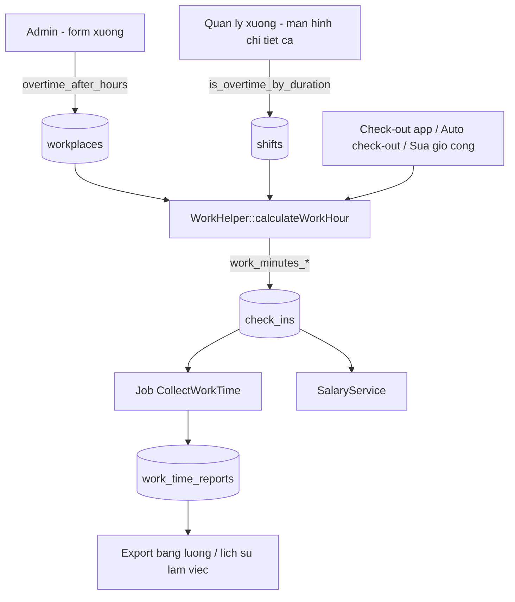
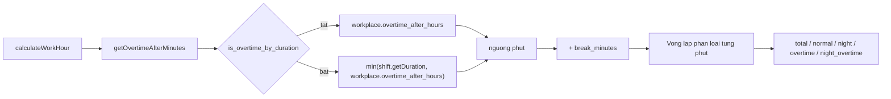
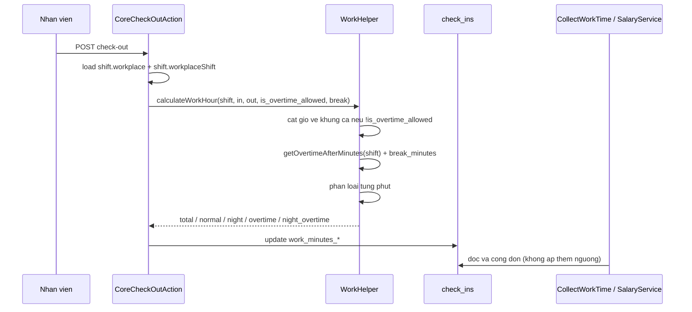

# Design Document: Overtime Threshold Configuration

## Overview

Ngưỡng tăng ca hiện là hằng số đọc từ `config('work.time.over_time_after')` ngay trong `WorkHelper::calculateWorkHour`. Thiết kế này giữ nguyên toàn bộ kiến trúc tính giờ công (vẫn là một hàm static, vẫn chạy tại 7 điểm gọi hiện có, vẫn ghi vào cùng các cột của `check_ins`) và chỉ thay hằng số đó bằng một ngưỡng suy ra từ chính đối tượng `Shift` được truyền vào: ngưỡng của xưởng (`workplaces.overtime_after_hours`), thu hẹp lại theo thời lượng chuẩn của ca khi cờ `shifts.is_overtime_by_duration` được bật. Nhờ đặt toàn bộ logic bên trong `calculateWorkHour`, mọi đường ghi nhận giờ công tự động áp dụng quy tắc mới mà không phải sửa từng caller. Lỗi ngưỡng gộp giờ nghỉ được sửa bằng cách cộng số phút nghỉ vào mốc so sánh, giữ nguyên cách phân loại ca đêm và cách làm tròn giờ vào/ra.

### Design Goals

- Một điểm quyết định duy nhất cho ngưỡng tăng ca, để 7 caller không thể lệch nhau.
- Không đổi chữ ký công khai của `calculateWorkHour` và không đổi cấu trúc mảng kết quả, để các caller và test hiện có không phải viết lại.
- Xưởng chưa cấu hình phải cho kết quả y hệt trước đây, trừ phần sửa lỗi giờ nghỉ.
- Không phát sinh truy vấn trong `calculateWorkHour`; dữ liệu cần thiết đến từ quan hệ đã nạp sẵn.
- Không đụng tới dữ liệu `check_ins`, `work_time_reports`, `salaries` đã tồn tại.

### Key Design Decisions

- **Ngưỡng suy ra từ `Shift`, không truyền qua tham số.** `calculateWorkHour` đã nhận `Shift`; đọc `$shift->workplace` và `$shift->is_overtime_by_duration` ngay trong hàm giúp mọi caller được cập nhật đồng thời, thay vì thêm tham số thứ 6 mà 7 caller phải tự truyền đúng.
- **Cờ ở bảng `shifts`, không ở `workplace_shifts`.** Yêu cầu nghiệp vụ là bật cho một ca cụ thể phát sinh bất thường, không phải cho mẫu ca lặp lại hằng ngày.
- **Cờ ca KHÔNG đè `shift_users.is_overtime_allowed`.** Cờ của ca chỉ hạ ngưỡng tăng ca; việc giữ hay cắt giờ chấm công nằm ngoài khung ca vẫn do một mình `shift_users.is_overtime_allowed` quyết định như trước. Nếu OR hai cờ với nhau, phần đầu ca cũng hết bị cắt: nhân viên được phép tự check-in sớm tới `config('work.check_in.check_in_before_hour')` giờ sẽ tự sinh ra phút tăng ca có lương mà không ai duyệt. Hệ quả: với nhân viên chưa được bật OT riêng, cờ ca gần như không tạo ra phút tăng ca nào — check-in/check-out vẫn bị cắt về đúng khung ca `[start, end]`, nên số phút đếm được không thể vượt quá `min(ngưỡng xưởng, thời lượng chuẩn ca)` mà cờ vừa hạ xuống; hai giá trị trùng khớp nhau ở mọi trường hợp thông thường (kể cả ca dài hơn ngưỡng xưởng, hay ca khai giờ nghỉ mà nhân viên làm xuyên — vòng lặp vẫn bỏ break không điều kiện hoặc luôn trừ `break_minutes`, không phụ thuộc nhân viên có làm xuyên hay không). Cờ chỉ thật sự có tác dụng khi: (1) nhân viên đó cũng có `shift_users.is_overtime_allowed`, hoặc (2) lần chấm công đó dùng `custom_break_minutes` riêng (sửa giờ công) nhỏ hơn `shifts.break_minutes`, khiến ngưỡng thấp hơn số phút đếm được.
- **Cờ bật thì ngưỡng là `min(thời lượng chuẩn ca, ngưỡng xưởng)`.** Bảo toàn nguyên tắc ngưỡng xưởng là trần: ca dài 10 giờ ở xưởng đặt 9 giờ vẫn tính tăng ca từ giờ thứ 9.
- **Sửa lỗi giờ nghỉ bằng cách cộng số phút nghỉ vào mốc so sánh** thay vì đổi cách đếm vòng lặp. Vòng lặp hiện đếm cả phút nghỉ khi giờ nghỉ được khai bằng số phút; cộng số phút nghỉ vào ngưỡng cho kết quả tương đương "so ngưỡng với giờ làm thực", đồng thời không đụng vào phân loại ca đêm của từng phút.
- **Đơn vị lưu là giờ nguyên.** Thống nhất với `min_rest_hours` và tránh sai số dấu phẩy động khi quy đổi ra phút.
- **Không có migration dữ liệu.** Cột mới nullable / default false; dữ liệu lịch sử giữ nguyên theo Requirement 1.6 và 2.7.

### Interface Change Summary

**Before** — ngưỡng cố định trong `WorkHelper::calculateWorkHour`:

```php
$overTimeAfter = config('work.time.over_time_after') * 60; // luôn là 480
...
if ($totalMinutes > $overTimeAfter) { /* overtime */ }
...
if ($customBreakDuration) {
    $totalMinutes = $totalMinutes - $customBreakDuration; // trừ break SAU khi đã phân loại
}
```

**After** — ngưỡng động, đã bù giờ nghỉ:

```php
// $allowOvertime giữ nguyên: chỉ đến từ shift_users.is_overtime_allowed
$overTimeAfter = self::getOvertimeAfterMinutes($shift) + (int) $customBreakDuration;
```

## Architecture

### System Context

Tính năng nằm gọn trong lớp tính giờ công của backend. Nó nhận cấu hình từ hai bảng (`workplaces`, `shifts`) do admin và quản lý xưởng nhập, và chỉ ảnh hưởng tới các cột phân loại phút của `check_ins`. Các tầng phía sau (`CollectWorkTime`, `SalaryService`, các export) chỉ đọc và cộng dồn các cột đó nên không cần sửa.



### High-Level Architecture



## Components and Interfaces

### Component 1: `WorkHelper::getOvertimeAfterMinutes`

**Purpose**: Điểm quyết định duy nhất cho ngưỡng tăng ca của một ca.

**Responsibilities**:

- Đọc ngưỡng của xưởng, rơi về `config('work.time.over_time_after')` khi xưởng không cấu hình hoặc quan hệ workplace không tồn tại.
- Khi cờ của ca bật, thu hẹp ngưỡng về thời lượng chuẩn của ca.
- Trả về số phút nguyên, luôn lớn hơn 0.

**Interfaces**:

- **Input**: `Shift $shift` (đã hoặc sẽ nạp quan hệ `workplace`, `workplaceShift`).
- **Output**: `int` số phút làm việc thực tế mà sau mốc đó mỗi phút là tăng ca.
- **Dependencies**: `Shift::getDuration()`, `config('work.time.over_time_after')`.

**Implementation Notes**:

```php
// backend/app/Helpers/WorkHelper.php
public static function getOvertimeAfterMinutes(Shift $shift): int
{
    $hours = $shift->workplace?->overtime_after_hours ?? config('work.time.over_time_after');
    $thresholdMinutes = (int) round($hours * 60);

    if ($shift->is_overtime_by_duration) {
        $shiftMinutes = (int) round($shift->getDuration() * 60);
        if ($shiftMinutes > 0) {
            $thresholdMinutes = min($thresholdMinutes, $shiftMinutes);
        }
    }

    return $thresholdMinutes;
}
```

- `$shift->getDuration()` mặc định `$breakTimeExcluded = true` nên đã là thời lượng chuẩn đã trừ giờ nghỉ của ca (dùng `shifts.break_minutes`, hoặc khung nghỉ của workplace_shift).
- Dùng `?->` cho `workplace` để thỏa Reliability Requirement: ca thiếu quan hệ xưởng vẫn chạy được với ngưỡng mặc định.
- `$shiftMinutes > 0` chặn trường hợp thời lượng chuẩn bằng 0 (giờ nghỉ khai dài bằng cả ca) làm mọi phút thành tăng ca.

### Component 2: `WorkHelper::calculateWorkHour` (sửa đổi)

**Purpose**: Phân loại từng phút của một lần chấm công thành total / normal / night / overtime / night_overtime.

**Responsibilities**:

- Giữ nguyên bước cắt giờ về khung ca: chỉ `shift_users.is_overtime_allowed` mới bỏ cắt.
- Dùng ngưỡng động từ Component 1 thay cho hằng số.
- Bù số phút nghỉ vào mốc ngưỡng khi giờ nghỉ được khai bằng số phút.

**Interfaces**:

- **Input**: giữ nguyên `(Shift $shift, Carbon $checkInTime, Carbon $checkOutTime, bool $allowOvertime = false, ?int $customBreakDuration = null)`.
- **Output**: giữ nguyên mảng `['total', 'normal', 'night', 'overtime', 'night_overtime', 'check_in_time', 'check_out_time']`.
- **Dependencies**: Component 1.

**Implementation Notes**:

- Khối cắt giờ về khung ca ở đầu hàm giữ nguyên: `$allowOvertime` chỉ đến từ tham số, cờ của ca không tham gia vào đó.
- Khối tính ngưỡng đặt **sau** dòng gán mặc định `$customBreakDuration = $shift->break_minutes` (dòng 97-99 hiện tại), vì mốc ngưỡng phụ thuộc số phút nghỉ thực tế:

    ```php
    $overTimeAfter = self::getOvertimeAfterMinutes($shift) + (int) $customBreakDuration;
    ```

- Khi giờ nghỉ đến từ khung `start_break_time`–`end_break_time` (`$customBreakDuration === null`), vòng lặp đã bỏ qua các phút nghỉ nên `(int) null = 0` là đúng, không cần nhánh riêng.
- Hai điều kiện so sánh `$totalMinutes > $overTimeAfter` ở nhánh ca đêm và nhánh ca ngày giữ nguyên nguyên văn.
- Khối chuẩn hóa âm ở cuối hàm (dòng 139-151 hiện tại) giữ nguyên; nó tiếp tục bảo đảm tổng bốn thành phần bằng `total` sau khi trừ giờ nghỉ.
- Thứ tự thao tác không đổi: cắt giờ theo khung ca → làm tròn → phân loại. Nghĩa là với nhân viên chưa được bật `is_overtime_allowed`, giờ chấm công ngoài khung ca vẫn bị cắt kể cả khi cờ ca bật; cờ ca chỉ đổi mốc phân loại.

### Component 3: Cấu hình ngưỡng theo xưởng

**Purpose**: Lưu và cho phép sửa ngưỡng tăng ca của từng xưởng.

**Responsibilities**:

- Thêm cột `workplaces.overtime_after_hours`, nullable.
- Validate và lưu qua API cập nhật xưởng hiện có.

**Interfaces**:

- **Input**: `PUT admin/workplaces/{workplace}` với trường `overtime_after_hours`.
- **Output**: bản ghi xưởng đã cập nhật.
- **Dependencies**: `App\Http\Requests\Admin\Workplace\StoreRequest` (dùng chung cho store và update).

**Implementation Notes**:

- Migration: `unsignedTinyInteger('overtime_after_hours')->nullable()->after('min_rest_hours')`, không đặt default để phân biệt rõ "chưa cấu hình".
- `Workplace` model đang `$guarded = []` nên không cần thêm fillable; chỉ bổ sung docblock `@property int|null $overtime_after_hours`.
- Rule: `['bail', 'nullable', 'integer', 'min:1', 'max:24']`. `min:1` thay vì `min:0` vì ngưỡng 0 nghĩa là mọi phút đều là tăng ca — không phải nghiệp vụ hợp lệ.
- Không thêm endpoint mới, không thêm permission mới.

### Component 4: Cờ tăng ca theo thời lượng ca

**Purpose**: Cho quản lý bật quy tắc tăng ca theo thời lượng ca cho một ca cụ thể.

**Responsibilities**:

- Thêm cột `shifts.is_overtime_by_duration`, boolean, default false.
- Nhận và lưu giá trị qua endpoint cấu hình ca hiện có.

**Interfaces**:

- **Input**: `PATCH manage/shifts/{shift}/config` với trường `is_overtime_by_duration`.
- **Output**: bản ghi ca đã cập nhật.
- **Dependencies**: `ShiftService::updateConfig`, permission `shift.edit` trên xưởng của ca.

**Implementation Notes**:

- Migration: `boolean('is_overtime_by_duration')->default(false)->after('break_minutes')`.
- `Shift` model: thêm `@property bool $is_overtime_by_duration` và cast `'is_overtime_by_duration' => 'boolean'` vào `$casts`.
- `UpdateConfigRequest`: thêm rule `['nullable', 'boolean']`.
- `ShiftService::updateConfig`: thêm `'is_overtime_by_duration' => $data['is_overtime_by_duration'] ?? false` vào mảng update. Dùng `?? false` chứ không `?? $shift->is_overtime_by_duration`, vì form gửi đủ trường mỗi lần lưu và checkbox bỏ tick cần tắt được cờ.
- Kiểm tra quyền giữ nguyên: `updateConfig` đã kiểm `PermissionName::ShiftEdit` trên `$shift->workplace_id` và trả 403.
- Endpoint tạo ca không nhận trường này (Requirement 2.6, mặc định tắt theo default của cột).

### Component 5: Nạp sẵn quan hệ tại các điểm gọi

**Purpose**: Giữ đúng ràng buộc "không truy vấn thêm trong `calculateWorkHour`" và tránh N+1 ở các luồng chạy hàng loạt.

**Responsibilities**:

- Bảo đảm `shift.workplace` và `shift.workplaceShift` đã nạp trước khi gọi.

**Interfaces**:

- **Input**: các query hiện có tại 7 điểm gọi.
- **Output**: không đổi.

**Implementation Notes**:

| Điểm gọi | Hiện trạng | Cần sửa |
|----------|-----------|---------|
| `CoreCheckOutAction:70` | `$shiftUser->load(['shift.workplaceShift'])` | thêm `shift.workplace` |
| `Jobs\AutoCheckOut:38` | `with('shift.workplaceShift', 'shiftUser')` | thêm `shift.workplace` (chạy hàng loạt, bắt buộc) |
| `Services\Manage\WorkHistoryService:86` | truy cập `$checkIn->shift` | thêm `loadMissing('shift.workplace')` |
| `Services\Manage\ShiftService:416` | `$shiftUser->shift` | thêm `loadMissing('shift.workplace')` |
| `Actions\Manage\WorkHistory\AddUsersToShiftAction:105` | `$shift` đơn lẻ dùng lại trong vòng lặp | `loadMissing('workplace')` một lần trước vòng lặp |
| `Console\Commands\FixWorkHour:45` | `with('shift.workplace', ...)` | không cần sửa |
| `Console\Commands\FixCheckInTimeRounded:45` | `with('shift.workplace', ...)` | không cần sửa |

### Component 6: Form xưởng (frontend)

**Purpose**: Cho admin nhập ngưỡng tăng ca của xưởng.

**Responsibilities**: Hiển thị, validate phía client và gửi giá trị (hoặc null khi để trống).

**Implementation Notes**:

- `frontend/src/pages/admin/workplace/partials/workplace_form.tsx`: thêm `NumberInput` ngay dưới ô `min_rest_hours`, dùng đúng bố cục sẵn có:
    - `label={t('Overtime after hours')}`
    - `description={t('Leave empty to use the system default of 8 hours')}`
    - `min={1} max={24}`, `disabled={isReadOnly}`
- Thêm `overtime_after_hours: null` vào `initialValues`, `overtime_after_hours: Validator.number().integer().gte(1).lte(24)` vào `validate`, và ánh xạ giá trị khi nạp dữ liệu xưởng.
- Ô trống phải gửi `null`, theo đúng cách `min_rest_hours` đang xử lý.

### Component 7: Modal cấu hình ca và thẻ thông tin ca (frontend)

**Purpose**: Cho quản lý bật/tắt cờ và nhìn thấy trạng thái cờ.

**Implementation Notes**:

- `frontend/src/pages/manage/shift/partials/update/config_modal.tsx`: thêm `Checkbox` `is_overtime_by_duration` dưới ô `break_minutes`:
    - `label={t('Count work beyond shift duration as overtime')}`
    - `description={t('Applies to this shift only, overriding per-employee overtime permission')}`
    - dùng `form.getInputProps('is_overtime_by_duration', { type: 'checkbox' })`
- `ConfigFormValues` thêm `is_overtime_by_duration: boolean`; `initialValues` lấy `shift.is_overtime_by_duration ?? false`; payload mutation gửi kèm trường này.
- `frontend/src/pages/manage/shift/partials/update/shift_info_card.tsx`: hiển thị `Badge`/dòng thông tin khi cờ bật, để quản lý biết ca đang áp quy tắc đặc biệt (Usability Requirement).
- Chuỗi mới đi qua luồng dịch chuẩn: `t(...)` trước, sau đó `pnpm trans:prepare` → điền vi/ja → `pnpm trans:apply`.

## Data Models

### Entity 1: Workplace

```typescript
// frontend/src/types/models/workplace.d.ts
export interface Workplace {
    // ...các trường hiện có
    min_rest_hours: number | null;
    overtime_after_hours: number | null; // null = dùng mặc định hệ thống (8 giờ)
}
```

```sql
-- backend/database/migrations/xxxx_add_overtime_after_hours_to_workplaces_table.php
ALTER TABLE workplaces ADD COLUMN overtime_after_hours TINYINT UNSIGNED NULL AFTER min_rest_hours;
```

**Validation Rules**:

- `nullable`, `integer`, `min:1`, `max:24`.
- Đơn vị: giờ. Không chấp nhận giá trị lẻ.

**Relationships**:

- Áp dụng cho mọi `shifts` thuộc xưởng, đọc tại thời điểm tính giờ công (không sao chép xuống ca).

### Entity 2: Shift

```typescript
// frontend/src/types/models/shift.d.ts
export interface Shift {
    // ...các trường hiện có
    break_minutes: number;
    is_overtime_by_duration: boolean; // mặc định false
}
```

```sql
-- backend/database/migrations/xxxx_add_is_overtime_by_duration_to_shifts_table.php
ALTER TABLE shifts ADD COLUMN is_overtime_by_duration TINYINT(1) NOT NULL DEFAULT 0 AFTER break_minutes;
```

**Validation Rules**:

- `nullable`, `boolean` ở request; thiếu trường thì hiểu là `false`.

**Relationships**:

- Chỉ ảnh hưởng các `check_ins` thuộc chính ca đó, và chỉ tại thời điểm phút làm việc được tính.

### Entity 3: Kết quả tính giờ (không đổi)

```typescript
// hình dạng mảng trả về của WorkHelper::calculateWorkHour
interface WorkHourResult {
    total: number; // phút, đã trừ giờ nghỉ
    normal: number;
    night: number;
    overtime: number;
    night_overtime: number;
    check_in_time: string; // đã làm tròn
    check_out_time: string; // đã làm tròn
}
```

**Validation Rules**:

- `normal + night + overtime + night_overtime === total`, mọi thành phần `>= 0` (Requirement 3.6).

### Data Flow



## API Design

### Endpoint 1: Cập nhật xưởng

**Method**: `PUT`
**Path**: `/api/admin/workplaces/{workplace}`

**Request** (chỉ phần liên quan):

```json
{
    "name": "Xuong Tokyo",
    "min_rest_hours": 9,
    "overtime_after_hours": 9
}
```

**Response**:

```json
{
    "data": {
        "id": 1,
        "min_rest_hours": 9,
        "overtime_after_hours": 9
    }
}
```

**Error Responses**:

- `422 Unprocessable Entity`: `overtime_after_hours` không phải số nguyên, nhỏ hơn 1 hoặc lớn hơn 24.
- `403 Forbidden`: không có quyền quản trị xưởng.

### Endpoint 2: Cập nhật cấu hình ca

**Method**: `PATCH`
**Path**: `/api/manage/shifts/{shift}/config`

**Request**:

```json
{
    "fixed_total": 5,
    "temp_total": 3,
    "max_registered_temp": 10,
    "break_minutes": 60,
    "is_overtime_by_duration": true
}
```

**Response**:

```json
{
    "data": {
        "id": 120,
        "break_minutes": 60,
        "is_overtime_by_duration": true
    }
}
```

**Error Responses**:

- `403 Forbidden`: không có `shift.edit` trên xưởng của ca.
- `422 Unprocessable Entity`: `is_overtime_by_duration` không ép được về boolean.

## Security Considerations

### Authentication

- Không thay đổi: cả hai endpoint đều nằm sau middleware xác thực hiện có.

### Authorization

- Ngưỡng xưởng: dùng nguyên middleware permission của route `PUT admin/workplaces/{workplace}`.
- Cờ của ca: `ShiftService::updateConfig` kiểm `PermissionName::ShiftEdit` theo `$shift->workplace_id`, không dựa vào middleware route vì middleware không xét phạm vi xưởng.

### Data Protection

- Không có dữ liệu cá nhân mới. Hai cột mới là cấu hình vận hành.

### Input Validation

- Ngưỡng: chặn ở FormRequest (1–24, integer, nullable) và ở client bằng `Validator`.
- Cờ: ép boolean tại FormRequest; giá trị thiếu hiểu là `false`.

## Error Handling

### Cấu hình không hợp lệ

| Scenario | Handling |
|----------|----------|
| `overtime_after_hours` ngoài 1–24 | 422 với message validation chuẩn, không lưu |
| `overtime_after_hours` để trống | Lưu `null`, xưởng dùng mặc định 8 giờ |
| `is_overtime_by_duration` không gửi lên | Hiểu là `false`, ghi đè giá trị cũ |

### Dữ liệu ca bất thường

| Scenario | Handling |
|----------|----------|
| `shift.workplace` null (dữ liệu cũ hoặc quan hệ bị xóa) | `?->` rơi về `config('work.time.over_time_after')` |
| Thời lượng chuẩn của ca `<= 0` | Bỏ qua cờ, dùng ngưỡng của xưởng |
| Giờ nghỉ khai lớn hơn tổng giờ làm | Giữ nguyên khối chuẩn hóa âm hiện có; các thành phần không âm, `total` có thể bằng 0 |
| Ca qua đêm (`end_time < start_time`) | Không đổi: `getShiftTimes` đã cộng thêm một ngày cho `end`, thời lượng chuẩn vì thế vẫn đúng |

### Vận hành

| Scenario | Handling |
|----------|----------|
| Admin đổi ngưỡng giữa tháng | Chỉ các bản ghi chấm công tính sau thời điểm đổi mới theo giá trị mới; không tính lại quá khứ |
| Quản lý tick cờ sau khi nhân viên đã check-out | Bản ghi cũ giữ nguyên; muốn áp lại phải sửa giờ công của bản ghi đó, đường sửa giờ công sẽ tính lại theo cờ mới |

## Performance Considerations

### Expected Load

- **Check-out**: một lần gọi mỗi lần chấm công, vài nghìn lần/ngày ở giờ cao điểm cuối ca.
- **AutoCheckOut**: chạy theo lịch, duyệt toàn bộ `check_ins` chưa check-out.
- **FixWorkHour**: chạy tay, xử lý theo lô 100 bản ghi.

### Optimization Strategies

- `getOvertimeAfterMinutes` không truy vấn; chỉ đọc quan hệ đã nạp và `config()` (đã cache khi `config:cache`).
- Bổ sung eager load `shift.workplace` ở `AutoCheckOut` để tránh N+1 trên vòng lặp toàn bảng.
- `Shift::getDuration()` chỉ được gọi khi cờ bật, và chỉ dùng `loadMissing('workplaceShift')` vốn đã nạp sẵn ở mọi caller.
- Không thêm index: hai cột mới không dùng để lọc.

## Testing Strategy

### Unit Tests

**`WorkHelper::calculateWorkHour` (`backend/tests/Unit/Helpers/WorkHelperCalculateWorkHourTest.php` — mới):**

- Xưởng không cấu hình ngưỡng, ca 10 giờ không nghỉ: tăng ca bắt đầu từ phút thứ 481 (giữ nguyên hành vi cũ).
- Xưởng đặt `overtime_after_hours = 9`: cùng dữ liệu vào, tăng ca bắt đầu từ phút thứ 541.
- Xưởng đặt 9 giờ, ca có `break_minutes = 60`, làm 10 giờ liên tục: `total = 540`, `overtime = 0` (Requirement 3.4).
- Ca có khung giờ nghỉ và `break_minutes` null: phút trong khung nghỉ không được đếm, ngưỡng không bị cộng thêm.
- Cờ ca bật, ca chuẩn 8 giờ, xưởng đặt 9 giờ, nhân viên làm 9 giờ: 8 giờ đầu là thường, 1 giờ sau là tăng ca.
- Cờ ca bật, ca chuẩn 10 giờ, xưởng đặt 9 giờ: ngưỡng lấy 9 giờ (min).
- Cờ ca bật nhưng `is_overtime_allowed` của nhân viên tắt: giờ ngoài khung ca **vẫn bị cắt**, cả phía check-out lẫn phía check-in sớm (không tự sinh phút tăng ca).
- Cờ ca bật và `is_overtime_allowed` bật: giờ ngoài khung ca được giữ và tính tăng ca theo ngưỡng của ca.
- Cờ ca tắt và `is_overtime_allowed` tắt: giờ ngoài khung ca vẫn bị cắt như hiện tại (kiểm tra không hồi quy).
- Ca đêm bắt qua khung 22:00–05:00 với ngưỡng 9 giờ: phân tách đúng `night` và `night_overtime`.
- Ca thiếu quan hệ workplace: rơi về ngưỡng 8 giờ, không ném exception.
- Thời lượng chuẩn của ca bằng 0 và cờ bật: dùng ngưỡng xưởng.
- Bất biến: với mọi tổ hợp trên, `normal + night + overtime + night_overtime === total` và không thành phần nào âm.

**`WorkHelper::getOvertimeAfterMinutes`:** phủ gián tiếp qua các case trên; không viết test riêng để tránh trùng lặp.

### Integration Tests

**Cấu hình xưởng (`backend/tests/Feature/Admin/WorkplaceOvertimeConfigTest.php` — mới, chưa có test cho endpoint cập nhật xưởng):**

- `PUT admin/workplaces/{id}` với `overtime_after_hours = 9` lưu đúng giá trị.
- Gửi `0` và `25` đều trả 422.
- Gửi `null` xóa cấu hình về mặc định.

**Cấu hình ca (`backend/tests/Feature/Manage/Shift/UpdateConfigTest.php` — bổ sung vào file có sẵn):**

- `PATCH manage/shifts/{id}/config` với `is_overtime_by_duration = true` lưu đúng và trả bản ghi mới.
- Gửi lại request không kèm trường này thì cờ về `false`.
- Người dùng không có `shift.edit` trên xưởng của ca nhận 403 và cờ không đổi.

**Vòng đời chấm công (`backend/tests/Feature/Manage/Shift/CheckInOutTest.php` — bổ sung, theo Test Design Rules):**

- Đi qua luồng thật: tạo ca → duyệt nhân viên → check-in → check-out qua endpoint, với xưởng đặt ngưỡng 9 giờ, và khẳng định các cột `work_minutes_*` của `check_ins` đúng theo ngưỡng mới.
- Cùng luồng đó với ca đã tick cờ (bật qua chính endpoint cấu hình ca, không set thẳng vào DB) và nhân viên **được** bật `is_overtime_allowed`: khẳng định phút vượt thời lượng ca được xếp vào tăng ca theo ngưỡng của ca.
- Cùng luồng đó với ca đã tick cờ nhưng nhân viên **không** được bật `is_overtime_allowed`, check-in sớm và check-out muộn: khẳng định `check_in_time_rounded` / `check_out_time_rounded` bị cắt về khung ca và `work_minutes_overtime = 0`.

**Sửa giờ công (`backend/tests/Feature/Manage/WorkHistoryControllerTest.php` — bổ sung):**

- Quản lý sửa giờ ra của bản ghi đã tạo qua luồng check-in/check-out thật: khẳng định các cột được tính lại theo cùng ngưỡng và job cập nhật lương/tổng hợp giờ vẫn được dispatch.

### Frontend Tests

**`workplace_form.test.tsx` — bổ sung:**

- Render ra ô ngưỡng tăng ca với giá trị đang lưu.
- Submit gửi `overtime_after_hours` trong payload; để trống gửi `null`.

**`config_modal.test.tsx` — bổ sung:**

- Checkbox hiển thị đúng trạng thái ban đầu từ `shift.is_overtime_by_duration`.
- Tick rồi lưu gửi `is_overtime_by_duration: true` trong payload.

### Không kiểm thử

- Migration thêm cột (không có logic).
- Các export Excel và màn hình báo cáo: chỉ đọc lại cột cũ, không đổi cấu trúc; đã có test hiện hành phủ.
