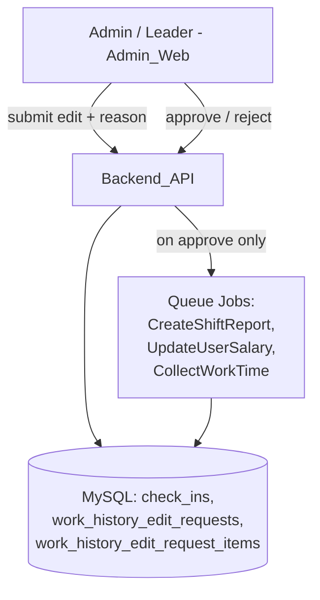
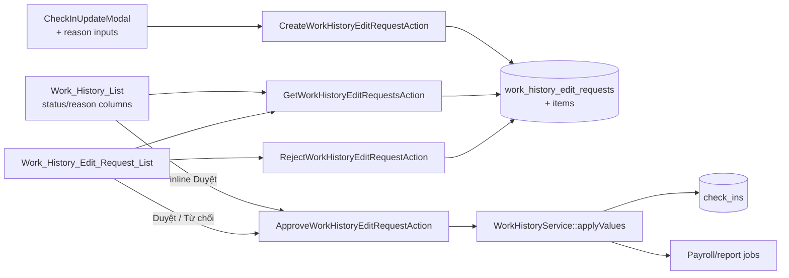
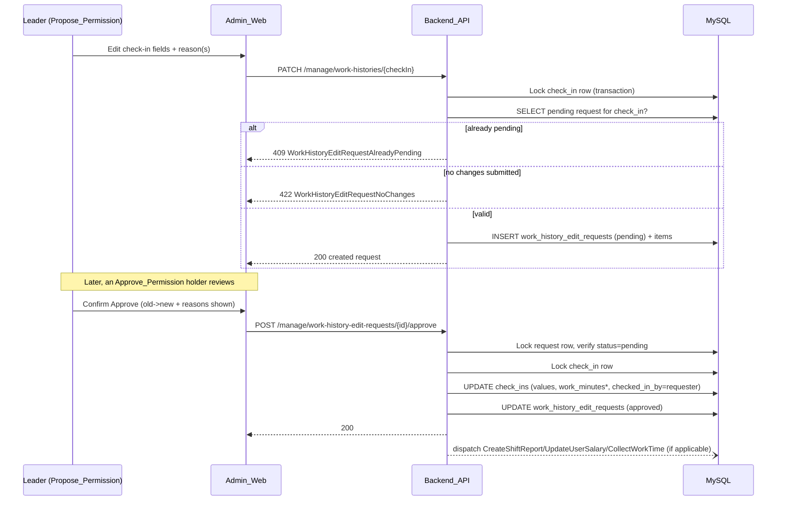

# Design Document: Work History Edit Approval

## Overview

This feature replaces the direct-write "edit check-in" flow on `/manage/work-history` with a request/approval workflow, mirroring the existing `FixedScheduleChangeRequest` pattern already in the codebase. A new `work_history_edit_requests` (+ `work_history_edit_request_items`) table pair records a proposed edit as `pending` until an authorized approver resolves it; the underlying `check_ins` row is only mutated at approval time, reusing the exact recalculation logic (`work_minutes*`, `check_in_time_rounded`/`check_out_time_rounded`, downstream jobs) the current direct-edit flow already performs. Access is split by a new permission, `work_history_edit_request.process`, independent of the existing `work_history.edit` permission — the same person may hold both.

### Design Goals

- Reuse the `FixedScheduleChangeRequest` request/approval pattern (status enum, `processed_by_id`/`processed_at`, row-locked transactional approve/reject, bulk-resolve) rather than inventing a new one.
- Zero behavior change to the payroll recalculation logic itself (`WorkHelper::calculateWorkHour`, `work_minutes*`, `CreateShiftReport`/`UpdateUserSalary`/`CollectWorkTime` jobs) — only *when* it runs changes (at approval, not at edit time).
- Keep `work_history.edit` as the existing permission value (no rename), so current role assignments are unaffected; add exactly one new permission for approval.
- Support both UI entry points required (inline on `Work_History_List`, and the dedicated `Work_History_Edit_Request_List` screen) from one shared backend API surface.

### Key Design Decisions

- **One permission, not two, for the review screen.** `Work_History_Edit_Request_List` is gated solely by the new `work_history_edit_request.process` permission (no separate `.list` permission) — per confirmed requirements, there is no "view-only, can't act" reviewer role in this feature, unlike Fixed Schedule Change Requests' List/Process split.
- **Permission key deliberately breaks from the `work_history.*` prefix.** Using `work_history_edit_request.process` (not `work_history.process`) puts it in its own group in Role Management's `getPermissionTree()` (grouped by the first dot-segment of the permission value), exactly like `fixed_schedule_change_request.*` already forms its own group separate from `fixed_schedule.*`. This is an existing, working convention — not a new mechanism.
- **`checked_in_by`/`checked_out_by` are attributed to the requester, not the approver**, on approval — confirmed by stakeholder. This means the value-recalculation call at approval time must accept an explicit "attributed user id" parameter instead of implicitly using `Auth::id()`.
- **The existing update-check-in route/verb is kept** (`PATCH /manage/work-histories/{checkIn}`); only its internal behavior changes (creates a request instead of writing directly). This avoids a frontend route/method churn for a single call site.
- **No separate detail/show endpoint.** `GetWorkHistoryEditRequestsAction`'s list response already eager-loads `items` per row, so the detail modal opens directly from the already-fetched row object — mirroring `FixedScheduleChangeRequest`'s `RequestDetailModal`, which also takes its data as a prop rather than issuing a second request.
- **New backend code lives under the `Manage` namespace** (`App\Actions\Manage\WorkHistoryEditRequest\*`, `App\Http\Controllers\Manage\WorkHistoryEditRequestController`), matching the existing `WorkHistoryController`/`WorkHistoryService` and the `manage/*` route prefix both the submit and review endpoints share — not `Admin`, which in this codebase is reserved for the `admin/*`-prefixed controllers (e.g. `FixedScheduleChangeRequestController`).
- **Reason granularity is per DB column, not per UI input.** The edit modal has 5 inputs (`check_in_date`, `check_in_time`, `check_out_date`, `check_out_time`, `break_minutes`), but `check_ins` stores `check_in_time` and `check_out_time` as combined datetimes. A `Work_History_Edit_Request_Item` is created per changed **combined** field — `check_in_time`, `check_out_time`, `break_minutes` — so there are at most 3 reason inputs, not 5. Changing only the date half of a check-in still requires the "Check in" reason.
- **Duplicate-pending prevention is a locked check-then-insert inside one transaction**, not a database uniqueness constraint (MySQL has no native "unique among rows where status=pending" constraint without a generated column). The `check_ins` row is locked for the duration of the check, closing the race window described in the Reliability NFR.

## Architecture

### System Context



### High-Level Architecture



## Components and Interfaces

### Component 1: `CreateWorkHistoryEditRequestAction`

**Purpose**: Validate and persist a proposed edit as a `pending` request, replacing the current direct `CheckIn::update()` call.

**Responsibilities**:
- Lock the target `CheckIn` row (`lockForUpdate`) and verify no other `pending` request already exists for it (Requirement 3.3).
- Diff the submitted `check_in_time`/`check_out_time`/`break_minutes` against the `CheckIn`'s current values (same Carbon-combination logic `WorkHistoryService::updateCheckIn` already uses for `check_in_date`+`check_in_time`).
- Build one `Work_History_Edit_Request_Item` per changed field with its `old_value`, `new_value`, and the matching reason from the request payload; reject if zero fields changed (Requirement 2.4).
- Resolve `workplace_id` from `$checkIn->shift->workplace_id` and store it on the request (denormalized, for `FiltersByWorkplace` scoping).

**Interfaces**:
- **Input**: `User $user` (submitter), `CheckIn $checkIn`, validated array (`check_in_date`, `check_in_time`, `check_out_date`, `check_out_time`, `break_minutes`, `check_in_reason`, `check_out_reason`, `break_minutes_reason`)
- **Output**: `ActionResult` wrapping the created `WorkHistoryEditRequest` (with `items`), or an error (`WorkHistoryEditRequestAlreadyPending`, `WorkHistoryEditRequestNoChanges`)
- **Dependencies**: `CheckIn`, `WorkHistoryEditRequest`, `WorkHistoryEditRequestItem`

**Implementation Notes**:
- Runs inside `DB::transaction`, with the `CheckIn` lock held for the check-then-insert, closing the concurrent-submission race (NFR Reliability).
- Does not touch `check_ins` at all — no recalculation, no job dispatch.

### Component 2: `ApproveWorkHistoryEditRequestAction`

**Purpose**: Atomically apply an approved request's values to `check_ins`, reusing the existing recalculation logic.

**Responsibilities**:
- Permission check: `$user->isAbleTo(PermissionName::WorkHistoryEditRequestProcess->value, $request->workplace_id)`.
- Lock the request (`lockForUpdate`), guard `status === Pending` (409 `WorkHistoryEditRequestNotPending` otherwise) — same pattern as `ApproveFixedScheduleChangeRequestAction`.
- Lock the underlying `CheckIn`, apply the request's new values via `WorkHistoryService::applyValues($checkIn, $data, attributedUserId: $request->requested_by_id)`.
- Set `status = approved`, `processed_by_id = $user->id`, `processed_at = now()`.

**Interfaces**:
- **Input**: `User $user` (approver), `WorkHistoryEditRequest $request`
- **Output**: `ActionResult` wrapping the resolved request, or 403/409
- **Dependencies**: `WorkHistoryEditRequest`, `WorkHistoryService::applyValues`

**Implementation Notes**:
- Permits self-approval by design — no check comparing `$user->id` to `$request->requested_by_id` (confirmed requirement, unlike `AdminLeaveRequest`'s self-approval block).
- `WorkHistoryService::applyValues` is the refactored extraction of today's `updateCheckIn` body (Component 4) — same recalculation, same conditional job dispatch, just parameterized on who gets attributed.

### Component 3: `RejectWorkHistoryEditRequestAction`

**Purpose**: Resolve a request as rejected without touching `check_ins`.

**Responsibilities**:
- Same permission check and locked pending-guard as Approve.
- Require and persist a non-empty `reject_reason` (Requirement 7.1/7.2).
- Set `status = rejected`, `processed_by_id`, `processed_at`, `reject_reason`.

**Interfaces**:
- **Input**: `User $user`, `WorkHistoryEditRequest $request`, `string $rejectReason`
- **Output**: `ActionResult`
- **Dependencies**: `WorkHistoryEditRequest`

### Component 4: `WorkHistoryService::applyValues` (refactor of existing `updateCheckIn`)

**Purpose**: The single place that writes corrected check-in values to `check_ins` and decides whether downstream jobs fire — used only from `ApproveWorkHistoryEditRequestAction` now (no longer called directly from the controller).

**Responsibilities**:
- Identical body to today's `updateCheckIn` (Carbon combination, `WorkHelper::calculateWorkHour`, `work_minutes*`, `check_in_time_rounded`/`check_out_time_rounded`), except `Auth::id()` is replaced by an explicit `int $attributedUserId` parameter for `checked_in_by`/`checked_out_by`.

**Interfaces**:
- **Input**: `CheckIn $checkIn`, `array $data`, `int $attributedUserId`
- **Output**: `void` (mutates `$checkIn`, dispatches jobs as needed)

**Implementation Notes**:
- This is a rename + signature change of an existing method, not new business logic — the recalculation behavior is byte-for-byte unchanged.

### Component 5: `GetWorkHistoryEditRequestsAction`

**Purpose**: Scoped, filterable listing backing both `Work_History_Edit_Request_List` and (in a lighter "latest per check-in" form) the status/reason columns on `Work_History_List`.

**Responsibilities**:
- Apply `applyWorkplaceFilter($user, PermissionName::WorkHistoryEditRequestProcess->value)`.
- Filter by `workplace_id`, `employee_name` (via `checkIn.user`, same `like` pattern as `GetFixedScheduleChangeRequestsAction`), `status` (default `pending`, `all` clears it), and `dates` (submission date range on `created_at`).

**Interfaces**:
- **Input**: `User $user`, `array $filters`
- **Output**: `ActionResult` wrapping a paginator of `WorkHistoryEditRequest` with `checkIn.user`, `checkIn.shift.workplace`, `items`, `processedBy` eager-loaded

### Component 6: `BulkResolveWorkHistoryEditRequestsAction`

**Purpose**: All-or-nothing bulk approve/reject, mirroring `BulkResolveFixedScheduleChangeRequestsAction`.

**Responsibilities**: Loop over `ids`, invoke `ApproveWorkHistoryEditRequestAction`/`RejectWorkHistoryEditRequestAction` per id inside one outer `DB::transaction`; abort (roll back) the whole batch on the first error via a `WorkHistoryEditRequestBulkResolveAbortedException`.

**Interfaces**:
- **Input**: `User $user`, `int[] $ids`, `'approve'|'reject' $action`, `?string $rejectReason` (required when `$action === 'reject'`)
- **Output**: `ActionResult` wrapping the resolved requests

### Component 7: Role Management label registration

**Purpose**: Make the new permission's checkbox and group label appear correctly translated in Role Management.

**Responsibilities**: `create_update_form.tsx` renders permission labels via the dynamic keys `t(`role|${group}`)` and `t(`role|${permission}`)`, where `group` is the first dot-segment of the permission value. Since `work_history_edit_request.process` does not share the `work_history` group (by design — see Key Design Decisions), it forms a **new** group `work_history_edit_request`, requiring two new dynamic-key entries:
- `t('role|work_history_edit_request')` — the group header (e.g. "Yêu cầu sửa công")
- `t('role|work_history_edit_request.process')` — the checkbox label (e.g. "Duyệt yêu cầu sửa công")

**Implementation Notes**:
- Both keys must be registered in `frontend/src/locales/for_scanner.ts` (alongside the existing `t('role|work_history')`, `t('role|work_history.edit')`, etc.) — the scanner cannot detect these dynamic keys otherwise, per the project's Frontend Translation Rules.
- Follow the standard Frontend Translation Flow: add the `t(...)` calls first, then `pnpm trans:prepare`, fill `vi`/`ja` in the generated batch, `pnpm trans:apply`, then `pnpm prettier`/`pnpm typecheck`.

### Component 8: Frontend — `Work_History_List` additions

**Purpose**: Show request status/reason inline and let dual-permission users approve without leaving the page.

**Responsibilities**: Render "Trạng thái"/"Lý do sửa đổi" columns from each row's eager-loaded `latest_edit_request`; disable the edit action while a request is `pending`; show an inline "Duyệt" action (confirmation dialog with old→new+reasons) when `WORK_HISTORY_EDIT_REQUEST_PROCESS` is granted.

### Component 9: Frontend — `Work_History_Edit_Request_List` (new page)

**Purpose**: Dedicated review screen for `work_history_edit_request.process` holders, structured like `admin/fixed-schedule/change-requests`.

**Responsibilities**: `CommonSearchBox` with workplace/employee/status/date filters; `DDataTable` with row selection (`isRecordSelectable`: `status === 'pending'`); a `RequestDetailModal` showing every `Work_History_Edit_Request_Item` (field, old→new, reason) with Approve/Reject actions (Reject requires a reason textarea — Requirement 7.1, so it cannot reuse the reason-less `DConfirmModal` used by Fixed Schedule's single-item reject; a small custom reject dialog with a required `Textarea` is needed); bulk approve/reject buttons, with bulk reject also collecting one shared reason applied to every selected request.

## Data Models

### Entity 1: `WorkHistoryEditRequest`

```typescript
// backend/database/migrations/2026_08_22_000001_create_work_history_edit_requests_table.php (schema)
// frontend/src/types/models/work_history_edit_request.d.ts
interface WorkHistoryEditRequest {
    id: number;
    check_in_id: number;
    workplace_id: number;
    requested_by_id: number;
    status: 'pending' | 'approved' | 'rejected';
    processed_by_id: number | null;
    processed_at: string | null;
    reject_reason: string | null;
    created_at: string;
    updated_at: string;
    // relations, eager-loaded on list/detail
    check_in?: CheckIn;
    requested_by?: User;
    processed_by?: User | null;
    items?: WorkHistoryEditRequestItem[];
}
```

**Validation Rules**:
- `status` defaults to `pending`; only `Approve`/`Reject` actions transition it, guarded by a locked pending-check (never client-settable).
- Exactly one `pending` request may exist per `check_in_id` at a time (enforced by locked check-then-insert in `CreateWorkHistoryEditRequestAction`, not a DB constraint).

**Relationships**:
- `belongsTo CheckIn` (`check_in_id`)
- `belongsTo Workplace` (`workplace_id`, denormalized from `check_in.shift.workplace_id` at creation)
- `belongsTo User` as `requestedBy` (`requested_by_id`)
- `belongsTo User` as `processedBy` (`processed_by_id`, nullable)
- `hasMany WorkHistoryEditRequestItem` as `items`

### Entity 2: `WorkHistoryEditRequestItem`

```typescript
// backend/database/migrations/2026_08_22_000002_create_work_history_edit_request_items_table.php (schema)
interface WorkHistoryEditRequestItem {
    id: number;
    work_history_edit_request_id: number;
    field: 'check_in_time' | 'check_out_time' | 'break_minutes';
    old_value: string | null;
    new_value: string | null;
    reason: string;
    created_at: string;
    updated_at: string;
}
```

**Validation Rules**:
- `reason` is non-empty (enforced at the `CreateEditRequestRequest` FormRequest level — a field with a changed value and no reason fails validation before the Action runs).
- `field` is restricted to the three known columns.

**Relationships**:
- `belongsTo WorkHistoryEditRequest`

### Migrations (column-level)

`work_history_edit_requests`:
```
id
check_in_id        FK -> check_ins, cascadeOnDelete
workplace_id        FK -> workplaces, cascadeOnDelete
requested_by_id     FK -> users, nullOnDelete
status              string, default 'pending'
processed_by_id     FK -> users, nullable, nullOnDelete
processed_at        timestamp, nullable
reject_reason       text, nullable
timestamps
index [check_in_id, status]
index [workplace_id, status]
```

`work_history_edit_request_items`:
```
id
work_history_edit_request_id  FK -> work_history_edit_requests, cascadeOnDelete
field               string
old_value           string, nullable
new_value           string, nullable
reason              text
timestamps
index [work_history_edit_request_id]
```

`check_ins` (no schema change; add an Eloquent-only relation):
- `WorkHistoryEditRequest[] editRequests()` — `hasMany`
- `?WorkHistoryEditRequest latestEditRequest()` — `hasOne(...)->latestOfMany()`, eager-loaded by `WorkHistoryService::getWorkHistory` to satisfy Requirement 8.3 without N+1.

### Data Flow: Submit → Approve



## API Design

### Endpoint 1: Submit edit request (kept route, new behavior)

**Method**: `PATCH`
**Path**: `/manage/work-histories/{checkIn}`
**Permission**: `work_history.edit`

**Request**:
```json
{
    "check_in_date": "2026-08-22",
    "check_in_time": "08:05:00",
    "check_out_date": "2026-08-22",
    "check_out_time": "17:10:00",
    "break_minutes": 60,
    "check_in_reason": "Nhân viên quẹt thẻ muộn do máy chấm công lỗi",
    "check_out_reason": null,
    "break_minutes_reason": null
}
```

**Response**:
```json
{ "data": { "id": 1, "status": "pending", "check_in_id": 42, "items": [ { "field": "check_in_time", "old_value": "2026-08-22 08:00:00", "new_value": "2026-08-22 08:05:00", "reason": "Nhân viên quẹt thẻ muộn do máy chấm công lỗi" } ] } }
```

**Error Responses**:
- `409 WorkHistoryEditRequestAlreadyPending`: a pending request already exists for this check-in
- `422 WorkHistoryEditRequestNoChanges`: no field differs from the current value
- `422 Validation`: a changed field is missing its reason

### Endpoint 2: List edit requests

**Method**: `GET`
**Path**: `/manage/work-history-edit-requests`
**Permission**: `work_history_edit_request.process`
**Query**: `workplace_id`, `employee_name`, `status` (default `pending`), `dates[]`, `page_size`

### Endpoint 3: Approve

**Method**: `POST`
**Path**: `/manage/work-history-edit-requests/{workHistoryEditRequest}/approve`
**Permission**: `work_history_edit_request.process`

**Error Responses**:
- `403`: caller lacks the permission for the request's workplace
- `409 WorkHistoryEditRequestNotPending`: request already resolved

### Endpoint 4: Reject

**Method**: `POST`
**Path**: `/manage/work-history-edit-requests/{workHistoryEditRequest}/reject`
**Permission**: `work_history_edit_request.process`

**Request**:
```json
{ "reject_reason": "Giờ đề xuất không khớp camera chấm công" }
```

**Error Responses**:
- `422 Validation`: `reject_reason` missing
- `409 WorkHistoryEditRequestNotPending`

### Endpoint 5: Bulk resolve

**Method**: `POST`
**Path**: `/manage/work-history-edit-requests/bulk-resolve`
**Permission**: `work_history_edit_request.process`

**Request**:
```json
{ "ids": [1, 2, 3], "action": "reject", "reject_reason": "Thiếu bằng chứng đối chiếu" }
```

## Security Considerations

### Authentication
- Unchanged: existing Sanctum-based admin session auth on all new endpoints.

### Authorization
- Every mutating action (`Create`, `Approve`, `Reject`, `BulkResolve`) re-checks `isAbleTo(permission, workplace_id)` **inside the action**, not only via route middleware — matching the `FixedScheduleChangeRequest` pattern, so a stale client can't bypass a permission revoked between page load and click (NFR Security).
- Listing and detail scope by `FiltersByWorkplace`/`applyWorkplaceFilter` against `WorkHistoryEditRequestProcess`, so a leader can only see/act on requests for workplaces they manage; `GlobalAdmin` is unrestricted (existing `isAbleTo` behavior).

### Data Protection
- No new PII fields; `reason`/`reject_reason` are free-text business justifications, not sensitive personal data.

### Input Validation
- `CreateEditRequestRequest`: reuses the existing date/time/break_minutes rules from `UpdateRequest`, plus `required_if`-style rules making each `*_reason` mandatory exactly when its paired value differs from the `CheckIn`'s current value (checked against `$this->route('checkIn')`).
- `RejectRequest`: `reject_reason` required, string, reasonable max length (e.g. 1000 chars).
- `BulkResolveRequest`: `ids` required array of existing `work_history_edit_requests` ids; `action` in `[approve, reject]`; `reject_reason` required when `action === reject`.

## Error Handling

### Request Lifecycle Errors

| Scenario | Handling |
|----------|----------|
| Submit edit when a pending request already exists for the check-in | `CreateWorkHistoryEditRequestAction` returns 409 `WorkHistoryEditRequestAlreadyPending`; Admin_Web shows a toast and keeps the edit action disabled |
| Submit edit with no field actually changed | 422 `WorkHistoryEditRequestNoChanges` |
| Submit edit with a changed field missing its reason | 422 validation error on the specific `*_reason` field |
| Approve/Reject a request not in `pending` (already resolved, or resolved concurrently) | 409 `WorkHistoryEditRequestNotPending`; Admin_Web refetches the list so the stale row disappears/updates |
| Approve/Reject without permission for the request's workplace | 403 `Forbidden` |
| Bulk resolve where one item fails (already resolved, permission) | Whole batch rolls back (`WorkHistoryEditRequestBulkResolveAbortedException`), Admin_Web shows which item failed and that nothing was applied |
| Reject without a reason | 422 validation error on `reject_reason` |

## Performance Considerations

### Expected Load
- Same order of magnitude as existing Work History traffic: a handful of edits per workshop per day, reviewed within the same day — no new high-throughput path.

### Optimization Strategies
- `Work_History_List`'s `latest_edit_request` is eager-loaded via `hasOne(...)->latestOfMany()` in the existing paginated query, avoiding one query per row (Requirement 8.3 / NFR Performance).
- `Work_History_Edit_Request_List` paginates via the existing `LengthAwarePaginator` convention used across the codebase; no full-table loads.

## Testing Strategy

### Unit Tests

**`CreateWorkHistoryEditRequestAction` (`backend/tests/Unit/Actions/Manage/WorkHistoryEditRequest/CreateWorkHistoryEditRequestActionTest.php`)**:
- Creates a `pending` request with one item per changed field, correct old/new values
- Rejects (422) when no field changed
- Rejects (422) when a changed field's reason is empty
- Rejects (409) when a `pending` request already exists for the check-in
- Does not modify `check_ins` or dispatch payroll jobs

**`ApproveWorkHistoryEditRequestAction`**:
- Applies new values to `check_ins`, recalculates `work_minutes*` identically to the pre-feature direct-edit behavior (regression-style comparison)
- Sets `checked_in_by`/`checked_out_by` to `requested_by_id`, not the approver
- Allows self-approval when the same user holds both permissions
- Rejects (403) when the approver lacks `work_history_edit_request.process` for the workplace
- Rejects (409) when the request is not `pending` (including a request approved/rejected between list-fetch and click, reached by actually resolving it first via the real endpoint, not a hand-set status fixture)
- Rolls back entirely if the mid-transaction recalculation throws (e.g. malformed shift data) — `check_ins` and request status both remain untouched

**`RejectWorkHistoryEditRequestAction`**:
- Requires a non-empty `reject_reason`
- Leaves `check_ins` unchanged
- Rejects (409) when not `pending`

**`GetWorkHistoryEditRequestsAction`**:
- Filters by workplace, employee name, status (default pending, `all`), submission date range
- Workplace-scoped: a leader only sees requests for their `Managed_Workplace`s

**`BulkResolveWorkHistoryEditRequestsAction`**:
- All-or-nothing: one already-resolved id in the batch rolls back every change

### Integration/Lifecycle Tests
- Full lifecycle via real endpoints: submit → pending visible with status/reason on `Work_History_List` and on `Work_History_Edit_Request_List` → approve → `check_ins` updated, `work_minutes*` correct, `checked_in_by = requester` → attempting a second edit before approval is blocked (409) → after rejection, a new edit can be submitted and approved.
- Accumulated-history test: a `check_in` with one prior `rejected` request, then a new `pending` request — list filtered to `status=all` for that employee shows both; filtered to `pending` shows only the new one.
- Route/permission tests: edit-only role gets 403 on approve/reject/bulk endpoints; approve-only role gets 403 on the submit-edit endpoint; dual-permission role succeeds on both, including approving its own submission.

### Frontend Tests
- `check_in_update_modal.test.tsx`: reason input becomes required only for fields the user actually changes; submit blocked client-side otherwise.
- `work-history/index.page.test.tsx`: status/reason columns render from `latest_edit_request`; edit action disabled while pending; inline "Duyệt" only rendered when `WORK_HISTORY_EDIT_REQUEST_PROCESS` is granted.
- `work-history/edit-requests/index.page.test.tsx` + `request_detail_modal.test.tsx`: filters, bulk approve/reject (including the reason-required bulk-reject dialog), detail view old→new+reason rendering — modeled directly on the existing `fixed-schedule/change-requests` test files.

### Test Configuration

```php
// Backend: PHPUnit method names are camelCase per repo convention (CLAUDE.md)
public function testApproveSetsCheckedInByToRequester(): void { /* ... */ }
public function testCreateRejectsWhenPendingRequestExists(): void { /* ... */ }
```
