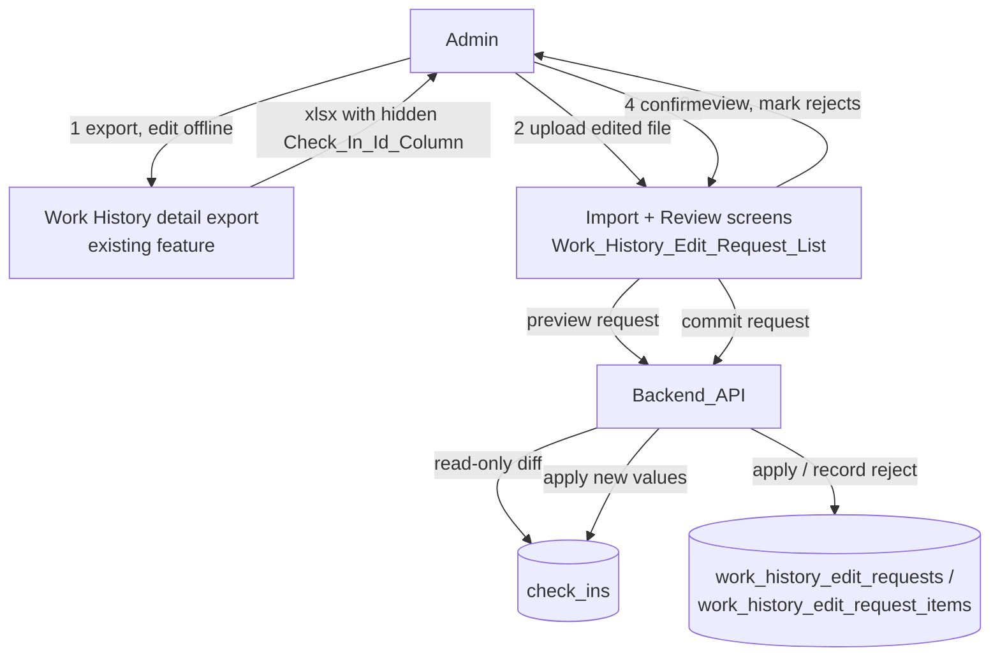
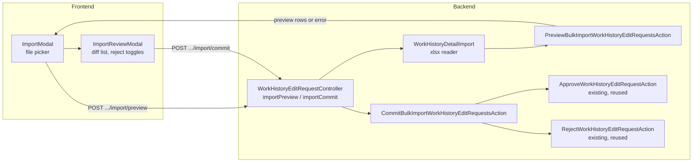
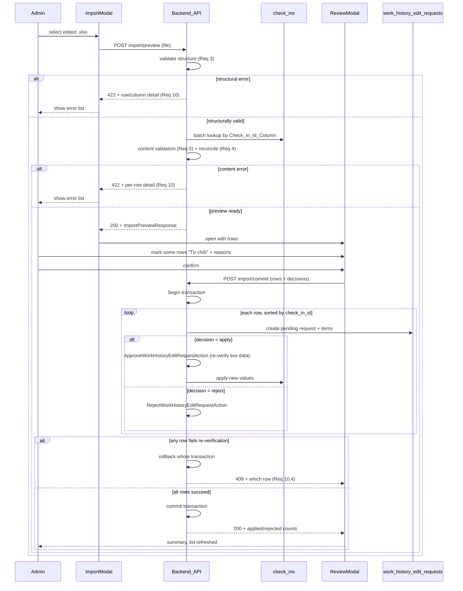

# Design Document: Bulk Work History Edit Import

## Overview

The feature adds a two-phase, stateless-preview / atomic-commit flow on top of the existing single-record `Work_History_Edit_Request` model, plus one additive column on the existing detail export. Phase 1 (**preview**) uploads an `.xlsx` file and returns a diff — computed entirely in memory, nothing written to the database. Phase 2 (**commit**) resubmits that diff, annotated with the admin's per-row apply/reject decisions, and processes the whole batch in one transaction by reusing the existing `ApproveWorkHistoryEditRequestAction` / `RejectWorkHistoryEditRequestAction` for every row — which also gives commit-time conflict detection (Requirement 7.1) for free, since those actions already re-check each item's `old_value` against the live `Check_In` before applying anything.

### Design Goals
- Reuse the existing approve/reject/data-model machinery from `.agents/specs/20260822-work-history-edit-approval/` instead of building a parallel apply path.
- Never persist anything from an upload the admin has not explicitly confirmed (Requirement 4.4, 6.5).
- Make the commit step trust nothing from the client except row identity and stated intent — every value is re-validated against live data at commit time, the same way a normal approve already is.
- Keep the export change additive and invisible to a human editing the file by hand.

### Key Design Decisions
- **The commit endpoint does not re-parse the uploaded file.** The preview response already contains, per changed field, the exact `old_value`/`new_value` pair. The client resubmits that same structure back with decisions attached. Commit re-validates each `old_value` against the live `Check_In` using the *same* `liveValueMatches`/snapshot-drift logic `ApproveWorkHistoryEditRequestAction` already runs — so Requirement 7.1's "re-verify at commit time" is satisfied by calling that existing action, not by re-implementing drift detection.
- **"Apply" and "reject" rows are both realized as a real `Work_History_Edit_Request`, created just-in-time at commit and immediately resolved.** For each reviewed row, commit creates the request (`status = pending`) with its items, then in the same transaction calls `ApproveWorkHistoryEditRequestAction` (row left as "apply") or `RejectWorkHistoryEditRequestAction` (row marked "Từ chối"). This means no new apply/reject logic is written at all — only new orchestration around the existing actions, mirroring how `BulkResolveWorkHistoryEditRequestsAction` already orchestrates them for the single-action bulk case.
- **`Work_History_Edit_Request_Item.reason` (non-nullable) for an applied import row is system-generated** (e.g. `"Nhập từ file Excel: {original filename}"`), since the review screen does not collect a per-field reason for rows left as "apply" (Requirement 6.2) — only rejected rows collect an admin-entered reason, which becomes `reject_reason` on the request exactly as it does today.
- **Time columns are compared as day-fractions, not absolute datetimes — resolving the calendar date for a changed value is a distinct step.** Columns G/H ("Giờ vào làm"/"Giờ tan làm") store only a fraction of a day (see `WorkHistoryService::buildDetailExportData`'s `toDayFraction`), with no date component and no adjustment for a shift crossing midnight (unlike the human-readable "Giờ làm" column, which already adds +24h for an overnight shift). Reconciliation therefore: (a) recomputes the *live* `Check_In`'s day-fraction the same way the export does, to compare fraction-for-fraction against the file (detecting *that* something changed does not require a date); (b) when a field did change, resolves the *new* absolute datetime by anchoring the new check-in time to the `Check_In`'s shift date, and anchoring the new check-out time to that same date unless the new check-out fraction is smaller than the new check-in fraction (rollover past midnight), in which case it is the following calendar day — the same rollover rule the export's shift-time column already applies. This is a heuristic, not a stored fact, so it is called out explicitly here and gets dedicated overnight-shift test coverage (see Testing Strategy).
- **File scope is enforced by content, not just by trusting the filename**: preview derives every row's workplace from its `Check_In_Id_Column` lookup and rejects the whole file if more than one workplace (or a workplace outside the caller's scope) appears — never assumes the exported filename says the truth.

## Architecture

### System Context



### High-Level Architecture



## Components and Interfaces

### Component 1: `WorkHistoryDetailExport` / `WorkHistoryService::buildDetailExportData` (modified)

**Purpose**: Add the hidden row identifier (Requirement 1) without disturbing the existing visible layout.

**Responsibilities**:
- `buildDetailExportData` includes `'check_in_id' => $checkIn->id` in every row's array (alongside the existing `shift_user_id` used only for sorting).
- `WorkHistoryDetailExport::__construct` copies `check_in_id` into column Q of every data row; blank on the workplace-header and separator rows (Requirement 1.3).
- `WorkHistoryDetailExport::headings()` appends a 17th heading (a fixed technical label, e.g. `Check_In_ID`) for column Q.
- A new `AfterSheet`-style hook (via the already-used `RegistersEventListeners` trait, or directly in `styles()`) calls `$sheet->getColumnDimension('Q')->setVisible(false)` so the column is present but hidden by default (Requirement 1.2).
- The day-fraction conversion (`toDayFraction`) is extracted from the anonymous closure in `buildDetailExportData` into a small reusable method on `WorkHistoryService` (e.g. `toDayFraction(?string $time): ?float`), so Component 3 below computes the *live* comparison value with the exact same formula the export used to produce the file.

**Interfaces**:
- **Input**: unchanged (`$conditions`, `$user`).
- **Output**: existing 16-column layout plus column Q (`check_in_id`), hidden.
- **Dependencies**: `CheckIn`, existing `WorkHistoryService`.

**Implementation Notes**:
- `check_in_id` must never collide with `NumberFormat::FORMAT_TEXT`/`[H]:mm` styling applied to A–P; column Q gets its own integer number format (or none).
- This is a backward-compatible, additive change per the Assumptions in requirements.md — no existing consumer reads column Q today.

### Component 2: `WorkHistoryDetailImport` (new, `App\Imports\WorkHistoryDetailImport`)

**Purpose**: Read an uploaded `.xlsx` file into raw rows without Maatwebsite's automatic heading-row mapping, so the header row itself can be validated against the exact expected layout (Requirement 3.1).

**Responsibilities**:
- Implements `ToCollection` (raw grid access — a `Collection` of row `Collection`s), not `WithHeadingRow`/`ToModel`, because the file has a fixed, position-based 17-column layout with grouped header/separator rows, not a flat heading-keyed table.
- Exposes the parsed grid to the caller (`PreviewBulkImportWorkHistoryEditRequestsAction`); does not itself decide validity — keeps parsing and business validation separate.

**Interfaces**:
- **Input**: uploaded file path (from `ImportPreviewRequest`).
- **Output**: `Collection<int, Collection<int, mixed>>` (rows of raw cell values).
- **Dependencies**: `Maatwebsite\Excel` (`Excel::toCollection`), `PhpOffice\PhpSpreadsheet` underneath — both already dependencies of the export path; this is the first read-side usage.

**Implementation Notes**:
- No existing `.xlsx` reader exists in this codebase (existing imports are CSV-only via `CsvHelper`); this class is new ground, isolated to this feature.

### Component 3: `PreviewBulkImportWorkHistoryEditRequestsAction` (new)

**Purpose**: Turn a raw parsed grid into a validated `Import_Preview`, enforcing Requirements 2–5 and 10, writing nothing.

**Responsibilities**:
1. Authorization: `WorkHistoryEditRequestProcess` permission check (workplace-scoped, resolved once every row's workplace is known — see step 3).
2. Structural validation (Requirement 3): compare the header row (row 1) cell-by-cell against the expected 17-heading array (Component 1's headings + `Check_In_ID`); reject with `ErrorCode::WorkHistoryEditRequestImportInvalidFormat` (422) and a Requirement-10-shaped message identifying the first mismatched column if it doesn't match. Reject with the same code if there are zero data rows.
3. Row classification: skip workplace-header rows (column A non-empty, columns B–Q empty) and blank separator rows, exactly mirroring how they were written; every remaining row is a data row.
4. Content validation (Requirement 5), evaluated across *all* data rows before returning anything:
    - Column Q parses as a positive integer, is not duplicated within the file, and matches an existing `Check_In` (batch-loaded via `CheckIn::whereIn('id', $ids)->with(['shift.workplace', 'shift.workplaceShift', 'shiftUser'])`, avoiding N+1).
    - All resolved Check_Ins share exactly one `workplace_id`, and the caller has `WorkHistoryEditRequestProcess` for it (Requirement 2.3–2.4).
    - No resolved `Check_In` has an existing `status = pending` `Work_History_Edit_Request`.
    - Any violation is collected (not short-circuited on the first one, per Requirement 10.3) and, if the collected list is non-empty, the whole call returns `ErrorCode::WorkHistoryEditRequestImportRowError` (422) with a `errors: [{row, employee_name, date, message}]` payload.
5. Reconciliation (Requirement 4): for each valid data row, compute the live day-fraction for `check_in_time`/`check_out_time` (via `WorkHistoryService::toDayFraction`) and, separately, the live `break_minutes` **also expressed as a day-fraction** (`break_minutes / 1440`, the exact formula column K was written with — comparing raw live minutes directly against K's fraction would always show a spurious mismatch), and compare each against the file's G/H/K cell values respectively; a mismatch on a field produces one preview item `{field, old_value, new_value}`, where `old_value`/`new_value` are the same normalized string form `Work_History_Edit_Request_Item` already stores (datetime string for time fields, integer-minutes string for break minutes — the fraction is only an intermediate comparison value, never what gets stored) — the *new* value's calendar date is resolved per the "Key Design Decisions" rollover rule. The employee/workplace/date shown on the preview row are read from the resolved live `Check_In` (via its `shift`), never from the file's columns A–F, so a hand-edited display column can never mislead the review screen.
   - **Break-minutes resolution, and a fixed pre-existing bug**: `Work_History_Edit_Request_Item.old_value` for `break_minutes` must be the *raw* `Check_In.break_minutes` column (nullable) — this is what `ApproveWorkHistoryEditRequestAction`'s reused drift-check (`liveValueMatches`) compares against, so anything else would make every import-created break-minutes change fail re-verification at commit time. Before this feature, `buildDetailExportData`'s break-time formula ignored `Check_In.break_minutes` entirely (shift-level default only), so a check-in with an approved per-check-in break override would export a *stale* K value — reconciling against that would either spuriously flag every such row as "changed" or, worse, propose silently reverting a real override back to the shift default. Fixed as part of this feature (`WorkHistoryService::buildDetailExportData`): `Check_In.break_minutes`, when not null, now takes priority over `Shift.break_minutes`/`WorkplaceShift.break_duration`, matching the same resolution order `WorkHelper::calculateWorkHour` already uses when applying an approved edit. With that fix, the file's K value and a freshly-recomputed live value (same priority order) always agree when the admin left K untouched, so no special-casing is needed in the reconciliation code beyond using this resolution order consistently on both sides.
6. Rows with no changed field are dropped from the result (Requirement 4.2). If the result is empty, return `ErrorCode::WorkHistoryEditRequestImportNoChanges` (422) instead of an empty success payload (Requirement 4.5).

**Interfaces**:
- **Input**: `User $user`, parsed grid from Component 2, original filename (for the system-generated reason string).
- **Output**: `ActionResult` — success with `{ rows: ImportPreviewRow[] }`, or a structural/content error per Requirement 10.
- **Dependencies**: `CheckIn`, `WorkHistoryEditRequest`, `WorkHistoryService::toDayFraction`.

### Component 4: `CommitBulkImportWorkHistoryEditRequestsAction` (new)

**Purpose**: Apply an admin-reviewed batch atomically (Requirement 7), by creating and immediately resolving one `Work_History_Edit_Request` per row.

**Responsibilities**:
- Accepts the reviewed rows (`check_in_id`, `items[]`, `decision`, optional `reject_reason`) from `ImportCommitRequest`.
- Sorts rows by `check_in_id` ascending before processing — same deterministic lock-ordering rationale as `BulkResolveWorkHistoryEditRequestsAction`.
- Wraps the whole batch in one `DB::transaction`. For each row:
    1. Row-locks the `Check_In` (`CheckIn::query()->where('id', ...)->lockForUpdate()->first()`), then, still under that lock, re-checks it has no `pending` request — the exact same lock-then-check order `CreateWorkHistoryEditRequestAction` already uses for the single-record flow. This is a deliberate check-then-act guard, not an optimistic re-check: without the row lock, two concurrent commits (or a commit racing a single-record submission) targeting the same `Check_In` could both pass the pending-check and both insert a request, since there is no unique DB constraint on `(check_in_id, status = pending)` to catch that after the fact.
    2. Creates a `Work_History_Edit_Request` (`status = pending`, `requested_by_id = $user->id`, full snapshot fields set from the *current* live `Check_In`) and its `Work_History_Edit_Request_Item`s from the row's `items` (with the system-generated reason for apply rows, Key Design Decisions), still within the lock acquired in step 1.
    3. If `decision === 'apply'`: calls `ApproveWorkHistoryEditRequestAction($user, $request)`. Its existing `liveValueMatches`/snapshot-drift checks are exactly Requirement 7.1's re-verification — if the check-in drifted since preview, this returns `WorkHistoryEditRequestDataChanged` (409).
    4. If `decision === 'reject'`: calls `RejectWorkHistoryEditRequestAction($user, $request, $row['reject_reason'])`.
    5. Any error result from either action aborts the whole transaction (reusing the existing `WorkHistoryEditRequestBulkResolveAbortedException` throw/catch pattern), rolling back every row processed so far in this batch (Requirement 7.4).
- On success, returns `{ applied_count, rejected_count }`.

**Interfaces**:
- **Input**: `User $user`, validated commit payload.
- **Output**: `ActionResult` — success with counts, or the aborting row's error (Requirement 10.4 for the 409 case).
- **Dependencies**: `ApproveWorkHistoryEditRequestAction`, `RejectWorkHistoryEditRequestAction`, `WorkHistoryEditRequestBulkResolveAbortedException`.

### Component 5: Frontend `ImportModal` + `ImportReviewModal` (new, `frontend/src/pages/manage/work-history/edit-requests/partials/`)

**Purpose**: Drive the two-phase upload → review → confirm UX (Requirements 2, 6).

**Responsibilities**:
- `ImportModal`: a `FileButton` (`accept=".xlsx"`) gated behind the page's existing `WORK_HISTORY_EDIT_REQUEST_PROCESS` permission check; on file selection immediately calls the preview mutation (`FormData`). On a structural/content error response, renders the Requirement-10 error list in place (row/employee/date/message) with no review screen. On success, hands the preview rows to `ImportReviewModal` and closes itself.
- `ImportReviewModal`: renders one row per changed `Check_In` (employee, workplace, date, changed fields old→new), each defaulting to "apply"; a "Từ chối" toggle per row reveals a required reason input (mirrors `RejectRequestModal`'s existing required-reason pattern). The confirm button is disabled until every "Từ chối" row has a non-empty reason. On confirm, posts the commit payload; on success, shows an "applied X / rejected Y" summary, invalidates `EDIT_REQUESTS_QUERY_KEY`, and closes.

**Interfaces**:
- **Input**: user file selection; user's per-row decisions.
- **Output**: two new mutations in `api.ts` (`usePreviewImportWorkHistoryEditRequestMutation`, `useCommitImportWorkHistoryEditRequestMutation`).
- **Dependencies**: existing `ApiHelper`, `NotificationHelper`, `ErrorCodeEnum` patterns already used on this page.

## Data Models

### Entity: ImportPreviewRow (transient — not a DB table)

```typescript
// frontend/src/pages/manage/work-history/edit-requests/partials/import_types.ts
interface ImportPreviewItem {
    field: 'check_in_time' | 'check_out_time' | 'break_minutes';
    old_value: string | null;
    new_value: string | null;
}

interface ImportPreviewRow {
    check_in_id: number;
    employee_name: string;
    workplace_name: string;
    date: string; // shift date, for display only
    items: ImportPreviewItem[];
}

interface ImportPreviewResponse {
    rows: ImportPreviewRow[];
}
```

**Validation Rules**:
- `items` is never empty (rows with no detected change are dropped server-side, Requirement 4.2).
- `field`/`old_value`/`new_value` use the identical normalized string representation `Work_History_Edit_Request_Item` already stores today, so they round-trip into Component 4 without reinterpretation.

**Relationships**:
- `check_in_id` corresponds to an existing `Check_In` row; not itself persisted until commit creates a real `Work_History_Edit_Request`.

### Entity: ImportCommitRow (request payload — not a DB table)

```typescript
// frontend/src/pages/manage/work-history/edit-requests/api.ts
interface ImportCommitRow {
    check_in_id: number;
    items: ImportPreviewItem[]; // resubmitted verbatim from the preview response
    decision: 'apply' | 'reject';
    reject_reason?: string; // required when decision === 'reject'
}

interface ImportCommitRequestBody {
    rows: ImportCommitRow[];
}

interface ImportCommitResponse {
    applied_count: number;
    rejected_count: number;
}
```

**Validation Rules** (`Http/Requests/Manage/WorkHistoryEditRequest/ImportCommitRequest.php`):
- `rows`: required array, min 1.
- `rows.*.check_in_id`: required integer.
- `rows.*.items`: required array, min 1; `rows.*.items.*.field`: in `check_in_time,check_out_time,break_minutes`.
- `rows.*.decision`: required, in `apply,reject`.
- `rows.*.reject_reason`: `required_if:rows.*.decision,reject`, string, max 1000 — same constraint `RejectRequest` already enforces for the single-record flow.

**Relationships**:
- Each row becomes exactly one `Work_History_Edit_Request` + its `Work_History_Edit_Request_Item`s (existing schema, unchanged) at commit time.

### Data Flow



## API Design

### Endpoint 1: Preview import

**Method**: `POST`
**Path**: `/manage/work-history-edit-requests/import/preview`
**Permission**: `work_history.process_edit_request`

**Request**: `multipart/form-data`
```
file: <workhistory-export-edited.xlsx>
```

**Response** (`200`):
```json
{
    "data": {
        "rows": [
            {
                "check_in_id": 4821,
                "employee_name": "Yamada Taro",
                "workplace_name": "Tokyo Office",
                "date": "2026/8/20",
                "items": [
                    { "field": "check_in_time", "old_value": "2026-08-20 09:00:00", "new_value": "2026-08-20 08:45:00" }
                ]
            }
        ]
    }
}
```

**Error Responses**:
- `403 Forbidden`: caller lacks `work_history.process_edit_request` for the file's workplace.
- `422 Unprocessable Entity` (`WORK_HISTORY_EDIT_REQUEST_IMPORT_INVALID_FORMAT`): not a valid `.xlsx`, empty, or header/columns don't match the expected export layout.
- `422 Unprocessable Entity` (`WORK_HISTORY_EDIT_REQUEST_IMPORT_ROW_ERROR`): one or more rows have a content problem; body includes `{ "errors": [{ "row": 5, "employee_name": "...", "date": "...", "message": "..." }] }`.
- `422 Unprocessable Entity` (`WORK_HISTORY_EDIT_REQUEST_IMPORT_NO_CHANGES`): file is valid but every row already matches live data.

### Endpoint 2: Commit import

**Method**: `POST`
**Path**: `/manage/work-history-edit-requests/import/commit`
**Permission**: `work_history.process_edit_request`

**Request**:
```json
{
    "rows": [
        {
            "check_in_id": 4821,
            "items": [
                { "field": "check_in_time", "old_value": "2026-08-20 09:00:00", "new_value": "2026-08-20 08:45:00" }
            ],
            "decision": "apply"
        },
        {
            "check_in_id": 4830,
            "items": [
                { "field": "break_minutes", "old_value": "60", "new_value": "45" }
            ],
            "decision": "reject",
            "reject_reason": "Số liệu file bị nhập nhầm, cần đối chiếu lại."
        }
    ]
}
```

**Response** (`200`):
```json
{ "data": { "applied_count": 1, "rejected_count": 1 } }
```

**Error Responses**:
- `403 Forbidden`: caller lacks permission for one of the rows' workplaces.
- `409 Conflict` (`WORK_HISTORY_EDIT_REQUEST_DATA_CHANGED`): a row's live `Check_In` no longer matches the `old_value` it was reviewed against (Requirement 7.1); whole batch rolled back, offending row identified per Requirement 10.4.
- `409 Conflict` (`WORK_HISTORY_EDIT_REQUEST_ALREADY_PENDING`): a row's `Check_In` gained a pending request after preview (e.g. a concurrent single-record submission); whole batch rolled back.
- `422 Unprocessable Entity`: payload shape invalid (missing `reject_reason` on a `reject` row, etc.).

## Security Considerations

### Authentication
- Both endpoints sit under the existing authenticated `api` guard middleware group, same as every other `work-history-edit-requests` route.

### Authorization
- Both endpoints require `work_history.process_edit_request`, resolved per workplace exactly like `approve`/`reject`/`bulk-resolve` already do (`$user->isAbleTo(PermissionName::WorkHistoryEditRequestProcess->value, $workplaceId)`).
- Preview additionally rejects a file whose rows span more than one workplace or a workplace outside the caller's scope (Requirement 2.4), computed from the resolved `Check_In`s, not from any workplace value the client could put directly in the request.

### Data Protection
- No new PII surface: the same employee name/date/attendance-value fields already exposed by the existing detail/export/request endpoints.

### Input Validation
- Preview: file MIME/size validated by `ImportPreviewRequest` before parsing (mirrors `ImportCsvRequest`'s `mimes`/`max` pattern); header/content validated by Component 3.
- Commit: `ImportCommitRequest` validates payload shape; per-row values are re-verified against live `Check_In` data by the reused `ApproveWorkHistoryEditRequestAction`/`RejectWorkHistoryEditRequestAction` — the commit endpoint never trusts a client-supplied `old_value`/`new_value` pair without that re-check.

## Error Handling

### Structural (whole file, before any row is evaluated)

| Scenario | Handling |
|----------|----------|
| Not a valid `.xlsx` / unreadable | `WORK_HISTORY_EDIT_REQUEST_IMPORT_INVALID_FORMAT` (422), reject before reconciliation (Req 3.2) |
| Header row / column layout mismatch | Same code, message names the first mismatched column, expected vs. found (Req 10.1) |
| Zero data rows | Same code, "nothing to import" message (Req 3.3) |

### Content (per row, evaluated across the whole file before responding)

| Scenario | Handling |
|----------|----------|
| Missing/duplicate/unresolvable `Check_In_Id_Column` value | `WORK_HISTORY_EDIT_REQUEST_IMPORT_ROW_ERROR` (422), all offending rows listed (Req 5.1, 10.2, 10.3) |
| Row's `Check_In` already has a `pending` request | Same code, row identified (Req 5.2) |
| Rows resolve to more than one workplace, or one outside caller's scope | Same code (Req 2.4, 5.3) |
| No row has any changed field | `WORK_HISTORY_EDIT_REQUEST_IMPORT_NO_CHANGES` (422) (Req 4.5) |

### Commit-time

| Scenario | Handling |
|----------|----------|
| A row's live data drifted since preview | `WORK_HISTORY_EDIT_REQUEST_DATA_CHANGED` (409), whole transaction rolled back, row identified (Req 7.1, 10.4) |
| A row gained a pending request since preview | `WORK_HISTORY_EDIT_REQUEST_ALREADY_PENDING` (409), whole transaction rolled back |
| Reject row missing a reason | Caught client-side (confirm button disabled); server-side `422` defense-in-depth via `ImportCommitRequest`, mirroring `RejectRequest` |

## Performance Considerations

### Expected Load
- **Concurrent Users**: same admin population as the existing Work_History_Edit_Request_List screen (low tens of concurrent workplace managers), not a high-throughput endpoint.
- **File size**: bounded by the same order of magnitude as `ImportCsvRequest`'s `max:2048` KB precedent; a single-workplace detail export is expected to be at most a few hundred rows per import.

### Optimization Strategies
- Preview batch-loads all `Check_In`s referenced by the file in one `whereIn` query with eager-loaded `shift.workplace`/`shift.workplaceShift`/`shiftUser`, avoiding N+1 across potentially hundreds of rows.
- Both endpoints run synchronously in the request/response cycle (no queued job) — acceptable given the bounded row count; no export-style async batching is needed since there's no large file generation involved.

## Testing Strategy

### Unit Tests

**`PreviewBulkImportWorkHistoryEditRequestsActionTest`** (`tests/Unit/Actions/Manage/WorkHistoryEditRequest/`):
- Rejects a file with a wrong header (Req 3.1/3.2)
- Rejects an empty (zero data row) file (Req 3.3)
- Drops a row with no actual change from the preview (Req 4.2)
- Detects a changed `check_in_time`/`check_out_time`/`break_minutes` and produces correct old/new values (Req 4.3)
- Correctly resolves the new date for an overnight-shift check-out (rollover heuristic) — including the boundary case where the new fraction equals the old one
- Rejects the whole file (no preview rows returned) when one row has a missing/duplicate/unresolvable Check_In_Id_Column (Req 5.1)
- Rejects the whole file when one row's Check_In already has a pending request (Req 5.2)
- Rejects the whole file when rows span two workplaces, or one outside the caller's scope (Req 2.4, 5.3)
- Reports every content error found, not just the first (Req 10.3)
- Returns "no changes" when every row matches live data (Req 4.5)
- Never creates any `Work_History_Edit_Request`/`Work_History_Edit_Request_Item` row (Req 4.4)

**`CommitBulkImportWorkHistoryEditRequestsActionTest`**:
- All-apply batch: every row becomes an approved request and its `Check_In` is updated
- Mixed apply/reject batch: applied rows update `check_ins`, rejected rows create a `rejected` request with the given reason and leave `check_ins` untouched (Req 7.2/7.3)
- A row whose live data drifted since preview aborts the entire batch — no `Check_In` changed, no request left `pending`/`approved` from this batch (Req 7.1/7.4)
- A row whose `Check_In` gained a pending request since preview aborts the entire batch
- Deterministic lock ordering (rows sorted by `check_in_id` before processing), matching `BulkResolveWorkHistoryEditRequestsAction`'s existing precedent

**`WorkHistoryServiceTest`** (extend existing):
- `toDayFraction` round-trips correctly for the export's own use and for reconciliation's live-value comparison

### Integration Tests

**`tests/Feature/Manage/WorkHistoryEditRequest/BulkImportTest.php`**:
- End-to-end: export → hand-edit values in a generated workbook → preview → commit, asserting the final `check_ins`/`work_history_edit_requests` state (lifecycle test, per this repo's Test Design Rules — reaches state through the real preview/commit endpoints, not fixtures)
- Permission: a user without `work_history.process_edit_request` gets 403 on both endpoints
- A file containing rows from a workplace the caller doesn't manage is rejected in full
- Import-originated requests (both applied and rejected) appear in `GET /work-history-edit-requests` under normal filters (Req 8.1) and their detail matches a manually-submitted request's shape (Req 8.2)
- Accumulated-history case: a check-in with a prior *rejected* single-record request can still be imported and applied (only `pending` blocks, per Req 5.2)

### Test Configuration
- Test `.xlsx` fixtures are generated in-test via the real `WorkHistoryDetailExport` (round-tripping the app's own export), not hand-authored binary fixtures — keeps fixtures in sync with the export format automatically.
