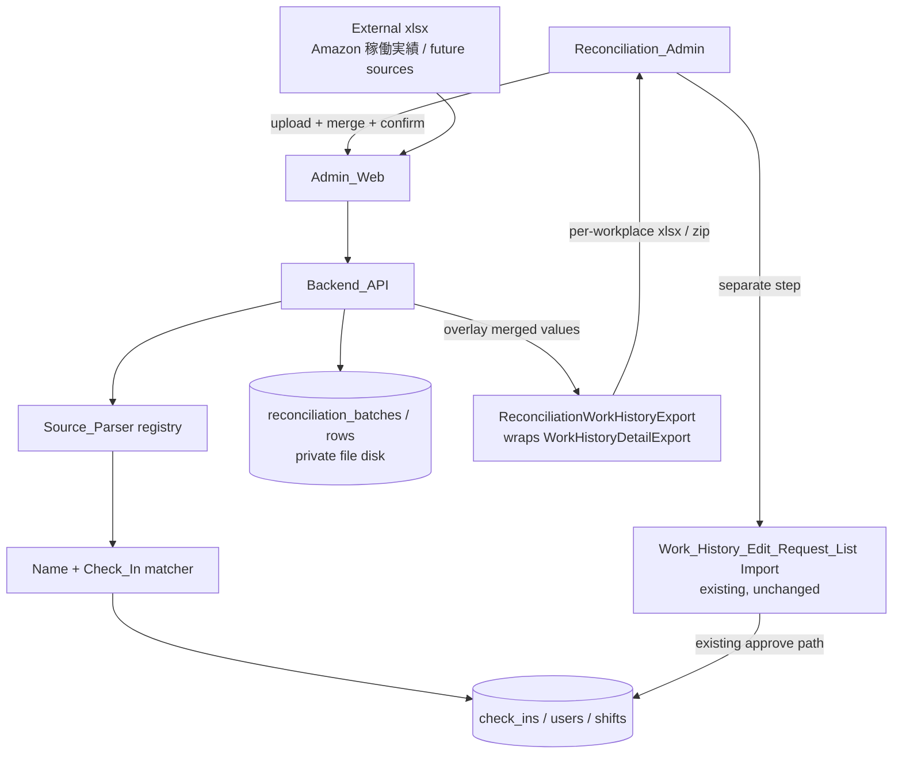
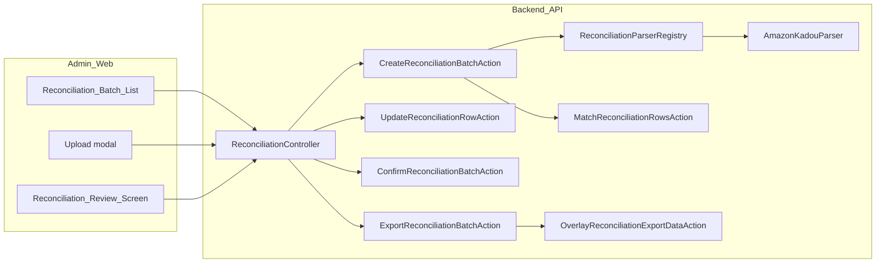
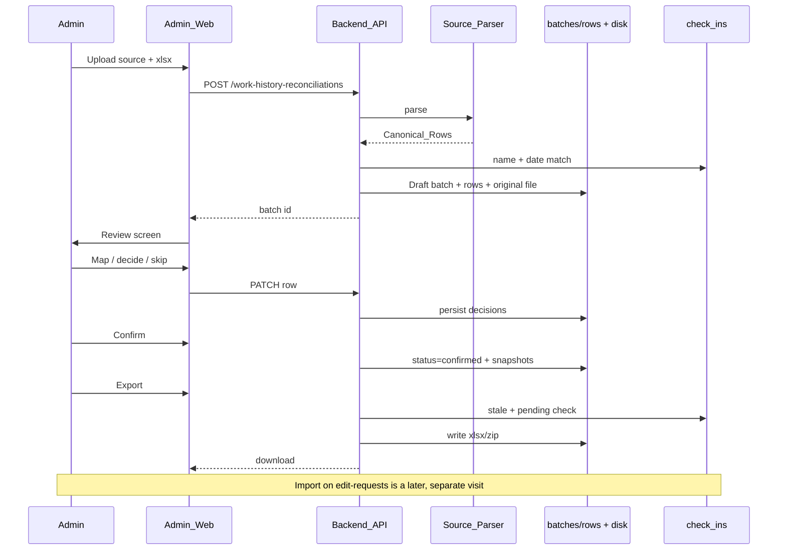

# Design Document: Attendance Reconciliation

## Overview

Reconciliation is a comparison-and-export pipeline, not an attendance writer. A Reconciliation_Admin uploads an external `.xlsx`, a Source_Parser turns punch rows into Canonical_Rows, a matcher attaches DGF users/`Check_In`s, the admin resolves Amazon-vs-DGF field conflicts, Confirm freezes the batch, and export emits Work_History_Detail_Export workbooks (one workplace each) for the existing bulk edit-request import. No code path in this feature inserts or updates `check_ins` or `work_history_edit_requests`.

### Design Goals
- Keep Source-specific knowledge inside parsers; match, merge, history, and export speak only Canonical_Rows.
- Never write payroll attendance from this feature (Requirement 12).
- Produce files the existing import already accepts: one workplace, hidden Check_In_ID, G/H as day-fractions (Requirement 10).
- Treat Reconciliation_Work as company-wide; do not reuse `workplace_access` (Requirement 1).
- Freeze decisions on Confirm so history is an audit record, not a second editor (Requirement 9, 11).

### Key Design Decisions
- **Parser registry, not a switch in the controller.** `ReconciliationParserRegistry` maps `source` → `ReconciliationSourceParser`. A later client file is one class + one enum case.
- **Two tables.** `reconciliation_batches` holds the upload/audit; `reconciliation_rows` holds each Punch_Log plus match, snapshots, and per-field decisions. Counts on the batch are denormalized on write so the list page does not aggregate.
- **Match is two-phase.** Exact indexes over all users (kana / short_name) first; similar-token scan prefers users with a Check_In on that Work_Date, then the rest of the directory. Auto-map only on a unique exact hit.
- **Workplace is a Check_In property**, never parsed from 会社名.
- **Export overlays merged values onto a reconciliation row mapper**, then writes through `ReconciliationWorkHistoryExport`, a wrapper around `WorkHistoryDetailExport`. It does **not** call `buildDetailExportData()` as-is (that method applies `WorkHistoryExport` workplace filters and skips null check-outs) and does **not** edit `WorkHistoryDetailExport.php` or `WorkHistoryService::buildDetailExportData` — those are the DGFC_132 / MR 304 conflict surface.
- **Check_In_ID is always present on the reconciliation file, without forking the shared exporter.** Current `dev` `WorkHistoryDetailExport` has columns A–P only. The wrapper appends hidden `Check_In_ID` as the last column iff the wrappee headings do not already contain that label. After DGFC_132 merges, headings already include `Check_In_ID`; the wrapper reuses it and must not add a second column. Overlay data always sets `check_in_id` on each item so either constructor path can pick it up.
- **Stale re-export compares live `check_in_time`, `check_out_time`, and the raw `break_minutes` column** to the confirm snapshot, not Effective_Break_Minutes (a template change must not look like an attendance edit).
- **Upload max 10 MB** (`max:10240` KB). The Amazon sample is ~42 KB; 2 MB would also work, but formatted 稼働実績 files grow fast. Parse+match stays synchronous (NFR: 500 punch rows / 30 s).
- **Draft row PATCHes persist immediately** so a refresh does not lose merge work. Confirm is a single transactional status flip plus snapshot copy.

## Architecture

### System Context



### High-Level Architecture



## Components and Interfaces

### Component 1: Permission `reconciliation.work`

**Purpose**: Gate every reconciliation screen and endpoint, company-wide.

**Responsibilities**:
- Register `PermissionName::ReconciliationWork = 'reconciliation.work'` (PHP) and `RECONCILIATION_WORK` (frontend enum). Role UI groups by the first segment → "Đối soát".
- Migration: `firstOrCreate` + `syncWithoutDetaching` on `RoleId::GlobalAdmin` and `RoleId::Admin` + `flushCache()`, same pattern as `2026_08_24_000001_grant_work_history_edit_request_process_permission.php`.
- Route middleware `permission:reconciliation.work` with no team id. `WorkplaceAwareUserChecker` + `strict_check = false` already treats “has this permission on any team” as enough to pass middleware.
- Do **not** add `reconciliation` to `GetMasterDataAction` workplace_access prefixes. Do **not** call `applyWorkplaceFilter` / `getWorkplaceIdsByPermission` inside reconciliation actions.
- Scanner keys: `t('role|reconciliation')`, `t('role|reconciliation.work')`.

**Interfaces**:
- **Input**: Laratrust role/permission assignment
- **Output**: 403 without the permission; unrestricted Check_In/user visibility with it
- **Dependencies**: Laratrust, Role Management UI (`getPermissionTree`)

**Implementation Notes**:
- Operational caveat (Requirement 1.6): do not attach this permission to a single-site leader role unless that person may reconcile every factory.

### Component 2: `ReconciliationSourceParser` + `ReconciliationParserRegistry`

**Purpose**: Isolate file layout so match/merge/export never branch on Source.

**Responsibilities**:
- Interface:

```php
interface ReconciliationSourceParser
{
    public function source(): string;

    /**
     * @return array{
     *     company_label: ?string,
     *     punch_rows: list<CanonicalRow>,
     *     skipped_non_punch_count: int
     * }
     *
     * @throws ReconciliationFormatException
     */
    public function parse(string $absolutePath): array;
}
```

- `CanonicalRow`: `external_name`, `work_date` (`Y-m-d`), `check_in` / `check_out` (Carbon), `break_minutes` (int), `raw` (JSON-able array of original cells, including 予定/作業 for tooltips).
- Registry: `source` string → parser. Unknown source → 422 `RECONCILIATION_UNKNOWN_SOURCE` before any file is stored.

**Interfaces**:
- **Input**: source key + absolute path of the uploaded workbook
- **Output**: Canonical_Rows + skip count, or format exception
- **Dependencies**: PhpSpreadsheet / Maatwebsite Excel (already in the app)

**Implementation Notes**:
- Tests register a fake second parser (`source = fake_csv`) that returns Canonical_Rows and drives match+export with no Amazon branches (Requirement 3.6).

### Component 3: `AmazonKadouParser`

**Purpose**: Read 稼働実績一覧 into Canonical_Rows (Requirement 4).

**Responsibilities**:
- Accept a workbook whose header row contains 氏名, 作業日, 実打刻 (start `～` end), 休憩. Match headers by prefix/contains so `氏名シメイ` / `実打刻時間ジツダコクジカン` still work. Do not require the sheet to be named `DGF人材開発`.
- Data rows: skip until after the header; skip the `計` total row; skip rows whose 実打刻 start **and** end are empty.
- 氏名: collapse Unicode spaces (including U+3000). 作業日: Excel serial or DateTime → `Y-m-d`. 実打刻 start/end: Excel date-times (overnight end may be serial day+1). 休憩: day-fraction × 1440, rounded to int.
- Store 会社名 on the batch as `company_label` only.
- Store 予定時間 / 作業時間 in `raw` for optional review tooltips; never compare them.

**Interfaces**:
- **Input**: `.xlsx` path
- **Output**: punch_rows, skipped_non_punch_count, company_label
- **Dependencies**: PhpSpreadsheet date conversion (`excelToDateTimeObject`)

**Implementation Notes**:
- Fixture: keep a slim copy of `20260825_DGF人材開発.xlsx` (or a generated equivalent) under `backend/tests/Fixtures/reconciliation/` asserting 48 punch rows, 208 skipped, Work_Date `2026-08-25`.
- Duplicate 氏名+Work_Date: parser still emits two Canonical_Rows; matcher marks `match_status = duplicate_external` (Requirement 4.7).

### Component 4: `MatchReconciliationRowsAction` + name helper

**Purpose**: Attach a DGF user and at most one Check_In per row (Requirements 5–6).

**Responsibilities**:
- Normalize: NFKC, hiragana→katakana, collapse whitespace, trim, `mb_strtoupper` for Latin. No romaji conversion.
- Exact unique match, in order:
    - 1 token: `first_name_kana` OR `last_name_kana` OR Short_Name
    - 2+ tokens: Name_Kana (`last + space + first`) OR reversed given+family OR Short_Name
    - Unique hit → `match_method = exact`, attach `user_id`
    - 2+ hits → `ambiguous`, no auto-map
- Else similar: every Amazon token is a substring of Name_Kana or Short_Name, or the reverse. Rank users with a Check_In on that Work_Date first. Cap stored candidate ids at 10 for the payload; the UI still has search (Requirement 5.5).
- Check_In lookup for a mapped user: `Shift.date = work_date`, else `Shift.adjusted_date = work_date`. Omit test workplaces when `ShouldShowTestWorkplacesAction` says so. Do **not** workplace-filter by the actor's role.
    - 1 row → attach, `workplace_id` from the shift
    - 0 → `no_attendance`
    - 2+ → `needs_check_in_pick`
- Absent `ShiftUser` still compares if a Check_In exists.
- Compare Editable_Fields (Component 5) once a Check_In is attached; set `compare_status` to `matched` or `differs`.
- Pending edit request: flag `has_pending_edit_request` from `WorkHistoryEditRequest` status pending.

**Interfaces**:
- **Input**: Canonical_Rows + actor (for test-workplace visibility only)
- **Output**: persisted `reconciliation_rows` with match fields
- **Dependencies**: `User`, `CheckIn`, `Shift`, `WorkHistoryEditRequest`, `ShouldShowTestWorkplacesAction`

**Implementation Notes**:
- Load candidate users once (`id, first_name, last_name, first_name_kana, last_name_kana, short_name, staff_no, profile_picture`) and index in memory. 500 punches against a few thousand users stays inside the 30 s budget.
- Nepal: use the `short_name` accessor as-is (null column → full `name`).

### Component 5: Field comparison

**Purpose**: Minute-level Amazon vs DGF for the three Editable_Fields (Requirement 7).

**Responsibilities**:
- Time equality: `(hour, minute)` of Canonical_Row vs `Check_In.check_in_time` / `check_out_time`. Ignore seconds. Do not use rounded columns.
- Overnight display: if check-out calendar date is after Work_Date (or after check-in date), UI shows `+1`.
- Null DGF check-out vs present Amazon check-out → differs on check-out.
- Effective_Break_Minutes = `check_ins.break_minutes ?? shift.break_minutes ?? workplace_shift.break_duration ?? 0`. Compare ints to Canonical_Row.break_minutes. Null column + template 60 vs Amazon 60 → matched.
- Differing fields start with `decision_* = null`. Matching fields are stored as `decision_* = dgf` (no click required).

**Interfaces**:
- **Input**: Canonical_Row + Check_In (with shift.workplaceShift)
- **Output**: per-field differ flags + default decisions
- **Dependencies**: none beyond the models

### Component 6: `CreateReconciliationBatchAction`

**Purpose**: Upload → parse → match → persist one Draft, atomically with the stored original file (Requirements 2, 3, Reliability NFR).

**Responsibilities**:
- Validate source + file (`mimes:xlsx`, `max:10240`).
- Parse; on format error or zero punch rows, delete any temp file and return 422 (`RECONCILIATION_INVALID_FORMAT` / `RECONCILIATION_NO_PUNCH_ROWS`) without a batch row.
- Store original on the private disk at `reconciliation/{batch_id}/original.xlsx` after the batch id exists (create batch, store, save path; on later failure roll back batch + file).
- Run matcher; denormalize list counts onto the batch.

**Interfaces**:
- **Input**: actor, source, uploaded file
- **Output**: batch id + row summaries
- **Dependencies**: registry, matcher, Storage

### Component 7: `UpdateReconciliationRowAction`

**Purpose**: Draft-only writes: skip, manual user map, Check_In pick, per-field decisions, bulk apply (Requirement 8).

**Responsibilities**:
- 409 `RECONCILIATION_BATCH_NOT_DRAFT` if Confirmed.
- Manual map: set `user_id`, `match_method = manual`, re-run Check_In lookup + comparison for that row.
- Check_In pick: must belong to the mapped user and to Work_Date via `date` or `adjusted_date`.
- Skip: `skipped = true`; Confirm treats it as resolved; export omits it.
- Field decision: only `amazon` | `dgf` on a field that differs (or already decided).
- Bulk endpoint applies Amazon or DGF to every still-null differing field on the batch.

**Interfaces**:
- **Input**: batch, row, patch payload
- **Output**: updated row JSON
- **Dependencies**: matcher (re-attach Check_In)

### Component 8: `ConfirmReconciliationBatchAction`

**Purpose**: Freeze a complete Draft (Requirement 9).

**Responsibilities**:
- Incomplete → 422 `RECONCILIATION_DECISIONS_INCOMPLETE` listing unfinished row ids. Complete means: every non-skipped row is either mapped with a single Check_In **or** is `no_attendance`/`unmatched` marked skipped; every differing field on an attached Check_In has amazon|dgf.
- `no_attendance` rows may Confirm without skip (they simply never export). Unmatched/similar/ambiguous/duplicate_external **must** be mapped or skipped.
- On success: `status = confirmed`, `confirmed_by/at`, copy live DGF times + Effective_Break + raw `break_minutes` into snapshot columns (idempotent if already confirmed by this user).
- Re-check `has_pending_edit_request` at confirm time so the flag is not stale from upload.

**Interfaces**:
- **Input**: actor, batch
- **Output**: confirmed batch
- **Dependencies**: row completeness rules

### Component 9: `ExportReconciliationBatchAction` + overlay + `ReconciliationWorkHistoryExport`

**Purpose**: Emit import-ready Work_History_Detail_Export files (Requirements 10–11) without touching the DGFC_132 conflict files.

**Responsibilities**:
- Only Confirmed batches.
- Stale check (Requirement 11.2): for every row that would export, compare live `check_in_time`, `check_out_time`, `break_minutes` **column** to snapshot. Any mismatch → 409 `RECONCILIATION_STALE`.
- Pending edit request at export time → omit that row (re-query, do not trust the confirm flag alone).
- Include a row only if: Check_In attached, not skipped, not pending, at least one Editable_Field decided `amazon` that still differs from the snapshot DGF value.
- Nothing to export → 422 `RECONCILIATION_NOTHING_TO_EXPORT`.
- Build each Excel row with a **reconciliation-local mapper** (copy the field list from today's `buildDetailExportData` item, do not edit that method): workplace name, date, shift time, staff_no, names, live rounded columns, live `work_minutes*`, plus always `check_in_id`. Then overlay:
    - G/H: `WorkHistoryService::toDayFraction` of the **merged** check-in/out datetimes
    - rest column: merged break minutes in the same numeric form as today's exporter (`minutes` as the mapper value; `/ 1440` still happens inside `WorkHistoryDetailExport`)
    - Rounded and `work_minutes*` stay live DGF (import ignores them; Requirement 10.8).
- Write via `ReconciliationWorkHistoryExport` (below), not `WorkHistoryDetailExport` directly.
- Group by `workplace_id`. One workplace → one `.xlsx`. Several → zip of `{safeWorkplaceName}.xlsx`. Store under `reconciliation/{batch_id}/export.xlsx` or `export.zip`. Update `exported_by/at` / `export_file_path`.
- Download is a separate GET so Confirm and export retries stay split (Reliability NFR).

**`ReconciliationWorkHistoryExport`** (new class under `App\Exports`):

- **Do not modify** `WorkHistoryDetailExport.php` or `WorkHistoryService::buildDetailExportData`. DGFC_132 edits exactly those: constructor row keys, `headings()` (adds `'Check_In_ID'`), `columnWidths()` Q, `styles()` A1:Q1 + hide Q.
- Construct an inner `WorkHistoryDetailExport($groupByWorkplace)` and decorate:
    1. Read `headings()[0]`. If it already contains `'Check_In_ID'`, use inner headings, collection, widths, and `styles()` unchanged (post-DGFC_132). Inner constructor already writes `check_in_id` from the item array.
    2. If it does not (current `dev`), headings = inner + `'Check_In_ID'`. Walk inner `collection()` in lockstep with the source items (same workplace-header / data / blank-separator order the inner constructor uses). On each data row (has `date` / `staff_no`), append `check_in_id` from the matching source item. Widths copy inner plus last column. `styles($sheet)`: call inner `styles($sheet)`, then hide and number-format the last column (`Check_In_ID`), and bold that header cell (inner still styles `A1:P1` only).
- Import looks up `Check_In_ID` by header name / last technical column, not by assuming Q forever, but the contract is: last heading is `Check_In_ID`, hidden, one id per data row. After merge this is still column Q, same as DGFC_132.
- Tests cover both heading states with a stub wrappee (or a test double of `WorkHistoryDetailExport`) so the “already has Check_In_ID” path is proven **before** DGFC_132 lands.

**Interfaces**:
- **Input**: actor, confirmed batch
- **Output**: stored path + binary download
- **Dependencies**: `WorkHistoryDetailExport` (wrappee, unmodified), `WorkHistoryService::toDayFraction`, ZipArchive (already used by `WorkHistoryExportJob`)

**Implementation Notes**:
- Do not extract `mapCheckInToDetailExportRow` from `WorkHistoryService` in this PR — that edit would sit on the same lines DGFC_132 uses to inject `check_in_id`. Duplicating the small field list in `OverlayReconciliationExportDataAction` is the merge-safe tradeoff; add a comment pointing at `buildDetailExportData`.
- Do not apply `WorkHistoryExport` permission or `whereNotNull('check_out_time')` on this path. Reconciliation_Work is sufficient; a row whose DGF check-out was null but Amazon out was accepted must still export.
- Lifecycle test: confirm → export → `PreviewBulkImportWorkHistoryEditRequestsAction` (when present on the branch) returns old DGF / new Amazon for accepted fields. If import is not on the branch yet, parse the workbook: headers A–P match `WorkHistoryDetailExport`, last heading is `Check_In_ID`, that column is hidden, G/H are day-fractions, data-row ids match the Check_Ins.

### Component 10: Admin_Web pages

**Purpose**: List, upload, merge, confirm, export (Requirements 2, 8, 9, 10).

**Responsibilities**:
- Sidebar Check in group, after Work history edit requests: route `/manage/work-history/reconciliation`, permission `reconciliation.work`.
- List: `DDataTable` + `CommonSearchBox` filters (source, uploader, date range). Columns per Requirement 2.2. “Đối soát mới” opens the upload modal (source select: Amazon 稼働実績; file `.xlsx`).
- Review `/manage/work-history/reconciliation/[id]`: full page, not a modal.
    - Draft: merge radios Amazon | DGF per differing field; bulk accept; skip; map-user modal (candidates + search); Check_In picker when multiple; pending-edit-request badge; Confirm disabled until complete.
    - Confirmed: read-only + Export / Re-export. Copy that Import is a separate step and needs Work_History_Edit_Request_Process.
- Overnight `06:03 (+1)`. All strings via `t(...)`.
- Optional Draft delete (Requirement 11.5 MAY): trash on list/detail for Draft only.

**Interfaces**:
- **Input**: reconciliation API
- **Output**: list + review UX
- **Dependencies**: Mantine, existing `DDataTable` / `UserWithAvatar` / `CommonSearchBox`

### Component 11: User search for manual map

**Purpose**: Attach a user who is not in the similar-candidate list (Requirement 5.5).

**Responsibilities**:
- `GET /manage/work-history-reconciliations/users?q=` gated by Reconciliation_Work, **no** workplace filter.
- Search `staff_no`, `name`, `name_kana`, `short_name` using the same normalization/diacritic helpers existing user search uses.
- Response: id, staff_no, names, avatar, and Check_Ins on the row’s Work_Date (id, workplace, shift time) so the admin can pick person and ca in one step when possible.

**Interfaces**:
- **Input**: query string + optional `work_date`
- **Output**: short user list (page_size default 20)
- **Dependencies**: User filter / `NormalizesDiacritics`

## Data Models

### Entity 1: `ReconciliationBatch`

```typescript
// frontend/src/types/models/reconciliation_batch.d.ts
export type ReconciliationSource = 'amazon_kadou';
export type ReconciliationBatchStatus = 'draft' | 'confirmed';

export interface ReconciliationBatch {
    id: number;
    source: ReconciliationSource;
    original_filename: string;
    company_label: string | null;
    status: ReconciliationBatchStatus;
    punch_count: number;
    skipped_non_punch_count: number;
    matched_count: number;
    differs_count: number;
    unmatched_count: number;
    manual_map_count: number;
    uploaded_by: { id: number; name: string };
    created_at: string;
    confirmed_by: { id: number; name: string } | null;
    confirmed_at: string | null;
    exported_by: { id: number; name: string } | null;
    exported_at: string | null;
    rows?: ReconciliationRow[];
}
```

**Validation Rules**:
- `source` must be a registered parser key
- `status` only `draft` → `confirmed` (no reverse)

**Relationships**:
- hasMany `ReconciliationRow`
- belongsTo uploaded_by / confirmed_by / exported_by (`users`)

### Entity 2: `ReconciliationRow`

```typescript
// frontend/src/types/models/reconciliation_row.d.ts
export type ReconciliationMatchStatus =
    | 'exact'
    | 'similar'
    | 'ambiguous'
    | 'unmatched'
    | 'duplicate_external';

export type ReconciliationCheckInStatus = 'none' | 'single' | 'multiple';
export type ReconciliationCompareStatus = 'not_comparable' | 'matched' | 'differs';
export type ReconciliationDecision = 'amazon' | 'dgf' | null;
export type EditableField = 'check_in_time' | 'check_out_time' | 'break_minutes';

export interface ReconciliationRow {
    id: number;
    external_name: string;
    work_date: string;
    external_check_in: string;
    external_check_out: string;
    external_break_minutes: number;
    scheduled_range?: string | null;
    work_time_range?: string | null;
    match_status: ReconciliationMatchStatus;
    match_method: 'exact_kana' | 'exact_short' | 'manual' | null;
    skipped: boolean;
    user: { id: number; staff_no: string | null; name: string; name_kana: string; profile_picture: string } | null;
    candidates?: Array<{ id: number; staff_no: string | null; name: string; name_kana: string }>;
    check_in_status: ReconciliationCheckInStatus;
    check_ins_options?: Array<{
        id: number;
        workplace_id: number;
        workplace_name: string;
        shift_time: string;
        check_in_time: string | null;
        check_out_time: string | null;
    }>;
    check_in_id: number | null;
    workplace: { id: number; name: string } | null;
    compare_status: ReconciliationCompareStatus;
    has_pending_edit_request: boolean;
    dgf_check_in: string | null;
    dgf_check_out: string | null;
    dgf_break_minutes: number | null;
    decisions: {
        check_in_time: ReconciliationDecision;
        check_out_time: ReconciliationDecision;
        break_minutes: ReconciliationDecision;
    };
}
```

**Validation Rules**:
- `decision_*` only `amazon`/`dgf`/null
- `check_in_id` must belong to `user_id` when both set
- Confirm forbids null decisions on differing fields unless `skipped`

**Relationships**:
- belongsTo batch, user, check_in, workplace

### Schema (Laravel)

`reconciliation_batches`: `source`, `original_filename`, `original_file_path`, `export_file_path` nullable, `company_label` nullable, `status`, integer counts, `uploaded_by`, `confirmed_by/at`, `exported_by/at`, timestamps.

`reconciliation_rows`: `batch_id` FK cascade, `source_row_index`, `external_name`, `work_date`, `external_check_in/out` datetime, `external_break_minutes`, `raw` JSON, `match_status`, `match_method` nullable, `skipped` bool default false, `user_id` nullable, `candidate_user_ids` JSON nullable, `check_in_id` nullable, `workplace_id` nullable, `compare_status`, `has_pending_edit_request` bool, snapshot columns (`snapshot_dgf_check_in/out`, `snapshot_effective_break`, `snapshot_break_column`), `decision_check_in/out/break` nullable strings, timestamps. Indexes: `(batch_id, match_status)`, `(batch_id, skipped)`, `user_id`, `check_in_id`.

### Data Flow



## API Design

Prefix: `/api/manage/work-history-reconciliations`  
Middleware: auth + `permission:reconciliation.work` on every route.

### List batches

**Method**: `GET`  
**Path**: `/manage/work-history-reconciliations`

**Query**: `source`, `uploaded_by`, `dates[]`, `page`, `page_size` (existing pagination)

**Response**: paginated `ReconciliationBatch` without `rows`

### Create batch (upload)

**Method**: `POST`  
**Path**: `/manage/work-history-reconciliations`  
`multipart/form-data`: `source` (string), `file` (xlsx, max 10240 KB)

**Response**: `201` `{ data: ReconciliationBatch }` including `rows`

**Error Responses**:
- `422 RECONCILIATION_UNKNOWN_SOURCE`
- `422 RECONCILIATION_INVALID_FORMAT` (`reason` + expected vs found)
- `422 RECONCILIATION_NO_PUNCH_ROWS`
- `403` missing permission

### Show batch

**Method**: `GET`  
**Path**: `/manage/work-history-reconciliations/{id}`

**Response**: batch + rows. Draft includes `candidates` / `check_ins_options` where relevant.

### Patch row

**Method**: `PATCH`  
**Path**: `/manage/work-history-reconciliations/{id}/rows/{rowId}`

**Request**:
```json
{
    "skipped": false,
    "user_id": 12,
    "check_in_id": 345,
    "decisions": {
        "check_in_time": "amazon",
        "check_out_time": "dgf",
        "break_minutes": "amazon"
    }
}
```

**Error Responses**:
- `409 RECONCILIATION_BATCH_NOT_DRAFT`
- `422` invalid user / Check_In / field

### Bulk decide remaining

**Method**: `POST`  
**Path**: `/manage/work-history-reconciliations/{id}/bulk-decide`  
**Request**: `{ "side": "amazon" | "dgf" }`  
Applies to unresolved differing fields only. 409 if not Draft.

### Confirm

**Method**: `POST`  
**Path**: `/manage/work-history-reconciliations/{id}/confirm`

**Error Responses**:
- `422 RECONCILIATION_DECISIONS_INCOMPLETE` `{ unfinished_row_ids: number[] }`
- `409` already confirmed (idempotent 200 is also allowed; prefer 200 with the confirmed resource)

### Export

**Method**: `POST`  
**Path**: `/manage/work-history-reconciliations/{id}/export`  
Builds the file, stores it, returns `{ filename, content_type }`.

**Method**: `GET`  
**Path**: `/manage/work-history-reconciliations/{id}/export`  
Downloads the last stored export (`application/vnd.openxmlformats-officedocument.spreadsheetml.sheet` or `application/zip`).

**Error Responses**:
- `409 RECONCILIATION_STALE`
- `422 RECONCILIATION_NOTHING_TO_EXPORT`
- `409` if not Confirmed

### Original file

**Method**: `GET`  
**Path**: `/manage/work-history-reconciliations/{id}/original`  
Private-disk download of the uploaded workbook.

### User search

**Method**: `GET`  
**Path**: `/manage/work-history-reconciliations/users?q=&work_date=`

### Delete draft (optional)

**Method**: `DELETE`  
**Path**: `/manage/work-history-reconciliations/{id}`  
Only Draft. Deletes DB rows and stored original file. 409 if Confirmed.

## Security Considerations

### Authentication
- Same Admin_Web session as other `/manage/*` routes.

### Authorization
- Every endpoint: `reconciliation.work`.
- Data plane: no workplace team filter (Requirement 1.4–1.5).
- Import of the exported file remains `work_history.process_edit_request` + workplace team on that existing controller. Reconciliation must not call it.

### Data Protection
- Original and export files on the default private disk, not `public`.
- Download endpoints require Reconciliation_Work.
- Candidate payloads omit email, address, papers.

### Input Validation
- Source enum, xlsx mime + size, integer ids, decision enum.
- Parser rejects workbooks that do not satisfy that Source’s header contract before match runs.

## Error Handling

### Upload / parse

| Scenario | Handling |
|----------|----------|
| Unknown source | 422 `RECONCILIATION_UNKNOWN_SOURCE` |
| Not xlsx / too large | 422 validation (same shape as Shift CSV import) |
| Missing 氏名 / 実打刻 headers | 422 `RECONCILIATION_INVALID_FORMAT` with expected vs found |
| Zero Punch_Logs | 422 `RECONCILIATION_NO_PUNCH_ROWS` |
| Parse throws after batch insert | Transaction rollback + delete stored file |

### Match / merge

| Scenario | Handling |
|----------|----------|
| Ambiguous / similar | Row status, no auto-map; UI search |
| Duplicate 氏名+date | `duplicate_external`; skip or map each row separately |
| Multiple Check_Ins | `check_in_status = multiple`; Confirm blocked until pick or skip |
| Confirmed PATCH | 409 `RECONCILIATION_BATCH_NOT_DRAFT` |
| Incomplete Confirm | 422 + `unfinished_row_ids` |

### Export

| Scenario | Handling |
|----------|----------|
| Not confirmed | 409 |
| Live Check_In drifted vs snapshot | 409 `RECONCILIATION_STALE` |
| No amazon-accepted diffs | 422 `RECONCILIATION_NOTHING_TO_EXPORT` |
| Pending edit request on a row | Omit row; if that empties the export, 422 nothing-to-export |
| Export IO failure | Batch stays Confirmed; admin retries |

## Performance Considerations

### Expected Load
- **Concurrent Users**: a handful of back-office Reconciliation_Admins, not employees
- **Requests per Second**: low; the expensive call is one POST upload per file
- **File size**: ≤ 10 MB; ≤ 500 Punch_Logs + ≤ 2,000 skipped rows per NFR

### Optimization Strategies
- Exact-match indexes in memory from one `users` query; Check_Ins for the file’s Work_Dates in one query (`whereIn date or adjusted_date`) with `user` / `shift.workplace` / `workplaceShift` / latest pending request eager-loaded.
- Similar scan: users-with-Check_In-that-day first.
- List page uses denormalized counts; no `withCount` over rows.
- Export writes one workplace at a time (same memory bound as `WorkHistoryExportJob`).

## Testing Strategy

PHPUnit method names are camelCase (`testCheckInSuccess()`). Feature tests reach state through real actions (upload → patch → confirm → export), not by inserting `status = confirmed` except where a prior test already proved that path.

### Unit Tests

**`AmazonKadouParserTest`**:
- Sample/fixture file: 48 punches, 208 skipped, date 2026-08-25
- Overnight 実打刻 `20:19 ~ 06:03`
- Break day-fraction → 60
- Ideographic space in 氏名
- Missing 実打刻 skipped
- 予定/作業時間 not copied into Canonical_Row compare fields
- Bad headers throw format exception
- 会社名 is label only

**`ReconciliationNameMatcherTest`**:
- 2-token = Name_Kana unique → exact
- 1-token = first_name_kana unique → exact
- 1-token family name shared by many → ambiguous
- Reversed given+family
- Short_Name exact (Latin)
- Nepal null short_name uses full name accessor
- Similar substring, no auto-map
- NFKC / hiragana / spaces
- No kana↔Latin accidental match

**`ReconciliationFieldCompareTest`**:
- Minute equality ignores seconds
- Rounded columns ignored
- Effective break 60 vs null column + template 60 → match
- Null DGF checkout vs Amazon out → differs

**`ReconciliationParserRegistryTest`**:
- Unknown source errors
- Fake second parser participates in match/export with no Amazon types

### Feature / HTTP Tests

**`ReconciliationPermissionTest`**:
- 403 without permission; menu relies on frontend permission (assert API)
- Role assigned only to workplace A still matches a Check_In at workplace B
- Global Admin and Admin receive the permission after the migration
- `workplace_access` JSON has no `reconciliation` key

**`CreateReconciliationBatchTest`**:
- Happy path persists Draft + original file + rows
- Format error creates no batch and no orphan file
- Zero punches: no batch
- Duplicate file bytes → second independent batch

**`UpdateAndConfirmReconciliationBatchTest`**:
- Manual map + Check_In pick + decisions persist
- Confirm incomplete 422
- Confirm success freezes; PATCH 409
- Confirm retry idempotent
- Skip unmatched allows confirm
- Multiple Check_Ins require a pick
- Overnight adjusted_date match
- Absent Check_In still comparable
- Pending request flagged

**`ExportReconciliationBatchTest`**:
- One workplace → xlsx with A–P + hidden Check_In_ID; G/H day-fractions; break overlay
- Two workplaces → zip of two xlsx; each single-workplace
- Wrapper: inner headings without Check_In_ID → file has hidden last Check_In_ID, not duplicated; inner headings already with Check_In_ID (test double) → still exactly one such column
- Combined-file would be CROSS_WORKPLACE if fed to import (assert via preview action when present)
- Keep-all-DGF / unmatched / no Check_In / pending omitted
- Nothing-to-export 422
- Lifecycle: accept Amazon in → export → import preview old/new (when import exists)
- Upload→confirm→export does not change `check_ins` or create edit requests
- Re-export OK when live equals snapshot; 409 stale after a real approve-edit on that Check_In
- Export does not require `work_history.export` or `work_history.process_edit_request`

### Frontend tests

**`reconciliation/index.page.test.tsx`**:
- Renders list; hides without permission
- Upload modal requires source + xlsx

**`reconciliation/[id].page.test.tsx`**:
- Differing field radios; Confirm disabled while unresolved
- Bulk accept
- Confirmed read-only + export
- +1 overnight label
- Map modal search field present

### Test Configuration

- Fixture xlsx under `backend/tests/Fixtures/reconciliation/`
- Fake parser bound in the registry only in tests
- Use existing Check_In / User / Shift factories; Sri Lanka nationality when asserting Short_Name

## Requirement traceability

| Requirement | Design |
|-------------|--------|
| 1 | Component 1, permission tests |
| 2 | Component 10, list/create API |
| 3 | Components 2, registry tests |
| 4 | Component 3 |
| 5 | Component 4, user search API |
| 6 | Component 4 Check_In lookup |
| 7 | Component 5 |
| 8 | Components 7, 10 |
| 9 | Component 8 |
| 10 | Component 9 + `ReconciliationWorkHistoryExport` wrapper (no edits to `WorkHistoryDetailExport`) |
| 11 | Component 9 stale + download original |
| 12 | Component 9 + export feature test |
| NFR performance | two-phase match, denormalized counts |
| NFR security | private disk, permission middleware |
