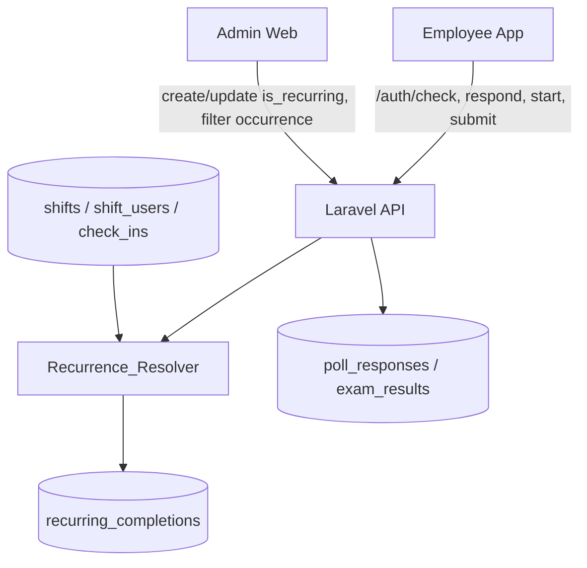
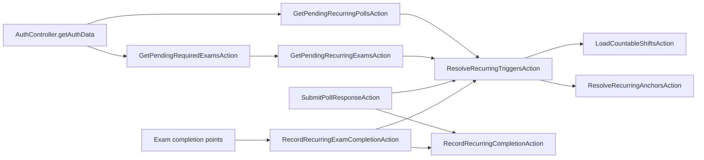
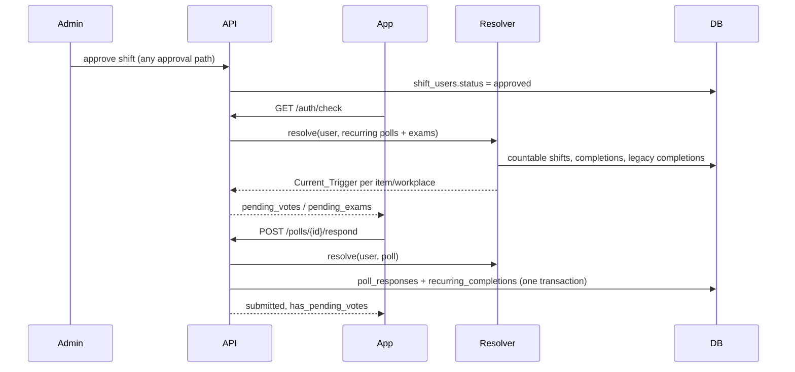

# Design Document: Recurring Feedback Polls and Exams

## Overview

Recurrence is computed at read time from shift data instead of being scheduled or hooked into shift approval. A single resolver walks an employee's countable shifts at a workplace from the position recorded at the last completion (the Anchor) and returns the Current_Trigger, if any. Completions are recorded per workplace in a new `recurring_completions` table that stores the Anchor position, so the Anchor survives shift deletion. `poll_responses` and `exam_results` gain `workplace_id` and `occurrence` for filtering. Non-recurring polls and exams keep their current code paths. External-form exams cannot be recurring.

### Design Goals
- Reflect every shift change (approval from any approval path, rejection, absence, check-out, deletion) on the next `/auth/check` without jobs, observers or hooks.
- Keep the employee app contracts unchanged; the backend derives cycle, workplace and occurrence.
- Keep one-time guarantees for Vote polls, non-recurring Feedback polls and non-recurring exams enforced by the database.
- Bound the number of queries per `/auth/check` regardless of shift count and recurring item count.

### Key Design Decisions
- **Read-time evaluation over event hooks**: shifts are approved from `AssignShiftUsersAction`, `FinalizeShiftPlanAction`, `AddUsersToShiftAction`, employee registration and other paths, and later changed by rejection, absence, check-in deletion and shift deletion. Hooking every path is fragile; walking the shift list per request is cheap and self-correcting.
- **Anchor = the later of the trigger shift and the latest worked shift at completion time**: an employee who completes late, or who is asked for the first time with a long shift history, restarts the 10-shift count from where they are. Anchoring on the trigger shift alone would ask them again after only a few shifts.
- **Anchor stored as a position, not only a foreign key**: `recurring_completions` stores `anchor_shift_user_id` (nullable, `nullOnDelete`) plus `anchor_date`, `anchor_start_at` and `anchor_sort_id`. Deleting or rejecting the anchor shift does not reset the cycle (Requirement 7.5).
- **Gap measured against the previous countable shift, not the previous worked shift**: approving a month of shifts in advance must not look like a 30-day break. The Gap_Reference is the later of the Anchor date and the previous Countable_Shift, so an unworked Upcoming_Shift drops out once its date passes and the walk self-corrects.
- **Separate completion table, strictly per workplace**: recurrence belongs to a workplace. Every completion writes exactly one `recurring_completions` row for the workplace of the response or result. An employee pending for the same exam at two workplaces completes it once per workplace; the attempt for the second workplace starts after the first one is completed.
- **Recurring items have no end date**: `polls.expires_at` and `exams.end_at` are forced to null on save and ignored at read time.
- **Only Feedback polls and assessment exams**: external-form exams complete through a sweep of every `pending_external` row of the user and exam, which cannot be scoped per round without reworking that flow. They are rejected for recurring.
- **`occurrence` NOT NULL DEFAULT 1**: existing and non-recurring rows become occurrence 1, which matches Legacy_Completion = Occurrence 1 (Requirement 6.3). `poll_responses` unique changes from `(user_id, poll_id)` to `(user_id, poll_id, occurrence)`. This keeps one response per employee for non-recurring polls, because the occurrence is always 1, and blocks duplicate submits for the same round of a recurring poll.
- **Exam completion binds to the trigger resolved at completion time**: this implements "an in-progress attempt that passes counts for the newest trigger" (Requirement 5.4) without re-binding rows.
- **Legacy completions are resolved dynamically**: there is no backfill when `is_recurring` is switched on. A completion without a workplace anchors at the latest Worked_Shift on or before its completion date (Requirement 6.1). Turning the flag off and on again needs no data migration.
- **Cumulative `result_counters` stays as is**: per-occurrence Feedback counters are aggregated from `poll_responses.answer` only when an `occurrence` filter is requested.

### API Change Summary

**Admin poll/exam payload, before:**
```json
{ "type": "feedback", "target_type": "workplace", "workplace_id": 3, "is_required": false, "expires_at": "2026-12-31 23:59:59" }
```

**After:**
```json
{ "type": "feedback", "target_type": "workplace", "workplace_id": 3, "is_required": true, "expires_at": null, "is_recurring": true }
```

Employee endpoints are unchanged in shape. `pending_votes`, `pending_exams`, `/polls/{poll}/respond`, `/exams/*` return the same fields with cycle-aware values.

## Architecture

### System Context



### High-Level Architecture



## Components and Interfaces

### Component 1: LoadCountableShiftsAction

**Purpose**: Load the Countable_Shifts of one employee at a set of workplaces in one query.

**Responsibilities**:
- Select `shift_users` joined to `shifts`, `workplace_shifts` and left-joined `check_ins` where `shift_users.user_id = ?`, `status = approved`, `is_absent = false`, `shifts.workplace_id IN (?)`.
- Keep a row if `check_ins.check_out_time IS NOT NULL` (worked) OR `shifts.date >= today` (upcoming).
- Order by `shifts.date`, `workplace_shifts.start_time`, `shift_users.id`.

**Interfaces**:
- **Input**: `User $user`, `Collection<int> $workplaceIds`
- **Output**: `Collection<int workplaceId, list<CountableShift>>`
- **Dependencies**: none

**Implementation Notes**:
- `CountableShift` is a readonly value object `{shiftUserId, workplaceId, date: CarbonImmutable, startAt: CarbonImmutable, worked: bool}` in `app/Data/Recurring/`.
- `startAt = date + start_time` with the same parsing as `WorkHelper::getShiftTimes`.
- "today" is `now()` in `APP_TIMEZONE` (Asia/Tokyo).
- A `ShiftPosition {shiftUserId, date, startAt, sortId}` value object orders shifts and anchors by `(date, startAt, sortId)`.

_Requirements: 3.5, 3.6, 3.8_

### Component 2: ResolveRecurringAnchorsAction

**Purpose**: Return the Anchor and the last occurrence per `(item, workplace)` for one employee.

**Responsibilities**:
- Read `recurring_completions` for the user and the given items: latest row per `(completable_type, completable_id, workplace_id)` by `occurrence`, returning its stored anchor position.
- For items/workplaces without a row, look up a Legacy_Completion:
    - poll: the earliest `poll_responses` row for the poll with `workplace_id IS NULL`; completion date is `created_at`
    - exam: the latest `exam_results` row with `workplace_id IS NULL` and `score >= min_score`; completion date is `completed_at`
- Convert a Legacy_Completion into an Anchor at the latest Worked_Shift at that workplace with `date <= completion date`, using the shifts from Component 1, with `lastOccurrence = 1`. If there is none, there is no Anchor and `lastOccurrence = 1`, so the next occurrence is 2.

**Interfaces**:
- **Input**: `User`, list of `RecurringTarget {type, id, workplaceIds}`, shifts from Component 1
- **Output**: `array<string key, RecurringAnchor {position: ShiftPosition|null, lastOccurrence: int}|null>` keyed by `"{type}:{id}:{workplaceId}"`; `null` means no history
- **Dependencies**: `RecurringCompletion`, `PollResponse`, `ExamResult`

**Implementation Notes**:
- One query for `recurring_completions`, and one query per item type for legacy rows. Both use `whereIn` on item ids.

_Requirements: 6.1, 6.2, 6.3, 7.5_

### Component 3: ResolveRecurringTriggersAction (Recurrence_Resolver)

**Purpose**: Apply the Trigger_Rule and return the Current_Trigger per `(item, workplace)`, together with the Anchor position to record if the employee completes it now.

**Responsibilities**:
- For each target workplace, walk the Countable_Shifts strictly after the Anchor position.
- Return the latest Trigger_Shift, the next occurrence (`lastOccurrence + 1`, or 1 when there is no history) and the completion anchor.
- The completion anchor is the later position of the Trigger_Shift and the latest Worked_Shift at that workplace.

**Interfaces**:
- **Input**: `User`, `list<RecurringTarget>`
- **Output**: `array<key, RecurringTrigger {workplaceId, trigger: ShiftPosition, completionAnchor: ShiftPosition, occurrence}|null>`
- **Dependencies**: Components 1 and 2

**Implementation Notes** (walk per workplace):

```text
prev        = anchor.position             // null when there is no Anchor
workedSince = 0                           // Worked_Shifts strictly after prev
gapRef      = anchor.position?.date       // Gap_Reference
current     = null
for s in shifts strictly after anchor.position:
    isTrigger = prev == null
             or workedSince == 9
             or (gapRef != null and s.date.diffInDays(gapRef) > 30)
    if isTrigger:
        current = s; prev = s; workedSince = 0
    elif s.worked:
        workedSince += 1
    gapRef = s.date
if current == null: return null
latestWorked = last worked shift in the whole list, or null
completionAnchor = max(current, latestWorked) by position
return {current, completionAnchor, occurrence}
```

Worked examples (one workplace, "Wn" = worked, "Un" = upcoming):

| Case | Shifts after the Anchor | Current_Trigger | Anchor after completion |
|------|-------------------------|-----------------|-------------------------|
| New employee | U1 (5/10) | U1 | U1 |
| 10-shift cycle | Anchor W1; W2…W10, U11 | U11 | U11 |
| Two upcoming | Trigger W1; W2…W9, U A, U B | none; B once A is worked | — |
| Upcoming trigger removed | W1 Anchor; W2…W10, U A removed, U B | B | B |
| Month in advance | Anchor 20/9; W up to 27/9; U 1/10…31/10 | none from the gap rule | — |
| Long break | Last W 10/8; U 20/9 | U 20/9 (41 days) | U 20/9 |
| Exactly 30 days | Last W 10/8; U 9/9 | none | — |
| Late completion | Trigger W11; W12…W15 worked before completing | W11 | W15; next trigger is the 10th shift after W15 |
| Missed occurrences | No completion since Anchor W1; W11 and W21 both qualify | W21, occurrence +1 | W21 or later |
| Long history, first time | No Anchor; W1…W57 | W51 | W57; next at W67 |
| Upcoming Anchor never worked | Anchor U 5/10 later removed; next U 20/1 | U 20/1 (gap from 5/10) | U 20/1 |

- Gap: `diffInDays` compares calendar dates, and "more than 30" is strict (Assumption).
- Shift loading happens once per request for the union of all target workplaces.

_Requirements: 3.1–3.13_

### Component 4: RecordRecurringCompletionAction

**Purpose**: Persist one Completion for one `(item, workplace, trigger)`.

**Responsibilities**:
- Insert into `recurring_completions` with `trigger_shift_user_id`, the completion anchor position, `occurrence`, `source_type` / `source_id` and `completed_at = now()`.
- Rely on unique `(user_id, completable_type, completable_id, workplace_id, occurrence)` to reject duplicates.

**Interfaces**:
- **Input**: `User`, `Model $item`, `RecurringTrigger`, `Model $source`
- **Output**: `RecurringCompletion`
- **Dependencies**: none

_Requirements: 3.12, 7.2, 7.4_

### Component 5: GetPendingRecurringPollsAction and pending vote changes

**Purpose**: Add recurring Feedback polls to `pending_votes`.

**Responsibilities**:
- Candidates: `Poll::active()->where('is_recurring', true)->where('type', feedback)->where('target_type', workplace)->whereIn('workplace_id', userWorkplaceIds)`, only for approved users with `staff_no`.
- Keep the candidates with a Current_Trigger from Component 3.
- `GetPendingPollsAction` excludes `is_recurring = true` polls, so the existing responded-once logic applies only to one-time polls.
- `EvaluatePendingVotesFlagAction::__invoke` and `getForAuthResponse` merge both lists.
    - `getForAuthResponse` no longer returns early when the flag is false if the user belongs to a workplace with an active recurring poll. The check is one `exists` query.
    - The flag is written as `non-empty(merged)`.
- `SerializePendingPollsAction` output is unchanged.

**Interfaces**:
- **Input**: `User`
- **Output**: `Collection<Poll>` ordered by `id`, merged after one-time polls
- **Dependencies**: Component 3

_Requirements: 4.1, 4.2, 4.6, 4.7, 4.8_

### Component 6: SubmitPollResponseAction changes

**Purpose**: Accept one response per round for recurring Feedback polls.

**Responsibilities**:
- The pre-transaction lifetime `already_responded` check runs only for non-recurring polls.
- Recurring branch, inside the existing transaction after `lockForUpdate()` on the poll:
    1. Resolve the Current_Trigger for `(poll, poll.workplace_id)`. If it is null, throw the existing 422 `poll.already_responded`.
    2. Create `PollResponse` with `workplace_id` and `occurrence = trigger.occurrence`.
    3. Call `RecordRecurringCompletionAction`.
    4. Increment the cumulative `result_counters`, then re-evaluate `has_pending_votes`.
- The non-recurring branch is unchanged (occurrence defaults to 1).
- A `UniqueConstraintViolationException` from either insert maps to 422 `poll.already_responded`.

_Requirements: 4.3, 4.4, 4.5, 7.1, 7.4_

### Component 7: Recurring exam pending, access and results

**Purpose**: Make exam pending lists, list/detail/start/submit/result cycle-aware.

**Responsibilities**:
- `GetPendingRequiredExamsAction`:
    - The existing query adds `where('is_recurring', false)`.
    - A new `GetPendingRecurringExamsAction` selects `is_recurring = true` exams with `start_at <= now` or null, through `ApplyExamAudienceScopeAction` with `includeAttempted: false` (this keeps the 15-day rule). `end_at` is not checked.
    - It resolves triggers for `exam.workplaces ∩ user workplaces` and keeps exams with at least one Current_Trigger.
    - Results are merged and sorted by the existing `start_at desc, id desc`.
- `ResolveExamRoundAction` returns `{activeTrigger, roundResults}` for one user and one recurring exam.
    - `activeTrigger` is the Current_Trigger of the workplace that has an `in_progress` result with that trigger's occurrence, if any. Otherwise it is the Current_Trigger with the earliest trigger position (ties broken by `workplace_id`).
    - `roundResults` are the results with `occurrence = activeTrigger.occurrence` AND `workplace_id` in `(activeTrigger.workplaceId, NULL)`.
- `ExamService::setCustomFieldForExam` for recurring exams:
    - With a trigger, `result`, `retry_count` and `can_view_result` come from `roundResults` (`null` / `0` / `false` when empty).
    - Without a trigger, `result` is the latest Completion and `retry_count` counts only the attempts of that Completion's round (same occurrence and workplace).
- `ExamService::isExamActive` needs no change: recurring exams are required, and required exams already ignore `end_at`.
- `StartOrResumeExamAction` for recurring exams:
    - With no trigger, the existing `ExamAlreadyPassed` 400 applies.
    - With a trigger, it resumes the in-progress row from `roundResults`. A resumed row without a workplace (started before the exam became recurring) is bound to `activeTrigger.workplaceId` and `activeTrigger.occurrence`.
    - Otherwise it creates a new row with `workplace_id = activeTrigger.workplaceId` and `occurrence = activeTrigger.occurrence`.
    - `carryOverCorrectAnswers` receives the round and reads only `roundResults`.
- `GetExamsAction` excludes, through `GetUnavailableRecurringExamIdsAction`, recurring exams for which the employee has no Current_Trigger, no Completion and no in-progress attempt. The ids are computed before the paginated query so pagination stays correct.
- `SubmitExamAnswerAction` for recurring exams:
    - The session is the user's latest `in_progress` result for the exam, not the round `result`. An attempt stays submittable when its trigger disappears.
    - The final submit then follows Component 8.

_Requirements: 5.1, 5.2, 5.3, 5.5, 5.6, 5.7, 5.8, 5.9, 5.10_

### Component 8: RecordRecurringExamCompletionAction

**Purpose**: Record Completions when a recurring exam result passes.

**Responsibilities**:
- Called after a result becomes a Completion at both completion points:
    - `SubmitExamAnswerAction` final submit with `score >= min_score`, inside its existing transaction.
    - `ExamResultCalculation` expiry grading that passes. The job wraps the conditional `where status = in_progress` update and this call in one `DB::transaction`, and calls it only when the update affected one row.
- Skip when the exam is not recurring, or when the result has no `workplace_id`.
- Resolve the Current_Trigger for the result's `workplace_id` only, at that moment, and call `RecordRecurringCompletionAction` with the result as source. A newer trigger at the same workplace is the one recorded, so an attempt started before it counts for it (Requirement 5.4).
- The result keeps its `occurrence`: it is the next occurrence at that workplace both at start and at completion, because no completion can be recorded at the same workplace in between.
- Other workplaces are not touched; if one still has a Current_Trigger, the exam stays pending and the next start binds to it (Requirement 5.5).
- No trigger at completion time (for example, the trigger shift was rejected mid-exam): store no completion. The result stays as history.

_Requirements: 5.4, 5.5, 5.9, 3.9, 7.2_

### Component 9: Admin validation and persistence

**Purpose**: Accept and enforce `is_recurring`.

**Responsibilities**:
- `StorePollRequest` / `UpdatePollRequest`:
    - `is_recurring` is `boolean`.
    - In `after()`, reject when the effective `is_recurring` is true and the type is not feedback or the effective `target_type` is not workplace. Effective means submitted, or else stored on update. `type` is never updatable, so it is always the stored one on update.
- `CreatePollAction` / `UpdatePollAction`:
    - Add `is_recurring` to the create payload and the update whitelist. It is not a locked field.
    - When the effective `is_recurring` is true, force `is_required = true` and `expires_at = null`.
- `CreateUpdateExamRequest`:
    - `is_recurring` is `boolean`.
    - In `after()`, reject when the effective `is_recurring` is true and `workplaces` is empty, or the effective exam type is `external_form_prep`.
- `CreateExamAction` / `UpdateExamAction`: persist `is_recurring`, and when it is set force `is_required = true` and `end_at = null`.
- Admin list/detail resources include `is_recurring`.

_Requirements: 1.1–1.6, 1.9, 2.1–2.5, 2.7, 6.4, 6.5_

### Component 10: Admin occurrence filters

**Purpose**: Filter responses, statistics and results by occurrence.

**Responsibilities**:
- `GetPollResponsesAction`:
    - Optional `occurrence` filter.
    - Eager-load `workplace:id,name`.
    - Each row includes `occurrence`.
- `GetPollAction`:
    - Returns `available_occurrences` (distinct, ascending).
    - With `occurrence`, it returns `result_counters` aggregated from the responses of that occurrence, using the same shape as the stored counters.
- `GetExamStatisticsAction` and `StatisticsRequest`:
    - Optional `occurrence` applied to the base query.
    - For recurring exams, the workplace filter matches `exam_results.workplace_id`, falling back to membership for rows without a workplace. The latest attempt is ranked per `(user_id, workplace_id)`.
    - Response adds `available_occurrences`.
- `ExamResultFilter`, `IndexRequest`, `ExamResultExport`:
    - Optional `occurrence` filter.
    - Rows include `occurrence` and `workplace {id, name}`.
    - Export adds occurrence and workplace name columns.
- `GetExamCompletionStatsAction` is unchanged: it keeps counting employees who completed at least once.

_Requirements: 8.1–8.4_

### Component 11: Admin web

**Purpose**: UI for the flag and the filters.

**Responsibilities**:
- `poll_form.tsx`:
    - "Recurring" checkbox beside `is_required`, visible only for Feedback + workplace, with a tooltip explaining the cadence.
    - Checking it sets and disables `is_required`, and clears and disables the expiry date.
    - Hiding it resets the value to false.
- `exam_form.tsx`:
    - "Recurring" checkbox beside `is_required`, hidden and reset to false when the type is `external_form_prep`.
    - Checking it sets and disables `is_required`, and clears and disables the end date picker; the `start_at < end_at` validator is skipped while it is empty.
    - The form validator requires at least one workplace while it is checked. Employee-targeted exams still submit workplaces, so the rule is on the `workplaces` field.
- `poll/[id]/results/index.page.tsx`:
    - Occurrence Select built from `available_occurrences`, with an "All" option. It drives both `usePollQuery` and `usePollResponsesQuery`.
    - The table adds occurrence and workplace columns.
    - Shown when `is_recurring` or `max(available_occurrences) > 1`.
- `ExamStatistics.tsx`: occurrence Select next to the workplace Select, under the same visibility rule.
- `exam-result/index.page.tsx`: occurrence NumberInput filter and occurrence and workplace columns, always shown. Export passes the filter.
- All new text goes through `t(...)` and the translation flow.

_Requirements: 1.7, 1.8, 2.6, 2.8, 8.5, 8.6, 8.7_

## Data Models

### Entity 1: recurring_completions (new)

| Column | Type | Notes |
|--------|------|-------|
| id | bigint PK | |
| user_id | FK users, cascadeOnDelete | |
| completable_type | string(20) | `poll` or `exam` |
| completable_id | unsigned bigint | poll id or exam id |
| workplace_id | FK workplaces, cascadeOnDelete | |
| occurrence | unsigned smallint | 1-based per user/item/workplace |
| trigger_shift_user_id | FK shift_users, nullable, nullOnDelete | the Current_Trigger that was completed |
| anchor_shift_user_id | FK shift_users, nullable, nullOnDelete | later of trigger and latest worked shift |
| anchor_date | date | Anchor position |
| anchor_start_at | datetime | Anchor position |
| anchor_sort_id | unsigned bigint | Anchor tie-break (original shift_user id) |
| source_type | string(20) | `poll_response` or `exam_result` |
| source_id | unsigned bigint | |
| completed_at | datetime | |
| timestamps | | |

- Unique `(user_id, completable_type, completable_id, workplace_id, occurrence)`.
- Index `(completable_type, completable_id, occurrence)` for admin filters.

### Entity 2: Column additions

| Table | Column | Type | Notes |
|-------|--------|------|-------|
| polls | is_recurring | boolean default false | |
| exams | is_recurring | boolean default false | |
| poll_responses | workplace_id | FK workplaces nullable, nullOnDelete | null for non-recurring and legacy rows |
| poll_responses | occurrence | unsigned smallint NOT NULL default 1 | |
| exam_results | workplace_id | FK workplaces nullable, nullOnDelete | |
| exam_results | occurrence | unsigned smallint NOT NULL default 1 | |

- `poll_responses`: drop `poll_response_user_poll_unique` and add unique `(user_id, poll_id, occurrence)`. The `user_id` FK index requirement is covered by the new composite index, which starts with `user_id`.
- `exam_results`: add index `(exam_id, occurrence)`.

**Validation Rules**:
- `is_recurring = true` requires a Feedback poll with `target_type = workplace`, or an assessment exam with at least one workplace.
- `is_recurring = true` implies `is_required = true` and no end date.
- `occurrence >= 1`.

**Relationships**:
- `RecurringCompletion` belongs to `User`, `Workplace`, and `ShiftUser` (trigger and anchor); `completable` and `source` are resolved by type string. There is no Laravel morph map dependency.
- `Poll`, `Exam` hasMany `RecurringCompletion` through `completable_type` constraints.

### Frontend types

```typescript
// frontend/src/types/models/poll.d.ts
interface Poll {
    is_recurring: boolean;
    available_occurrences?: number[];
}

// frontend/src/types/models/poll_response.d.ts
interface PollResponse {
    occurrence: number;
    workplace?: { id: number; name: string } | null;
}

// frontend/src/types/models/exam.d.ts
interface Exam {
    is_recurring: boolean;
}
interface ExamStatistics {
    available_occurrences: number[];
}

// frontend/src/types/models/exam_result.d.ts
interface ExamResult {
    occurrence: number;
    workplace?: { id: number; name: string } | null;
}
```

### Data Flow



## API Design

### Endpoint 1: Create / Update Poll

**Method**: `POST` / `PUT`
**Path**: `/api/admin/polls`, `/api/admin/polls/{poll}`

**Request** (new field):
```json
{ "is_recurring": true }
```

**Error Responses**:
- `422 Unprocessable Entity`: `is_recurring` with a vote poll or with a non-workplace target.

### Endpoint 2: Get Poll

**Method**: `GET`
**Path**: `/api/admin/polls/{poll}?occurrence=2`

**Response** (additions):
```json
{ "is_recurring": true, "available_occurrences": [1, 2, 3], "result_counters": { "choiceA": 4 } }
```

### Endpoint 3: Poll Responses

**Method**: `GET`
**Path**: `/api/admin/polls/{poll}/responses?occurrence=2&page_size=15`

**Response row** (additions):
```json
{ "occurrence": 2, "workplace": { "id": 3, "name": "Factory A" } }
```

### Endpoint 4: Create / Update Exam

**Method**: `POST` / `PUT`
**Path**: `/api/admin/exams`, `/api/admin/exams/{exam}`

**Request** (new field): `{ "is_recurring": true }`

**Error Responses**:
- `422 Unprocessable Entity`: `is_recurring` with no workplaces, or with type `external_form_prep`.

### Endpoint 5: Exam Statistics

**Method**: `GET`
**Path**: `/api/admin/exams/{exam}/statistics?occurrence=2&workplace_id=3&from=&to=`

**Response** (addition): `{ "available_occurrences": [1, 2] }`

### Endpoint 6: Exam Results List / Export

**Method**: `GET`
**Path**: `/api/admin/exam-results?occurrence=2`, `/api/admin/exam-results/export?occurrence=2`

**Response row** (addition): `{ "occurrence": 2, "workplace": { "id": 3, "name": "Factory A" } }`. The export adds occurrence and workplace name columns.

### Employee endpoints

`/auth/check`, `/polls/{poll}/respond`, `/exams`, `/exams/{exam}`, `/exams/{exam}/start`, `/exams/{exam}/submit` and `/exams/{exam}/result` keep their request and response shapes.

## Security Considerations

### Authentication
- Unchanged: Sanctum tokens for admin and employee routes.

### Authorization
- `is_recurring` writes are covered by `poll.create` / `poll.edit` and `exam.create` / `exam.edit`.
- Occurrence filters are covered by `poll.list`, `exam_result.list` and `exam_result.export`.

### Data Protection
- No new personal data. The poll responses table and exam results expose the workplace name, which admins with these permissions already see.

### Input Validation
- `occurrence` is `nullable|integer|min:1`.
- Employee requests never accept workplace, trigger, anchor or occurrence; the server derives them (Security requirement).

## Error Handling

### Employee

| Scenario | Handling |
|----------|----------|
| Respond to a recurring poll without a Current_Trigger | 422 `poll.already_responded` |
| Two concurrent responds for the same round | Unique index rejects the second; mapped to 422 `poll.already_responded` |
| Start a recurring exam without a trigger after passing | 400 `ExamAlreadyPassed` (existing) |
| Trigger shift rejected or removed while an attempt is in progress | Submit is still accepted; a pass records no completion; the item disappears until a new trigger |
| Other workplace gets an earlier trigger while an attempt is in progress | The in-progress attempt keeps being resumed for its own workplace |
| Completion insert fails | Whole transaction rolls back; the result status update is also rolled back |

### Admin

| Scenario | Handling |
|----------|----------|
| `is_recurring` with a vote poll or a non-workplace target | 422 on `is_recurring` |
| Recurring poll updated to a non-workplace target without `is_recurring = false` | 422 on `is_recurring` |
| `is_recurring` exam without workplaces, or with type `external_form_prep` | 422 on `is_recurring` |
| `is_recurring` with `is_required = false` | Stored as required, no error |
| `is_recurring` poll with `expires_at` or exam with `end_at` | Stored as null, no error |

## Performance Considerations

### Expected Load
- **Concurrent Users**: a few thousand employees opening the app around shift start.
- **Requests per Second**: `/auth/check` peaks at tens per second.

### Optimization Strategies
- Per `/auth/check`, the extra work is at most:
    - one `exists` query for recurring polls at the user's workplaces
    - one candidate query per item type
    - one countable-shift query for the union of workplaces
    - one `recurring_completions` query
    - one legacy query per item type
- The shift walk is O(shifts) in PHP. At 1,000 shifts it is well under 10 ms.
- Skip the resolver entirely when there are no recurring candidates.
- Existing indexes cover the shift query: `shift_users (user_id)`, `shifts (date, workplace_id)`, `check_ins (shift_user_id)` unique. Add an index on `shift_users (user_id, status)` if `EXPLAIN` shows a scan.

## Testing Strategy

### Unit Tests

**ResolveRecurringTriggersAction (`backend/tests/Unit/Actions/Common/Recurring/ResolveRecurringTriggersActionTest.php`):**
- Every row of the worked-examples table in Component 3
- Past approved shift without check-out is ignored for counting and for the Gap_Reference
- Absent shifts are ignored
- Anchor whose shift was deleted still positions the walk
- Legacy_Completion Anchor with and without a Worked_Shift before it
- Two workplaces evaluated independently

### Integration Tests (Feature, real flows)

**`backend/tests/Feature/Api/User/RecurringFeedbackFlowTest.php`:**
- Lifecycle: admin creates a recurring poll, shift is approved through the real endpoint, `/auth/check` lists it, respond, not listed, then check-in/out through the real flow up to the 11th shift, listed again
- Future shift approved via the `AssignShiftUsersAction` endpoint makes the poll pending before its date; reject it through the real endpoint, poll disappears
- A month of shifts finalized in advance through `FinalizeShiftPlanAction` does not make the poll pending
- Late response after extra worked shifts moves the Anchor to the latest worked shift
- Out-of-order approval: a past worked shift added through `AddUsersToShiftAction` after the Anchor counts; one before the Anchor does not
- Respond without a trigger returns 422; double respond for the same round returns 422
- Vote poll and non-recurring Feedback poll keep one-response behaviour with accumulated history
- `has_pending_votes = false` user still receives a due recurring poll

**`backend/tests/Feature/Api/User/RecurringExamFlowTest.php`:**
- Lifecycle: pending, start, fail, retry, pass, not pending, 11th shift, pending with `result = null` and `retry_count = 0`
- In-progress attempt when a newer trigger arrives: pass records the newest trigger
- Employee at two workplaces pending at both: a pass records only the attempt's workplace, the exam stays pending, and the next attempt binds to the other workplace
- In-progress attempt at one workplace when the other workplace gets an earlier trigger: start resumes the same attempt
- Trigger shift rejected during an attempt: submit is accepted, the pass records nothing, the exam is not pending
- Expiry-graded pass in `ExamResultCalculation` records the completion
- Saving a recurring exam with `end_at` stores null; existing recurring exam stays pending regardless of `end_at`
- Legacy passing result before enabling recurring anchors correctly and counts as occurrence 1
- Rollback: force `RecordRecurringCompletionAction` to throw during submit; the result stays in progress and no completion exists

**`backend/tests/Feature/Api/Admin/RecurringAdminTest.php`:**
- Validation: vote + recurring, global + recurring, exam without workplaces, external-form exam return 422; recurring forces required and clears the end date
- Occurrence filters on poll show/responses, exam statistics, exam results list and export

### Frontend Tests
- `poll_form.test.tsx`: checkbox visibility by type/target; checking disables and sets required and clears the expiry date; hiding resets
- `exam_form.test.tsx`: checking disables required, clears and disables the end date; workplace validator while recurring; hidden for external-form type
- `ExamStatistics` / poll results page: occurrence select passes the param and follows the visibility rule

### Test Configuration
- Reuse `tests/Concerns/BuildsExamShiftFixtures.php` for workplace/shift setup; states after the first trigger are produced through the real approval, check-in and check-out endpoints.
