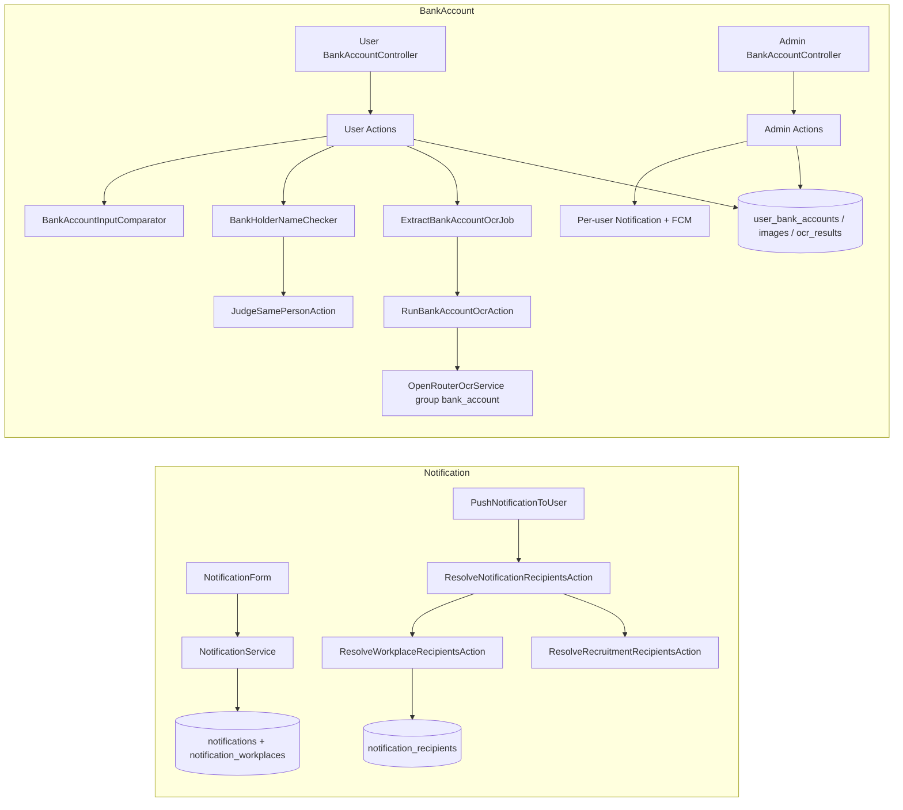
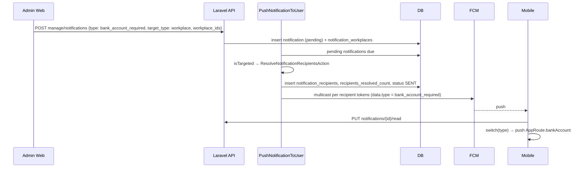

# Design Document: Bank Account Info Collection (DGFC-148)

## Overview

The feature is delivered as two loosely coupled pieces. The first generalizes the admin notification pipeline: a `target_type` on notifications plus a `notification_workplaces` pivot, resolved into the existing `notification_recipients` table at send time, and three new `NotificationType` cases (`bank_account_required`, `bank_account_approved`, `bank_account_rejected`) that the mobile app maps to the bank account screen. The second is a new bank account module with its own tables and state machine, which reuses the lower layers of the document OCR pipeline (`OpenRouterOcrService`, `OcrImagePreparer`, `OcrFieldNormalizer`, `ImageHelper`) but not the `user_paper_*` storage, since payout details are independent of identity-document approval.

### Design Goals
- Reuse the recruitment recipient/visibility machinery for workplace targeting instead of adding a second delivery path.
- Reuse the OCR provider, image preparation, normalization, polling, and mobile capture UI; add only a new OCR group and storage.
- Keep the bank account lifecycle independent of `users.paper_status` so already-approved employees can submit without re-entering the document flow.
- Make every state transition a conditional update so out-of-order job completion or double admin clicks cannot corrupt state.
- Protect account numbers: encrypted at rest, masked by default, unmasked only with the approve permission or for the owner's own draft.

### Key Design Decisions
- **Type-based deep link, no `screen` field.** Mobile already switches on `type`; adding cases is consistent with `paper_*` and `poll_available`. (Requirement 3)
- **`target_type` column + pivot, resolved at send time.** Selection must be editable before sending, so it is stored as a pivot; resolution into `notification_recipients` happens once in `PushNotificationToUser`, reusing `deliverToResolvedRecipients`. (Requirements 1, 2)
- **Separate bank account tables, not new document steps.** Document steps are deleted on paper approval and gated by `paper_status`; the bank record has its own approval and history. (Requirements 4–12)
- **Own OCR result table.** `OcrResultCacheService` is bound to `UserPaperOcrResult` (FK to steps, item ids). A small `RunBankAccountOcrAction` reproduces its run loop against `user_bank_account_ocr_results`. No cross-user cache: bank images are never shared between users. (Requirements 5, 6)
- **Deterministic name check first, LLM second.** The LLM opinion is advisory and stored with its reason; it never blocks or auto-approves. (Requirement 8)
- **One effective record per employee** via `superseded_at`; a new submission creates a new row only when the current row is approved, otherwise the rejected/draft row is reused. (Requirement 11)

### API Change Summary (notifications)

**Before:**
```json
{ "type": "normal", "title": "...", "content": "...", "icon": "money", "url": null, "is_manually_scheduled": false }
```

**After:**
```json
{
  "type": "bank_account_required",
  "title": "...", "content": "...", "icon": "money", "url": null,
  "target_type": "workplace",
  "workplace_ids": [12, 15],
  "is_manually_scheduled": false
}
```
Responses add `target_type`, `workplaces: [{id, name}]`, and `recipients_resolved_count` (already present).

## Architecture

### System Context

```mermaid
graph TB
    Admin[Admin Web - Next.js] -->|manage/notifications| API[Laravel API]
    Admin -->|admin/bank-accounts| API
    Employee[Mobile App - Flutter] -->|user/bank-account/*| API
    Employee -->|user/notifications| API
    API --> DB[(MySQL)]
    API --> Disk[(Private storage users/{id}/bank)]
    API -->|queue| Jobs[Queue workers]
    Jobs -->|OpenRouter chat/completions| LLM[Gemini via OpenRouter]
    Jobs -->|FCM multicast| FCM[Firebase Cloud Messaging]
    FCM --> Employee
```

### High-Level Architecture



## Components and Interfaces

### Component 1: Notification target storage and form (backend + admin web)

**Purpose**: Let admins address a `normal` or `bank_account_required` notification to selected workplaces. (Req 1, 3)

**Responsibilities**:
- Persist `target_type` (`all` | `workplace`) and pivot rows.
- Validate workplace ids exist and are required when `target_type = workplace`.
- Expose target data in list/detail responses.

**Interfaces**:
- **Input**: `StoreRequest` fields `type`, `target_type`, `workplace_ids[]`.
- **Output**: `Notification` with `workplaces` relation loaded.
- **Dependencies**: `Workplace` model, `NotificationService::createOrUpdateNotification`.

**Implementation Notes**:
- Migration `add_target_type_to_notifications_table`: `target_type string(20) default 'all'` indexed; `create_notification_workplaces_table` (`notification_id` FK cascade, `workplace_id` FK cascade, unique pair).
- New enum `NotificationTargetType { All = 'all', Workplace = 'workplace' }`.
- `NotificationType` gains `BANK_ACCOUNT_REQUIRED`, `BANK_ACCOUNT_APPROVED`, `BANK_ACCOUNT_REJECTED`. `StoreRequest` restricts `type` to `Rule::in([NORMAL, RECRUITMENT, BANK_ACCOUNT_REQUIRED])` (today it accepts every value; narrowing is safe because the form never sends others).
- `StoreRequest`: `target_type` required-with-type in `[normal, bank_account_required]`, `workplace_ids` `required_if:target_type,workplace|array|min:1`, `workplace_ids.*` `integer|exists:workplaces,id|distinct`. For `recruitment`, both are unset in the service.
- `NotificationService`: after save, `$notification->workplaces()->sync($workplaceIds)` when `target_type = workplace`, else `sync([])`. For `bank_account_required`, `url` is forced null like recruitment.
- `Notification::workplaces()` BelongsToMany; list endpoint eager-loads `workplaces:id,name`.
- Frontend: `NotificationTypeEnum` adds `BANK_ACCOUNT_REQUIRED`; `NotificationTargetTypeEnum` new; form adds `SegmentedControl` (All / Selected workplaces) and `MultiSelect` of workplaces from master data; `notification_form.ts` validation `workplace_ids` requiredIf target is workplace; list column "Target".

### Component 2: Workplace recipient resolution and delivery (backend)

**Purpose**: Deliver a workplace-targeted notification to members only and hide it from everyone else. (Req 2)

**Responsibilities**:
- Resolve distinct active member ids for the pivot workplaces.
- Persist `notification_recipients` and `recipients_resolved_count`.
- Send multicast pushes per user token, in chunks, both Firebase projects as today.
- Restrict list/detail visibility to recipients.

**Interfaces**:
- **Input**: `Notification` with `target_type = workplace`.
- **Output**: `int[]` recipient user ids.
- **Dependencies**: `workplace_users`, `users.is_disabled`, `PushNotificationToUser::deliverToResolvedRecipients`.

**Implementation Notes**:
- New `ResolveWorkplaceRecipientsAction`: `User::query()->whereHas('workplaces', fn($q) => $q->whereIn('workplaces.id', $ids))->where('is_disabled', false)->pluck('id')`. Test/production boundary: if every selected workplace is `is_test`, keep only `is_test` users; mirror the recruitment rule.
- New `ResolveNotificationRecipientsAction` dispatches by `type`/`target_type` and is what `deliverToResolvedRecipients` calls instead of `ResolveRecruitmentRecipientsAction` directly. It also inserts the `notification_recipients` rows (moved out of the recruitment action if currently inside it; verify during implementation).
- `PushNotificationToUser` branch condition becomes `!$notification->user_id && $notification->isTargeted()`, where `Notification::isTargeted()` = `type === RECRUITMENT || target_type === WORKPLACE`.
- `Notification::scopeVisibleToUser` / `isVisibleToUser`: replace the `type != RECRUITMENT` clause with `NOT isTargeted` expressed as `where(type != recruitment AND target_type = all)`. Keep the `recipients_resolved_count IS NULL` escape hatch for legacy sent rows only, and keep the `SENT` guard in `isVisibleToUser`.
- Admin `manage/notifications` index continues to use `whereNull('user_id')`; unaffected.

### Component 3: Bank account storage and state machine (backend)

**Purpose**: Persist payout details per employee and enforce the lifecycle. (Req 4, 5, 7, 10, 11)

**Responsibilities**:
- Own the `user_bank_accounts`, `user_bank_account_images`, `user_bank_account_ocr_results` tables.
- Provide guarded transitions via conditional updates.
- Determine the "current" (in-progress or latest) and "effective" (approved, not superseded) record.

**Interfaces**:
- **Input**: user actions (choose method, upload, submit, discard), admin decisions, OCR job completion.
- **Output**: `UserBankAccount` models; `BankAccountResource` (user view, masked) and `AdminBankAccountResource`.
- **Dependencies**: `ImageHelper`, `UrlHelper`, enums below.

**Implementation Notes**:
- Enums: `PayoutMethod { BankTransfer = 'bank_transfer', SevenBankAtm = 'seven_bank_atm' }`, `BankAccountStatus { Draft, OcrProcessing, OcrReady, OcrFailed, WaitForApproval, Approved, Rejected }`, `BankAccountType { Ordinary = 'ordinary', Current = 'current', Savings = 'savings', TimeDeposit = 'time_deposit' }`, `BankAccountImageFolder { Current, Old }`, `NameCheckVerdict { Match, Partial, Mismatch }`.
- `UserBankAccount` casts: `account_number => 'encrypted'`, `ocr_fields`, `confirmed_fields`, `name_check`, `input_mismatches` => `array`, status/method to enums.
- Scopes: `scopeEffective()` = `status = approved AND superseded_at IS NULL`; `scopeCurrent()` = latest row by id.
- Transition helper `TransitionBankAccountStatusAction(UserBankAccount, BankAccountStatus $from|array, BankAccountStatus $to, array $extra = []): bool` performing `whereKey()->where('status', $from)->update([...])` and returning whether a row changed. Every transition in the module goes through it.
- OCR budget: `ocr_run_count` on the account, max from `config('bank_account.ocr_max_runs', 3)`; `can_reupload = status ∉ {ocr_processing, wait_for_approval, approved} && ocr_run_count < max`.
- `StartBankAccountCycleAction(User)`: returns the row to work on. If current row is `approved` → create new `draft` row. If `rejected` → reset it (`ocr_run_count = 0`, null OCR/confirmed fields, invalidate OCR results, move images to `old`, status `draft`). If `draft/ocr_*` → return as is. If `ocr_processing`/`wait_for_approval` → throw `BankAccountLocked`.

### Component 4: Upload and OCR pipeline (backend)

**Purpose**: Store card/passbook images, run OCR asynchronously, expose progress. (Req 5, 6)

**Responsibilities**:
- Validate and store 1–2 images.
- Create a pending OCR result, dispatch job after commit.
- Run OCR with fallback, normalize, write status; never overwrite a status the account has already left.

**Interfaces**:
- **Input**: `UploadBankAccountImagesRequest` (`files[]` 1–2, mimes jpg/jpeg/png/webp/heic, max 8 MB).
- **Output**: account resource with `status = ocr_processing`, `ocr_result_id`.
- **Dependencies**: `OpenRouterOcrService`, `OcrImagePreparer`, `OcrFieldNormalizer`.

**Implementation Notes**:
- `UploadBankAccountImagesAction`: inside a transaction: `StartBankAccountCycleAction`, budget check, move `current` images to `old`, `ImageHelper::handleImageUpload($file, "users/{id}/bank")`, insert image rows, invalidate previous OCR results (`invalidated_at`), create `user_bank_account_ocr_results` row (status processing, `image_ids`), transition `draft|ocr_ready|ocr_failed → ocr_processing` with `ocr_run_count + 1`, `ExtractBankAccountOcrJob::dispatch($ocrResultId)->afterCommit()`. If the transition returns false → rollback and throw `BankAccountLocked`.
- `OpenRouterOcrService`: add `GROUP_BANK_ACCOUNT = 'bank_account'`, prompt and schema (fields per Req 6.1; `account_type` enum incl. null; `is_yucho` boolean). Prompt states: Japanese cash card or passbook, holder name may be absent, katakana holder name in full-width, do not guess, strip formatting from numbers, ゆうちょ has 記号/番号 instead of branch/account.
- `OcrFieldNormalizer::normalizeBankAccount`: digits-only + zero-pad (`account_number` 7, `branch_code` 3, `bank_code` 4, `yucho_symbol` 5), `normalizeKanaName` for `holder_name_kana`, `normalizeName` for `holder_name_latin`, enum check for `account_type` (warning `account_type_invalid_value`), warnings on unparsable numbers (`{field}_format`).
- `RunBankAccountOcrAction(UserBankAccountOcrResult)`: mirrors `OcrResultCacheService::run` (refresh, invalidated check, prepare images, extract with `retryWithFallback = true`, normalize, conditional update to completed). On failure writes `failed` + error (100 chars).
- `ExtractBankAccountOcrJob` (`tries = 2`, `timeout = 130`, backoff `[10]`): runs the action, then transitions the account `ocr_processing → ocr_ready|ocr_failed` only if `ocr_result_id` still equals this result. Also sets `ocr_fields` snapshot on the account. A stale job (superseded result) exits silently.
- Config `config/bank_account.php`: `ocr_max_runs`, `max_images`, `name_check_model` (defaults to `services.openrouter.model`).

### Component 5: Submission, name check, input comparison (backend)

**Purpose**: Validate confirmed fields, run the two checks, move to `wait_for_approval`. (Req 7, 8, 9)

**Responsibilities**:
- Validate per `BankAccountConfirmRules`.
- Reject non-ordinary account types and stale `ocr_result_id`.
- Compute `name_check` and `input_mismatches` and store them atomically with the status change.

**Interfaces**:
- **Input**: `SubmitBankAccountRequest`: `ocr_result_id?`, `bank_name`, `bank_code?`, `branch_name?`, `branch_code?`, `account_number`, `account_holder_kana`, `is_yucho`, `yucho_symbol?`, `yucho_number?`.
- **Output**: account resource with `name_check` (user-safe subset) and `status = wait_for_approval`.
- **Dependencies**: `BankHolderNameChecker`, `JudgeSamePersonAction`, `BankAccountInputComparator`, `UserInfo` (for kana names), `User` (Latin names).

**Implementation Notes**:
- `BankAccountConfirmRules::rules(bool $isYucho)`: `bank_name required|string|max:100`; `account_number required|regex:/^\d{1,7}$/` (padded server side); `account_holder_kana required|regex:/^[ァ-ヶー　 ]+$/u|max:60`; `branch_code nullable|regex:/^\d{3}$/`; `branch_name nullable|max:100`; `required_without` between `branch_name`/`branch_code` unless `is_yucho`; `yucho_symbol required_if:is_yucho,true|regex:/^\d{5}$/`; `yucho_number required_if:is_yucho,true|regex:/^\d{1,8}$/`.
- `SubmitBankAccountAction`: transaction; status must be `ocr_ready|ocr_failed`; if `ocr_result_id` on the account is non-null it must equal the request value, else `BankAccountChanged`; if OCR `account_type` ∈ {current, savings, time_deposit} → `BankAccountTypeNotAllowed` (server-side guard behind the mobile block); store `confirmed_fields` + columns (`account_type = ordinary`), `entered_manually = ocr_result_id === null`; run checker and comparator; conditional transition to `wait_for_approval`.
- `BankHolderNameChecker::check(User $user, string $holderKana, ?string $holderLatin): array`:
  - `normalizeKana`: NFKC → full-width katakana (`mb_convert_kana('KVC')`), hiragana→katakana, drop spaces/`・`/`　`, map small kana variants (ヴ→ブ optional table), remove `ー`.
  - Tokens: registered parts = `[last_name_kana, first_name_kana]` each split by space; holder parts = holder split by space, or, when unsplit, tested as concatenation. Verdict `match` if multiset of normalized tokens equal OR concatenations equal in either order; `partial` if every holder token is a registered token and at least one registered token missing (or vice versa); else `mismatch`.
  - Latin path: `strtoupper`, remove spaces and hyphens, compare concatenations in both orders against `holder_name_latin`.
  - Output: `{verdict, kana: {registered, holder, normalized_equal}, latin: {...}|null, warnings: ['kana_unavailable'?], ai: null}`.
- `JudgeSamePersonAction(array $nameCheck, User $user, string $holderKana, ?string $holderLatin): array` called only when verdict is `mismatch`: OpenRouter JSON-schema call with `{verdict: same_person|different_person|uncertain, confidence: 0-1, reason: string}`; prompt includes registered Latin + kana names, nationality, holder kana/latin, and Japanese-bank naming conventions (order swap, dropped middle name, 30-char truncation, half-width). Timeout 20 s; on exception returns `{available: false}`. Runs inside the request but after the DB write is prepared; if it fails the submission still commits (Req 8.6).
- `BankAccountInputComparator::compare(array $ocrFields, array $confirmed): array` per Req 9.1–9.5, normalizing names with `mb_convert_kana('asKV')` + removing `銀行|支店|信用金庫|出張所`, numbers via digits + pad. Returns `[{field, ocr_value, input_value}]`.

### Component 6: Admin review API and page (backend + admin web)

**Purpose**: Let admins list, inspect, approve, and reject. (Req 10, 11.4)

**Responsibilities**:
- Paginated list with filters; detail with images, OCR, confirmed, checks, history.
- Approve/reject with conditional transition, supersede previous effective row, notify employee.
- Enforce permissions and masking.

**Interfaces**:
- **Input**: `IndexRequest` (`workplace_id[]`, `status[]`, `payout_method`, `has_warning`, `keyword`, pagination), `RejectRequest` (`note required|max:500`).
- **Output**: `AdminBankAccountResource`, `AdminBankAccountDetailResource`.
- **Dependencies**: `PermissionName::BankAccountList`, `BankAccountApprove`; `Notification` creation pattern from `ApprovePapersAction`; `lang/*/lang.php` keys `bank_account_approved`, `bank_account_rejected`.

**Implementation Notes**:
- `GetBankAccountsAction`: base query = latest row per user (`whereIn('id', subquery max(id) group by user_id)`), joins `users`, `user_infos.staff_no`, eager `user.workplaces:id,name`; `has_warning` = `name_check->verdict != match OR JSON_LENGTH(input_mismatches) > 0 OR entered_manually`.
- `ApproveBankAccountAction`: transaction; transition `wait_for_approval → approved` with `approver_id`, `approved_at`; `UserBankAccount::where('user_id')->effective()->whereKeyNot($id)->update(['superseded_at' => now()])`; create per-user notification (`type = bank_account_approved`, translations for all locales from `lang.bank_account_approved`), push through the existing pending-notification job (status pending, `scheduled_at = now()`).
- `RejectBankAccountAction`: same with `rejected`, `rejected_note`, notification `bank_account_rejected` with note in content.
- `ChooseSevenBankAtmAction` (user side, but same supersede logic): create row `payout_method = seven_bank_atm`, `status = approved`, `approved_at = now()`, `approver_id = null`; supersede previous effective; discard any in-progress draft row of the user (delete draft row and its images) unless it is `ocr_processing`/`wait_for_approval` → `BankAccountLocked`.
- Masking: `AdminBankAccountResource` returns `account_number_masked` (`***` + last 3) always and `account_number` only when `Gate::allows(BankAccountApprove)`.
- Frontend: route `ADMIN_BANK_ACCOUNT` (`/admin/bank-account`), sidebar entry under the same group as user papers, page `frontend/src/pages/admin/bank-account/index.page.tsx` with `CommonSearchBox`, filters, `DataTable`; `partials/bank_account_detail_drawer.tsx` (images with lightbox, two-column OCR vs input with red highlight via `bank_account_compare.ts`, name check alert with AI reason, history list, approve/reject modals). Enums `payout_method.enum.ts`, `bank_account_status.enum.ts`, `name_check_verdict.enum.ts`; types `frontend/src/types/models/bank_account.d.ts`.

### Component 7: Mobile bank account flow (Flutter)

**Purpose**: Everything the employee sees. (Req 3.4–3.5, 4, 5, 7, 11.6, 12)

**Responsibilities**:
- Status hub screen, method selection, capture, processing, confirm, result screens.
- Deep link from notification types.
- Profile card with status chip.

**Interfaces**:
- **Input**: `BankAccountRepository` (`fetch`, `chooseSevenBank`, `uploadImages`, `submit`, `discardDraft`).
- **Output**: `BankAccountState` (freezed) consumed by screens.
- **Dependencies**: `documentMediaPickerProvider`, `CameraDocumentScreen`, `StepTextField`/`LabeledField`, `ApiClient.postFormWithFiles`, `notificationsProvider`.

**Implementation Notes**:
- Routes: `AppRoute.bankAccount('/bank-account')` hub; sub-steps are pushed as separate `GoRoute`s `bankAccountMethod`, `bankAccountCapture`, `bankAccountProcessing`, `bankAccountConfirm` for back-stack clarity.
- `BankAccountController extends StateNotifier<BankAccountState>` in `lib/view_controllers/`, provider watching `userProvider.select((u) => u.id)`. Polling helper copied from `DocumentStepsController` (3 s / 60 s window, `restartPollWindow`).
- Results: sealed `BankAccountActionResult` = `Success | Locked | Changed | BudgetSpent | TypeNotAllowed | ValidationError(message, fieldErrors) | UnexpectedError`, mapped from `ApiBusinessException.code` via new `ApiErrorCode` values.
- Models: `lib/models/responses/bank_account/bank_account.dart` (freezed: `id, payoutMethod, status, canReupload, ocrRunCount, ocrResultId, ocr: BankAccountOcr?, confirmed: BankAccountFields?, nameCheck: NameCheck?, inputMismatches, rejectedNote, approvedAt, images: List<BankAccountImage>, effective: BankAccountSummary?`), `bank_account_ocr.dart`, request `submit_bank_account_request.dart`.
- Enums: `PayoutMethod`, `BankAccountStatus`, `NameCheckVerdict` in `lib/enums/bank_account/`; `NotificationType` gains three cases (converter default stays `normal`).
- Screens (`lib/ui/bank_account/`): `bank_account_screen.dart` (hub: reads state; routes to step by status; approved/rejected views with change/resubmit), `payout_method_screen.dart`, `bank_image_capture_screen.dart` (1–2 slots, gallery/camera via `DocumentMediaPicker`, client-side type/size checks), `bank_ocr_processing_screen.dart`, `bank_account_confirm_screen.dart` (fields per Req 7; account type read-only row; yucho toggle appears when OCR says yucho, user may also toggle manually; blocked view when OCR type not ordinary), `components/name_check_banner.dart`, `components/bank_account_status_card.dart` (profile card).
- Deep links: `fcm_helper.dart` and `notification_item.dart` add cases `bankAccountRequired | bankAccountApproved | bankAccountRejected → routerProvider.push(AppRoute.bankAccount.path)` after marking read; `main.dart` background handler also calls `bankAccountProvider.fetch()` for those types.
- Profile tab: insert `BankAccountStatusCard` below `DocumentStepsOverview`; visible regardless of `paperStatus` when the API is reachable (endpoint sits behind `CheckUserPaperStatus`, so for non-approved users the card shows "available after documents are approved").
- Strings added to all 5 ARB files; generated with `intl_utils`.
- **UI style parity (mandatory).** New screens must look and behave like the existing document steps flow, not introduce a new visual language: `HookConsumerWidget` + `useState` for local state, the app's `AppBar`/scaffold wrappers, `LabeledField`, `StepTextField`, `StepSelectField`, `StepSwitchField` for inputs, the same status chip style as `_StepCard` in `document_steps_overview.dart`, `CommonSnackBar` for messages, the existing dialogs in `document_step_dialogs.dart` (locked, budget spent, changed) reused or extended rather than re-created, theme colors and text styles from the app theme only, and no new third-party UI packages. Before building a screen, open the closest existing screen (`step_capture_wizard_screen.dart`, `ocr_processing_screen.dart`, `step_confirm_screen.dart`) and mirror its layout, spacing, and copy tone.

## Data Models

### Entity 1: Notification (extended)

```typescript
// frontend/src/types/models/notification.d.ts
interface Notification {
    id: number;
    type: 'normal' | 'recruitment' | 'bank_account_required' | string;
    target_type: 'all' | 'workplace';
    workplaces: { id: number; name: string }[];
    recipients_resolved_count: number | null;
    // existing fields unchanged
}
```

**Validation Rules**:
- `target_type` in enum; `workplace_ids` required and non-empty when `workplace`; each id exists and distinct.
- `type` in `[normal, recruitment, bank_account_required]` for admin-created notifications.

**Relationships**:
- `notifications` 1..* `notification_workplaces` *..1 `workplaces`.
- `notifications` 1..* `notification_recipients` (filled at send time).

### Entity 2: UserBankAccount

```typescript
// frontend/src/types/models/bank_account.d.ts
interface UserBankAccount {
    id: number;
    user_id: number;
    payout_method: 'bank_transfer' | 'seven_bank_atm';
    status: 'draft' | 'ocr_processing' | 'ocr_ready' | 'ocr_failed' | 'wait_for_approval' | 'approved' | 'rejected';
    bank_name: string | null;
    bank_code: string | null;        // 4 digits
    branch_name: string | null;
    branch_code: string | null;      // 3 digits
    account_type: 'ordinary' | null;
    account_number_masked: string | null;   // "****123"
    account_number?: string;         // only for approve permission / owner draft
    account_holder_kana: string | null;
    account_holder_latin: string | null;
    is_yucho: boolean;
    yucho_symbol: string | null;     // 5 digits
    yucho_number: string | null;     // <= 8 digits
    ocr_result_id: number | null;
    ocr_run_count: number;
    can_reupload: boolean;
    ocr_fields: BankAccountOcrFields | null;
    confirmed_fields: BankAccountFields | null;
    entered_manually: boolean;
    name_check: NameCheck | null;
    input_mismatches: { field: string; ocr_value: string | null; input_value: string | null }[];
    approver_id: number | null;
    approved_at: string | null;
    rejected_note: string | null;
    superseded_at: string | null;
    submitted_at: string | null;
    images: { id: number; file_path: string; folder: 'current' | 'old'; url: string }[];
    created_at: string;
    updated_at: string;
}

interface BankAccountOcrFields {
    bank_name: string | null; bank_code: string | null;
    branch_name: string | null; branch_code: string | null;
    account_type: 'ordinary' | 'current' | 'savings' | 'time_deposit' | null;
    account_number: string | null;
    holder_name_kana: string | null; holder_name_latin: string | null;
    is_yucho: boolean | null; yucho_symbol: string | null; yucho_number: string | null;
}

interface NameCheck {
    verdict: 'match' | 'partial' | 'mismatch';
    kana: { registered: string; holder: string } | null;
    latin: { registered: string; holder: string } | null;
    warnings: string[];
    ai: { available: boolean; verdict?: 'same_person' | 'different_person' | 'uncertain'; confidence?: number; reason?: string } | null;
}
```

**Database**:
- `user_bank_accounts`: `id`, `user_id` FK, `payout_method string(20)`, `status string(20)` index, `bank_name`, `bank_code string(4)`, `branch_name`, `branch_code string(3)`, `account_type string(20)`, `account_number text` (encrypted), `account_holder_kana`, `account_holder_latin`, `is_yucho bool`, `yucho_symbol string(5)`, `yucho_number string(8)`, `ocr_result_id` FK nullable, `ocr_run_count tinyint`, `ocr_fields json`, `confirmed_fields json`, `entered_manually bool`, `name_check json`, `input_mismatches json`, `approver_id` FK nullable, `approved_at`, `rejected_note string(500)`, `superseded_at`, `submitted_at`, timestamps. Indexes: `(user_id, status)`, `(user_id, superseded_at)`.
- `user_bank_account_images`: `id`, `user_bank_account_id` FK cascade, `file_name`, `file_path`, `folder string(10)`, timestamps.
- `user_bank_account_ocr_results`: `id`, `user_bank_account_id` FK cascade, `image_ids json`, `model`, `status string(20)`, `fields json`, `warnings json`, `error string(100)`, `completed_at`, `invalidated_at`, timestamps.

**Validation Rules**: see Component 5.

**Relationships**:
- `users` 1..* `user_bank_accounts` (history), at most one `effective`.
- `user_bank_accounts` 1..* images, 1..* ocr_results, `ocr_result_id` points to the live one.

### State Machine

| State \ Event | upload images | OCR done ok | OCR failed | submit | choose Seven | approve | reject | change (approved) |
|---|---|---|---|---|---|---|---|---|
| none / draft | → ocr_processing | – | – | 422 not confirmable | → approved (seven) | – | – | – |
| ocr_processing | 409 locked | → ocr_ready | → ocr_failed | 409 locked | 409 locked | – | – | – |
| ocr_ready | → ocr_processing if budget else 422 budget | ignore (stale) | ignore | → wait_for_approval | → approved (seven), draft discarded | – | – | – |
| ocr_failed | same as ocr_ready | ignore | ignore | → wait_for_approval (manual if budget spent) | same | – | – | – |
| wait_for_approval | 409 locked | ignore | ignore | 409 locked | 409 locked | → approved, supersede previous | → rejected | – |
| approved | new draft row → ocr_processing | – | – | – | new seven row, supersede | 409 state | 409 state | new draft row |
| rejected | reset row → ocr_processing | – | – | 422 not confirmable | reset → seven approved | 409 state | 409 state | – |

### Data Flow



```mermaid
sequenceDiagram
    participant M as Mobile
    participant API
    participant DB
    participant J as ExtractBankAccountOcrJob
    participant LLM as OpenRouter

    M->>API: POST user/bank-account/images (1-2 files)
    API->>DB: start cycle, store images, ocr_result(processing), status ocr_processing, run_count+1
    API-->>M: 200 {status: ocr_processing, ocr_result_id}
    API->>J: dispatch afterCommit
    J->>LLM: extract(group bank_account)
    LLM-->>J: fields JSON
    J->>DB: ocr_result completed; account ocr_processing→ocr_ready (if ocr_result_id matches)
    loop every 3s ≤ 60s
        M->>API: GET user/bank-account
    end
    API-->>M: {status: ocr_ready, ocr_fields}
    M->>API: POST user/bank-account/submit {ocr_result_id, fields}
    API->>API: validate, type guard, NameChecker (+ JudgeSamePerson if mismatch), InputComparator
    API->>DB: confirmed_fields, name_check, input_mismatches, status→wait_for_approval
    API-->>M: 200 {status: wait_for_approval, name_check(user subset)}
```

## API Design

All endpoints are under the existing authenticated API groups. User endpoints sit behind `CheckUserPaperStatus` like other `user/*` routes.

### User: Get bank account
**Method**: `GET` **Path**: `user/bank-account`
**Response**: `{ data: { current: UserBankAccount | null, effective: UserBankAccount | null } }` (owner view: `account_number` unmasked only while `current.status ∈ {ocr_ready, ocr_failed}`; masked otherwise).

### User: Choose Seven Bank ATM
**Method**: `POST` **Path**: `user/bank-account/seven-bank`
**Request**: `{}` **Response**: `{ data: { current: UserBankAccount(status approved) } }`
**Errors**: `409 BANK_ACCOUNT_LOCKED`, `422 BANK_ACCOUNT_PHONE_REQUIRED` (profile phone missing).

### User: Upload images
**Method**: `POST` **Path**: `user/bank-account/images` (multipart `files[]`)
**Response**: `{ data: UserBankAccount }` with `status = ocr_processing`.
**Errors**: `409 BANK_ACCOUNT_LOCKED`, `422 BANK_ACCOUNT_OCR_BUDGET_SPENT`, `422` validation (count/type/size).

### User: Submit details
**Method**: `POST` **Path**: `user/bank-account/submit`
**Request**:
```json
{ "ocr_result_id": 12, "bank_name": "三菱UFJ銀行", "bank_code": "0005", "branch_name": "新宿支店", "branch_code": "021",
  "account_number": "1234567", "account_holder_kana": "グエン バン アン", "is_yucho": false, "yucho_symbol": null, "yucho_number": null }
```
**Response**: `{ data: UserBankAccount }` with `status = wait_for_approval`, `name_check` (user subset: `verdict`, `warnings`).
**Errors**: `409 BANK_ACCOUNT_NOT_CONFIRMABLE`, `409 BANK_ACCOUNT_CHANGED`, `422 BANK_ACCOUNT_TYPE_NOT_ALLOWED`, `422` field validation.

### User: Discard draft
**Method**: `DELETE` **Path**: `user/bank-account/draft`
**Response**: `{ data: { current: previous effective or null } }`
**Errors**: `409 BANK_ACCOUNT_LOCKED` when `ocr_processing`/`wait_for_approval`.

### Admin: List
**Method**: `GET` **Path**: `admin/bank-accounts` (permission `bank_account.list`)
**Query**: `keyword, workplace_id[], status[], payout_method, has_warning, page, per_page, sort`
**Response**: paginated `AdminBankAccountResource` rows: `user {id, full_name, staff_no, workplaces[]}`, `payout_method`, `status`, `submitted_at`, `name_check.verdict`, `mismatch_count`, `entered_manually`, `account_number_masked`.

### Admin: Detail
**Method**: `GET` **Path**: `admin/bank-accounts/{bankAccount}`
**Response**: `{ data: UserBankAccount (full, unmasked with approve permission), history: UserBankAccount[] }`.

### Admin: Approve / Reject
**Method**: `POST` **Path**: `admin/bank-accounts/{bankAccount}/approve`, `.../reject` (permission `bank_account.approve`)
**Request (reject)**: `{ "note": "口座名義が一致しません" }`
**Response**: `{ data: UserBankAccount }`
**Errors**: `409 BANK_ACCOUNT_INVALID_STATE`, `403`.

### Manage: Notifications (extended)
**Method**: `POST/PUT` **Path**: `manage/notifications[/{id}]`
Adds `target_type`, `workplace_ids[]`; `type` accepts `bank_account_required`. Index/detail responses add `target_type`, `workplaces`.

### New ErrorCode cases
`BankAccountLocked`, `BankAccountNotConfirmable`, `BankAccountChanged`, `BankAccountOcrBudgetSpent`, `BankAccountTypeNotAllowed`, `BankAccountInvalidState`, `BankAccountPhoneRequired`. Mirrored in mobile `ApiErrorCode`.

## Security Considerations

### Authentication
- Existing Sanctum/JWT auth for user and manage/admin groups; no new auth.

### Authorization
- `PermissionName::BankAccountList ('bank_account.list')`, `BankAccountApprove ('bank_account.approve')`, seeded to the admin role by `RolePermissionSeeder` (it grants all `PermissionName::values()`).
- Route middleware `permission:` as elsewhere. Unmasked `account_number` requires `BankAccountApprove`.
- User endpoints act on `Auth::user()` only; no id in path.
- Targeted notifications: `scopeVisibleToUser` + `isVisibleToUser` gate list/detail/read endpoints; non-recipients get 404.

### Data Protection
- `account_number` encrypted with Laravel `encrypted` cast; excluded from `toArray()` logging by `$hidden`, exposed via resources only.
- Images on the private disk, served via `UrlHelper` temporary URLs (same as papers). Old images kept in `old` folder for audit; no hard delete in this phase.
- `name_check.ai.reason` and OCR fields contain names only; no card images are sent anywhere except OpenRouter for OCR, same as identity documents today.
- Logs: never log request bodies of submit; error strings truncated as in the OCR pipeline.

### Input Validation
- Form requests for every endpoint; regex rules for digits/katakana; file mimes and sizes; `workplace_ids` existence.
- Server-side account type guard even though the client blocks it.

## Error Handling

### Notification targeting

| Scenario | Handling |
|----------|----------|
| `target_type = workplace` without ids | 422 validation on `workplace_ids` |
| Workplace deleted before send | Resolution uses remaining pivot rows; if none, sent with 0 recipients (Req 2.6) |
| Resolution throws | Notification `FAILED`, logged, no push (Req 2.5) |
| Per-device push failure | Logged, other chunks continue, notification stays `SENT` |

### Bank account lifecycle

| Scenario | Handling |
|----------|----------|
| Upload while `ocr_processing`/`wait_for_approval` | 409 `BANK_ACCOUNT_LOCKED`; mobile refetches and shows locked dialog |
| Upload with budget spent | 422 `BANK_ACCOUNT_OCR_BUDGET_SPENT`; mobile goes to manual entry |
| OCR job finishes after user submitted manually | Conditional update from `ocr_processing` only → no change |
| OCR job for superseded result | `ocr_result_id` mismatch → exit silently |
| OCR provider failure after fallback | result `failed`, account `ocr_failed`, `can_reupload` per budget |
| Submit with stale `ocr_result_id` | 409 `BANK_ACCOUNT_CHANGED`; mobile discards draft fields and refetches |
| OCR account type not ordinary | 422 `BANK_ACCOUNT_TYPE_NOT_ALLOWED`; mobile shows blocked view |
| LLM name judgement fails | `name_check.ai.available = false`; submission succeeds |
| Storage move fails during upload/reset | Transaction rollback; images already written are deleted in `catch` |
| Approve/reject on wrong state or lost race | 409 `BANK_ACCOUNT_INVALID_STATE`; UI refetches |
| Seven Bank chosen without phone | 422 `BANK_ACCOUNT_PHONE_REQUIRED`; mobile links to edit profile |

### Mobile

| Scenario | Handling |
|----------|----------|
| Poll timeout 60 s | "Keep waiting" (restart window) or "Enter manually" (opens confirm empty; server still `ocr_processing` → submit returns not confirmable → mobile shows "still processing, try again") |
| 422 field errors | Mapped to `fieldErrors` under inputs |
| Offline | Card shows cached state; snackbar on action failure |

## Performance Considerations

### Expected Load
- **Concurrent Users**: bursts of a few hundred employees after a notification; each does 1–3 uploads (≤ 2 images, ≤ 1200 px after resize) and ~20 polls.
- **Requests per Second**: polling ≤ 100 rps peak; single indexed lookup per poll.

### Optimization Strategies
- Poll endpoint loads only the current row with images; no joins to OCR results beyond `ocr_result_id`.
- OCR jobs on the existing queue with the same timeout; no extra concurrency limits needed (same profile as document steps).
- Recipient resolution is one `whereIn` over `workplace_users`; pushes chunked at 500 tokens.
- Admin list uses a `MAX(id) GROUP BY user_id` subquery with `(user_id, status)` index; warning filter on JSON columns is acceptable at 10k rows; add generated columns later if slow.
- LLM name judgement only on `mismatch`, expected < 10 % of submissions.

## Testing Strategy

### Unit Tests

**Backend (`tests/Unit`)**
- `BankHolderNameCheckerTest`: exact match, swapped order, half-width vs full-width, hiragana input, dropped middle name → partial, different name → mismatch, missing kana → latin only + warning, latin case/hyphen insensitivity.
- `BankAccountInputComparatorTest`: zero-padding equality, suffix stripping (三菱UFJ銀行 vs 三菱UFJ), null OCR field skipped, holder kana spacing differences.
- `OcrFieldNormalizerBankAccountTest`: number padding, invalid account type warning, yucho fields, garbage number → warning and null.
- `ResolveWorkplaceRecipientsActionTest`: multiple workplaces dedupe, disabled excluded, test/production boundary.

**Frontend (Vitest)**
- `notification_form` validation: workplace ids required when target is workplace; hidden for recruitment; `bank_account_required` hides Link.
- `bank_account_compare.ts`: highlights differing fields; masks numbers.
- Bank account page: filters call API with params; approve/reject modals; reject requires note.

**Mobile**
- `bank_account_controller_test.dart`: state transitions from API responses, polling timeout, result mapping for each error code.
- Confirm form widget test: required fields, katakana validation, blocked view for non-ordinary type, yucho toggle.
- Deep-link test: `notification_item` and `fcm_helper` open bank route for the three types.

### Integration Tests (Backend Feature)
- `Manage/Notification/WorkplaceTargetTest`: create/edit with workplaces; list shows target; recruitment unaffected; validation errors.
- `Jobs/PushNotificationWorkplaceTargetTest`: recipients persisted, count set, multicast to recipient tokens only, empty set → SENT with 0, resolver exception → FAILED, `all` still topic broadcast.
- `User/NotificationVisibilityTest`: member sees, non-member gets 404 and empty list; legacy broadcast still visible.
- `User/BankAccountLifecycleTest` (real flow, per CLAUDE.md): choose seven → approved immediately; upload → job → ready → submit → wait → approve → approved and notification created; change after approval creates new row and supersedes on approve; reject → resubmit reuses row and resets budget; budget exhaustion after 3 uploads; locked errors in each locked state; stale `ocr_result_id`; non-ordinary type blocked; OCR job completing after manual submission does not revert; job for invalidated result is a no-op; LLM failure does not fail submit (fake OpenRouter via `Http::fake`).
- `Admin/BankAccountTest`: permissions (403 without list/approve), list filters and masking, detail unmasked with approve permission only, approve/reject state errors, double decision keeps first, notifications sent to employee.
- Transaction failure test: force storage exception during upload → no rows, no status change, no orphan files.

### Test Configuration

```php
// tests use Http::fake() for OpenRouter and Storage::fake('local') for images;
// OpenRouterOcrService::extract is faked through a bound stub returning per-test fields
$this->mock(OpenRouterOcrService::class)->shouldReceive('extract')->andReturn(['fields' => [...], 'model' => 'test']);
```
