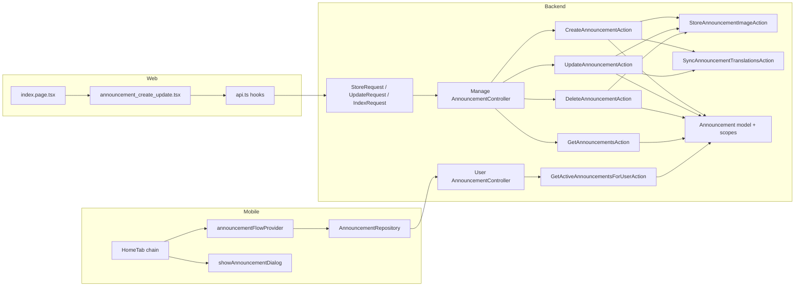
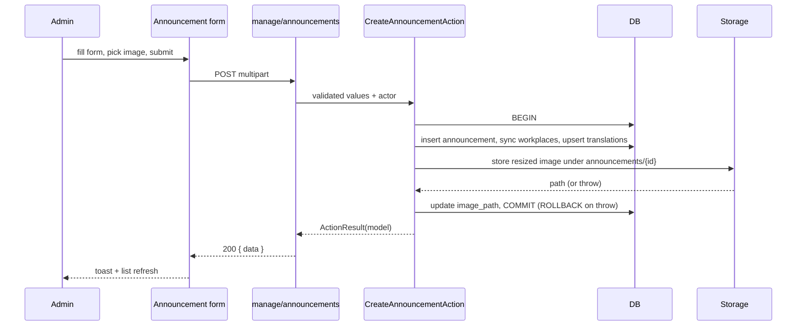

# Design Document: Workplace Announcement Popup

## Overview

The feature is a new, self-contained aggregate: an `Announcement` with its translations and target workplaces. It deliberately shares nothing with the `notifications` pipeline except the admin AI-translate action and the image/URL helpers. The backend exposes two surfaces: an admin CRUD API built from invokable Actions behind the four `announcement.*` permissions, and a single read-only employee endpoint that resolves the caller's workplaces from `workplace_users` and returns every announcement that is active and inside its validity window. The admin web adds one management page cloned from the notification page's structure (list + modal), swapping the plain textarea for the tiptap editor already used by documents and adding a workplace multi-select, a date-time range, and an image dropzone. The mobile app adds a small repository/provider pair and a dialog widget, and hooks it in as the last link of the existing mandatory-popup chain in `HomeTab`, guarded by a session-scoped "already shown" set so a rebuild never re-shows a popup.

### Design Goals

- Zero change to the existing notification tables, admin screen, push job, and mobile notification endpoints.
- Reuse existing building blocks: Action pattern, `ImageHelper` and `UrlHelper`, `TranslateContentAction`, the tiptap editor, `DDataTable`, `showDialog + PopScope + Dialog` popup pattern, `flutter_html`, `cached_network_image`.
- Keep the employee query a single indexed query so it is cheap to call on every cold start.
- Keep authorisation server-side: the app never sends a workplace id.

### Key Design Decisions

- **Separate aggregate, not a notification type.** A notification is a one-shot send with pending/sent status, 255-char content, and a shared broadcast list. An announcement is period-bound, editable while live, rich-text, image-bearing, and workplace-scoped. Folding it into `notifications` would require scoping `getNotifications`, the forever-cached system list, and `PushNotificationToUser`, all of which the recruitment-targeting work showed to be fragile.
- **Translations only for locales the admin filled; fallback on the client.** `notification_translations` carries `is_fallback` rows because Firebase topics are per locale and every locale must receive a push. Announcements are pulled, not pushed, so the app falls back to the base text in code and the table stores only real translations.
- **HTML content stored as-is, rendered by tiptap on the web and `flutter_html` on mobile.** This is the exact contract documents already use (`documents.content`, `PolicyDialogContent`), so no new sanitiser is introduced. Only admins author the HTML.
- **Validity window is a half-open interval `[start_at, end_at)`** evaluated with the server clock, so an announcement ending at 18:00 is gone at 18:00 exactly. Admin inputs are date-time in `Asia/Tokyo` and are sent as `YYYY-MM-DD HH:mm:ss`, the same wire format as `scheduled_at`.
- **Image handled inside the write transaction.** `ImageHelper::handleImageUpload` runs inside `DB::transaction` after the row exists (the path needs the id). A storage failure throws, the transaction rolls back, and no orphan row remains. The old image is deleted only after the new one is stored.
- **Employee endpoint instead of piggy-backing on `/auth/check`.** `pending_votes` and `pending_exams` ride on the auth payload, but that payload is not refetched after login, and a separate endpoint keeps the auth response stable and allows a later "refetch on resume" without touching auth.
- **Shown-once state lives in a non-autoDispose Riverpod provider.** `HomeTab` is lazily built and can rebuild when tabs change; the set of shown ids must outlive it but not the process.

## Architecture

### System Context

```mermaid
graph TB
    Admin[Admin web: Announcement page] -->|multipart CRUD| AdminAPI[manage/announcements]
    Admin -->|title + HTML| Translate[POST admin/translate]
    AdminAPI --> DB[(announcements / translations / workplaces)]
    AdminAPI --> Storage[(default disk: announcements/{id})]
    App[Employee app: HomeTab] -->|GET on cold start| EmpAPI[user/announcements/active]
    EmpAPI --> DB
    EmpAPI -->|workplace_users| WU[(workplace_users)]
    EmpAPI -->|image_url via UrlHelper| Storage
    App --> Popup[AnnouncementDialog]
```

### High-Level Architecture



## Components and Interfaces

### Component 1: Announcement model and scopes

**Purpose**: Eloquent aggregate root for the three new tables.

**Responsibilities**:

- Relations: `translations()` (HasMany `AnnouncementTranslation`), `workplaces()` (BelongsToMany `Workplace` via `announcement_workplaces`), `creator()` (BelongsTo `User`).
- Casts: `start_at`, `end_at` as datetime, `is_active` as boolean. Uses `SoftDeletes`.
- `scopeValidAt(Builder $q, CarbonInterface $at)`: `is_active = 1 AND start_at <= $at AND end_at > $at`.
- `scopeForWorkplaceIds(Builder $q, array $ids)`: `whereHas('workplaces', fn($w) => $w->whereIn('workplaces.id', $ids))`.
- Accessor `image_url` (appended): `image_path ? UrlHelper::getStorageUrl(image_path) : null`.
- Accessor `state` (appended): `inactive | scheduled | active | expired` computed against `now()`.

**Interfaces**:

- **Input**: none beyond Eloquent.
- **Output**: model with `workplaces`, `translations`, `image_url`, `state`.
- **Dependencies**: `UrlHelper`, `Workplace`, `User`.

**Implementation Notes**:

- `app/Models/Announcement.php`, `app/Models/AnnouncementTranslation.php`, `app/Models/AnnouncementWorkplace.php` (pivot, only if a `using()` pivot class is needed; otherwise plain `belongsToMany`).
- New enum `App\Enums\AnnouncementState` with the four values, used by the accessor and the list filter.

### Component 2: Admin Actions

**Purpose**: All admin business logic, one invokable class per operation under `app/Actions/Manage/Announcement/`.

**Responsibilities**:

- `GetAnnouncementsAction(array $filters, int $perPage): LengthAwarePaginator`: eager-loads `workplaces` and `translations`, applies `workplace_id`, `state`, `keyword`, orders by `start_at desc, id desc`. The `state` filter is translated to SQL on `is_active`, `start_at`, `end_at` (not filtered on the accessor). `keyword` is escaped with `addcslashes($keyword, '%_\\')` and matched against the base title or any translation title.
- `CreateAnnouncementAction(array $values, User $actor): ActionResult`: inside `DB::transaction`: create row (`created_by = actor`), `sync` workplaces, `SyncAnnouncementTranslationsAction`, then `StoreAnnouncementImageAction` when `image` present. If the transaction throws after the file was written, the file is deleted before rethrowing. Returns the reloaded model.
- `UpdateAnnouncementAction(Announcement $a, array $values): ActionResult`: same as create on an existing row, plus image replacement when `image` present and image removal when `remove_image` is true. The previous file is deleted only after the transaction commits; a newly written file is deleted if the transaction fails.
- `DeleteAnnouncementAction(Announcement $a): ActionResult`: clear `image_path` and soft-delete inside a transaction, then delete the image file after commit, so the trashed row never points at a missing file.
- `StoreAnnouncementImageAction(Announcement $a, UploadedFile $file): ?string`: calls `ImageHelper::handleImageUpload($file, "announcements/{$a->id}", 1200)` without a delete path, saves the new path, and returns the previous path so the caller can delete it after commit.
- `SyncAnnouncementTranslationsAction(Announcement $a, array $values): void`: for each locale in `Locale::getBaseTranslationLocales()`, upsert when `title_{lang}` is non-empty and `content_{lang}` is not blank HTML (`NonEmptyHtml::isBlank`), delete otherwise.

**Interfaces**:

- **Input**: validated request arrays; models via route binding.
- **Output**: `ActionResult` with the model or an `ErrorCode`.
- **Dependencies**: `ImageHelper`, `Locale`, `DB`.

**Implementation Notes**:

- Controller `app/Http/Controllers/Manage/AnnouncementController.php` mirrors `PollController`: inject the Action per method, return `ResponseHelper::successPaginated` for index and `$result->toResponse()` otherwise.
- Route model binding on `{announcement}` automatically returns 404 for soft-deleted rows.

### Component 3: Admin request validation

**Purpose**: Form requests under `app/Http/Requests/Manage/Announcement/`.

**Responsibilities**:

- `IndexRequest`: `page`, `page_size`, `workplace_id` (exists), `state` (in `AnnouncementState`), `keyword` (string max 255). `prepareForValidation` maps the `all` sentinel sent by `CommonSearchBox` to null.
- `StoreRequest`: rules listed in Data Models. Uses `after:start_at` on `end_at`, and the `App\Rules\NonEmptyHtml` rule on `content` and `content_{lang}` so an empty tiptap document (`<p></p>`, `&nbsp;`) is rejected server-side as well.
- `UpdateRequest extends StoreRequest`: adds `remove_image` boolean; `image` stays optional.

**Implementation Notes**:

- Requests arrive as `multipart/form-data` because of the image. Booleans and arrays are therefore strings; the frontend sends `is_active` as `1`/`0` and `workplace_ids[]` entries, and the request uses `boolean` and `array` rules which accept those forms. Laravel's `PUT` cannot parse multipart, so the update route is `POST manage/announcements/{announcement}` with `_method=PUT` spoofing sent by `ApiHelper.postForm`.

### Component 4: Employee endpoint

**Purpose**: `GET user/announcements/active` returning the caller's currently valid announcements.

**Responsibilities**:

- `App\Actions\User\Announcement\GetActiveAnnouncementsForUserAction(User $user): Collection`.
- Loads workplace ids through `$user->workplaces()->pluck('workplaces.id')`, returns `collect()` when empty.
- Query: `Announcement::validAt(now())->forWorkplaceIds($ids)->with('translations')->orderByDesc('start_at')->orderByDesc('id')->get()`. `whereHas` guarantees one row per announcement even with several matching workplaces.
- Serialises to the shape in API Design; `workplaces` are not included.

**Implementation Notes**:

- Controller `app/Http/Controllers/User/AnnouncementController.php`, route inside the existing `auth:api` group next to `user/notifications`.
- No caching: the query is indexed and per user.

### Component 5: Permission

**Purpose**: Four new permissions mirroring the notification set.

**Implementation Notes**:

- `PermissionName::AnnouncementList`, `AnnouncementCreate`, `AnnouncementEdit`, `AnnouncementDelete` (`announcement.list` etc.) under a new `Announcement` block placed right after the notification cases.
- `RolePermissionSeeder` already grants `PermissionName::values()` to Global Admin and Admin; the data migration `2026_09_30_000001_grant_announcement_permissions.php` inserts the four rows and attaches them to those two roles so existing environments pick them up without reseeding.
- Add `AnnouncementCreate` and `AnnouncementEdit` to the `admin/translate` permission list.
- Frontend: `ANNOUNCEMENT_LIST`, `ANNOUNCEMENT_CREATE`, `ANNOUNCEMENT_EDIT`, `ANNOUNCEMENT_DELETE` in `permission_name.enum.ts`, inserted right after `NOTIFICATION_DELETE` because the role screen builds its groups from enum order and the first segment of the permission name. Group and permission labels live in `locales/*/role.json` under the `announcement` keys.

### Component 6: Admin web page

**Purpose**: `frontend/src/pages/manage/announcement/` list and modal.

**Responsibilities**:

- `index.page.tsx`: `CommonSearchBox` with `keyword`, `workplace_id` (select from `masterAtom.workplaces`), `state` (select). `DDataTable` columns: image thumbnail (`Avatar`/`Image` 48px), title with translated-language flags, workplaces (comma-joined names, truncated), period (`start_at ~ end_at` via `t('FORMAT_DATE_WITH_TIME')`), state `Badge`, actions (edit, delete via `DConfirmModal`). Permission via `usePermissions(['ANNOUNCEMENT_LIST', 'ANNOUNCEMENT_CREATE', 'ANNOUNCEMENT_EDIT', 'ANNOUNCEMENT_DELETE'])`: the query and the no-permission state follow `list`, the create button `create`, the edit icon `edit`, the delete icon `delete`.
- `partials/announcement_create_update.tsx`: Mantine `Modal` + `useForm` + `validatorResolver(schema)`. Fields: `title`, `content` (tiptap `RichTextEditor` reusing `TextEditor.tsx` from documents with `useEditor` per language), `workplace_ids` (`MultiSelect`), `start_at` and `end_at` (`DateTimePicker` from `@mantine/dates`), `is_active` (`Switch`), `image` (`Dropzone` accepting `IMAGE_MIME_TYPE`, max 8MB, preview via `URL.createObjectURL`, "remove" sets `remove_image`). Translation block copied from the notification modal: per-locale checkbox `translated_{lang}` enabling `title_{lang}` + a second editor `content_{lang}`, and an AI-translate button calling `useTranslateContentMutation` with `context: 'announcement'` and items `title`, `content`.
- `partials/announcement_form.ts`: `formInitialValue`, `schema`, and `buildFormData(values): FormData`.
- `api.ts`: `useGetAnnouncementsQuery`, `useCreateAnnouncementMutation` (postForm), `useUpdateAnnouncementMutation` (postForm with `_method=PUT`), `useDeleteAnnouncementMutation`, all invalidating `['announcements']`.

**Implementation Notes**:

- `ApiConfig.MANAGE_ANNOUNCEMENT_LIST = 'manage/announcements'`, `MANAGE_ANNOUNCEMENT_DETAIL = 'manage/announcements/:id'`.
- `RouteConfig.MANAGE_ANNOUNCEMENT` with `permissions: [ANNOUNCEMENT_LIST, ANNOUNCEMENT_CREATE]`, sidebar item after Notification with icon `LuMegaphone`, `customName: 'Announcement'` added to `route.json` and `for_scanner.ts`.
- Types: `src/types/models/announcement.d.ts` (`Announcement`, `AnnouncementTranslation`, `AnnouncementWithRelation`), enum `src/enums/announcement_state.enum.ts`.
- Editor content is submitted as the editor's `getHTML()`; an "empty" editor yields `<p></p>`, so the schema treats content as empty when the text length after stripping tags is 0.

### Component 7: Backend translate context

**Purpose**: Let the AI-translate action keep HTML intact for announcements.

**Implementation Notes**:

- Add `OpenRouterTranslationService::CONTEXT_ANNOUNCEMENT = 'announcement'` to `contexts()` with the prompt line "The texts are a workplace announcement title and its body. The body is HTML: translate only the human-readable text and return every tag and attribute unchanged."
- The request's 5000-character per-item limit applies to the HTML string; the admin form shows the translate error message when exceeded.

### Component 8: Mobile data layer

**Purpose**: Fetch and hold the announcement queue.

**Responsibilities**:

- `lib/models/entities/announcement/announcement.dart` (`@JsonSerializable`): `id`, `title`, `content`, `imageUrl`, `startAt`, `endAt`, `translations` (`List<AnnouncementTranslation>`), plus `titleFor(String lang)` and `contentFor(String lang)` returning the translation or the base text.
- `lib/models/entities/announcement/announcement_response.dart`: `{ data: List<Announcement> }`.
- `Endpoint.activeAnnouncements('/user/announcements/active')`.
- `lib/repositories/announcement_repository.dart`: `Future<List<Announcement>> getActiveAnnouncements()` following `NotificationRepositoryImpl` (bearer header, `ShowSnackBarException` wrapping).
- `lib/providers/announcement_provider.dart`: `announcementFlowProvider = StateNotifierProvider<AnnouncementFlowController, AnnouncementFlowState>` (not autoDispose). State (`freezed`): `items`, `currentIndex`, `shownIds` (`Set<int>`). Methods: `load()`, `seed(list)` (drops ids already in `shownIds`), `markShownAndAdvance()`.

### Component 9: Mobile popup and chain hook

**Purpose**: Show the popup at the right time, once per id.

**Responsibilities**:

- `lib/widgets/popup/announcement_dialog_content.dart`: rounded white card, optional `CachedNetworkImage` (fit width, `BoxFit.cover`, placeholder spinner, error hides the image), title `Text`, `Html(data: content)` inside `SingleChildScrollView` with `maxHeight` 70% of screen, and a full-width close button labelled `S.of(context).close`. `onLinkTap` opens absolute URLs with `url_launcher` (external first, in-app browser fallback) and ignores scheme-less hrefs.
- `showAnnouncementDialog(BuildContext, Announcement, {required VoidCallback onClose})` in `dialog_helper.dart` using `showDialog` + `PopScope(canPop: false)` + transparent `Dialog`; the close button and the back gesture both call `onClose` after `Navigator.pop`.
- `HomeTab`: a `useEffect` on `[user.paperStatus]` calls `announcementFlowProvider.notifier.load()` when approved. A second `useEffect` on `[flowState.currentIndex, examFlowState.items.length, surveyFlowState.items.length, user.pendingDocuments?.length]` shows the dialog for `currentItem` only when `pendingDocuments` is empty, `examFlowProvider.items` is empty, and `surveyFlowProvider.items` is empty; `onClose` calls `markShownAndAdvance()`, which moves to the next item and triggers the effect again.

**Implementation Notes**:

- The shown-ids set is cleared on logout and at the start of `AuthController.login()`, which also covers the forced-logout path, so a different account on the same device is not suppressed. `markShownAndAdvance()` is a no-op when nothing is current.
- Strings added to all five `.arb` files: `close` (reuse if exists), `announcement` (dialog semantics label).

## Data Models

### Entity 1: Announcement

```typescript
// frontend/src/types/models/announcement.d.ts
interface Announcement {
    id: number;
    title: string;
    content: string;
    image_path: string | null;
    image_url: string | null;
    start_at: string;
    end_at: string;
    is_active: boolean;
    state: 'inactive' | 'scheduled' | 'active' | 'expired';
    created_by: number | null;
    created_at: string;
    updated_at: string;
}

interface AnnouncementTranslation {
    id: number;
    announcement_id: number;
    lang: 'en' | 'ja' | 'ne' | 'si';
    title: string;
    content: string;
}

interface AnnouncementWithRelation extends Announcement {
    workplaces: Pick<Workplace, 'id' | 'name'>[];
    translations: AnnouncementTranslation[];
}
```

**Validation Rules** (`StoreRequest`):

- `title`: `bail|required|string|max:255`
- `content`: `bail|required|string|max:65535|NonEmptyHtml`
- `workplace_ids`: `bail|required|array|min:1`; `workplace_ids.*`: `bail|integer|distinct|exists:workplaces,id`
- `start_at`: `bail|required|date_format:Y-m-d H:i:s`
- `end_at`: `bail|required|date_format:Y-m-d H:i:s|after:start_at`
- `is_active`: `bail|required|boolean`
- `image`: `bail|nullable|image|mimes:jpg,jpeg,png,webp|max:8192`
- `remove_image` (update only): `bail|nullable|boolean`
- `title_{lang}`: `bail|nullable|required_with:content_{lang}|string|max:255`; `content_{lang}`: `bail|nullable|required_with:title_{lang}|string|max:65535|NonEmptyHtml`

**Relationships**:

- `Announcement 1..* AnnouncementTranslation` (cascade delete).
- `Announcement *..* Workplace` through `announcement_workplaces` (cascade delete both sides).
- `Announcement *..1 User` via `created_by` (null on delete).

**Migrations** (`2026_09_30_000002_create_announcements_tables.php`):

```php
Schema::create('announcements', function (Blueprint $table) {
    $table->id();
    $table->string('title');
    $table->mediumText('content');
    $table->string('image_path')->nullable();
    $table->dateTime('start_at');
    $table->dateTime('end_at');
    $table->boolean('is_active')->default(true);
    $table->foreignId('created_by')->nullable()->constrained('users')->nullOnDelete();
    $table->timestamps();
    $table->softDeletes();
    $table->index(['is_active', 'start_at', 'end_at']);
});
Schema::create('announcement_translations', function (Blueprint $table) {
    $table->id();
    $table->foreignId('announcement_id')->constrained()->cascadeOnDelete();
    $table->string('lang', 2);
    $table->string('title');
    $table->mediumText('content');
    $table->timestamps();
    $table->unique(['announcement_id', 'lang']);
});
Schema::create('announcement_workplaces', function (Blueprint $table) {
    $table->id();
    $table->foreignId('announcement_id')->constrained()->cascadeOnDelete();
    $table->foreignId('workplace_id')->constrained()->cascadeOnDelete();
    $table->timestamps();
    $table->unique(['announcement_id', 'workplace_id']);
});
```

### Data Flow



```mermaid
sequenceDiagram
    participant App as HomeTab
    participant Flow as announcementFlowProvider
    participant API as user/announcements/active
    participant DB

    App->>Flow: load() when paperStatus approved
    Flow->>API: GET
    API->>DB: workplace ids for user; validAt(now) ∩ forWorkplaceIds
    DB-->>API: rows + translations
    API-->>Flow: [announcement...]
    Flow-->>App: items minus shownIds, currentIndex 0
    Note over App: wait until docs, exams, surveys are all clear
    App->>App: showAnnouncementDialog(currentItem)
    App->>Flow: markShownAndAdvance() on close
    Flow-->>App: next item or done
```

## API Design

### Endpoint 1: List announcements

**Method**: `GET`
**Path**: `manage/announcements`
**Permission**: `announcement.list`

**Query**: `page`, `page_size`, `workplace_id?`, `state?`, `keyword?`

**Response**: standard paginated envelope; each item is `AnnouncementWithRelation`.

### Endpoint 2: Create announcement

**Method**: `POST` (multipart)
**Path**: `manage/announcements`
**Permission**: `announcement.create`

**Request fields**: `title`, `content`, `workplace_ids[]`, `start_at`, `end_at`, `is_active`, `image?`, `title_{lang}?`, `content_{lang}?`

**Response**:

```json
{
    "data": {
        "id": 12,
        "title": "Bảo trì dây chuyền A",
        "content": "<p>Từ 10:00 ...</p>",
        "image_url": "https://.../announcements/12/abc.jpg?signature=...",
        "start_at": "2026-10-01 08:00:00",
        "end_at": "2026-10-03 18:00:00",
        "is_active": true,
        "state": "scheduled",
        "workplaces": [{ "id": 3, "name": "Xưởng Kawasaki" }],
        "translations": [{ "lang": "ja", "title": "...", "content": "<p>...</p>" }]
    }
}
```

**Error Responses**:

- `422 Unprocessable Entity`: validation failure (`end_at` not after `start_at`, no workplace, bad image).
- `403 Forbidden`: missing permission.

### Endpoint 3: Update announcement

**Method**: `POST` with `_method=PUT` (multipart)
**Path**: `manage/announcements/{announcement}`
**Permission**: `announcement.edit`

Same fields as create plus `remove_image?`. `404` when the id is missing or soft-deleted.

### Endpoint 4: Delete announcement

**Method**: `DELETE`
**Path**: `manage/announcements/{announcement}`
**Permission**: `announcement.delete`

**Response**: `{ "data": null }`. `404` when already deleted.

### Endpoint 5: Active announcements for employee

**Method**: `GET`
**Path**: `user/announcements/active`
**Auth**: `auth:api` (any employee)

**Response**:

```json
{
    "data": [
        {
            "id": 12,
            "title": "Bảo trì dây chuyền A",
            "content": "<p>Từ 10:00 ...</p>",
            "image_url": "https://...",
            "start_at": "2026-10-01 08:00:00",
            "end_at": "2026-10-03 18:00:00",
            "translations": [{ "lang": "ja", "title": "...", "content": "<p>...</p>" }]
        }
    ]
}
```

### Endpoint 6: Translate (existing, extended)

`POST admin/translate` accepts `context: "announcement"`, and `announcement.create` / `announcement.edit` are added to its permission list.

## Security Considerations

### Authentication

- All endpoints sit inside the existing `auth:api` + `CheckUserDisabled` + `SetLocale` group.

### Authorization

- Admin endpoints use `permission:announcement.list|create|edit|delete` middleware per route, exactly like the notification routes.
- The employee endpoint derives workplaces from `workplace_users` for `Auth::id()` only; any query parameter is ignored.

### Data Protection

- Image URLs are temporary signed URLs when the disk supports them (S3), so images are not publicly enumerable. On the local disk they fall back to plain URLs, matching every other image in the system.
- Soft-deleted announcements never leave the database through any endpoint.

### Input Validation

- MIME and size are validated server-side and the file is re-encoded by the image library, so a disguised non-image cannot be stored.
- HTML is authored only by permission-holding admins and rendered by tiptap and `flutter_html`, neither of which executes scripts. The admin list never injects `content` as raw HTML; it shows the title only.

## Error Handling

### Admin API

| Scenario | Handling |
|----------|----------|
| `end_at <= start_at` | 422 with error on `end_at` |
| Empty `workplace_ids` or unknown workplace id | 422 |
| Image over 8 MB or wrong MIME | 422 on `image` |
| Storage throws during create/update | Transaction rolled back, 500 via global handler, no row and no orphan file |
| Update/delete on soft-deleted id | 404 from route binding |
| Translation over 5000 chars | 422 from `TranslateContentRequest`; form shows the message |

### Employee API and app

| Scenario | Handling |
|----------|----------|
| User has no workplace | `data: []` |
| Network or 5xx on cold start | Provider stays empty; error logged; no dialog |
| Image fails to load | Dialog renders without the image block |
| Translation missing for current locale | Base title/content shown |

## Performance Considerations

### Expected Load

- **Concurrent Users**: every employee cold start hits Endpoint 5 once; a few hundred per minute at shift boundaries.
- **Admin list**: tens of rows, low traffic.

### Optimization Strategies

- Composite index `(is_active, start_at, end_at)` plus the pivot unique index makes the employee query an index range scan followed by a small `EXISTS`.
- Translations eager-loaded in one query; no `workplaces` load on the employee path.
- Images resized to 1200 px and JPEG quality 80 by `ImageHelper`, so a popup image stays well under 300 KB.
- No cache layer; invalidation complexity is not worth it at this volume.

## Testing Strategy

### Unit Tests

**`tests/Unit/Models/AnnouncementTest.php`:**

- `state` accessor for the four cases and both boundaries (`now == start_at` is active, `now == end_at` is expired).
- `validAt` scope excludes inactive, future, past, and soft-deleted rows.

**`tests/Unit/Actions/Manage/Announcement/SyncAnnouncementTranslationsActionTest.php`:**

- Upserts a filled locale, deletes a cleared locale, ignores the base locale.

### Feature Tests

**`tests/Feature/Manage/AnnouncementLifecycleTest.php`** (real flow: create → update → replace image → remove image → delete):

- 403 without any permission on every endpoint, and a list-only user gets 200 on the list but 403 on create, update, and delete.
- 422 cases for dates, workplaces, image.
- Create stores the row, pivot rows, translations, and the resized image under `announcements/{id}` (`Storage::fake`).
- Update with new image deletes the old file; `remove_image` clears the path and file.
- Delete soft-deletes and removes the file; a second delete is 404.
- Forced storage failure during create (mock `ImageHelper` to throw) leaves no row.
- List filters by `workplace_id`, `state`, `keyword`, and orders by `start_at desc`.

**`tests/Feature/Api/User/ActiveAnnouncementsTest.php`:**

- Returns only announcements whose workplaces intersect the user's memberships, once each when two workplaces match.
- Respects `is_active` and both window boundaries using `Carbon::setTestNow`.
- Excludes soft-deleted rows.
- Returns `[]` for a user with no membership and for an admin-only user.
- Payload contains `image_url` null when no image and the translations list.

### Frontend Tests

**`src/pages/manage/announcement/index.page.test.tsx`:** renders rows with state badge and workplace names; delete confirm calls the mutation.

**`src/pages/manage/announcement/partials/announcement_create_update.test.tsx`:** blocks submit on end before start, no workplace, empty editor; builds `FormData` with `workplace_ids[]`, `_method` on update, `remove_image` when cleared.

### Mobile

**`test/view_controllers/announcement_flow_controller_test.dart`:** `load()` seeds from the repository and swallows errors, `seed()` drops already-shown ids and items without an id, `markShownAndAdvance()` records and advances (no-op when nothing is current), `reset()` clears everything.

**`test/models/announcement_test.dart`:** JSON parsing with and without translations or image, `titleFor`/`contentFor` locale match and fallback for a missing or blank translation.

- Manual verification on Android emulator: popup order after documents/exams/surveys, sequential display of two announcements, English and Japanese rendering, fallback to the base text, no re-show after tab switch.
